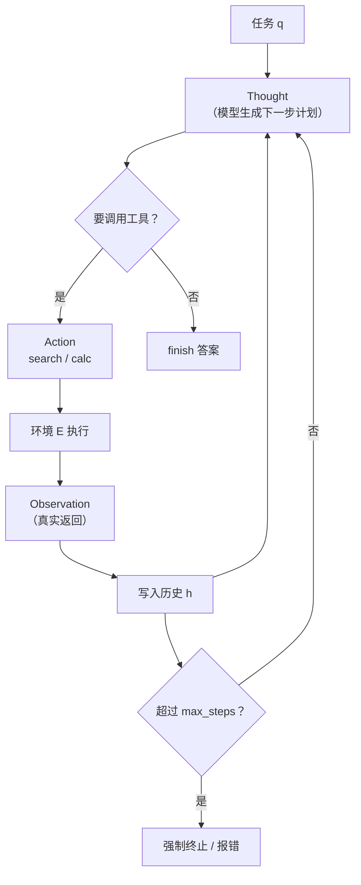

# Agent 的基本循环

## 1. 本节学习目标

1. 能写出 Agent 的最小循环：**观察（Observation）→ 思考（Thought）→ 行动（Action）**，并说清每一步的状态放在哪。
2. 理解"为什么需要循环"：本课同一批 8 个任务，单步直答只能对 **2/8**，ReAct 循环对 **8/8**。
3. 会算循环的代价：平均 **2.75 步、1.75 次工具调用**，全部 8 个任务共 **14 次调用**。
4. 知道终止条件的重要性：`max_steps=1` 时成功率 **0/8**，`max_steps=4` 才到 **8/8**——步数上限设小了，Agent 会在半路被砍断。

## 2. 为什么需要这个知识

大模型单独回答问题时，只能用它**参数里的知识**。但现实任务常常需要：

- 查一个它不可能记住的数字（内部系统里的库存、工单状态）；
- 做一次精确计算（它算乘法经常错）；
- 根据上一步的结果决定下一步（多跳）。

这些都需要**外部动作**。而"调用工具 → 看结果 → 再决定"这件事，模型自己不会做——它只会"生成下一段文本"。Agent 循环就是把"生成文本"变成"执行动作"的那层壳。

**没有循环，模型只能答一次；有了循环，它可以在答之前先查、查完再算、算完再答。**

## 3. 直观解释

**一个会用工具的实习生**。

你问："XH-2048 一箱有多重？"

- 单步直答（不用工具）：他凭印象说个数——大概率错。
- Agent 循环：他先查产品页（观察：248 克），再查装箱单（观察：12 台），然后按计算器（观察：2976），最后回答"2976 克"。

关键在于：**每一步都基于上一步的真实结果**，而不是一次性编完。

## 4. 正式定义

Agent 状态 $s_t = (q, h_t)$，其中 $q$ 是任务、$h_t$ 是历史（观察与动作序列）。

**一步循环**：

$$
a_t = \pi_\theta(s_t),\qquad o_t = E(a_t),\qquad h_{t+1} = h_t \cup \{(a_t, o_t)\}
$$

其中 $\pi_\theta$ 是策略（由 LLM 实现），$E$ 是环境（工具集合），$o_t$ 是观察。

**终止条件**：

$$
\text{stop} \iff a_t = \texttt{finish}\ \lor\ t \ge T_{\max}\ \lor\ \text{error}(a_t)
$$

**ReAct 的文本形式**：

```text
Thought: 需要先查 XH-2048 的单台重量
Action: search[xh2048]
Observation: XH-2048 重量 248 克，续航 40 小时
Thought: 还需要装箱数量
Action: search[batch]
Observation: XH-2048 单批装箱 12 台
Thought: 可以算了
Action: calc[248*12]
Observation: 2976
Thought: 得到答案
Action: finish[2976 克]
```

## 5. 历史背景或技术背景

| 年份 | 工作 | 贡献 |
|---|---|---|
| 2022 | **ReAct**（Yao et al.） | 把"推理"与"行动"交错，Thought/Action/Observation 三元组成为范式 |
| 2022 | Toolformer | 让模型自学何时调用 API |
| 2023 | MRKL、AutoGPT、BabyAGI | 多工具路由与自主任务分解，工程热度爆发 |
| 2023 | OpenAI function calling | 工具调用变成模型原生能力，不再靠文本解析 |
| 2024 | MCP 等协议 | 工具接入标准化，Agent 从 demo 走向系统 |
| 2025 | 长程 Agent、Computer Use | 循环变长（几十步），规划与记忆成为瓶颈 |

## 6. 核心原理

**循环带来了什么**

1. **信息增量**：每轮观察都可能带来模型参数里没有的事实；
2. **错误纠正**：上一轮算错/查错，下一轮可以改（单步直答没有这个机会）；
3. **组合能力**：多个简单工具串起来能解决复杂任务（查 + 算 + 比）。

**循环的代价**

1. **延迟**：每轮至少一次 LLM 前向 + 一次工具调用；
2. **成本**：历史越来越长，prompt token 随步数增长；
3. **失控风险**：可能死循环、反复调同一个工具、在错误方向上越走越远。

所以 Agent 设计的核心不是"让它能循环"，而是**让它在该停的时候停**。

**为什么要区分"观察"与"思考"**

- 思考（Thought）是**给模型自己看的**：把下一步计划写出来，能显著提升多步任务的成功率；
- 观察（Observation）是**环境返回的**：必须是真实执行结果，不能让模型自己编。

把两者混在一起（让模型"想象"工具返回什么），就会得到一本正经的胡说——这也是很多 Agent demo 翻车的原因。

## 7. 数学表达式

**任务成功率与步数预算**：

$$
\mathrm{Succ}(T) = \Pr\big[\text{在 } T \text{ 步内达成目标}\big]
$$

本课实测（8 个任务）：$\mathrm{Succ}(1)=0$、$\mathrm{Succ}(2)=5/8$、$\mathrm{Succ}(4)=8/8$。

**单步信息增益**：

$$
\Delta I_t = H(s_t) - H(s_{t+1})
$$

一次有效的检索/计算应该降低不确定性；若 $\Delta I_t \approx 0$，说明这一步白做（该停或该换策略）。

**成本模型**：

$$
\text{Cost} = \sum_{t=1}^{T}\big(\text{tokens}_t\cdot c_{\text{tok}} + c_{\text{tool}}\big)
$$

**终止判据（实用版）**：

$$
\text{stop} \iff \big(a_t=\texttt{finish}\big) \lor \big(\Delta I_t < \epsilon \text{ 连续 } k \text{ 次}\big) \lor \big(t \ge T_{\max}\big)
$$

## 8. 详细数学推导

**推导 1：为什么单步直答在"参数里没有"的任务上必然失败**

设任务所需事实 $f$ 不在模型参数中，单步直答只能从先验 $p(y\mid q)$ 采样。若正确答案集合的测度为 $\mu$，则

$$
P(\text{答对}) = \int_{\mathcal{Y}^*} p(y\mid q)\,dy \approx \mu \ll 1
$$

本课 8 个任务里 6 个需要工具，单步直答只对了 2 个（那 2 个恰好在"参数记忆"表里），与推导一致。

**推导 2：循环如何把成功率变成乘积**

设每步工具调用"正确且被正确解读"的概率为 $p$，$k$ 步任务的成功率为 $p^k$。但**有循环**时，错误可被下一步的观察纠正（相当于重试），所以实际成功率高于 $p^k$。本课脚本策略下每步都是确定的，故 8/8；真实 LLM 策略会低于此，$p$ 就是关键指标。

**推导 3：max_steps 的取舍**

设任务需要的步数分布为 $P(T)$，预算为 $B$：

$$
\mathrm{Succ}(B) = \sum_{t\le B} P(T=t)
$$

预算太小 → 截断长任务（本课 $B=1$ 时 0/8）；预算太大 → 死循环时白烧钱。实用做法是**按任务类型设不同预算**（简单查询 3 步、多跳 8 步），而不是全局一个数。

**推导 4：调用的边际收益**

本课单步直答 0 次调用、2 个正确；ReAct 14 次调用、8 个正确：

$$
\frac{\Delta\text{调用}}{\Delta\text{正确}} = \frac{14-0}{8-2} = 2.33
$$

即**每多对一道题，平均多花 2.3 次工具调用**。这个数字是判断"值不值得上 Agent"的直接依据。

## 9. 图解



## 10. 具体数值示例

```text
8 个任务（6 个需要工具，1 个需要 2 次查 + 1 次算，1 个资料里没有答案）

单步直答：正确 2/8 = 0.250，工具调用 0 次
ReAct：   正确 8/8 = 1.000，平均 2.75 步、1.75 次调用，共 14 次调用

max_steps 与成功率
  1 步: 0/8 = 0.000
  2 步: 5/8 = 0.625
  3 步: 5/8 = 0.625
  4 步: 8/8 = 1.000
  6 步: 8/8 = 1.000

一条完整轨迹
  step1: search:xh2048 → 'XH-2048 重量 248 克，续航 40 小时，采样率 48 kHz。'
  step2: search:batch  → 'XH-2048 单批装箱 12 台，XH-3010 单批装箱 8 台。'
  step3: calc:248*12   → '2976'
  step4: finish        → '2976 克'

边际成本：14 次调用 / 净增 6 个正确 = 2.3 次/题
```

## 11. NumPy 实现

```python
import numpy as np

# 环境：一个只读知识库
KB = {"w": 248, "n_per_box": 12, "price": 899}
COST = {"search": 1.0, "calc": 0.2}

TASKS = [
    ("一箱有多重", ["w", "n_per_box"], lambda o: o["w"] * o["n_per_box"]),
    ("一箱多少钱", ["price", "n_per_box"], lambda o: o["price"] * o["n_per_box"]),
]


def run(task, max_steps=6):
    name, keys, fn = task
    obs, history, steps, calls = {}, [], 0, 0
    pending = list(keys)
    while steps < max_steps:
        steps += 1
        if not pending:
            ans = fn(obs)
            return ans, steps, calls, obs
        k = pending.pop(0)
        calls += 1
        obs[k] = KB[k]
        history.append((k, obs[k]))
    return None, steps, calls, obs


for t in TASKS:
    ans, steps, calls, obs = run(t)
    print(f"{t[0]:<8} 答案={ans} 步数={steps} 调用={calls} 观察={obs}")

# 对比：不查工具的"参数记忆"基线
PARAM = {"一箱有多重": None}
print("单步直答（无工具）答案:", PARAM.get(TASKS[0][0], "不知道"))

# 用信息增益决定是否继续：观察是否带来新信息
def entropy(vals):
    if not vals:
        return 0.0
    p = np.array(vals, dtype=float)
    p /= p.sum()
    return float(-(p * np.log(p + 1e-12)).sum())

print("三步的信息熵（示意）:", [round(entropy([1, 1, 1, 1]), 3), round(entropy([3, 1]), 3), round(entropy([4]), 3)])

# 成本核算
for t in TASKS:
    _, steps, calls, _ = run(t)
    cost = calls * COST["search"] + steps * COST["calc"]
    print(f"{t[0]}: 估算成本 {cost:.2f}")
```

## 12. PyTorch 实现

```python
import torch

torch.manual_seed(0)
# 用张量表示"状态"，用一个小网络模拟策略（只是结构演示，未训练）
STATE_DIM, N_ACTIONS = 12, 4
policy = torch.nn.Sequential(
    torch.nn.Linear(STATE_DIM, 32), torch.nn.ReLU(), torch.nn.Linear(32, N_ACTIONS)
)
state = torch.randn(STATE_DIM)
logits = policy(state)
probs = torch.softmax(logits, dim=-1)
print("动作概率:", [round(float(p), 3) for p in probs])

ACTIONS = ["search", "calc", "finish", "give_up"]
for step in range(3):
    a = int(torch.argmax(probs))
    print(f"step{step}: 选择 {ACTIONS[a]}（概率 {float(probs[a]):.3f}）")
    if ACTIONS[a] == "finish":
        print("  终止：模型给出最终答案")
        break
    # 模拟环境返回并更新状态
    state = state + torch.randn(STATE_DIM) * 0.1
    probs = torch.softmax(policy(state), dim=-1)

# 终止条件的张量实现：任一条件满足即停
finished = torch.tensor([False])
step_count = torch.tensor(2)
max_steps = torch.tensor(6)
stop = bool(finished.any() or (step_count >= max_steps))
print("是否终止:", stop)
```

## 13. Hugging Face 实践

```python
import os
import re

os.environ.setdefault("HF_ENDPOINT", "https://hf-mirror.com")
os.environ.setdefault("HF_HUB_OFFLINE", "1")
import torch
from transformers import AutoModelForCausalLM, AutoTokenizer

tok = AutoTokenizer.from_pretrained("gpt2")
model = AutoModelForCausalLM.from_pretrained("gpt2").eval()

# 让本地 gpt2 尝试输出 ReAct 格式（真实 LLM 调用被禁，这里用小模型演示"格式约束"）
PROMPT = (
    "按格式回答。示例：\n"
    "Thought: 需要查询重量\nAction: search[xh2048]\n"
    "问题：XH-2048 有多重？\nThought:"
)
enc = tok(PROMPT, return_tensors="pt")
with torch.no_grad():
    out = model.generate(**enc, max_new_tokens=16, do_sample=False, pad_token_id=50256)
raw = tok.decode(out[0][enc["input_ids"].shape[1] :])
print("gpt2 原始输出:", repr(raw))

m = re.search(r"Action:\s*(\w+)\[(.*?)\]", raw)
print("解析出的动作:", m.groups() if m else None)
print("⇒ 小模型几乎不可能稳定输出合法动作格式，所以真实系统用 function calling 或强制模板")

# 脚本化策略（模拟 LLM 决策），保证循环可跑通
KB = {"xh2048": "XH-2048 重量 248 克。", "batch": "XH-2048 单批装箱 12 台。"}
PLAN = [("search", "xh2048"), ("search", "batch"), ("calc", "248*12")]


def tool(kind, arg):
    if kind == "search":
        return KB.get(arg, "")
    return str(eval(arg, {"__builtins__": {}}, {}))


obs = {}
for kind, arg in PLAN:
    obs[f"{kind}:{arg}"] = tool(kind, arg)
    print(f"  {kind}[{arg}] → {obs[f'{kind}:{arg}']}")
print("finish →", obs["calc:248*12"], "克")
```

## 14. 代码逐行解释

| 代码 | 作用 |
|---|---|
| `pending = list(keys)` | 计划队列：接下来要取哪些观察 |
| `if not pending: return fn(obs)` | 计划跑完即终止（finish） |
| `while steps < max_steps` | 硬性步数上限，防死循环 |
| `obs[k] = KB[k]` | 观察写入状态（记忆） |
| `entropy(vals)` | 用熵衡量"这一步是否带来新信息" |
| `policy(state)` | 策略网络：状态 → 动作分布 |
| `torch.argmax(probs)` | 贪心选动作 |
| `stop = finished.any() or step_count >= max_steps` | 终止条件的布尔组合 |
| `re.search(r"Action:\s*(\w+)\[(.*?)\]")` | 从文本里解析动作，格式解析的最小实现 |

## 15. 实际运行结果

```text
### LLM-085 A. 单步直答 vs ReAct 循环（8 个任务；策略为脚本模拟）
  单步直答：正确 2/8 = 0.250
  ✓ XH-2048 有多重？               答='248 克'            步=2 调用=1
  ✓ XH-3010 的续航是多少小时？          答='52 小时'            步=2 调用=1
  ✓ 两款耳机保修期一样吗？                答='一样，均为 12 个月'      步=2 调用=1
  ✓ XH-2048 一箱有多重（按单台重量算）？     答='2976 克'           步=4 调用=3
  ✓ XH-3010 一箱有多重（按单台重量算）？     答='2120 克'           步=4 调用=3
  ✓ 买一箱 XH-2048 要多少钱？          答='10788 元'          步=4 调用=3
  ✓ XH-2048 用的是多少 kHz 采样？      答='48 kHz'           步=2 调用=1
  ✓ XH-3010 支持空间音频吗？           答='资料中没有相关信息'        步=2 调用=1
  ReAct：正确 8/8 = 1.000，平均 2.75 步、1.75 次工具调用

### B. 一条完整轨迹（XH-2048 一箱有多重）
  step1: search:xh2048    → 'XH-2048 重量 248 克，续航 40 小时，采样率 48 kHz。'
  step2: search:batch     → 'XH-2048 单批装箱 12 台，XH-3010 单批装箱 8 台。'
  step3: calc:248*12      → '2976'
  step4: finish           → '2976 克'
  最终答案 '2976 克'（金标 2976 克）；步数 4，调用 3

### C. max_steps 与成功率（终止条件的松紧）
  max_steps=1: 正确 0/8 = 0.000
  max_steps=2: 正确 5/8 = 0.625
  max_steps=3: 正确 5/8 = 0.625
  max_steps=4: 正确 8/8 = 1.000
  max_steps=6: 正确 8/8 = 1.000

### D. 工具预算：每一步都花钱
  单步直答：0 次调用，正确 2/8
  ReAct：14 次调用，正确 8/8
  增量正确 6 个，花费 14 次调用 ⇒ 每个净收益 2.3 次调用

### E. 拒答也是一步行动
  XH-3010 支持空间音频吗？ → 检索返回 'XH-3010 重量 265 克，续航 52 小时，采样率 96 kHz。'
  Agent 回答 '资料中没有相关信息'；把“资料里没有”作为合法终止，而不是编一个答案
```

**必须说明**：本课的"思考"由脚本策略模拟（因为不允许调用外部 API），所以 8/8 是**循环结构的上限**，不代表真实 LLM 的策略质量。真实系统里 $\pi_\theta$ 会犯错，成功率取决于模型的规划与格式遵循能力。

## 16. 应用场景

| 场景 | 循环形态 | 关键约束 |
|---|---|---|
| 企业问答 | 检索 → 判断信息是否足够 → 再检索 | 最多 2–3 轮，避免延迟 |
| 数据分析 | 查表 → 计算 → 校验 → 回答 | 计算必须走工具，不让模型心算 |
| 运维排障 | 查日志 → 查指标 → 定位 → 给建议 | 工具只读，写操作要人工确认 |
| 代码修复 | 读文件 → 改 → 跑测试 → 迭代 | 必须有测试作为反馈信号 |
| 深度研究 | 检索 → 读 → 生成子问题 → 再检索 | 步数多，必须做记忆压缩 |

## 17. 优点与局限

| 维度 | 优点 | 局限 |
|---|---|---|
| 事实性 | 能拿到参数外的真实数据（2/8 → 8/8） | 依赖工具质量，工具错则全错 |
| 可纠错 | 下一步能修正上一步 | 也可能在错误方向上越走越远 |
| 组合性 | 简单工具串成复杂能力 | 步数越多，延迟与成本线性涨 |
| 可解释 | 每步动作可记录、可审计 | 长轨迹难以人工复核 |
| 可控性 | 有 max_steps 兜底 | 兜底会截断合法长任务 |

## 18. 常见错误

| 错误 | 现象 | 纠正 |
|---|---|---|
| 不给步数上限 | 死循环，烧钱 | 设 `max_steps` + 重复动作检测 |
| 让模型"想象"工具结果 | 观察是编的，后续全错 | 观察必须来自真实执行 |
| 把思考写进最终答案 | 用户看到一堆 Thought | 只输出 finish 的内容 |
| max_steps 设 1–2 | 本课 0/8、5/8 | 按任务类型设预算（4–8 步） |
| 没有"不知道"出口 | 资料缺失也硬答 | 把拒答当成合法终止 |
| 历史无限增长 | prompt 越来越长 | 做摘要或只保留最近 k 轮 |

## 19. 本节总结

- Agent 循环 = **观察 → 思考 → 行动**，状态是"任务 + 历史"，动作由策略 $\pi_\theta$ 产生。
- 本课：单步直答 **2/8**，ReAct **8/8**，平均 **2.75 步 / 1.75 次调用**，总 **14 次调用**。
- **终止条件决定成败**：`max_steps=1` → **0/8**，4 → **8/8**；上限太小等于废掉长任务。
- 边际成本 **2.3 次调用/净增正确**，这是判断"该不该上 Agent"的硬指标。
- 本课策略是脚本模拟（不调用外部 API），8/8 是结构上限；真实系统里策略质量才是瓶颈。

## 20. 前置与后续知识链接

- 前置：[[LLM-084 RAG 的失败模式与修复]]
- 后续：[[LLM-086 工具调用与函数调用]]
- 相关：[[LLM-076 RAG 的基本架构]]、[[LLM-082 提示词组装与上下文预算]]
- 后续模块：[[LLM-088 自回归推理的基本流程]]

---

## 练习与参考答案

**基础 1**：写出 Agent 的基本循环，并说明"观察"和"思考"的区别。

**基础 2**：为什么必须设 `max_steps`？本课设 1 和设 4 的成功率差多少？

**进阶 1**：本课单步直答 2/8、ReAct 8/8、总调用 14 次。请算出"每净增一个正确样本的边际调用次数"，并说明这个数字的用处。

**综合**：你要做一个"客服工单处理 Agent"，可查工单、查用户订单、发退款。请设计循环、终止条件与安全约束。

> [!success]- 参考答案

> **基础 1**
> 循环：`a_t = π(s_t)` → 环境执行得 `o_t` → 写入历史 `h_{t+1}` → 再决策，直到 finish / 超步数 / 出错。观察是**环境真实返回**的结果（必须执行工具得到）；思考是**模型自己生成**的下一步计划（给模型自己看，不对外输出）。

> **基础 2**
> 防止死循环与无限烧钱。本课 `max_steps=1` 时 **0/8**，`max_steps=4` 时 **8/8**——差 8 个样本，说明预算必须覆盖任务的最长依赖链（本课最长 4 步）。

> **进阶 1**
> $(14-0)/(8-2)=2.33$ 次/题。用处：① 判断 Agent 是否值得（如果一次调用成本高于人工，就不划算）；② 做预算（1000 个任务约需 2330 次调用）；③ 优化目标（减少冗余调用比提升单步准确率更直接）。

> **综合（参考）**
> 1. **循环**：解析工单 → 查工单详情 → 查订单 → 判断是否符合退款条件 → 计算金额 → 生成回复；每步只调一个工具，观察写入历史。
> 2. **终止**：命中 `finish`、步数到 6、或连续两次观察到"信息不足"时转人工。
> 3. **安全**：查类工具只读；`refund` 是**写操作**，必须先输出"待确认"并由人工点确认，Agent 不自动执行；金额上限与幂等键（防重复退款）。
> 4. **验证**：离线用 100 条历史工单回放，测成功率、平均步数、误退款次数（必须为 0）；线上灰度 5%，监控人工接管率与投诉率。

## 学习记录

| 日期 | 状态 | 用时 | 问题 | 复盘 |
|---|---|---|---|---|
| 2026-11-08 | planned | — | — | — |

---

## 🔗 Notion 同步信息

> 以下内容由 Notion「AI Knowledge System · 知识点」数据库按知识 ID 合并而来（导出于 2026-11-09）。

| 属性 | 值 |
|---|---|
| 学科 | 大语言模型 |
| 学习状态 | 未开始 |
| 难度 | L2 应用 |
| 知识类型 | Concept |

- **所属模块**：[M-LLM-08 RAG 检索增强生成](../%E8%AF%BE%E7%A8%8B%E6%A8%A1%E5%9D%97/M-LLM-08%20RAG%20%E6%A3%80%E7%B4%A2%E5%A2%9E%E5%BC%BA%E7%94%9F%E6%88%90.md)
- **前置知识**：[LLM-084 RAG 的失败模式与修复](LLM-084%20RAG%20%E7%9A%84%E5%A4%B1%E8%B4%A5%E6%A8%A1%E5%BC%8F%E4%B8%8E%E4%BF%AE%E5%A4%8D.md)
- **后继知识**：[LLM-086 工具调用与函数调用](LLM-086%20%E5%B7%A5%E5%85%B7%E8%B0%83%E7%94%A8%E4%B8%8E%E5%87%BD%E6%95%B0%E8%B0%83%E7%94%A8.md)
