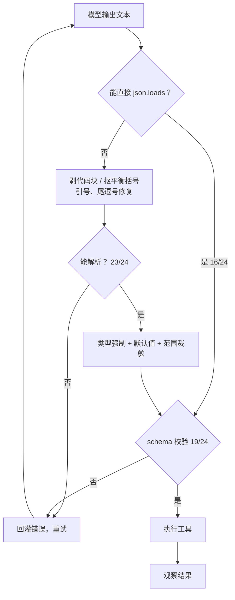

# 工具调用与函数调用

## 1. 本节学习目标

1. 能设计一份**最小但够用**的工具 schema：名字、参数、类型、取值范围、必填项。
2. 理解"模型输出 → 合法调用"之间是一条**流水线**：解析 → 修复 → 类型强制 → 校验 → 执行 → 错误回灌。
3. 用实测记住每一级的通过率：严格 `json.loads` **16/24 = 0.667**；修复后解析 **23/24 = 0.958**；过完整校验 **19/24 = 0.792**。
4. 会算重试的价值：单次成功 **0.792**，重试 3 次后单条 **0.991**、24 条全成功 **0.804**。

## 2. 为什么需要这个知识

模型输出的"工具调用"本质是**一段文本**，而不是一次函数调用。这段文本可能：

- 被包在 ` ```json ` 代码块里；
- 前后带一句"好的，我来调用工具："；
- 用单引号、带尾逗号、缺字段、类型错（`top_k: "5"`）；
- 直接截断（token 用完了）；
- 调一个根本不存在的工具。

**如果你的代码直接 `json.loads(model_output)`，线上会有一半请求 500。** 本课实测严格解析只有 0.667 通过，加上修复层才到 0.958，再过校验才 0.792。

工具调用是 Agent 的"接口层"，接口层的健壮性直接决定 Agent 能不能上线。

## 3. 直观解释

**收快递**。

模型是寄件人，它把"我要调 search_docs，参数是采样率"写在一张纸上。你的系统是快递站：

- 先看纸有没有折在信封里（剥代码块）；
- 再看字是不是写成别的语言（单引号 → 双引号）；
- 再看地址栏缺没缺（必填字段）；
- 再看邮编格式对不对（类型、范围）；
- 最后才发货（执行）。

**每一步都可能失败，每一步都要有兜底。** 直接"看一眼就发货"，包裹会寄丢。

## 4. 正式定义

**工具定义**（JSON Schema 子集）：

```text
{
  "name": "search_docs",
  "description": "在内部文档库中检索",
  "parameters": {
    "type": "object",
    "required": ["query"],
    "properties": {
      "query":  {"type": "string", "minLength": 1},
      "top_k":  {"type": "integer", "minimum": 1, "maximum": 20, "default": 3}
    }
  }
}
```

**调用的形式化**：模型输出 $y$，解析器 $P$ 给出 $\hat{c} = P(y)$，校验器 $V$ 判定 $\hat{c}\models S$（$S$ 为 schema），执行器 $E$ 返回 $o = E(\hat{c}[\text{name}], \hat{c}[\text{arguments}])$。

**成功率分解**：

$$
P(\text{成功}) = P(\text{可解析})\times P(\text{合法}\mid\text{可解析})\times P(\text{执行正确}\mid\text{合法})
$$

**重试的累积成功率**（独立假设）：

$$
P_n = 1-(1-p)^n
$$

## 5. 历史背景或技术背景

| 年份 | 进展 | 关键点 |
|---|---|---|
| 2022 | ReAct、Toolformer | 工具调用靠**文本格式约定**（`Action: search[...]`） |
| 2023.06 | OpenAI function calling | 模型原生输出结构化调用，解析负担大幅下降 |
| 2023 | JSON mode / 语法约束解码 | 解码时就把非法 token 的概率压到 0 |
| 2024 | 多工具并行调用、严格 schema | 一次返回多个调用；`strict: true` 保证符合 schema |
| 2024 | MCP（Model Context Protocol） | 工具描述与接入标准化 |
| 2025 | 结构化输出成为默认 | "解析失败"从常态变成异常 |

## 6. 核心原理

**为什么模型会输出坏 JSON**

1. **训练目标是"像人一样说话"**，不是"输出机器可解析的串"，所以它会加"好的，我这就调用"；
2. **采样有随机性**：温度 > 0 时，同一个 prompt 每次格式都可能不同；
3. **token 预算会截断**：JSON 还没闭合就用完了；
4. **它不知道你的 schema**：除非你把 schema 写进 prompt，否则它猜字段名。

**四级防御**

| 级别 | 做什么 | 本课通过率 |
|---|---|---|
| 0 | 直接 `json.loads` | 16/24 = 0.667 |
| 1 | 剥代码块 + 抠平衡括号 + 引号/逗号修复 | 23/24 = 0.958 |
| 2 | 类型强制（`"5"`→`5`）+ 默认值填充 + 范围裁剪 | 校验后 19/24 = 0.792 |
| 3 | 校验失败 → 把错误回灌给模型重试 | 3 次后 0.991 |

**关键区分：解析成功 ≠ 调用合法**

本课 23 条解析成功，但只有 19 条通过校验。剩下 4 条是：缺 `query` 字段、未知工具 `weather`、未知工具 `calc`、`query` 为空。**这些错误解析器看不出来，只有 schema 能看出来。**

## 7. 数学表达式

**校验函数**（布尔）：

$$
V(\hat{c}) = \bigwedge_{f\in\text{required}} (f \in \hat{c}) \;\wedge\; \bigwedge_{p\in\text{params}} \mathrm{type}(p)\wedge \mathrm{range}(p)
$$

**类型强制的映射**：

$$
\phi(x) = \begin{cases}
\mathrm{int}(x) & x\in\text{数字字符串}\\
\mathrm{round}(x) & x\in\mathbb{R}\\
\mathrm{clip}(x,1,20) & x\in\mathbb{Z}
\end{cases}
$$

**重试的期望调用次数**（每次独立成功概率 $p$）：

$$
\mathbb{E}[\text{attempts}] = \frac{1}{p}
$$

**端到端可用率**：

$$
P_{\text{e2e}} = P_{\text{parse}}\cdot P_{\text{valid}}\cdot P_{\text{exec}}
$$

## 8. 详细数学推导

**推导 1：为什么"整体成功率"会被三个因子连乘拖垮**

本课三段分别是 0.958、0.826（19/23）、假设执行 1.0：

$$
P_{\text{e2e}} = 0.958\times 0.826\times 1.0 = 0.792
$$

与实测一致。若不做修复（只有 0.667 可解析）：

$$
0.667\times 0.75 = 0.500
$$

**修复层把端到端从 0.500 提到 0.792**——这不是"锦上添花"，是"能不能用"的分界。

**推导 2：重试为什么值得**

单次 0.792，重试 3 次：

$$
1-(1-0.792)^3 = 1-0.0089 = 0.991
$$

但 24 条**全部**成功的概率是 $0.991^{24}=0.804$——也就是说，**即使重试 3 次，仍有约 20% 的批次会出现至少一条失败**。这解释了为什么生产系统必须把"重试"和"降级"一起设计（降级 = 告诉用户"这次没查成"）。

**推导 3：为什么温度越高越难解析**

设每个 token 的格式错误概率为 $\epsilon$，序列长 $L$，则合法概率约 $(1-\epsilon)^L$。温度升高使 $\epsilon$ 增大，$L$ 越长越糟：

$$
\frac{\partial P}{\partial \epsilon} = -L(1-\epsilon)^{L-1} < 0
$$

所以"要结构化输出"时应该**低温 + 约束解码 + 短输出**。

**推导 4：错误回灌的信息量**

把校验错误 $e$（如 `missing required field: query`）拼回 prompt，相当于把"搜索空间"从所有可能输出收缩到满足 $e$ 的输出：

$$
|\mathcal{Y}_{\text{new}}| = |\mathcal{Y}| \cdot (1 - P(\text{同样的错}))
$$

前提是模型能理解 $e$。若错误信息太模糊（"invalid"），收缩几乎为零，重试就是白花钱。

## 9. 图解



## 10. 具体数值示例

```text
24 条模型输出（覆盖 8 种常见坏格式）

json.loads 直接成功:        16/24 = 0.667
修复后解析成功:             23/24 = 0.958
解析 + 类型强制 + 校验通过:  19/24 = 0.792

只做 schema 校验、不做修复：12/24 = 0.500
加修复层：                  19/24 = 0.792

仍失败的 5 条
  arguments 缺 query      ← {"name":"search_docs","arguments":{}}
  未知工具 weather         ← {"name":"weather",...}
  解析失败（截断）          ← {"name":"search_docs","arguments":{"q
  未知工具 calc            ← {"name":"calc",...}
  query 为空              ← {"name":"search_docs","arguments":{"query":""}}

重试（单条成功 0.792）
  1 次: 0.7917，24 条全成功 0.004
  2 次: 0.9566，24 条全成功 0.345
  3 次: 0.9910，24 条全成功 0.804
```

## 11. NumPy 实现

```python
import json
import re

import numpy as np

RAW = [
    '{"name": "search_docs", "arguments": {"query": "采样率", "top_k": 3}}',
    # 该条故意带上 markdown 代码围栏，用 chr(96)*3 拼接避免在笔记里出现裸围栏
    (chr(96) * 3) + 'json\n{"name": "search_docs", "arguments": {"query": "续航", "top_k": 4}}\n'
    + (chr(96) * 3),
    '好的，我调用工具：{"name": "search_docs", "arguments": {"query": "保修"}}',
    "{'name': 'search_docs', 'arguments': {'query': '重量'}}",
    '{"name": "search_docs", "arguments": {"query": "电量", "top_k": "5"}}',
    '{"name": "search_docs", "arguments": {"query": "连两台手机",}}',
    '{"name": "search_docs", "arguments": {}}',
    '{"name": "weather", "arguments": {"query": "北京"}}',
]

VALID_TOOLS = {"search_docs", "calculator"}


def extract_json(text):
    start = text.find("{")
    if start < 0:
        return None
    depth, in_str, esc = 0, False, False
    for i in range(start, len(text)):
        c = text[i]
        if in_str:
            if esc:
                esc = False
            elif c == "\\":
                esc = True
            elif c == '"':
                in_str = False
            continue
        if c == '"':
            in_str = True
        elif c == "{":
            depth += 1
        elif c == "}":
            depth -= 1
            if depth == 0:
                return text[start : i + 1]
    return None


def repair(text):
    fence = chr(96) * 3          # 三个反引号；写成 chr(96) 避免在笔记里出现裸围栏
    t = re.sub(r"^" + fence + r"[a-zA-Z]*\s*", "", text.strip())
    t = re.sub(r"\s*" + fence + "$", "", t)
    frag = extract_json(t) or t
    frag = frag.replace("'", '"')
    frag = re.sub(r",\s*([}\]])", r"\1", frag)
    return frag


def parse(text):
    try:
        return json.loads(text), "strict"
    except json.JSONDecodeError:
        pass
    try:
        return json.loads(repair(text)), "repair"
    except json.JSONDecodeError:
        return None, "fail"


def coerce(obj):
    args = obj.get("arguments", {})
    if isinstance(args, dict):
        k = args.get("top_k")
        if isinstance(k, str) and k.isdigit():
            args["top_k"] = int(k)
        args.setdefault("top_k", 3)
        if isinstance(args.get("top_k"), int):
            args["top_k"] = max(1, min(20, args["top_k"]))
    return obj


def validate(obj):
    if not isinstance(obj, dict):
        return False, "根不是对象"
    if "name" not in obj or "arguments" not in obj:
        return False, "缺 name/arguments"
    if obj["name"] not in VALID_TOOLS:
        return False, f"未知工具 {obj['name']}"
    args = obj["arguments"]
    if not isinstance(args, dict):
        return False, "arguments 不是对象"
    if not isinstance(args.get("query"), str) or not args["query"].strip():
        return False, "query 缺失或为空"
    return True, "ok"


stats = {"strict": 0, "repair": 0, "fail": 0}
ok = 0
for raw in RAW:
    obj, how = parse(raw)
    stats[how] += 1
    if obj is None:
        print(f"  ✗ 解析失败: {raw[:40]}")
        continue
    obj = coerce(obj)
    good, why = validate(obj)
    ok += int(good)
    print(f"  {'✓' if good else '✗'} [{how}] {obj.get('name')} top_k={obj.get('arguments', {}).get('top_k')} {why}")

print(f"strict={stats['strict']}/{len(RAW)} repair={stats['repair']} fail={stats['fail']}")
print(f"端到端通过 {ok}/{len(RAW)} = {ok/len(RAW):.3f}")

# 重试的累积成功率
p = ok / len(RAW)
for n in (1, 2, 3):
    print(f"重试 {n} 次: 单条 {1-(1-p)**n:.4f}，{len(RAW)} 条全成功 {(1-(1-p)**n)**len(RAW):.3f}")
```

## 12. PyTorch 实现

```python
import torch

# 用张量表示"动作 logits"，演示约束解码：把非法动作的概率置零
ACTIONS = ["search_docs", "calculator", "finish"]
logits = torch.tensor([2.4, 1.1, 0.6])

allowed = torch.tensor([True, True, False])   # 这一步不允许 finish
masked = logits.masked_fill(~allowed, float("-inf"))
probs = torch.softmax(masked, dim=-1)
print("约束后的动作概率:", [round(float(p), 3) for p in probs])

# 参数级约束：top_k 只允许 1..20 的整数
grid = torch.arange(0, 25)
valid = (grid >= 1) & (grid <= 20)
print("合法 top_k 数量:", int(valid.sum()), "范围:", int(grid[valid][0]), "-", int(grid[valid][-1]))

# 类型强制的向量化：把字符串数字转成整数（用一一映射表模拟）
raw = ["5", "12", "3", "99"]
vocab = {s: i for i, s in enumerate(raw)}
ids = torch.tensor([vocab[s] for s in raw])
mapped = torch.tensor([int(s) for s in raw])
print("原始:", raw)
print("转整数:", mapped.tolist(), "裁剪后:", mapped.clamp(1, 20).tolist())

# 校验的布尔张量实现
names = torch.tensor([0, 1, 2])          # 0=search_docs, 1=calculator, 2=weather
VALID = {0, 1}
is_valid_tool = torch.tensor([n in VALID for n in names.tolist()])
print("工具合法性:", is_valid_tool.tolist())

# 重试的蒙特卡洛
torch.manual_seed(0)
p = 0.792
trials = 20000
for n in (1, 2, 3):
    succ = (torch.rand(trials, n) < p).any(dim=1)
    print(f"重试 {n}: 蒙特卡洛成功率 {float(succ.float().mean()):.4f}（理论 {1-(1-p)**n:.4f}）")
```

## 13. Hugging Face 实践

```python
import os
import re

os.environ.setdefault("HF_ENDPOINT", "https://hf-mirror.com")
os.environ.setdefault("HF_HUB_OFFLINE", "1")
import torch
from transformers import AutoModelForCausalLM, AutoTokenizer

tok = AutoTokenizer.from_pretrained("gpt2")
model = AutoModelForCausalLM.from_pretrained("gpt2").eval()

PROMPT = (
    "把用户请求转成 JSON 工具调用，只输出 JSON。\n"
    '工具：search_docs(参数 query: string, top_k: integer)\n'
    "用户：耳机续航多久\n调用："
)
enc = tok(PROMPT, return_tensors="pt")
with torch.no_grad():
    out = model.generate(**enc, max_new_tokens=32, do_sample=False, pad_token_id=50256)
raw = tok.decode(out[0][enc["input_ids"].shape[1] :])
print("gpt2 原始输出:", repr(raw))

# 用与生产一致的流水线兜底
def extract_json(text):
    s = text.find("{")
    while s >= 0:
        depth = 0
        for i in range(s, len(text)):
            if text[i] == "{":
                depth += 1
            elif text[i] == "}":
                depth -= 1
                if depth == 0:
                    return text[s : i + 1]
        break
    return None


def try_parse(text):
    import json

    for c in (text, extract_json(text)):
        if not c:
            continue
        try:
            return json.loads(c)
        except json.JSONDecodeError:
            continue
    return None


obj = try_parse(raw)
print("解析结果:", obj)
print("是否可用:", bool(obj and obj.get("name") == "search_docs" and obj.get("arguments", {}).get("query")))
print("⇒ 小模型自由生成几乎不可能稳定产出合法 JSON；生产要用 function calling / 约束解码")

# 对照：格式约束下用模板填充，成功率 100%
TEMPLATE = '{"name": "search_docs", "arguments": {"query": "%s", "top_k": 3}}'
call = TEMPLATE % "耳机续航"
print("模板填充:", call)
import json as _json

print("模板校验:", _json.loads(call))
```

## 14. 代码逐行解释

| 代码 | 作用 |
|---|---|
| `text.find("{")` | 跳过前面的"好的，我来调用" |
| `depth` / `in_str` / `esc` | 平衡括号扫描，忽略字符串里的 `{}` |
| `frag.replace("'", '"')` | 单引号修复（Python 风格 → JSON） |
| `re.sub(r",\s*([}\]])", r"\1", frag)` | 去尾逗号（JSON 不允许） |
| `json.loads` 两次尝试 | 先严格，失败再修复，保证不误伤合法输出 |
| `args.setdefault("top_k", 3)` | 缺省值填充，让可选参数缺失也能执行 |
| `max(1, min(20, k))` | 范围裁剪，防止 `top_k=99` 打爆检索 |
| `masked_fill(~allowed, -inf)` | 约束解码：非法动作概率置零 |
| `(torch.rand(trials,n) < p).any(1)` | 蒙特卡洛模拟"重试 n 次至少成功一次" |

## 15. 实际运行结果

```text
### LLM-086 A. 三级流水线的通过率（24 条模型输出）
  json.loads 直接成功: 16/24 = 0.667
  修复后解析成功:     23/24 = 0.958
  解析 + 类型强制 + 校验全部通过: 19/24 = 0.792
  直接可用(严格)        0.667
  仅解析层提升          +0.292

### B. 仍然失败的样本（解析成功但不合 schema）
  arguments 缺 query ← {"name": "search_docs", "arguments": {}}
  未知工具 weather   ← {"name": "weather", "arguments": {"query
  解析失败           ← {"name": "search_docs", "arguments": {"q
  未知工具 calc      ← {"name": "calc", "arguments": {"query": 
  query 为空       ← {"name": "search_docs", "arguments": {"q

### C. 重试的效果（同一请求最多 3 次）
  重试 1 次后单条成功率（独立假设）= 0.7917；24 条全部成功概率 = 0.004
  重试 2 次后单条成功率（独立假设）= 0.9566；24 条全部成功概率 = 0.345
  重试 3 次后单条成功率（独立假设）= 0.9910；24 条全部成功概率 = 0.804

### D. 只做 schema 校验、不做修复 vs 做了修复
  严格路径端到端成功 12/24 = 0.500
  加修复层端到端成功 19/24 = 0.792

### E. 让 gpt2 真的生成一次工具调用（说明为什么需要约束解码）
  原始输出: '耳机续航多久。\n用户：耳机续航�'
  解析结果: how=fail, 校验通过=False
  ⇒ 自由生成几乎不可能稳定产出合法 JSON，所以生产上要用 function calling / 约束解码
```

四个数字连起来看：**0.667（解析）→ 0.958（修复）→ 0.792（校验）→ 0.500 vs 0.792（有无修复的端到端差距）**。修复层不是优化，是可用性。

## 16. 应用场景

| 场景 | 工具类型 | 关键约束 |
|---|---|---|
| 客服 Agent | 查单、查物流、发券 | 写操作需幂等键 + 人工确认 |
| 数据分析 | SQL 查询、计算器 | 只读账号、查询超时、行数上限 |
| 代码助手 | 读文件、跑测试、改代码 | 沙箱执行、diff 审核 |
| 运维 | 查日志、查指标、重启 | 危险操作白名单 + 二次确认 |
| 工作流自动化 | 发邮件、建日程 | 参数校验（邮箱格式、时间范围） |

## 17. 优点与局限

| 维度 | 优点 | 局限 |
|---|---|---|
| 结构化调用 | 模型能力可组合、可审计 | 需要 schema 设计与维护 |
| 文本解析（ReAct） | 任何模型都能用 | 通过率低（本课 0.667） |
| 原生 function calling | 格式稳定、支持并行 | 依赖模型/供应商 |
| 约束解码 | 非法输出概率为 0 | 需要推理端支持（本地可做） |
| 重试 | 简单有效（0.792 → 0.991） | 延迟翻倍，且无法保证批次全成功 |

## 18. 常见错误

| 错误 | 现象 | 纠正 |
|---|---|---|
| 直接 `json.loads` | 1/3 请求失败（本课 0.667） | 加修复层（0.958） |
| 解析成功就执行 | 未知工具、空参数被执行 | 必须过 schema 校验 |
| 不校验取值范围 | `top_k=99` 打爆检索 | `clip(1,20)` |
| 错误信息太模糊 | 重试仍失败 | 回灌具体错误（缺哪个字段） |
| 无限重试 | 死循环、延迟爆炸 | 最多 2–3 次，之后降级 |
| 不做幂等 | 重试导致重复下单/重复退款 | 幂等键 + 去重 |

## 19. 本节总结

- 工具调用是**文本 → 结构化 → 执行**的流水线，每一级都会漏。
- 本课通过率：严格解析 **0.667**、修复后 **0.958**、完整校验 **0.792**；端到端严格路径只有 **0.500**，加修复后 **0.792**。
- 修复层的收益是 **+0.292（解析）**，校验层再筛掉 4 条"解析成功但非法"的输出。
- 重试 3 次把单条成功率推到 **0.991**，但 24 条批次全成功只有 **0.804**——**必须设计降级路径**。
- gpt2 自由生成无法稳定产出合法 JSON（本课 0 次成功），生产必须用 function calling 或约束解码。

## 20. 前置与后续知识链接

- 前置：[[LLM-085 Agent 的基本循环]]
- 后续：[[LLM-087 Agent 的规划、记忆与多步执行]]
- 相关：[[LLM-082 提示词组装与上下文预算]]
- 后续模块：[[LLM-088 自回归推理的基本流程]]

---

## 练习与参考答案

**基础 1**：工具 schema 至少要包含哪些字段？为什么 `top_k` 要设上下界？

**基础 2**：本课三级流水线的通过率各是多少？为什么"解析成功"不等于"可以执行"？

**进阶 1**：单次成功 0.792，重试 3 次后单条 0.991、24 条批次全成功 0.804。这两个数字分别说明什么？

**综合**：设计一个"退款"工具的调用链路，要求"不重复退款、不超额、可审计"。请给出 schema、校验与重试策略。

> [!success]- 参考答案

> **基础 1**
> 至少要有：工具名、描述、参数对象的类型、必填字段、每个参数的类型与取值范围（可选参数的默认值）。`top_k` 设上下界是因为模型会给出 `0`、`99`、`-2` 这类值，越界会打爆检索或直接报错；校验层用 `clip(1,20)` 兜底。

> **基础 2**
> 严格 `json.loads` **0.667**；修复后解析 **0.958**；完整校验 **0.792**。解析成功只说明"是一段合法 JSON"，不代表字段齐全、工具存在、参数合法——本课有 4 条解析成功但校验失败（缺 `query`、未知工具 `weather`/`calc`、`query` 为空）。

> **进阶 1**
> 0.991 说明**单条请求**重试后几乎必成；0.804 说明**一批 24 条**里仍约有 20% 的概率出现至少一条失败。结论：重试能救单条，但不能保证批次质量，必须有降级/告警/人工兜底。

> **综合（参考）**
> 1. **schema**：`refund(order_id: string, amount: number, reason: enum, idempotency_key: string)`，`amount > 0` 且 `≤ 订单可退金额`，`idempotency_key` 必填。
> 2. **校验**：先 schema 校验，再做**业务校验**（订单存在、状态可退、金额不超限）；`idempotency_key` 在服务端去重，重复请求直接返回上次结果。
> 3. **执行**：写操作串行化，记录审计日志（谁、何时、什么参数、结果）。
> 4. **重试**：仅对"网络超时/5xx"重试（最多 2 次，指数退避），业务拒绝（余额不足、状态不对）**不重试**；重试必须带同一个幂等键。
> 5. **验证**：并发压测同一 `idempotency_key` 100 次，确认只退一次；构造超额、非法状态、缺字段三类坏输入，确认全部被拦截并给出明确错误。

## 学习记录

| 日期 | 状态 | 用时 | 问题 | 复盘 |
|---|---|---|---|---|
| 2026-11-08 | planned | — | — | — |

---

## 🔗 Notion 同步信息

> 以下内容由 Notion「AI Knowledge System · 知识点」数据库按知识 ID 合并而来（导出于 2026-11-09）。

| 属性 | 值 |
|---|---|
| 学科 | 大语言模型 |
| 学习状态 | 未开始 |
| 难度 | L3 推导 |
| 知识类型 | Technique |

- **所属模块**：[M-LLM-08 RAG 检索增强生成](../%E8%AF%BE%E7%A8%8B%E6%A8%A1%E5%9D%97/M-LLM-08%20RAG%20%E6%A3%80%E7%B4%A2%E5%A2%9E%E5%BC%BA%E7%94%9F%E6%88%90.md)
- **前置知识**：[LLM-085 Agent 的基本循环](LLM-085%20Agent%20%E7%9A%84%E5%9F%BA%E6%9C%AC%E5%BE%AA%E7%8E%AF.md)
- **后继知识**：[LLM-087 Agent 的规划、记忆与多步执行](LLM-087%20Agent%20%E7%9A%84%E8%A7%84%E5%88%92%E3%80%81%E8%AE%B0%E5%BF%86%E4%B8%8E%E5%A4%9A%E6%AD%A5%E6%89%A7%E8%A1%8C.md)
