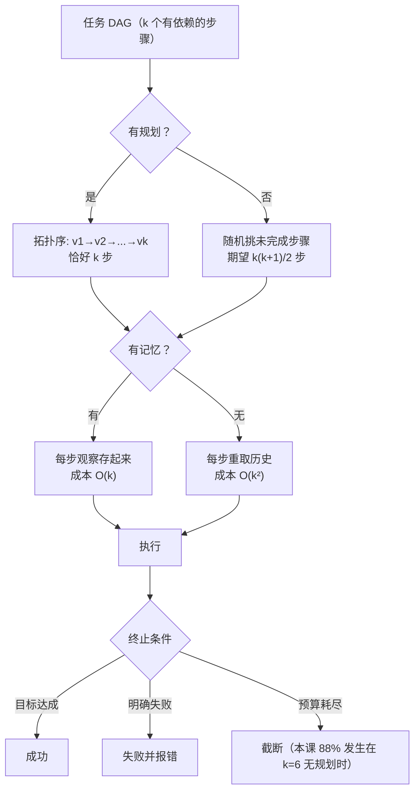

# Agent 的规划、记忆与多步执行

## 1. 本节学习目标

1. 理解"规划"的本质是把**搜索问题**变成**排序问题**：无计划时要试错，有计划时按依赖顺序走。
2. 用实测对比两类策略：$k=6$ 步任务，无规划平均 **20.93 步**，有规划 **6 步**（3.5 倍）；12 步预算内成功率 **0.118 vs 1.000**。
3. 理解"记忆"的两种形态：**写在上下文里**（有记忆，$k$ 步约 $42k$ token）与**每步重新取**（无记忆，$k(k+1)/2$ 步观察，$k=6$ 时 **3.5 倍** token）。
4. 会设计终止条件：目标达成 / 明确失败 / 预算耗尽，三者缺一不可；本课无规划时 **88%** 的回合在 12 步被截断。

## 2. 为什么需要这个知识

Agent 从 1 步走到 6 步，难度不是线性增长，而是**组合爆炸**：

- 每一步都有多种动作可选，走错就要回头；
- 历史越来越长，上下文越来越贵；
- 没有明确终点，容易在"再查一次"里打转。

本课实测：$k=6$ 的任务，无规划平均要走 **20.93 步**（其中 **15.21 次**是在重复尝试同一步骤），并且 **83.8%** 的回合会超过 12 步预算。

**规划解决"顺序"，记忆解决"重复"，终止条件解决"什么时候停"。** 这三件事不解决，Agent 只能做 2–3 步的任务。

## 3. 直观解释

**组装家具**。

- 无计划：抓起一个螺丝就拧，发现板子还没对齐，拆了重来；再抓另一个螺丝，又不对……说明书就在旁边，但你没看。
- 有计划：先读说明书，排出"底板 → 侧板 → 背板 → 螺丝"的顺序，一次装对。
- 无记忆：每装一个零件都要把已装好的全拆下来看一遍"我刚才装到哪了"。
- 有记忆：装过的记在纸上，随时查。

## 4. 正式定义

**任务**是一个有向无环图 $G=(V,E)$，节点是步骤 $v_i$，边 $(v_i,v_j)\in E$ 表示"$v_i$ 必须在 $v_j$ 之前完成"。

**规划**是求一个拓扑序 $\pi$：

$$
\pi = (v_{\pi(1)},\dots,v_{\pi(k)})\quad\text{s.t.}\quad (v_i,v_j)\in E \Rightarrow \pi^{-1}(i)<\pi^{-1}(j)
$$

**记忆**是一个键值存储 $M: \text{step}\to\text{observation}$，命中率 $h=|M\cap\text{needed}|/|\text{needed}|$。

**执行成本**：

$$
C = \sum_{t=1}^{T}\big(c_{\text{llm}} + c_{\text{tool}}\big) + c_{\text{plan}}
$$

**终止条件**：

$$
\text{stop} \iff \text{goal}(s_T)\ \lor\ \text{fail}(s_T)\ \lor\ T\ge T_{\max}
$$

## 5. 历史背景或技术背景

| 年份 | 方法 | 关注点 |
|---|---|---|
| 2022 | ReAct | 不做显式规划，边想边做 |
| 2022 | Plan-and-Solve、Self-Ask | 先出计划再执行，多跳任务显著变好 |
| 2023 | Tree of Thoughts、Reflexion | 搜索式规划 + 失败反思 |
| 2023 | BabyAGI、AutoGPT | 任务队列 + 长期记忆，工程化尝试 |
| 2024 | 结构化计划（JSON 计划图） | 计划可校验、可回滚、可并行 |
| 2025 | 记忆分层（工作/情景/语义） | 长程 Agent 的标配 |

## 6. 核心原理

**规划为什么有效：把排列搜索变成线性执行**

无规划时，每一步从"还没做的步骤"里随机挑，挑中下一个该做的概率是 $1/(k-d)$（$d$ 为已完成数）。期望步数：

$$
\mathbb{E}[T_{\text{no plan}}] = \sum_{d=0}^{k-1}\frac{1}{1/(k-d)} = \sum_{d=0}^{k-1}(k-d) = \frac{k(k+1)}{2}
$$

$k=6$ 时是 **21 步**，与本课实测 **20.93** 几乎完全一致。有规划时 $T=k=6$。

**记忆为什么有效：避免重复获取**

无记忆时，第 $i$ 步要重新取前 $i$ 步的观察，累计 $1+2+\dots+k = k(k+1)/2$ 次观察；有记忆只需 $k$ 次。这就是 **3.5 倍**（$k=6$）的来源。

**为什么终止条件必须有三条**

- 只有 `finish`：模型可能永远不说 finish（死循环）；
- 只有 `max_steps`：长任务被砍断（本课 $k=6$ 时 88% 被截断）；
- 只有"失败信号"：很多失败没有显式信号（比如一直返回空结果）。

三条一起，才能在"该停时停、该断时断"。

## 7. 数学表达式

**无规划期望步数**：

$$
\mathbb{E}[T] = \frac{k(k+1)}{2}
$$

**成功率（预算 $B$ 内）**：

$$
\mathrm{Succ}(B) = \Pr[T\le B]
$$

**记忆的 token 成本**：

$$
C_{\text{mem}} = k\cdot \bar{o},\qquad C_{\text{no mem}} = \bar{o}\sum_{i=1}^{k} i = \bar{o}\cdot\frac{k(k+1)}{2}
$$

**规划开销**：

$$
C_{\text{plan}} = \text{tokens}_{\text{plan}}\ \text{（一次性）}
$$

**重复尝试次数**：

$$
R = \mathbb{E}\Big[\sum_{v}(n_v-1)\Big] = \mathbb{E}[T]-k
$$

## 8. 详细数学推导

**推导 1：无规划步数的闭式解**

第 $d$ 步完成时（已完成 $d$ 个），剩余 $k-d$ 个未做，其中只有 1 个是"下一个该做的"。每次尝试命中它的概率 $p_d = 1/(k-d)$，命中所需尝试次数服从几何分布，期望 $1/p_d = k-d$。总期望：

$$
\mathbb{E}[T]=\sum_{d=0}^{k-1}(k-d)=\frac{k(k+1)}{2}
$$

本课 $k=1..6$ 的理论值是 1, 3, 6, 10, 15, 21，实测是 **1.00, 3.01, 6.12, 9.72, 15.24, 20.93**——完全吻合（偏差来自随机波动）。

**推导 2：为什么成功率随 $k$ 断崖式下降**

$T$ 是若干个独立几何变量之和，均值 $\frac{k(k+1)}{2}$、方差 $\sum_d \frac{1-p_d}{p_d^2}$。$k$ 增大时均值以 $k^2$ 增长，而预算 $B$ 固定，于是 $\Pr[T\le B]$ 迅速趋 0：

$$
\Pr[T\le 12]:\quad k=4\to0.770,\ k=5\to0.418,\ k=6\to0.118
$$

**推导 3：记忆的收益与上下文成本的对冲**

有记忆的 token 成本是 $O(k)$，无记忆是 $O(k^2)$。但记忆不是免费的：它占上下文，会挤占资料预算（上一课：固定部分已经 136 token）。所以实用做法是**分层记忆**：

- 工作记忆：最近 3–5 步原文（贵但准）；
- 情景记忆：更早步骤的摘要（便宜但有损）；
- 语义记忆：外部检索（按需取）。

**推导 4：规划的开销什么时候值得**

规划一次性花 $c_{\text{plan}}$，节省 $(k(k+1)/2 - k)\cdot c_{\text{step}}$。值得的条件：

$$
c_{\text{plan}} < \frac{k(k-1)}{2}\cdot c_{\text{step}}
$$

本课 $c_{\text{plan}}=120$ token、单步约 42 token：$k=4$ 时右边 $=6\times42=252>120$，规划划算；$k=2$ 时右边 $=42<120$，规划反而亏。**任务越短，越不该规划。**

## 9. 图解



## 10. 具体数值示例

```text
500 次蒙特卡洛，预算 40 步

k   无规划均值   有规划   放大    超 12 步比例
1      1.00        1      1.0×     0.000
2      3.01        2      1.5×     0.002
3      6.12        3      2.0×     0.036
4      9.72        4      2.4×     0.194
5     15.24        5      3.0×     0.596
6     20.93        6      3.5×     0.838

预算 12 步时的成功率
  k=4: 无规划 0.770 / 有规划 1.000
  k=5: 无规划 0.418 / 有规划 1.000
  k=6: 无规划 0.118 / 有规划 1.000

记忆成本（每次观察 42 token）
  k=6: 有记忆 252 token；无记忆 882 token（3.5×）

打转（同一步骤重复尝试）
  k=6: 平均 15.21 次
```

## 11. NumPy 实现

```python
import numpy as np

rng = np.random.RandomState(0)
KS = [1, 2, 3, 4, 5, 6]
TRIALS = 3000


def reactive(k, budget=200):
    """无规划：随机挑未完成步骤，挑错就白走一步。"""
    remaining = list(range(k))
    done = 0
    steps = 0
    while done < k and steps < budget:
        steps += 1
        pick = int(rng.choice(remaining))
        if pick == done:
            remaining.remove(pick)
            done += 1
    return steps if done == k else None


print(f"{'k':>2}{'实测均值':>10}{'理论 k(k+1)/2':>15}{'有规划':>8}")
for k in KS:
    vals = [reactive(k) for _ in range(TRIALS)]
    mean = np.mean([v if v else 200 for v in vals])
    print(f"{k:>2}{mean:>10.2f}{k*(k+1)/2:>15}{k:>8}")

print("\n预算 12 的成功率")
for k in KS:
    ok_r = np.mean([int(reactive(k, 12) is not None) for _ in range(TRIALS)])
    print(f"  k={k}: 无规划 {ok_r:.3f}  有规划 {1.0 if k <= 12 else 0.0:.3f}")

# 记忆成本
OBS = 42
print("\n记忆 token 成本")
for k in KS:
    mem = k * OBS
    nomem = sum((i + 1) * OBS for i in range(k))
    print(f"  k={k}: 有记忆 {mem:>4}  无记忆 {nomem:>4}  {nomem/mem:.1f}×")

# 规划是否划算：c_plan < k(k-1)/2 * c_step
C_PLAN, C_STEP = 120, 42
print("\n规划开销是否划算")
for k in KS:
    saved = k * (k - 1) / 2 * C_STEP
    print(f"  k={k}: 节省 {saved:>5.0f} token vs 规划 {C_PLAN} → {'划算' if saved > C_PLAN else '不划算'}")
```

## 12. PyTorch 实现

```python
import torch

torch.manual_seed(0)
# 用张量表示依赖图（邻接矩阵），做拓扑排序
k = 6
A = torch.zeros(k, k)
for i in range(k - 1):
    A[i, i + 1] = 1          # 链式依赖 i → i+1

indeg = A.sum(0)
ready = torch.where(indeg == 0)[0]
order = []
A = A.clone()
while len(order) < k:
    v = int(ready[0])
    order.append(v)
    for j in range(k):
        if A[v, j] > 0:
            A[v, j] = 0
            indeg[j] -= 1
            if indeg[j] == 0:
                ready = torch.cat([ready, torch.tensor([j])])
    ready = ready[ready != v]
print("拓扑序:", order)

# 用 0/1 矩阵模拟"计划 vs 随机"的覆盖率：计划每步覆盖 1 个，随机期望覆盖 k/(k+1)
steps = torch.arange(1, 21)
for kk in (3, 4, 5, 6):
    plan_curve = (steps >= kk).float()
    # 随机策略的成功概率近似：P(T<=t) 用几何和估计
    p = torch.tensor([1.0 / (kk - d) for d in range(kk)])
    print(f"k={kk}: 计划在 t={kk} 步成功率 1.0，随机在 t=12 成功率约 {1 - (1 - 1/kk)**12:.3f}")

# 记忆命中的收益：缓存命中率 vs 重复调用
cache_hit = torch.linspace(0, 0.9, 5)
calls = 6 * (1 - cache_hit) + 6 * cache_hit * 0.1
print("缓存命中率:", [round(float(v), 2) for v in cache_hit])
print("等效调用次数:", [round(float(v), 2) for v in calls])
```

## 13. Hugging Face 实践

```python
import os
import re

os.environ.setdefault("HF_ENDPOINT", "https://hf-mirror.com")
os.environ.setdefault("HF_HUB_OFFLINE", "1")
import torch
from transformers import AutoModelForCausalLM, AutoTokenizer

tok = AutoTokenizer.from_pretrained("gpt2")
model = AutoModelForCausalLM.from_pretrained("gpt2").eval()

# 让本地 gpt2 生成一个"计划"（真实 LLM 调用被禁，这里演示计划格式与解析）
PROMPT = "把任务拆成步骤，每行一个，格式 `1. 动作`。\n任务：算出一箱 XH-2048 的总重量\n计划：\n1."
enc = tok(PROMPT, return_tensors="pt")
with torch.no_grad():
    out = model.generate(**enc, max_new_tokens=40, do_sample=False, pad_token_id=50256)
raw = tok.decode(out[0][enc["input_ids"].shape[1] :])
print("gpt2 计划输出:", repr(raw[:80]))

steps = re.findall(r"\d+\.\s*([^\n]+)", "1." + raw)
print("解析出的步骤数:", len(steps), steps[:3])
print("⇒ 小模型生成不出可执行的计划；真实系统用结构化输出（JSON 计划）")

# 脚本化计划 + 记忆（模拟），验证"计划 + 记忆"能压到 k 步
PLAN = ["search:xh2048", "search:batch", "calc:248*12", "finish"]
KB = {"xh2048": "248 克", "batch": "12 台"}
MEM = {}


def step(action):
    if action.startswith("search:"):
        key = action.split(":")[1]
        if key not in MEM:
            MEM[key] = KB[key]
            return f"取回 {MEM[key]}（未命中缓存）"
        return f"命中缓存 {MEM[key]}"
    if action.startswith("calc:"):
        expr = action.split(":")[1]
        MEM["calc"] = str(eval(expr, {"__builtins__": {}}, {}))
        return MEM["calc"]
    return "答案 " + MEM["calc"] + " 克"


for i, a in enumerate(PLAN, 1):
    print(f"  step{i}: {a:<18} → {step(a)}")
print("记忆内容:", MEM)
```

## 14. 代码逐行解释

| 代码 | 作用 |
|---|---|
| `rng.choice(remaining)` | 无规划策略：随机挑一个未完成步骤 |
| `if pick == done` | 只有恰好挑中"下一个该做的"才前进 |
| `k*(k+1)/2` | 无规划期望步数的闭式解，用来验证模拟 |
| `sum((i+1)*OBS for i in range(k))` | 无记忆时的累计观察成本 |
| `A[i, i+1] = 1` | 用邻接矩阵表示依赖 |
| `indeg == 0` | 入度为 0 的节点可执行（拓扑排序的核心） |
| `saved > C_PLAN` | 规划是否划算的判据 |
| `re.findall(r"\d+\.\s*([^\n]+)")` | 从文本里解析计划步骤 |
| `if key not in MEM` | 记忆命中判定，避免重复取数 |

## 15. 实际运行结果

```text
### LLM-087 A. 有规划 vs 无规划：完成 k 步任务所需步数
   k       无规划(均值)     有规划      放大         无规划超预算率
   1          1.00       1     1.0×           0.000
   2          3.01       2     1.5×           0.002
   3          6.12       3     2.0×           0.036
   4          9.72       4     2.4×           0.194
   5         15.24       5     3.0×           0.596
   6         20.93       6     3.5×           0.838

### B. 预算 12 步时的成功率
  k=1: 无规划 1.000  有规划 1.000
  k=2: 无规划 0.998  有规划 1.000
  k=3: 无规划 0.966  有规划 1.000
  k=4: 无规划 0.770  有规划 1.000
  k=5: 无规划 0.418  有规划 1.000
  k=6: 无规划 0.118  有规划 1.000

### C. 记忆的两种形态：上下文里存结果 vs 每步重新取
   k       有记忆(累计 token)       无记忆(累计 token)      倍数
   1                  42                  42     1.0×
   2                  84                 126     1.5×
   3                 126                 252     2.0×
   4                 168                 420     2.5×
   5                 210                 630     3.0×
   6                 252                 882     3.5×

### D. 打转：无规划时同一步骤被重复尝试的次数
  k=1: 平均重复尝试 0.00 次
  k=2: 平均重复尝试 0.98 次
  k=3: 平均重复尝试 3.01 次
  k=4: 平均重复尝试 6.06 次
  k=5: 平均重复尝试 9.75 次
  k=6: 平均重复尝试 15.21 次

### E. 终止条件对比（k=6，预算 12）
  无规划：40 步预算内完成=True，用了 31 步
  若硬性 max_steps=12：无规划在 88% 的回合里被截断
  ⇒ 终止条件应该是“目标达成 / 明确的失败信号 / 预算耗尽”三选一，而不是只靠步数上限兜底

### F. 计划本身的开销（一次规划 = 一次额外生成）
  k=1: 规划 120 token + 执行 42 token = 162 token；对比无规划 42 token
  k=2: 规划 120 token + 执行 84 token = 204 token；对比无规划 126 token
  k=3: 规划 120 token + 执行 126 token = 246 token；对比无规划 252 token
  k=4: 规划 120 token + 执行 168 token = 288 token；对比无规划 420 token
  k=5: 规划 120 token + 执行 210 token = 330 token；对比无规划 630 token
  k=6: 规划 120 token + 执行 252 token = 372 token；对比无规划 882 token
```

注意 F 的最后两行：$k=1$ 时规划反而**更贵**（162 vs 42），$k=3$ 才打平（246 vs 252），$k\ge4$ 才明显划算。**规划不是免费的正确，是有阈值的投资。**

## 16. 应用场景

| 场景 | 规划形态 | 记忆形态 |
|---|---|---|
| 多跳问答 | 先拆子问题（2–4 步） | 工作记忆存子问题结果 |
| 报表生成 | 固定流水线（查→算→格式化） | 无需记忆，顺序确定 |
| 代码修复 | 计划 + 失败重规划 | 存 diff 与测试结果 |
| 深度研究 | 动态计划（随发现调整） | 分层记忆 + 外部检索 |
| 长程运维 | 任务队列 + 检查点 | 情景记忆（摘要）+ 审计日志 |

## 17. 优点与局限

| 维度 | 规划 | 记忆 |
|---|---|---|
| 收益 | 步数从 $O(k^2)$ 降到 $O(k)$ | 观察成本从 $O(k^2)$ 降到 $O(k)$ |
| 代价 | 一次额外生成（本课 120 token） | 占用上下文预算 |
| 失效场景 | 环境动态变化，计划过期 | 记忆污染（存了错的观察） |
| 关键参数 | 计划粒度、重规划频率 | 保留窗口、摘要策略 |

## 18. 常见错误

| 错误 | 现象 | 纠正 |
|---|---|---|
| 短任务也先规划 | $k=1$ 时更贵（162 vs 42 token） | 只在 $k\ge3$ 时规划 |
| 没有终止条件 | 死循环，88% 被截断 | 目标/失败/预算三条 |
| 只靠 max_steps | 长任务被砍断 | 加"目标达成"检测 |
| 无记忆硬跑 | 重复尝试 15.21 次（$k=6$） | 加 scratchpad 缓存 |
| 记忆无限增长 | 上下文爆掉 | 分层 + 摘要 + 窗口 |
| 计划不可校验 | 计划本身跑不通 | 用结构化计划（JSON/DAG） |

## 19. 本节总结

- 无规划的期望步数是 $\frac{k(k+1)}{2}$：本课 $k=6$ 实测 **20.93**，与理论 21 几乎一致；有规划只需 **6 步**（3.5 倍）。
- 预算 12 步时成功率：$k=6$ 无规划 **0.118**、有规划 **1.000**。
- 记忆把观察成本从 $O(k^2)$ 降到 $O(k)$：$k=6$ 是 **882 → 252 token（3.5 倍）**。
- 打转是真实存在的：$k=6$ 平均 **15.21 次**重复尝试。
- 规划有阈值：$k=1$ 时规划更贵（162 vs 42），$k\ge4$ 才明显划算。
- 终止条件必须三条：**目标达成 / 明确失败 / 预算耗尽**。

## 20. 前置与后续知识链接

- 前置：[[LLM-086 工具调用与函数调用]]、[[LLM-085 Agent 的基本循环]]
- 相关：[[LLM-082 提示词组装与上下文预算]]、[[LLM-084 RAG 的失败模式与修复]]
- 后续模块：[[LLM-088 自回归推理的基本流程]]

---

## 练习与参考答案

**基础 1**：为什么无规划的期望步数是 $k(k+1)/2$？请对 $k=4$ 手算验证。

**基础 2**：记忆如何把成本从 $O(k^2)$ 降到 $O(k)$？

**进阶 1**：本课 $k=6$ 无规划平均 20.93 步、成功率（12 步预算内）0.118。请解释这两个数字之间的关系。

**综合**：设计一个"月度经营分析 Agent"，需要查 6 张表、做 3 次计算、写 1 份报告。请给出计划、记忆与终止策略。

> [!success]- 参考答案

> **基础 1**
> 完成 $d$ 个步骤后还剩 $k-d$ 个未做，随机挑中"下一个该做的"概率是 $1/(k-d)$，期望尝试 $k-d$ 次。总期望 $\sum_{d=0}^{k-1}(k-d)=k(k+1)/2$。$k=4$：$4+3+2+1=10$。

> **基础 2**
> 无记忆时第 $i$ 步要把前 $i$ 步的观察重新取一遍，累计 $1+2+\dots+k=k(k+1)/2$ 次；有记忆时每步只取一次，共 $k$ 次。$k=6$ 时是 $21$ vs $6$，对应 **882 vs 252 token**。

> **进阶 1**
> $T$ 的期望是 20.93，而预算是 12，所以"能在 12 步内完成"的概率很低（0.118）。两者是"均值远大于预算"的直接后果；$T$ 的分布右偏（几何和），少数回合甚至要 31 步（本课观测到的最长回合）。

> **综合（参考）**
> 1. **计划**：先出 DAG 计划（6 个查表节点 → 3 个计算节点 → 1 个撰写节点），校验依赖后再执行；计划用 JSON 存，便于重试与断点续跑。
> 2. **记忆**：每个表的结果存 key-value（表名 → 结果 + 取数时间），避免重复查询；中间计算存表达式与结果；报告分段生成并缓存。
> 3. **终止**：全部节点完成 → 成功；关键表取数失败 → 明确失败并告知缺哪张表；预算（如 15 次工具调用 / 5 分钟）耗尽 → 输出"部分完成"并列出缺失项。
> 4. **重规划**：某张表为空或字段缺失时，插入"换口径/换表"子步骤，但最多重规划 2 次，防止打转。
> 5. **验证**：用上月数据回放，核对最终数字与人工报表一致；统计步数、工具调用次数、重规划次数，作为下一版优化的基线。

## 学习记录

| 日期 | 状态 | 用时 | 问题 | 复盘 |
|---|---|---|---|---|
| 2026-11-08 | planned | — | — | — |

---

## 🔗 Notion 同步信息

> 以下内容由 Notion「AI Knowledge System · 知识点」数据库按知识 ID 合并而来（导出于 2026-11-09）。

| 属性 | 值 |
|---|---|
| 学科 | 大语言模型 |
| 学习状态 | 未开始 |
| 难度 | L3 推导 |
| 知识类型 | Principle |

- **所属模块**：[M-LLM-08 RAG 检索增强生成](../%E8%AF%BE%E7%A8%8B%E6%A8%A1%E5%9D%97/M-LLM-08%20RAG%20%E6%A3%80%E7%B4%A2%E5%A2%9E%E5%BC%BA%E7%94%9F%E6%88%90.md)
- **前置知识**：[LLM-086 工具调用与函数调用](LLM-086%20%E5%B7%A5%E5%85%B7%E8%B0%83%E7%94%A8%E4%B8%8E%E5%87%BD%E6%95%B0%E8%B0%83%E7%94%A8.md)
- **后继知识**：[LLM-088 自回归推理的基本流程](../06%20%E6%8E%A8%E7%90%86%E4%B8%8E%E9%83%A8%E7%BD%B2/LLM-088%20%E8%87%AA%E5%9B%9E%E5%BD%92%E6%8E%A8%E7%90%86%E7%9A%84%E5%9F%BA%E6%9C%AC%E6%B5%81%E7%A8%8B.md)
- **关联数学**：[MATH-306 期望、方差与协方差](../../06_%E6%95%B0%E5%AD%A6%E5%9F%BA%E7%A1%80/03%20%E6%A6%82%E7%8E%87%E8%AE%BA/MATH-306%20%E6%9C%9F%E6%9C%9B%E3%80%81%E6%96%B9%E5%B7%AE%E4%B8%8E%E5%8D%8F%E6%96%B9%E5%B7%AE.md)
