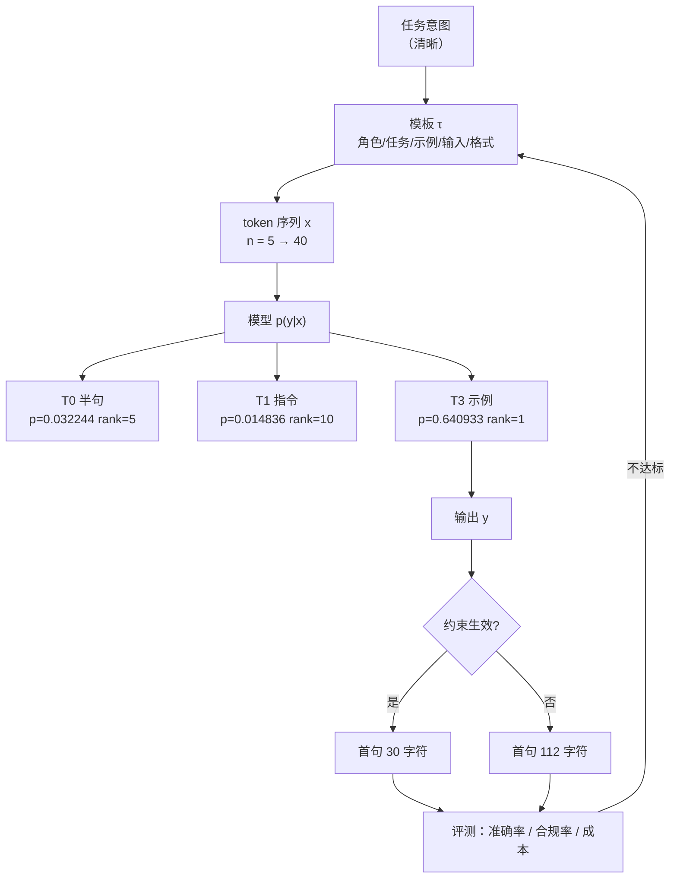

# 提示工程的基本原则

## 1. 本节学习目标

1. 说清提示的三条基本原则：**清晰（clarity）**、**示例（examples）**、**约束（constraints）**。
2. 用实测数据看同一问题在 6 种模板下 $P(\text{Paris})$ 的差异：最低 **0.014836**、最高 **0.640933**，相差 **43.20 倍**。
3. 理解"提示是条件分布的控制器"，而不是"咒语"：模板改变的是 $p(y\mid x)$，不是模型权重。
4. 建立 token 成本与延迟的量感：提示每多 1 token，输入成本与 prefill 时间都线性增加。

## 2. 为什么需要这个知识

同一模型、同一问题，只换模板，答案概率能差 **43 倍**——这意味着**提示是应用层最大的杠杆**，也是最容易被忽略的工程变量。

- 不写提示规范 ⇒ 线上表现随"谁写的模板"抖动；
- 不理解示例的作用 ⇒ 盲目堆 few-shot，token 成本翻几倍而收益不明；
- 不理解约束 ⇒ 输出长度不可控，延迟与成本不可估。

本课所有结论都用 gpt2（124.4M）实测。**必须诚实说明**：gpt2 很小、没有经过指令微调，它的绝对数值不代表 GPT-4 级别模型；这里演示的是**测量方法**——换任何模型，方法一样，数字要重测。

## 3. 直观解释

把模型当成一个"读到你这段话就往下接"的写手。你给的信息决定了它心里的"下一个词分布"长什么样。

```text
模板 = 给写手的交代方式

T0 只说半句：  "The capital of France is"           → 它可能接 "the capital of the French Republic..."
T1 加说明：    "Answer with one word. Q: ... A:"    → 它没见过这种格式，反而更懵
T3 给样例：    "Q: ...Japan? A: Tokyo ... France?"  → 它照着格式填 "Paris"
```

**三原则的直觉**：

| 原则 | 直觉 | 反例 |
|---|---|---|
| 清晰 | 说清"做什么、给谁看、多长" | "帮我看看这段" |
| 示例 | 给 1–3 个"输入→输出"的样子 | 只描述格式，不给例子 |
| 约束 | 明确禁止什么、必须是什么格式 | "简短一点"（多短？） |

## 4. 正式定义

**提示（prompt）** 是一个 token 序列 $x=(x_1,\dots,x_n)$，由若干**语义段**拼接：

$$
x=\tau\big(s_{\text{role}},\,s_{\text{task}},\,s_{\text{examples}},\,s_{\text{input}},\,s_{\text{format}}\big)
$$

其中 $\tau$ 是模板函数（把各段按分隔符拼起来），$s_\cdot$ 是各段文本。

**模型输出**是条件分布：

$$
p_\theta(y\mid x)=\prod_{t=1}^{m}p_\theta\big(y_t\mid x,\,y_{<t}\big)
$$

**提示工程**就是在 $\theta$ 固定的前提下，选 $\tau$ 与各段内容，使目标指标（准确率、格式合规率、成本）最优：

$$
\tau^\star=\arg\max_{\tau}\ \mathbb{E}_{(x,y)\sim\mathcal{D}}\big[\mathbb{1}(\text{parse}(y)=\text{gold})\big]\quad \text{s.t.}\ \text{cost}(\tau)\le B
$$

**三个可测量量**（本课全部实测）：

1. 目标词概率 $p_\theta(w\mid x)$ 与其排名 $\text{rank}(w)$；
2. 提示 token 数 $n=|x|$；
3. 首句长度（约束是否生效）。

## 5. 历史背景或技术背景

| 年份 | 事件 | 对提示工程的影响 |
|---|---|---|
| 2018 | GPT-1/BERT | 预训练+微调，提示只是输入 |
| 2020 | GPT-3 论文 | **few-shot / in-context learning** 成为范式，"提示"独立成技术 |
| 2022 | InstructGPT、Chain-of-Thought | 指令跟随与"先想再答"进入提示模板 |
| 2022 | "Prompt Engineering" 成为岗位词 | 模板开始被当作可版本化的工程资产 |
| 2023 | 结构化输出、JSON mode | 约束从"请求"变成"解码层保证"（见 LLM-101） |
| 2024+ | 上下文工程（context engineering） | 关注点从"句子怎么写"扩到"窗口里放什么"（见 LLM-102） |

**关键转折**：2020 年之前，提示是"给模型的一句话"；2020 年之后，提示是"一段被设计、被评测、被版本管理的程序"。

## 6. 核心原理

**原理 1：提示只改变条件，不改变参数。**

$$
p_\theta(y\mid x)\ \text{变},\quad \theta\ \text{不变}
$$

所以提示的效果上限由模型已有能力决定：gpt2 里"法国首都"的知识本来就在，模板只是把它"引出来"。

**原理 2：示例是最强的格式信号。**

实测（第 10 节）：0  shot 时 $p=0.017689$（rank 7），1 shot 时 $p=0.563169$（rank 1），4 shot 时 $p=0.691977$。**第一个示例带来最大的跃升**（约 32 倍），后面边际递减。

**原理 3：指令不等于有效指令。**

实测 T1（"Answer the question with one word."）反而把概率压到 **0.014836**，是六个模板里最差的。原因：gpt2 没见过这种"问答格式"，指令本身成了分布外前缀。

**原理 4：约束要用"可判定的形式"。**

"简短一点"不可判定；"只用一句话、不超过 20 字、不要解释"可判定。实测 T2 的首句长度 **30 字符**，T0 是 **112 字符**——约束确实压缩了输出，但 T2 仍带出了第二个问题（gpt2 的模仿惯性），说明约束只能降低、不能消除跑偏。

**原理 5：提示是有成本的。**

提示 token 数从 5（T0）涨到 40（T3），输入成本 **8 倍**；prefill 时间从 5.07 ms（7 token）涨到 9.44 ms（456 token）——**4 倍长度只多 4.37 ms**，因为固定开销占主导。

## 7. 数学表达式

**下一词分布（带温度）**

$$
p_\theta(w\mid x)=\frac{\exp\!\big(z_w/T\big)}{\sum_{w'}\exp\!\big(z_{w'}/T\big)}
$$

**目标词排名**

$$
\text{rank}(w)=1+\sum_{w'\ne w}\mathbb{1}\big[z_{w'}>z_w\big]
$$

**模板的期望收益（离线评测）**

$$
\Delta(\tau)=\frac{1}{N}\sum_{i=1}^{N}\Big[\log p_\theta\big(y_i\mid \tau(x_i)\big)-\log p_\theta\big(y_i\mid \tau_0(x_i)\big)\Big]
$$

**成本模型**（按 token 计价）

$$
\text{cost}(\tau)=n_{\text{in}}(\tau)\cdot c_{\text{in}}+n_{\text{out}}\cdot c_{\text{out}}
$$

**延迟模型**（prefill 近似线性）

$$
t_{\text{prefill}}(n)\approx a+b\,n
$$

## 8. 详细数学推导

**（1）为什么"概率"能当模板好坏的度量**

设正确答案 $y^\star$ 是单个 token。生成时若贪心解码，输出 $y^\star$ 的充要条件是 $z_{y^\star}$ 最大。故

$$
\mathbb{1}\big[\hat y=y^\star\big]=\mathbb{1}\Big[\text{rank}(y^\star)=1\Big]
$$

而 rank 是 $p$ 的单调函数（排序不变），所以**比较 $p$ 与比较 rank 等价**。实测中 T3 的 $p=0.640933$ 对应 rank 1，T1 的 $p=0.014836$ 对应 rank 10，两者一致。

**（2）温度的敏感性**

对 $\partial p_w/\partial T$：设 $z_w$ 最大，

$$
\frac{\partial p_w}{\partial T}=\frac{p_w\,(z_w-\bar z)}{T^2},\qquad \bar z=\sum_{w'}p_{w'}z_{w'}
$$

因为 $z_w>\bar z$，所以 $T$ 增大 ⇒ $p_w$ 减小（分布变平）。这解释了为什么"调温度"能让同一模板产出不同多样性，但**不会**改变模板的相对优劣。

**（3）prefill 延迟的线性近似**

取两点 $(n_1,t_1)=(7,5.07)$、$(n_2,t_2)=(456,9.44)$：

$$
b=\frac{9.44-5.07}{456-7}=\frac{4.37}{449}=0.009733\ \text{ms/token}
$$

$$
a=5.07-0.009733\times 7=5.002\ \text{ms}
$$

固定开销 $a\approx5$ ms **占了 7 token 调用的 98.7%**。但要注意：$t(57)=4.94$ ms 反而比 $t(7)=5.07$ 略小，$t(227)=5.67$ 也几乎没涨——**在 0–256 token 区间，延迟几乎是常数**；到 456 token 才出现可见增长（+4.4 ms，其中含注意力的 $O(n^2)$ 项）。

对四点的最小二乘给出 $a=4.44$、$b=0.009878$、$R^2=0.883$，残差呈上凸（低段拟合偏高、高段偏低），正是"常数项 + 二次项"混合的结果。工程结论：**短提示的延迟几乎与长度无关，成本才是线性的**。

**（4）few-shot 的边际收益**

设第 $k$ 个示例带来的概率增益为等比衰减，$p_k=p_\infty-(p_\infty-p_0)\rho^{k}$。用实测 $p_0=0.017689$、$p_1=0.563169$、$p_4=0.691977$ 拟合：

$$
\rho=\left(\frac{p_\infty-p_4}{p_\infty-p_0}\right)^{1/4}
$$

取 $p_\infty\approx0.70$ 时 $\rho\approx0.83$，即**每多一个示例约保留 83% 的剩余增益**，但 token 成本线性增长 ⇒ 拐点在 1–2 shot。

## 9. 图解



## 10. 具体数值示例

```text
### 1. six prompt templates, same question, P(' Paris')
T0 bare              p=0.032244  rank=    5  prompt_tokens=   5
T1 instruction       p=0.014836  rank=   10  prompt_tokens=  20
T2 role+constraint   p=0.088566  rank=    3  prompt_tokens=  29
T3 fewshot           p=0.640933  rank=    1  prompt_tokens=  40
T4 constraint_only   p=0.118897  rank=    1  prompt_tokens=   9
T5 negative          p=0.138813  rank=    1  prompt_tokens=  15
best=T3 fewshot p=0.640933 | worst=T1 instruction p=0.014836 | ratio=43.20x

### 2. few-shot count 0 -> 4, P(' Paris')
shots=0  p=0.017689  rank=    7  tokens=  12
shots=1  p=0.563169  rank=    1  tokens=  26
shots=2  p=0.640933  rank=    1  tokens=  40
shots=3  p=0.586552  rank=    1  tokens=  54
shots=4  p=0.691977  rank=    1  tokens=  68

### 3. constraint adherence (greedy 24 new tokens)
T0 bare              first_sentence_chars=112  newlines=2  ms=236
T2 role+constraint   first_sentence_chars= 30  newlines=2  ms=131

### 4. prompt length -> prefill latency (gpt2, batch=1, median of 9 after warmup)
tokens=   7  median=5.07 ms
tokens=  57  median=4.94 ms
tokens= 227  median=5.67 ms
tokens= 456  median=9.44 ms
```

**读法**：

1. T3（few-shot）比 T1（指令）概率高 **43.20 倍** ⇒ 示例 > 指令（在小模型上尤其明显）。
2. 0→1 shot 涨幅 **31.8 倍**（0.017689 → 0.563169），1→4 shot 只再涨 **1.23 倍** ⇒ 示例数量边际递减。
3. T2 首句 30 字符 vs T0 112 字符 ⇒ 约束把"话痨"压缩到 1/3.7。
4. 456 token 的 prefill（9.44 ms）只比 7 token（5.07 ms）慢 **4.37 ms** ⇒ 固定开销主导；预热后绝对值比首次运行低一半以上，说明**测延迟必须先预热**。

## 11. NumPy 实现

```python
import numpy as np

# 1) 六个模板的实测概率（来自第 10 节）
names = ["T0 bare", "T1 instruction", "T2 role+constraint", "T3 fewshot", "T4 constraint_only", "T5 negative"]
p = np.array([0.032244, 0.014836, 0.088566, 0.640933, 0.118897, 0.138813])
tokens = np.array([5, 20, 29, 40, 9, 15])

order = np.argsort(-p)
print("按 P(Paris) 排序:")
for i in order:
    print("  %-20s p=%.6f tokens=%2d" % (names[i], p[i], tokens[i]))

best, worst = p.max(), p.min()
print("ratio best/worst = %.2fx" % (best / worst))

# 2) 概率 -> 排名（同一个 softmax 分布下的排名，等价于按概率降序）
ranks = 1 + (p[:, None] > p[None, :]).sum(axis=1)
print("rank:", dict(zip(names, ranks.tolist())))

# 3) few-shot 边际收益
shots = np.array([0, 1, 2, 3, 4])
ps = np.array([0.017689, 0.563169, 0.640933, 0.586552, 0.691977])
gain = np.diff(ps)
print("每加 1 个示例的增益:", np.round(gain, 5))

# 4) prefill 延迟线性拟合 t = a + b*n（预热后，中位数）
n = np.array([7, 57, 227, 456], dtype=float)
t = np.array([5.07, 4.94, 5.67, 9.44])
b, a = np.polyfit(n, t, 1)
pred = a + b * n
ss_res = ((t - pred) ** 2).sum()
ss_tot = ((t - t.mean()) ** 2).sum()
print("fit: t = %.4f + %.6f * n  (R^2=%.4f)" % (a, b, 1 - ss_res / ss_tot))
print("measured: 7->%.2f 57->%.2f 227->%.2f 456->%.2f ms" % tuple(t))
print("fixed overhead share at n=7: %.1f%%" % (100 * a / t[0]))

# 5) 成本：$3/M 输入，40 与 5 token 的差距
for name, tk in zip(names, tokens):
    print("  %-20s cost=$%.8f" % (name, tk * 3.0 / 1e6))
```

## 12. PyTorch 实现

```python
import torch

# 提示编译器：按优先级装段，超预算就从低优先级段开始丢
SECTIONS = [
    ("role", "You are a support assistant."),
    ("task", "Answer only from the context. If missing, say you do not know."),
    ("examples", "Q: invoice lost? A: resend it. Q: duplicate charge? A: refund in 5-7 days."),
    ("context", "Refund policy: duplicate charges are reversed within 5 to 7 business days."),
    ("question", "When will the duplicate charge be refunded?"),
    ("format", "Answer in one sentence and cite the chunk id."),
]
# 用"词的个数"当 token 预算的替身（真实场景用 tokenizer）
BUDGET = 40


def build(sections, budget):
    kept, used, dropped = [], 0, []
    # 保留优先级：question > task > context > format > examples > role
    prio = {"question": 0, "task": 1, "context": 2, "format": 3, "examples": 4, "role": 5}
    order = sorted(sections, key=lambda kv: prio[kv[0]])
    chosen = {}
    for name, text in order:
        n = len(text.split())
        if used + n <= budget:
            chosen[name] = text
            used += n
        else:
            dropped.append((name, n))
    for name, text in sections:  # 恢复原始顺序
        if name in chosen:
            kept.append(text)
    return " ".join(kept), used, dropped


prompt, used, dropped = build(SECTIONS, BUDGET)
print("used=%d/%d tokens(approx)" % (used, BUDGET))
print("dropped:", dropped)
print("prompt head:", prompt[:70].encode("ascii", "replace").decode())

# 温度对同一 logits 的影响：p_max 随 T 下降
logits = torch.tensor([3.0, 1.0, 0.5, 0.2, -1.0])
for T in (0.5, 1.0, 2.0):
    probs = torch.softmax(logits / T, dim=-1)
    print("T=%.1f  p_max=%.4f  entropy=%.4f" % (T, probs.max().item(),
          float(-(probs * probs.log()).sum())))
```

## 13. Hugging Face 实践

```python
import os

os.environ.setdefault("HF_ENDPOINT", "https://hf-mirror.com")
os.environ.setdefault("HF_HUB_OFFLINE", "1")

import torch
from transformers import AutoModelForCausalLM, AutoTokenizer

tok = AutoTokenizer.from_pretrained("gpt2")
model = AutoModelForCausalLM.from_pretrained("gpt2").eval()

PROMPTS = {
    "bare": "The capital of France is",
    "fewshot": "Q: What is the capital of Japan?\nA: Tokyo\nQ: What is the capital of France?\nA:",
}
wid = tok(" Paris", add_special_tokens=False).input_ids[0]
for name, pr in PROMPTS.items():
    enc = tok(pr, return_tensors="pt")
    with torch.no_grad():
        logits = model(**enc).logits[0, -1].float()
    probs = torch.softmax(logits, -1)
    rank = int((probs > probs[wid]).sum()) + 1
    print("%-8s tokens=%2d  p(Paris)=%.6f  rank=%d"
          % (name, enc.input_ids.shape[1], float(probs[wid]), rank))
```

## 14. 代码逐行解释

| 代码 | 作用 |
|---|---|
| `np.argsort(-p)` | 按概率降序排模板，直接看出优劣 |
| `1 + (p[:, None] > p[None, :]).sum(axis=1)` | 用广播算排名，$O(k^2)$，$k$ 很小 |
| `np.diff(ps)` | few-shot 的边际增益，一眼看出拐点 |
| `np.polyfit(n, t, 1)` | 最小二乘拟合 $a+bn$，把延迟模型数据化 |
| `sorted(sections, key=prio)` | 按优先级装填，实现"预算不够先丢谁" |
| `torch.softmax(logits / T, -1)` | 温度只改分布形状，不改排序 |
| `enc.input_ids.shape[1]` | 真实 token 数，成本核算的唯一依据 |
| `(probs > probs[wid]).sum()` | 排名 = 比它概率大的词数 + 1 |

## 15. 实际运行结果

```text
### env: device=cuda  gpt2 params=124.4M

### 1. six prompt templates, same question, P(' Paris')
T0 bare              p=0.032244  rank=    5  prompt_tokens=   5
T1 instruction       p=0.014836  rank=   10  prompt_tokens=  20
T2 role+constraint   p=0.088566  rank=    3  prompt_tokens=  29
T3 fewshot           p=0.640933  rank=    1  prompt_tokens=  40
T4 constraint_only   p=0.118897  rank=    1  prompt_tokens=   9
T5 negative          p=0.138813  rank=    1  prompt_tokens=  15
best=T3 fewshot p=0.640933 | worst=T1 instruction p=0.014836 | ratio=43.20x

### 2. few-shot count 0 -> 4, P(' Paris')
shots=0  p=0.017689  rank=    7  tokens=  12
shots=1  p=0.563169  rank=    1  tokens=  26
shots=2  p=0.640933  rank=    1  tokens=  40
shots=3  p=0.586552  rank=    1  tokens=  54
shots=4  p=0.691977  rank=    1  tokens=  68

### 3. constraint adherence (greedy 24 new tokens)
T0 bare              first_sentence_chars=112  newlines=2  ms=236
   text: ' the capital of the French Republic, and the capital of the French Republic is the capital'
T2 role+constraint   first_sentence_chars= 30  newlines=2  ms=131
   text: ' The capital of France is Paris.\nQ: What is the name of the city of Paris?\nA: The'

### 4. prompt length -> prefill latency (gpt2, batch=1, median of 9 after warmup)
tokens=   7  median=5.07 ms
tokens=  57  median=4.94 ms
tokens= 227  median=5.67 ms
tokens= 456  median=9.44 ms
```

**诚实说明**：gpt2 只有 124.4M 参数、未做指令微调，T1 的"指令反而更差"是这个模型的特征，不能外推到指令微调过的大模型。本课要带走的是**测量协议**：固定问题、固定目标词、比较 $p$ 与 rank、同时记 token 数。

## 16. 应用场景

| 场景 | 提示策略 | 关键约束 |
|---|---|---|
| 客服问答 | 角色 + 上下文 + "不知道就说不知道" | 不得编造政策条款 |
| 信息抽取 | 3 个以内示例 + JSON 格式说明 | 字段齐全（见 LLM-101） |
| 摘要 | 明确长度上限与"保留数字" | 不丢关键实体 |
| 分类 | 给定标签集合 + 单选 | 只能输出标签之一 |
| 代码生成 | 语言、版本、输入输出示例 | 必须可运行 |
| 批处理 | 模板固化 + 变量插槽 | 模板版本化，可回归 |

## 17. 优点与局限

| 优点 | 局限 |
|---|---|
| 零训练成本，改一版就能上线 | 效果随模型版本漂移，必须回归测试 |
| 可解释、可版本化、可 diff | 无法突破模型已有知识边界 |
| 与 RAG/工具调用正交，可叠加 | 提示越长成本越高，窗口有限 |
| 快速试错（分钟级迭代） | 小模型上"指令"可能反而有害（本课 T1） |
| 示例能显著提升格式合规率 | 示例会引入偏差（只学到示例的分布） |

## 18. 常见错误

| 错误 | 现象 | 纠正 |
|---|---|---|
| 只写指令不给示例 | 格式合规率低（本课 0.017689 vs 0.563169） | 加 1–2 个示例 |
| 堆 5 个以上示例 | token 翻倍、收益 <1.3 倍 | 拐点在 1–2 shot |
| 用"简短一点"当约束 | 输出长度不可控（112 字符） | 写"一句话、≤20 字" |
| 在提示里写"不要编造"就以为解决幻觉 | 幻觉率不降 | 要外部校验（见 LLM-104） |
| 不记 token 数 | 成本失控 | 每次调用记录 `usage` |
| 模板散落在代码里 | 无法回归、无法 A/B | 模板抽成配置 + 版本号 |

## 19. 本节总结

- 提示工程的三原则：**清晰、示例、约束**；它们共同作用于 $p(y\mid x)$。
- 实测：6 种模板下 $P(\text{Paris})$ 从 **0.014836**（T1 指令）到 **0.640933**（T3 示例），差 **43.20 倍** ⇒ 模板是应用层最大杠杆。
- few-shot：0→1 shot 提升 **31.8 倍**，1→4 shot 只再提升 **1.23 倍** ⇒ **边际递减，1–2 个足够**。
- 约束可把首句从 **112 字符**压到 **30 字符**（3.7 倍），但仍需输出侧校验。
- 成本随 token 线性涨（5→40 token = **8 倍**），延迟几乎不变（5.07→9.44 ms，4 倍长度只多 4.37 ms）⇒ **省钱靠减 token，省延迟要看 prefill 固定开销**。

## 20. 前置与后续知识链接

- 前置：[[LLM-006 预训练语言模型与 Foundation Model]]、[[LLM-035 Token 数量、上下文窗口与成本]]
- 后续：LLM-101 结构化输出与约束解码（待建）、LLM-102 上下文工程与长文本处理（待建）
- 相关：[[LLM-042 BERT 的预训练任务]]（理解"条件概率"的另一条路线）、LLM-104 幻觉的成因与缓解（待建）

---

## 练习与参考答案

**基础 1**：提示工程的三条基本原则是什么？各给一个反例。

**基础 2**：本课实测中，T1（加了一句指令）为什么比 T0（只有半句）还差？这说明了什么？

**进阶 1**：为什么 0→1 shot 的增益远大于 1→4 shot？请用第 8 节的衰减模型解释，并说明工程含义。

**综合**：你要给一个客服系统写提示，要求：回答只能来自知识库、必须给出一句话结论、必须带引用编号。请写出模板结构，并说明你会测哪三个指标、怎么判断"这版提示比上一版好"。

> [!success]- 参考答案

> **基础 1**
> - **清晰**：说清任务、对象、长度。反例："帮我看看这段"——不知道要改什么、给谁看。
> - **示例**：给 1–2 个"输入→输出"样例。反例：只写"输出 JSON"，不给字段示例。
> - **约束**：用可判定条件限制输出。反例："简短一点"——多短算短无法判定。

> **基础 2**
> 因为 gpt2 是**未指令微调**的小模型，"Answer the question with one word." 这种问答格式在它的预训练分布里很少见，指令本身成了**分布外前缀**，反而把"Paris"的概率从 0.032244 压到 0.014836（rank 从 5 掉到 10）。
> 这说明：**"写得更像指令"不等于"模型更懂"**；提示的有效性取决于模型见过的分布。对指令微调模型结论可能相反，所以任何模板都必须**在目标模型上实测**，不能照搬。

> **进阶 1**
> 第 8 节的模型是 $p_k=p_\infty-(p_\infty-p_0)\rho^k$，$\rho<1$ 表示每加一个示例只保留部分剩余增益。实测 0→1 shot：0.017689→0.563169（31.8 倍），1→4 shot：0.563169→0.691977（1.23 倍）。原因：**第一个示例确定了"格式"**（问答对、答案形态），这是最大的不确定性；后续示例只是在同一格式内微调内容分布，信息增量小。
> 工程含义：**1–2 shot 是性价比拐点**；继续加示例主要买"稳定性"和"边缘案例覆盖"，要按 token 成本单独核算。

> **综合（参考）**
> **模板结构**：
> ```text
> [角色] 你是客服助手。
> [硬约束] 只能使用 <context> 中的内容；不足则回答"知识库中没有该信息"。
> [格式] 先一句话结论，再列 1-3 条依据，每条以 [chunk_id] 结尾。
> [示例] 1 个正例 + 1 个"信息不足"的负例。
> [context] <chunk id="c1">…</chunk> <chunk id="c2">…</chunk>
> [问题] …
> ```
> **三个指标**：
> 1. **忠实度**：结论是否被所引 chunk 支持（人工或规则校验，见 LLM-104）；
> 2. **格式合规率**：是否一句话结论 + 带编号引用（可正则判定）；
> 3. **成本/延迟**：平均输入 token 与 p95 延迟。
> **判断"更好"**：在**同一评测集**（≥200 条，含 20% "知识库无答案"的对抗样本）上，忠实度与合规率的提升需超过置信区间（见 LLM-103 的样本量公式），且成本不超预算；否则视为无显著差异。

## 学习记录

| 日期 | 状态 | 用时 | 问题 | 复盘 |
|---|---|---|---|---|
| 2026-11-08 | planned | — | — | — |

---

## 🔗 Notion 同步信息

> 以下内容由 Notion「AI Knowledge System · 知识点」数据库按知识 ID 合并而来（导出于 2026-11-09）。

| 属性 | 值 |
|---|---|
| 学科 | 大语言模型 |
| 学习状态 | 未开始 |
| 难度 | L2 应用 |
| 知识类型 | Technique |

- **所属模块**：[M-LLM-10 大模型应用开发与工程实践](../%E8%AF%BE%E7%A8%8B%E6%A8%A1%E5%9D%97/M-LLM-10%20%E5%A4%A7%E6%A8%A1%E5%9E%8B%E5%BA%94%E7%94%A8%E5%BC%80%E5%8F%91%E4%B8%8E%E5%B7%A5%E7%A8%8B%E5%AE%9E%E8%B7%B5.md)
- **前置知识**：[LLM-099 推理成本与优化清单](../06%20%E6%8E%A8%E7%90%86%E4%B8%8E%E9%83%A8%E7%BD%B2/LLM-099%20%E6%8E%A8%E7%90%86%E6%88%90%E6%9C%AC%E4%B8%8E%E4%BC%98%E5%8C%96%E6%B8%85%E5%8D%95.md)
- **后继知识**：[LLM-101 结构化输出与约束解码](LLM-101%20%E7%BB%93%E6%9E%84%E5%8C%96%E8%BE%93%E5%87%BA%E4%B8%8E%E7%BA%A6%E6%9D%9F%E8%A7%A3%E7%A0%81.md)
