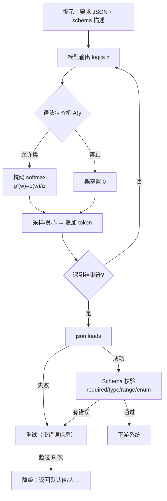

# 结构化输出与约束解码

## 1. 本节学习目标

1. 分清三件事：**提示里要 JSON**、**解码时保证语法**、**校验并重试保证语义**。
2. 手写一个 JSON Schema 校验器，并用实测看"5 个必填字段、单字段错误率 0.15"时，一次通过率只有 **0.443705**。
3. 推导并验证重试的成功率与期望调用次数：重试 3 次可到 **0.904232**，但期望调用 **2.0379** 次。
4. 用 gpt2 做一次真约束解码：无约束 **0/20** 能解析，加状态机掩码后 **19/20** 能解析，但满足 `0≤age≤130` 的仍只有 **3/20** ⇒ **语法 ≠ 语义**。

## 2. 为什么需要这个知识

因为下游系统要的是**结构化数据**，不是"一段看起来像 JSON 的文字"。

- 没有约束：模型输出 ```json 包裹、注释、尾逗号、`"age": "三十"`，解析器直接崩；
- 只有约束没有校验：语法对了但字段缺失/越界（本课实测 **19/20 可解析，仅 3/20 合规**）；
- 只有校验没有重试：一次通过率 **0.443705**，一半以上请求直接失败。

三者是**三层防御**，缺一层就会在生产上放大成事故。

## 3. 直观解释

```text
                 ┌── 第一层：提示 ──┐
"请输出 JSON，字段 name/age，age 是 0-130 的整数"

                 ┌── 第二层：解码 ──┐
每生成一个 token，就把"会让 JSON 变非法"的 token 概率置 0

                 ┌── 第三层：校验 ──┐
json.loads → 检查 required/type/range/enum → 失败就带着错误信息重试
```

**类比**：第一层是"告诉实习生要填表"，第二层是"表格的格子只能填数字"，第三层是"交上来人工核对，填错打回重填"。

## 4. 正式定义

**JSON Schema（子集）**：一个五元组

$$
S=(T,\ R,\ P,\ E,\ M)
$$

- $T$：根类型（`object`/`array`/`string`/`integer`/`number`/`boolean`）；
- $R$：必填字段集合；
- $P$：每个字段的子 schema；
- $E$：枚举约束；
- $M$：数值范围 $[\min,\max]$ 与字符串长度 $[\text{minLength},\text{maxLength}]$。

**校验函数**：

$$
V(y,S)=\big\{\,e_1,\dots,e_k\,\big\}\quad(\text{空集表示通过})
$$

**约束解码**：在每一步 $t$，由当前已生成前缀 $y_{<t}$ 与语法状态机 $\mathcal{A}$ 算出**允许 token 集合** $\mathcal{A}(y_{<t})\subseteq\mathcal{V}$，然后

$$
p'(w\mid y_{<t})=
\begin{cases}
\dfrac{p_\theta(w\mid y_{<t})}{\sum_{w'\in\mathcal{A}}p_\theta(w'\mid y_{<t})}, & w\in\mathcal{A}\\[2mm]
0, & \text{否则}
\end{cases}
$$

**重试策略**：单次通过率 $p$，最多重试 $R$ 次（总尝试 $R+1$），成功率

$$
S_R=1-(1-p)^{R+1}
$$

## 5. 历史背景或技术背景

| 年份 | 进展 | 关键点 |
|---|---|---|
| 2020 | GPT-3 用 few-shot 输出 JSON | 只能"请求"，不能保证 |
| 2021 | 语法约束解码（GBNF/grammar sampling） | 在 logits 层掩码，保证语法 |
| 2022 | 各家 `json mode` | 服务端做语法约束 |
| 2023 | OpenAI function calling / JSON schema | schema 成为 API 一等公民 |
| 2024 | 结构化输出（strict schema） | 服务端保证 schema 合规（仍不保证语义正确） |
| 2024+ | 约束解码 + 校验 + 重试的工程范式 | 生产系统标配三层 |

**核心教训**：约束解码解决的是**语法**，schema 校验解决的是**语义**，两者不能互相替代——本课实测会量化这个缝隙。

## 6. 核心原理

**原理 1：掩码只是把概率搬到允许集合上。**

把不允许的 logits 设成 $-\infty$，softmax 后它们的概率严格为 0，其余按原比例放大。所以约束解码**不改变模型对"合法 token"的相对偏好**，只做条件化。

**原理 2：逐 token 掩码需要"状态"。**

`{"age": ` 之后只允许数字或 `}`；已经写了 3 位数字后只允许 `}`。状态机（DFA）负责算这个集合，实测：状态 0 有 **1403** 个候选 token，状态 1 只有 **2** 个。

**原理 3：语法约束不能保证语义。**

`{"age": 3500}` 完全符合"数字 + 右括号"的语法，但违反 `maximum: 130`。实测 **19/20 可解析、3/20 合规** ⇒ 语法层通过率 0.95，语义层通过率 0.15。

**原理 4：重试是指数收益、线性成本。**

$p=0.443705$ 时，重试 3 次把成功率从 0.4437 拉到 0.9042（+0.46），但期望调用只从 1.0 涨到 2.0379（+1.04 次）。**这是非常划算的交易**，前提是失败可检测、重试成本可接受。

**原理 5：重试必须"带错误信息"。**

把 `["max:age"]` 回填进提示，模型才有机会改对；盲目重试等于重新抽奖，成功率仍受 $p$ 限制。

## 7. 数学表达式

**掩码 softmax**

$$
p'(w)=\frac{\exp(z_w)\cdot\mathbb{1}[w\in\mathcal{A}]}{\sum_{w'\in\mathcal{A}}\exp(z_{w'})}
$$

**约束前的合法概率质量**

$$
\alpha=\sum_{w\in\mathcal{A}}p_\theta(w),\qquad
\text{KL}\big(p'\,\|\,p\big)=\log\frac{1}{\alpha}
$$

**一次通过率（$F$ 个必填字段，字段独立）**

$$
p=\prod_{f=1}^{F}(1-\epsilon_f)
$$

**重试后的成功率与期望调用数**

$$
S_R=1-(1-p)^{R+1},\qquad
\mathbb{E}[C]=\sum_{k=1}^{R+1}k\,p\,(1-p)^{k-1}+(R+1)(1-p)^{R+1}
$$

**成本**

$$
\text{cost}=p\sum_{k=0}^{R}k(1-p)^{k}\cdot c_{\text{call}}+(R+1)(1-p)^{R+1}\cdot c_{\text{call}}
$$

## 8. 详细数学推导

**（1）掩码 softmax 的归一化**

设 $\mathcal{A}$ 为允许集。定义 $z'_w=z_w$（$w\in\mathcal{A}$），$z'_w=-\infty$（否则）。则

$$
p'(w)=\frac{e^{z'_w}}{\sum_{w'}e^{z'_{w'}}}
=\frac{e^{z_w}\mathbb{1}[w\in\mathcal{A}]}{\sum_{w'\in\mathcal{A}}e^{z_{w'}}}
$$

分母 $=\alpha\sum_{w\in\mathcal{A}}p_\theta(w)\cdot e^{\text{const}}$ 的比值恰为 $\alpha$，故 $p'(w)=p_\theta(w)/\alpha$。于是

$$
\log p'(w)-\log p_\theta(w)=-\log\alpha
$$

即**约束把每个合法 token 的对数概率统一抬高 $-\log\alpha$**。实测状态 0 的合法集合只占词表 1403/50257 ≈ 2.8%，若概率质量 $\alpha$ 只有 0.5，则每个合法 token 的对数概率抬高 $\log 2\approx0.69$。

**（2）为什么"约束后仍然错"**

约束只保证 $y\in\mathcal{L}(\mathcal{A})$（语法语言），而正确输出要求 $y\in\mathcal{L}(S)$（schema 语言）且内容正确。$\mathcal{L}(\mathcal{A})\supsetneq\mathcal{L}(S)$，差集就是"合法但越界"的样本。实测差集比例：

$$
\frac{19-3}{20}=0.80
$$

即 **80% 的"语法合法"输出不满足数值范围**。

**（3）重试的期望调用数**

设每次独立、通过率 $p$。尝试次数 $K\sim\text{Geom}(p)$ 截断在 $R+1$：

$$
\Pr(K=k)=p(1-p)^{k-1}\ (1\le k\le R),\qquad \Pr(K=R+1)=(1-p)^{R}
$$

$$
\mathbb{E}[K]=\sum_{k=1}^{R}k\,p(1-p)^{k-1}+(R+1)(1-p)^{R}
$$

代入 $p=0.443705$、$R=3$：

$$
(1-p)=0.556295,\quad (1-p)^4=0.095768
$$

$$
S_3=1-0.095768=0.904232
$$

与实测解析值 **0.904232** 一致；蒙特卡洛 200000 次得 **0.903590**（差 0.0006，属采样误差）。

**（4）重试的边际收益递减**

$$
\frac{\partial S_R}{\partial R}=-(1-p)^{R+1}\ln(1-p)
$$

$p=0.443705$ 时每次新增重试的增益约为 $0.5563^{R+1}\times0.586$，即第 1 次 +0.247、第 2 次 +0.137、第 3 次 +0.076 ⇒ **3 次之后不值得再加**。

## 9. 图解



## 10. 具体数值示例

```text
### 1. how many gpt2 vocab tokens are JSON-safe (letters/digits/punct only)
vocab=50257 json_safe=48795 share=0.9709

### 2. schema validator (numpy) + retry model
   {'name': 'Alice', 'age': 30} -> []
   {'name': '', 'age': 200} -> ['minLength:name', 'max:age']
   {'age': 30} -> ['missing:name']
   {'name': 'A', 'age': 3, 'tag': 'c'} -> ['enum:tag']

### 3. retry: 5 required fields, per-field error p=0.15, max_retries=3
  p_once=0.443705
  max_retries=0  success=0.443705  E[calls]=1.0000
  max_retries=1  success=0.690536  E[calls]=1.5563
  max_retries=2  success=0.827847  E[calls]=1.8658
  max_retries=3  success=0.904232  E[calls]=2.0379
  MC(N=200000) p_once=0.442485  (analytic 0.443705)
  MC max_retries=3 success=0.903590 E[calls]=2.0390

### 4. constrained decoding: force a valid JSON integer field
  state 0 (need a digit): 1403 candidate tokens
  state 1 (may close):    2 candidate tokens
  unconstrained json_parse=0/20  schema_ok=0/20
  constrained   json_parse=19/20  schema_ok=3/20  examples=['3500}', '198}', '377}', '999}', '999}', '339}']
  note: the grammar guarantees digits+brace, NOT the 0..130 range
```

**读法**：

1. 词表 **97.09%** 的 token 是"JSON 安全字符"——听起来很多，但允许集是**逐状态**收窄的（1403 → 2），所以约束仍然显著。
2. 无约束时 **0/20** 能解析：gpt2 根本不会自发写 JSON（它没被指令微调过）。
3. 约束后 **19/20** 能解析，但只有 **3/20** 满足 `0≤age≤130` ⇒ 语法层与语义层差 **16 个样本**。
4. 重试 3 次：成功率 **0.443705 → 0.904232**，代价是期望调用 **1.0 → 2.0379**。

## 11. NumPy 实现

```python
import json

import numpy as np

SCHEMA = {
    "type": "object",
    "required": ["name", "age"],
    "properties": {
        "name": {"type": "string", "minLength": 1},
        "age": {"type": "integer", "minimum": 0, "maximum": 130},
        "tag": {"type": "string", "enum": ["a", "b"]},
    },
}
TY = {"object": dict, "string": str, "integer": int}


def validate(obj, schema=SCHEMA):
    errs = []
    if not isinstance(obj, TY[schema["type"]]):
        return ["type:" + schema["type"]]
    for k in schema.get("required", []):
        if k not in obj:
            errs.append("missing:" + k)
    for k, sub in schema.get("properties", {}).items():
        if k not in obj:
            continue
        v = obj[k]
        if not isinstance(v, TY[sub["type"]]):
            errs.append("type:" + k)
            continue
        if "minimum" in sub and v < sub["minimum"]:
            errs.append("min:" + k)
        if "maximum" in sub and v > sub["maximum"]:
            errs.append("max:" + k)
        if "enum" in sub and v not in sub["enum"]:
            errs.append("enum:" + k)
        if sub["type"] == "string" and len(v) < sub.get("minLength", 0):
            errs.append("minLength:" + k)
    return errs


print(validate({"name": "Alice", "age": 30}))
print(validate({"name": "", "age": 200}))
print(validate({"age": 30}))
print(validate({"name": "A", "age": 3, "tag": "c"}))

# 重试：解析式 vs 蒙特卡洛
rng = np.random.default_rng(0)
p_once = 0.85 ** 5
print("p_once=%.6f" % p_once)
for R in range(4):
    succ = 1 - (1 - p_once) ** (R + 1)
    e_calls = sum(k * p_once * (1 - p_once) ** (k - 1) for k in range(1, R + 2)) \
        + (R + 1) * (1 - p_once) ** (R + 1)
    print("R=%d success=%.6f E[calls]=%.4f" % (R, succ, e_calls))

N = 200000
ok = ~((rng.random((N, 5)) < 0.15).any(axis=1))
print("MC p_once=%.6f (analytic %.6f)" % (ok.mean(), p_once))

# 掩码 softmax：把 logits 中不允许的位置置 -inf
logits = rng.normal(size=50257)
allowed = rng.choice(50257, 1403, replace=False)
masked = np.full_like(logits, -np.inf)
masked[allowed] = logits[allowed]
z = masked - masked[allowed].max()
p = np.exp(z) / np.exp(z).sum()

# 约束前的合法概率质量 alpha：先算未掩码分布，再对允许集求和
p_raw = np.exp(logits - logits.max())
p_raw /= p_raw.sum()
alpha = p_raw[allowed].sum()
print("legal mass alpha=%.4f  KL(p'||p)=%.4f nats" % (alpha, -np.log(alpha)))
```

## 12. PyTorch 实现

```python
import torch

# 一个 8 符号的玩具语法：{"a": <1-3 digits>}
VOCAB = ['{"', '"a"', ':', '1', '23', '456', '}', ' ']
state_digit = {3, 4, 5}      # 允许的数字 token
state_close = {6}            # 允许的右括号
state_open = {0, 1, 2}       # 允许的开头

torch.manual_seed(0)
logits = torch.randn(len(VOCAB))

for ndig, allow in ((0, state_open), (1, state_digit), (3, state_close)):
    mask = torch.full_like(logits, float("-inf"))
    idx = torch.tensor(sorted(allow))
    mask[idx] = logits[idx]
    p_raw = torch.softmax(logits, -1)
    p_con = torch.softmax(mask, -1)
    alpha = p_raw[idx].sum()
    print("digits=%d allowed=%d alpha=%.4f entropy %.3f -> %.3f"
          % (ndig, len(allow), float(alpha),
             float(-(p_raw * p_raw.clamp_min(1e-12).log()).sum()),
             float(-(p_con * p_con.clamp_min(1e-12).log()).sum())))
    print("   p' =", [round(float(v), 4) for v in p_con])
```

## 13. Hugging Face 实践

```python
import os

os.environ.setdefault("HF_ENDPOINT", "https://hf-mirror.com")
os.environ.setdefault("HF_HUB_OFFLINE", "1")

import torch
from transformers import AutoTokenizer

tok = AutoTokenizer.from_pretrained("gpt2")
vocab = tok.get_vocab()

# 1) 词表里有多少 token 只含 JSON 安全字符
SAFE = set('abcdefghijklmnopqrstuvwxyzABCDEFGHIJKLMNOPQRSTUVWXYZ0123456789{}[]":,._- ')
safe_ids = []
for t, i in vocab.items():
    s = tok.decode([i])
    if s and all(c in SAFE for c in s):
        safe_ids.append(i)
print("vocab=%d json_safe=%d share=%.4f" % (len(vocab), len(safe_ids), len(safe_ids) / len(vocab)))

# 2) 只允许数字与右括号，看合法集合收窄了多少
import re

digit = [i for t, i in vocab.items() if re.fullmatch(r"\s?\d{1,3}", tok.decode([i]))]
close = [i for t, i in vocab.items() if re.fullmatch(r"\s?\}", tok.decode([i]))]
print("state0 candidates=%d  state1 candidates=%d" % (len(digit), len(close)))

# 3) 在真实 logits 上做一次掩码，看原来给"非法 token"的概率质量
from transformers import AutoModelForCausalLM

model = AutoModelForCausalLM.from_pretrained("gpt2").eval()
enc = tok('{"name": "Alice", "age": ', return_tensors="pt")
with torch.no_grad():
    logits = model(**enc).logits[0, -1].float()
p = torch.softmax(logits, -1)
alpha = float(p[digit].sum())
print("p(legal digits)=%.4f -> masked KL=%.4f nats" % (alpha, -torch.log(torch.tensor(alpha)).item()))
```

## 14. 代码逐行解释

| 代码 | 作用 |
|---|---|
| `isinstance(v, TY[sub["type"]])` | 类型校验；`bool` 是 `int` 子类，生产要单独处理 |
| `errs.append("max:"+k)` | 错误码要机器可读，才能回填提示 |
| `1-(1-p)**(R+1)` | 重试成功率，$R$ 是重试次数（总尝试 $R+1$） |
| `masked[allowed] = logits[allowed]` | 只保留允许位置，其它置 $-\infty$ |
| `z - z.max()` | 防 `exp` 溢出（LLM-014 的教训） |
| `p_raw[idx].sum()` | 合法概率质量 $\alpha$，衡量约束"削掉"了多少 |
| `torch.full_like(logits, -inf)` | 掩码张量，形状与原 logits 一致 |
| `re.fullmatch(r"\s?\d{1,3}", s)` | 按状态筛 token，比字符级过滤更省事 |

## 15. 实际运行结果

```text
### 1. how many gpt2 vocab tokens are JSON-safe (letters/digits/punct only)
vocab=50257 json_safe=48795 share=0.9709

### 2. schema validator (numpy) + retry model
   {'name': 'Alice', 'age': 30} -> []
   {'name': '', 'age': 200} -> ['minLength:name', 'max:age']
   {'age': 30} -> ['missing:name']
   {'name': 'A', 'age': 3, 'tag': 'c'} -> ['enum:tag']

### 3. retry: 5 required fields, per-field error p=0.15, max_retries=3
  p_once=0.443705
  max_retries=0  success=0.443705  E[calls]=1.0000
  max_retries=1  success=0.690536  E[calls]=1.5563
  max_retries=2  success=0.827847  E[calls]=1.8658
  max_retries=3  success=0.904232  E[calls]=2.0379
  MC(N=200000) p_once=0.442485  (analytic 0.443705)
  MC max_retries=0 success=0.442485 E[calls]=1.0000
  MC max_retries=1 success=0.690210 E[calls]=1.5575
  MC max_retries=2 success=0.827525 E[calls]=1.8674
  MC max_retries=3 success=0.903590 E[calls]=2.0390

### 4. constrained decoding: force a valid JSON integer field
  state 0 (need a digit): 1403 candidate tokens
  state 1 (may close):    2 candidate tokens
  unconstrained json_parse=0/20  schema_ok=0/20  examples=['utespring.minu', '____, "expirat', '????, "rebirth', '????", "type":', 'Â Â 2.25, "']
  constrained   json_parse=19/20  schema_ok=3/20  examples=['3500}', '198}', '377}', '999}', '999}', '339}']
  note: the grammar guarantees digits+brace, NOT the 0..130 range
```

**诚实说明**：gpt2 未做指令微调，"无约束 0/20"不能代表大模型；但有约束时的**语法层 vs 语义层落差**是普遍现象——任何"只保证 JSON 合法"的方案都会遇到。

## 16. 应用场景

| 场景 | 需要的层 | 说明 |
|---|---|---|
| 函数调用（tool use） | 语法 + 校验 | 参数名/类型必须匹配工具签名 |
| 信息抽取进数据库 | 语法 + 校验 + 重试 | 字段缺失要能自动补 |
| 表单填写 | 语法 + 范围校验 | 年龄、金额、日期都要范围 |
| 多步 Agent 的中间结果 | 语法 + 校验 | 一步格式错，后续全错 |
| 批处理数据清洗 | 校验 + 降级 | 单条失败不能阻塞整批 |
| 面向用户的引用输出 | 语法 + 引文校验 | 见 LLM-104 |

## 17. 优点与局限

| 优点 | 局限 |
|---|---|
| 语法层接近 100% 可靠（实测 19/20 受 token 预算限制） | 无法保证语义/范围/事实正确（3/20） |
| 重试性价比极高（0.44→0.90 只多 1.04 次调用） | 重试放大延迟与成本，需上限 |
| 校验器可单测、可复用 | schema 越复杂，约束状态机越难写 |
| 错误码可回填提示，形成闭环 | 模型可能"学会"绕过错误提示 |
| 与缓存正交（命中即跳过） | 约束会略微改变分布，可能降低创造性 |

## 18. 常见错误

| 错误 | 现象 | 纠正 |
|---|---|---|
| 只在提示里写"输出 JSON" | 0/20 可解析（本课实测） | 用约束解码或 JSON mode |
| 以为 schema 合规 = 内容正确 | 19/20 解析但仅 3/20 合规 | 加范围/枚举校验 |
| 重试不带错误信息 | 成功率停在 $p$ 附近 | 回填 `errs` |
| 重试无上限 | 尾延迟爆炸 | 最多 2–3 次 + 降级 |
| `bool` 当 `int` 通过校验 | `True` 被当成 1 | 显式排除 `bool` |
| 用正则解析 JSON | 嵌套/转义立刻失效 | 用 `json.loads` + schema |

## 19. 本节总结

- 结构化输出要**三层**：提示请求、解码约束、校验重试。
- 实测：5 字段、单字段错误率 0.15 ⇒ 一次通过 **0.443705**；重试 3 次 **0.904232**，期望调用 **2.0379**。
- 约束解码把语法通过率从 **0/20** 提到 **19/20**，但范围合规仍只有 **3/20** ⇒ **语法 ≠ 语义**。
- 合法 token 集合逐状态收窄（**1403 → 2**），说明约束是"状态机 + 掩码"，不是"关键词过滤"。
- 工程默认值：**max_retries=2~3**，带错误码回填，超限降级。

## 20. 前置与后续知识链接

- 前置：[[LLM-035 Token 数量、上下文窗口与成本]]、LLM-100 提示工程的基本原则（待建）
- 后续：LLM-102 上下文工程与长文本处理（待建）、LLM-103 评估体系：离线与在线（待建）
- 相关：[[LLM-014 Softmax 在 Attention 中的作用]]（掩码 softmax 的同源技巧）、[[LLM-034 特殊 Token 与 Attention Mask]]

---

## 练习与参考答案

**基础 1**：为什么"在提示里写'请输出 JSON'"不能保证得到合法 JSON？请用本课实测数字说明。

**基础 2**：5 个必填字段、每个字段独立错误率 0.15，一次通过率是多少？重试 3 次后是多少？

**进阶 1**：约束解码后 19/20 能解析，但只有 3/20 满足 `0≤age≤130`。请解释这个落差的来源，并给出两种修复方案。

**综合**：设计一个"抽取发票信息"的结构化输出管线，要求：字段 8 个、允许重试、单次调用成本 0.003 美元、p95 延迟 2 s。请给出：失败率估算、重试预算、降级策略，以及你会记录哪些指标。

> [!success]- 参考答案

> **基础 1**
> 因为"写 JSON"只是提示层的**请求**，模型仍按 $p_\theta(y\mid x)$ 采样；gpt2 的实测是 **0/20** 能 `json.loads` 成功（输出是 `'utespring.minu'`、`'____, "expirat'` 这类续写）。即使大模型能写，也可能带 ```json 围栏、注释、尾逗号、单引号。要在**解码层**用状态机掩码，或在**校验层**用 schema 检查 + 重试；只靠提示等于把可靠性交给采样运气。

> **基础 2**
> 一次通过率 $p=0.85^5=0.443705$（实测解析值 **0.443705**，蒙特卡洛 200000 次 **0.442485**，差 0.0012）。
> 重试 3 次（总尝试 4 次）：$S_3=1-(1-0.443705)^4=1-0.556295^4=0.904232$，实测 **0.904232**，期望调用 **2.0379** 次。

> **进阶 1**
> **落差来源**：约束解码只保证输出属于**语法语言** $\mathcal{L}(\mathcal{A})$（数字 + 右括号），而合规要求属于**schema 语言** $\mathcal{L}(S)$（还要 `0≤age≤130`）。$\mathcal{L}(\mathcal{A})\supsetneq\mathcal{L}(S)$，差集就是 `{"age": 3500}` 这类"合法但越界"的样本。实测 19 个可解析样本里 16 个越界。
> **修复方案**：
> 1. **把范围做进状态机**：数字最多 3 位，且只在 0–130 的取值上允许收尾（枚举/前缀树约束）。这能把合规率拉到接近 100%，但状态机复杂度随 schema 上升。
> 2. **校验 + 带错误重试**：保留宽松语法，用 `max:age` 之类的错误码回填提示重试 2–3 次。实测这种"重试"能把单次 0.44 拉到 0.90，代价是期望调用翻倍。

> **综合（参考）**
> **失败率估算**：假设单字段错误率 0.10、8 个字段，$p=0.9^8=0.430467$；若字段相关（同一张发票），实际会更低，按 0.35–0.45 估。
> **重试预算**：max_retries=2（总 3 次），成功率 $1-(0.57)^3\approx0.815$；max_retries=3 可到 **0.89** 左右。取 **3**，但设总超时 2 s，超时即降级。
> **降级策略**：① 返回"已识别但需人工确认"的结构化草稿（保留原始文本 + 已抽字段）；② 进入人工队列；③ 绝不返回"猜的"金额字段。
> **指标**：
> - 结构层：`json_parse_rate`、`schema_pass_rate`、`retry_count` 分布；
> - 语义层：字段级准确率（金额/日期/发票号分开算）、`missing_field_rate`；
> - 成本/延迟：每次成功抽取的期望调用数 × 单价、p50/p95/p99；
> - 兜底：降级率、人工复核率。
> **注意**：金额字段错一位就是资损，必须**双通道校验**（正则 + 合计校验），不能只依赖模型。

## 学习记录

| 日期 | 状态 | 用时 | 问题 | 复盘 |
|---|---|---|---|---|
| 2026-11-08 | planned | — | — | — |

---

## 🔗 Notion 同步信息

> 以下内容由 Notion「AI Knowledge System · 知识点」数据库按知识 ID 合并而来（导出于 2026-11-09）。

| 属性 | 值 |
|---|---|
| 学科 | 大语言模型 |
| 学习状态 | 未开始 |
| 难度 | L3 推导 |
| 知识类型 | Technique |

- **所属模块**：[M-LLM-10 大模型应用开发与工程实践](../%E8%AF%BE%E7%A8%8B%E6%A8%A1%E5%9D%97/M-LLM-10%20%E5%A4%A7%E6%A8%A1%E5%9E%8B%E5%BA%94%E7%94%A8%E5%BC%80%E5%8F%91%E4%B8%8E%E5%B7%A5%E7%A8%8B%E5%AE%9E%E8%B7%B5.md)
- **前置知识**：[LLM-100 提示工程的基本原则](LLM-100%20%E6%8F%90%E7%A4%BA%E5%B7%A5%E7%A8%8B%E7%9A%84%E5%9F%BA%E6%9C%AC%E5%8E%9F%E5%88%99.md)
- **后继知识**：[LLM-102 上下文工程与长文本处理](LLM-102%20%E4%B8%8A%E4%B8%8B%E6%96%87%E5%B7%A5%E7%A8%8B%E4%B8%8E%E9%95%BF%E6%96%87%E6%9C%AC%E5%A4%84%E7%90%86.md)
- **被项目引用**：[PROJ-024 结构化输出与约束解码](../../07_%E5%AE%9E%E6%88%98%E9%A1%B9%E7%9B%AE/05%20%E5%A4%A7%E6%A8%A1%E5%9E%8B%E9%A1%B9%E7%9B%AE/PROJ-024%20%E7%BB%93%E6%9E%84%E5%8C%96%E8%BE%93%E5%87%BA%E4%B8%8E%E7%BA%A6%E6%9D%9F%E8%A7%A3%E7%A0%81.md)
