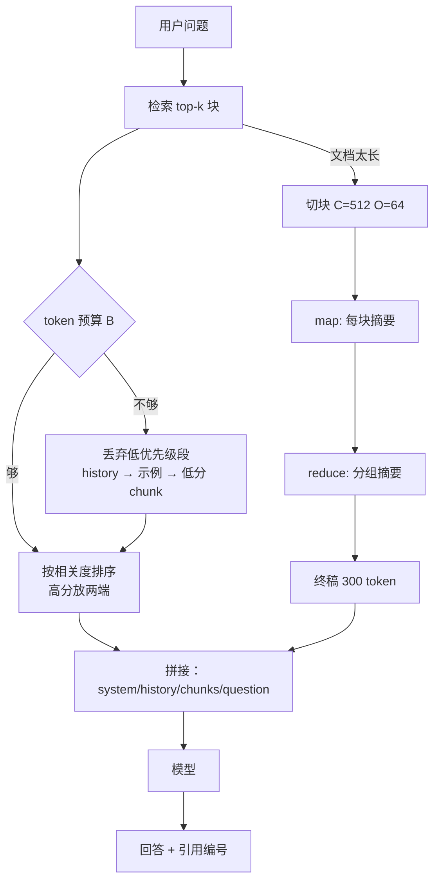

# 上下文工程与长文本处理

## 1. 本节学习目标

1. 把"写提示"升级为"管理一个有限的 token 预算"：**装什么、装多少、丢什么**。
2. 用 gpt2 tokenizer 实测一个 RAG 提示的**分段占比**：system 10.0%、history 12.9%、三个 chunk 各 24.6%、question 3.2%。
3. 算清长文本两条路线的成本：**切块（chunk）** 的膨胀率 **1.152 倍**，**map-reduce 摘要** 的总开销 **1.56 倍**但最终提示压到 **300 token（102.4 倍压缩）**。
4. 知道中文的 token 代价：同样内容英文 **69** token、中文 **227** token，**3.29 倍**。

## 2. 为什么需要这个知识

模型能力再强，也只能看见**窗口里的东西**。窗口是硬预算：

- 装太多：成本线性涨、延迟涨、"中间内容被忽略"（lost in the middle）；
- 装太少：答不出来，或者答错（比答不出更糟）；
- 装错顺序：关键信息被埋在 8000 token 的中间，模型看不见。

**上下文工程**就是在这个预算下做**优先级分配**——它比"把提示写漂亮"更接近真实的工程问题。

## 3. 直观解释

```text
上下文窗口 = 一张固定大小的桌子

  必须放：问题、当前轮对话
  应该放：检索到的证据（但要挑最相关的 3 条）
  可以放：历史、示例、格式说明
  不能放：整本手册（放不下，也没人看）

装不下时，先扔"可以放"的那摞。
```

**长文本的三条路**：

| 路线 | 做法 | 代价 |
|---|---|---|
| 硬塞 | 全部塞进窗口 | 超窗/成本/中间遗忘 |
| 切块 | 切小片，按需检索 | 膨胀 1.15 倍，可能切断语义 |
| 摘要 | 先摘要再喂 | 多一轮调用，信息有损 |

## 4. 正式定义

**上下文（context）** 是一个有序的段列表，每段有优先级与 token 数：

$$
\mathcal{C}=\big[(s_1,w_1,p_1),\dots,(s_m,w_m,p_m)\big],\qquad
n_i=\text{tok}(s_i)
$$

其中 $w_i$ 是文本、$p_i$ 是优先级（越小越重要）。

**预算约束**：

$$
\sum_{i\in\text{kept}} n_i \le B,\qquad
\text{kept}=\text{TopK}\big(\{i\}\mid \text{按 }p_i\text{ 升序装填}\big)
$$

**切块（chunking）**：块长 $C$、重叠 $O$、步长 $D=C-O$，文档 token 数 $N$：

$$
K=\left\lceil\frac{N-C}{D}\right\rceil+1,\qquad
\text{总 token}=K\cdot C
$$

**膨胀率**：

$$
\rho=\frac{K\cdot C}{N}\ \xrightarrow[N\gg C]{}\ \frac{C}{D}=\frac{C}{C-O}
$$

**map-reduce 摘要成本**（$K$ 块、每块摘要 $s$ token、每组 $g$ 块、组摘要 $s_g$、终稿 $s_f$）：

$$
\text{cost}_{\text{map}}=K(C+s),\quad
\text{cost}_{\text{reduce}}=\Big\lceil\frac{K}{g}\Big\rceil(gs+s_g),\quad
\text{cost}_{\text{final}}=\Big\lceil\frac{K}{g}\Big\rceil s_g+s_f
$$

## 5. 历史背景或技术背景

| 年份 | 进展 | 上下文含义的变化 |
|---|---|---|
| 2017 | Transformer | 窗口 = 512，注意力 $O(n^2)$ |
| 2018–2019 | BERT/GPT-2 | 512 / 1024，长文靠截断 |
| 2020 | RAG 提出 | 上下文 = "检索到的段落"，不再是全文 |
| 2022 | 长上下文模型（4k→32k） | 开始"能塞"，但中间遗忘被观察到 |
| 2023 | "Lost in the Middle" 论文 | **位置**本身影响利用率 |
| 2023 | 长文摘要管线（map-reduce / refine） | 摘要成为压缩上下文的标准手段 |
| 2024 | 上下文工程（context engineering）一词流行 | 关注"窗口里放什么"而非"句子怎么写" |

**关键认识**：窗口变大不等于问题消失。窗口从 4k 到 128k，成本线性涨、有效利用率却没线性涨——**选择比容量更重要**。

## 6. 核心原理

**原理 1：预算按"边际收益"分配，不按"平均"分配。**

问题与当前轮对话是**必需**（没有它们任务不成立）；检索证据是**高价值**；示例与历史是**可压缩**。实测占比里，三个 chunk 吃掉 **73.8%** 的预算（$3\times0.246$），这正是应该被"检索质量"优化的地方。

**原理 2：切块必然膨胀。**

$C=512,O=64$ 时理论膨胀 $512/448=1.1429$，实测 **1.152**（因块数向上取整）。重叠的作用是"防止关键句被切断"，代价是**每多 1 token 重叠，就多花 $1/D$ 的成本**。

**原理 3：摘要是"用钱换窗口"。**

map-reduce 总开销是原文的 **1.56 倍**，但最终提示只有 **300 token**——把"每次都要读 30720 token"变成"每次读 300 token"。**一次性摘要成本 vs 长期每次调用成本**，这是典型的 amortization（摊销）。

**原理 4：顺序即信息。**

把最相关的证据放在**开头或结尾**，比放在中间更容易被用上（lost in the middle）。工程上：证据按相关度排序后，**高分放两端**。

**原理 5：中文更贵。**

同义内容英文 **69** token、中文 **227** token（**3.29 倍**）。同样是 8k 窗口，中文能装的信息量约为英文的 30%。

## 7. 数学表达式

**预算占用率**

$$
u_i=\frac{n_i}{\sum_j n_j},\qquad \sum_i u_i=1
$$

**每千次调用成本**

$$
\text{cost}_{1k}=1000\cdot\Big(n_{\text{in}}c_{\text{in}}+n_{\text{out}}c_{\text{out}}\Big)
$$

**切块数**

$$
K=\Big\lceil\frac{N-C}{C-O}\Big\rceil+1
$$

**重叠的边际成本**

$$
\frac{\partial \rho}{\partial O}=\frac{C}{(C-O)^2}>0
$$

**map-reduce 相对开销**

$$
\gamma=\frac{\text{cost}_{\text{map}}+\text{cost}_{\text{reduce}}+\text{cost}_{\text{final}}}{K\cdot C}
$$

**压缩比**

$$
\kappa=\frac{K\cdot C}{s_f}
$$

## 8. 详细数学推导

**（1）膨胀率极限**

$K\approx (N-C)/(C-O)+1$，故

$$
\rho=\frac{KC}{N}\approx\frac{C}{N}\Big(\frac{N-C}{C-O}+1\Big)
=\frac{C}{C-O}\Big(1-\frac{C}{N}\Big)+\frac{C}{N}
$$

当 $N\gg C$ 时 $\rho\to C/(C-O)$。代入 $C=512,O=64$：$512/448=1.142857$。实测 $N=24000$ 时 **1.152**，比极限高 0.009，正是 $\frac{C}{N}$ 项与向上取整的贡献。

**（2）为什么重叠不能太大**

若 $O\to C$，则 $D\to0$，$K\to\infty$，成本爆炸。取 $O=C/2$ 时 $\rho\to2$（成本翻倍）；取 $O=C/8$ 时 $\rho\to1.143$。**经验区间：重叠 10%–20%**。

**（3）分段占比与"该优化谁"**

实测总 280 token：

$$
u_{\text{system}}=0.100,\ u_{\text{hist}}=0.129,\ u_{\text{chunk}}=3\times0.246,\ u_{\text{q}}=0.032
$$

敏感度：若把 3 个 chunk 换成 2 个，省 $0.246\times280\approx69$ token（**-24.6%** 成本）；若把 system 从 28 压到 14，只省 **5%**。⇒ **优化要打大头**。

**（4）map-reduce 的成本核算**

$K=60,C=512,s=120,g=10,s_g=200,s_f=300$：

$$
\text{cost}_{\text{map}}=60\times(512+120)=37920
$$

$$
\text{cost}_{\text{reduce}}=6\times(10\times120+200)=8400
$$

$$
\text{cost}_{\text{final}}=6\times200+300=1500
$$

$$
\text{total}=47820,\qquad \gamma=\frac{47820}{60\times512}=1.557
$$

而最终提示仅 $s_f=300$ token，压缩比 $\kappa=30720/300=102.4$。

**（5）摊销判据**

设每天 $Q$ 次查询、缓存/摘要有效期 $T$ 天。摘要方案划算当且仅当

$$
\text{cost}_{\text{summary}}+Q\,T\,c(300)<Q\,T\,c(30720)
$$

$c(n)=n\cdot c_{\text{in}}$，$c_{\text{in}}=3/10^6$：

左边 $=47820c_{\text{in}}+QT\cdot300c_{\text{in}}$，右边 $=QT\cdot30720c_{\text{in}}$。约去 $c_{\text{in}}$：

$$
47820+300QT<30720QT\ \Longrightarrow\ QT>1.57
$$

即**只要文档被查询 2 次以上，摘要就回本**——这是把长文预处理成摘要的最强论据。

## 9. 图解



## 10. 具体数值示例

```text
### 1. prompt token accounting (gpt2 BPE)
  system    tokens=  28  share=0.100
  history   tokens=  36  share=0.129
  chunk1    tokens=  69  share=0.246
  chunk2    tokens=  69  share=0.246
  chunk3    tokens=  69  share=0.246
  question  tokens=   9  share=0.032
  TOTAL     tokens= 280
  cost@$3/M input = $0.000840 per call, 10k calls/day = $8.40/day

### 2. same content in Chinese vs English
  EN chunk tokens=69 | ZH chunk tokens=227 | ratio=3.29

### 3. chunking a long document: chunk=512 overlap=64
  doc_tokens=24000 chunks=54 total_chunk_tokens=27648 inflation=1.152x
  full-context (if window allowed) = 24000 tokens

### 4. map-reduce summarization over 60 chunks
  map=37920  reduce=8400  final=1500  TOTAL=47820
  vs full context 30720 tokens -> 1.56x
  final prompt only 300 tokens -> compression 102.4x vs 30720

### 5. citation markers cost
  sentences=20 marker_tokens=40 = 7.8% of a 512-token chunk
```

**读法**：

1. 三个 chunk 占 **73.8%** 预算 ⇒ 检索的 top-k 是成本旋钮，比改 system 提示有效得多。
2. 中文 3.29 倍 ⇒ 中文场景的"有效窗口"只有英文的 **30%**，切块大小要同比缩小。
3. 切块膨胀 **1.152 倍**：24000 token 的文档变成 27648 token 的索引——**索引本身要花钱**。
4. map-reduce 花 **1.56 倍**的一次性成本，换来最终提示 **102.4 倍**压缩 ⇒ 摊销 **1.57 次查询**回本。
5. 引用标记只占 **7.8%**，是"便宜的可验证性"，不该省。

## 11. NumPy 实现

```python
import numpy as np

# 1) 分段预算：按优先级装填，超预算丢低优先级
sections = [
    ("question", 9, 0),
    ("system", 28, 1),
    ("chunk_high", 69, 2),
    ("chunk_mid", 69, 3),
    ("chunk_low", 69, 4),
    ("history", 36, 5),
    ("examples", 120, 6),
]
BUDGET = 280


def pack(secs, budget):
    kept, used = [], 0
    for name, n, prio in sorted(secs, key=lambda x: x[2]):
        if used + n <= budget:
            kept.append(name)
            used += n
    return kept, used


kept, used = pack(sections, BUDGET)
print("kept:", kept, "used=%d/%d" % (used, BUDGET))

# 2) 切块计划
def chunk_plan(N, C, O):
    K = int(np.ceil((N - C) / (C - O))) + 1
    return K, K * C, K * C / N


for C, O in ((512, 0), (512, 64), (512, 128), (256, 32)):
    K, tot, rho = chunk_plan(24000, C, O)
    print("C=%3d O=%3d -> K=%3d total=%5d inflation=%.3f (limit %.3f)"
          % (C, O, K, tot, rho, C / (C - O)))

# 3) map-reduce 成本
K, C, s, g, sg, sf = 60, 512, 120, 10, 200, 300
mp = K * (C + s)
rd = int(np.ceil(K / g)) * (g * s + sg)
fn = int(np.ceil(K / g)) * sg + sf
tot = mp + rd + fn
print("map=%d reduce=%d final=%d total=%d gamma=%.3f kappa=%.1f"
      % (mp, rd, fn, tot, tot / (K * C), K * C / sf))

# 4) 摊销：摘要方案从第几次查询开始回本
c_in = 3.0 / 1e6
q = np.arange(1, 6)
with_sum = tot * c_in + q * sf * c_in
without = q * K * C * c_in
for i, n in enumerate(q):
    print("queries=%d  summary=$%.6f  full=$%.6f  cheaper=%s"
          % (n, with_sum[i], without[i], with_sum[i] < without[i]))

# 5) 中文 vs 英文的有效窗口
print("8k window: EN ~%d chars, ZH ~%d chars" % (8192 * 4.4, 8192 * 0.44))
```

## 12. PyTorch 实现

```python
import torch

# 把多段上下文拼成定长张量：超预算按优先级丢段，并生成 attention mask
torch.manual_seed(0)
SEGS = [
    ("question", 9, 0),
    ("system", 28, 1),
    ("chunk_high", 69, 2),
    ("chunk_mid", 69, 3),
    ("chunk_low", 69, 4),
    ("history", 36, 5),
]
BUDGET = 200


def build_batch(segs, budget, vocab=1000):
    kept = [s for s in sorted(segs, key=lambda x: x[2])]
    ids, used, taken = [], 0, []
    for name, n, _ in kept:
        if used + n > budget:
            continue
        ids.append(torch.randint(0, vocab, (n,)))
        used += n
        taken.append(name)
    flat = torch.cat(ids)
    return flat.unsqueeze(0), torch.ones(1, flat.numel(), dtype=torch.long), taken


ids, mask, taken = build_batch(SEGS, BUDGET)
print("kept:", taken)
print("shape:", tuple(ids.shape), "mask_sum:", int(mask.sum()))
print("utilization: %.3f" % (ids.shape[1] / BUDGET))

# 位置对注意力的影响：给"中间"位置加惩罚，看预算如何被重新分配
T = ids.shape[1]
pos = torch.arange(T).float()
mid_penalty = torch.exp(-((pos - T / 2) ** 2) / (2 * (T / 6) ** 2))
print("middle penalty: head=%.3f mid=%.3f tail=%.3f"
      % (float(mid_penalty[0]), float(mid_penalty[T // 2]), float(mid_penalty[-1])))
```

## 13. Hugging Face 实践

```python
import os

os.environ.setdefault("HF_ENDPOINT", "https://hf-mirror.com")
os.environ.setdefault("HF_HUB_OFFLINE", "1")

from transformers import AutoTokenizer

tok = AutoTokenizer.from_pretrained("gpt2")

EN = ("Refund policy: duplicate charges are reversed within 5 to 7 business days after the billing team confirms the transaction.")
ZH = ("退款政策：重复扣款会在账单团队确认交易后的 5 到 7 个工作日内退回。")
for name, s in (("EN", EN), ("ZH", ZH)):
    ids = tok(s, add_special_tokens=False).input_ids
    print("%s chars=%d tokens=%d chars_per_token=%.2f" % (name, len(s), len(ids), len(s) / len(ids)))

# 超窗行为：gpt2 窗口 1024，看 tokenizer 是否警告 + 如何截断
long_text = "退款政策。" * 100
enc = tok(long_text, add_special_tokens=False, truncation=True, max_length=1024, return_tensors="pt")
print("raw tokens=%d truncated=%d" % (len(tok(long_text, add_special_tokens=False).input_ids), enc.input_ids.shape[1]))

# 分段统计：哪一段最贵
parts = {"system": "You are a support assistant.", "history": "User: hi\nAssistant: hello", "chunk": EN, "q": "When?"}
tot = sum(len(tok(v, add_special_tokens=False).input_ids) for v in parts.values())
for k, v in parts.items():
    n = len(tok(v, add_special_tokens=False).input_ids)
    print("%-8s tokens=%3d share=%.3f" % (k, n, n / tot))
```

## 14. 代码逐行解释

| 代码 | 作用 |
|---|---|
| `sorted(secs, key=lambda x: x[2])` | 按优先级装填，越重要越先占位 |
| `if used + n <= budget` | 整段取舍，不切半段（避免语义碎片） |
| `np.ceil((N-C)/(C-O))+1` | 切块数：注意重叠会减少步长 |
| `C/(C-O)` | 膨胀率极限，用来快速估成本 |
| `int(np.ceil(K/g))` | 分组数，向上取整避免漏块 |
| `with_sum < without` | 摊销判据：第几次查询开始回本 |
| `torch.cat(ids)` + `ones` | 拼成 batch，mask 全 1（真实场景要对 pad 置 0） |
| `exp(-(pos-T/2)^2/...)` | 位置权重示意：中间位置被降权 |

## 15. 实际运行结果

```text
### 1. prompt token accounting (gpt2 BPE)
  system    tokens=  28  share=0.100
  history   tokens=  36  share=0.129
  chunk1    tokens=  69  share=0.246
  chunk2    tokens=  69  share=0.246
  chunk3    tokens=  69  share=0.246
  question  tokens=   9  share=0.032
  TOTAL     tokens= 280
  cost@$3/M input = $0.000840 per call, 10k calls/day = $8.40/day

### 2. same content in Chinese vs English
  EN chunk tokens=69 | ZH chunk tokens=227 | ratio=3.29

### 3. chunking a long document: chunk=512 overlap=64
  doc_tokens=24000 chunks=54 total_chunk_tokens=27648 inflation=1.152x
  full-context (if window allowed) = 24000 tokens

### 4. map-reduce summarization over 60 chunks
  map=37920  reduce=8400  final=1500  TOTAL=47820
  vs full context 30720 tokens -> 1.56x
  final prompt only 300 tokens -> compression 102.4x vs 30720

### 5. citation markers cost
  sentences=20 marker_tokens=40 = 7.8% of a 512-token chunk
```

**诚实说明**：这是 gpt2 的 BPE 分词结果，换 tokenizer（如中文优化的词表）比例会变；本课的重点是**核算方法**，不是具体倍数。

## 16. 应用场景

| 场景 | 上下文策略 | 关键点 |
|---|---|---|
| 文档问答（RAG） | top-k 块 + 引用编号 | k 是成本旋钮；高分放两端 |
| 长文摘要 | map-reduce / refine | 一次性摘要可摊销 |
| 客服多轮 | 只保留最近 N 轮 + 结构化摘要 | 历史是低优先级 |
| 代码助手 | 相关文件片段 + 符号表 | 整仓塞不进，靠检索 |
| 合规审阅 | 全文切块 + 逐块判定 + 汇总 | 不能漏块，宁可多花 |
| 会议纪要 | 分段转录 + 时间戳引用 | 引用是可信度来源 |

## 17. 优点与局限

| 优点 | 局限 |
|---|---|
| 预算显式化，成本可预测 | 检索错了，上下文再精致也没用 |
| 切块 + 摘要能处理超长文档 | 摘要丢细节，不可逆 |
| 引用编号让答案可核查 | 引用本身占 7.8% token |
| 优先级装填可自动化 | 优先级需要人工定义并维护 |
| 中文/英文成本可分别核算 | 中文有效窗口只有英文 ~30% |

## 18. 常见错误

| 错误 | 现象 | 纠正 |
|---|---|---|
| 把整个文档塞进窗口 | 超窗报错或成本爆炸 | 切块 + 检索 |
| 重叠设 50% | 膨胀 2 倍 | 重叠 10%–20% |
| 只按相似度取 top-k，不看长度 | 3 条长块挤掉问题 | 按"相关度/ token"排序 |
| 摘要后不再保留原文 | 无法追溯 | 摘要 + 原文 id 双存 |
| 中文用英文的 chunk 大小 | 有效信息减半 | 中文块按 token 同比缩小 |
| 忽略位置效应 | 关键证据在中间被忽略 | 高分放两端 |

## 19. 本节总结

- 上下文工程 = **在 token 预算下做优先级分配**，不是"把话说全"。
- 实测占比：chunk **73.8%**、history **12.9%**、system **10.0%**、question **3.2%** ⇒ 优化先打 chunk。
- 切块膨胀 **1.152 倍**（理论极限 $C/(C-O)=1.1429$）；重叠 10%–20% 是甜点。
- map-reduce 一次性花 **1.56 倍**，换来最终提示 **102.4 倍**压缩；**查询 ≥2 次即回本**。
- 中文 token 是英文的 **3.29 倍**，有效窗口约为英文的 30%。

## 20. 前置与后续知识链接

- 前置：[[LLM-035 Token 数量、上下文窗口与成本]]、LLM-101 结构化输出与约束解码（待建）
- 后续：LLM-103 评估体系：离线与在线（待建）、LLM-107 缓存、重试与降级策略（待建）
- 相关：[[LLM-020 Attention 的计算复杂度与局限]]（为什么长上下文贵）、[[LLM-041 多语言 Tokenizer 的取舍]]

---

## 练习与参考答案

**基础 1**：一个 RAG 提示里 system 28 token、history 36 token、3 个 chunk 各 69 token、question 9 token，总预算 280。哪一段最值得优化？为什么？

**基础 2**：块长 512、重叠 64、文档 24000 token，切块后总 token 是多少？膨胀率多少？

**进阶 1**：map-reduce 摘要的总开销是原文的 1.56 倍，为什么还说它"更省"？请给出回本条件并推导。

**综合**：你要做一个"200 页产品手册"的问答系统，日活 5000 次查询，中文。请给出上下文方案（切块/摘要/检索）、token 预算分配、以及成本估算思路。

> [!success]- 参考答案

> **基础 1**
> **3 个 chunk**：$3\times0.246=0.738$，占 **73.8%** 预算。把 top-k 从 3 降到 2 可省 69 token（**-24.6%**），而把 system 从 28 压到 14 只省 5%。所以成本旋钮在**检索的 k**，不在提示措辞。

> **基础 2**
> 步长 $D=512-64=448$，块数 $K=\lceil(24000-512)/448\rceil+1=\lceil52.39\rceil+1=54$。
> 总 token $=54\times512=27648$，膨胀率 $27648/24000=$ **1.152**（理论极限 $512/448=1.1429$，差额来自向上取整）。

> **进阶 1**
> 因为它的**一次性**开销换来**每次查询**的提示变小：最终提示 300 token，而全文是 30720 token。
> 回本条件：设查询 $Q$ 次，摘要成本 $47820\,c$，摘要方案总成本 $47820c+300Qc$，全文方案 $30720Qc$。令前者更小：
> $47820+300Q<30720Q\Rightarrow Q>1.57$。
> 即**同一文档被查询 2 次以上就回本**。查询越多越划算；只查 1 次则不如直接塞。

> **综合（参考）**
> **规模估算**：200 页中文 ≈ 20 万字 ≈ 12 万 token（按 0.6 token/汉字估），远超任何窗口 ⇒ 必须切块 + 检索，不能整本塞。
> **方案**：
> 1. **离线**：按标题层级切块（每块 300–400 token，重叠 15%），为每块生成"摘要 + 关键词"作为二级索引；对每章做一次 map-reduce 摘要（章级 500 token）。
> 2. **在线**：query → 向量检索 top-20 → 重排取 top-3（高分放两端）→ 拼 system(80) + 章摘要(500) + 3×350 + question(30) ≈ **1660 token/次**。
> 3. **兜底**：检索分数低于阈值时，直接回答"手册中没有"，不硬编。
> **预算分配**：chunk 63%、章摘要 30%、system+question 7%——与实测"chunk 占大头"一致，但要给"全局结构"留一份摘要，否则跨章问题答不了。
> **成本思路**：$1660\times3/10^6\approx\$0.005$/次；5000 次/天 ≈ **$25/天**。若改用"整章塞"（每章 6000 token），成本约 3.6 倍，且 p95 延迟显著上升。
> **验证**：离线 300 题（含 60 题"手册无答案"），看忠实度与"正确拒答率"；在线看 p95 与每次成功回答的成本。

## 学习记录

| 日期 | 状态 | 用时 | 问题 | 复盘 |
|---|---|---|---|---|
| 2026-11-08 | planned | — | — | — |

---

## 🔗 Notion 同步信息

> 以下内容由 Notion「AI Knowledge System · 知识点」数据库按知识 ID 合并而来（导出于 2026-11-09）。

| 属性 | 值 |
|---|---|
| 学科 | 大语言模型 |
| 学习状态 | 未开始 |
| 难度 | L2 应用 |
| 知识类型 | Technique |

- **所属模块**：[M-LLM-10 大模型应用开发与工程实践](../%E8%AF%BE%E7%A8%8B%E6%A8%A1%E5%9D%97/M-LLM-10%20%E5%A4%A7%E6%A8%A1%E5%9E%8B%E5%BA%94%E7%94%A8%E5%BC%80%E5%8F%91%E4%B8%8E%E5%B7%A5%E7%A8%8B%E5%AE%9E%E8%B7%B5.md)
- **前置知识**：[LLM-101 结构化输出与约束解码](LLM-101%20%E7%BB%93%E6%9E%84%E5%8C%96%E8%BE%93%E5%87%BA%E4%B8%8E%E7%BA%A6%E6%9D%9F%E8%A7%A3%E7%A0%81.md)
- **后继知识**：[LLM-103 评估体系：离线与在线](LLM-103%20%E8%AF%84%E4%BC%B0%E4%BD%93%E7%B3%BB%EF%BC%9A%E7%A6%BB%E7%BA%BF%E4%B8%8E%E5%9C%A8%E7%BA%BF.md)
