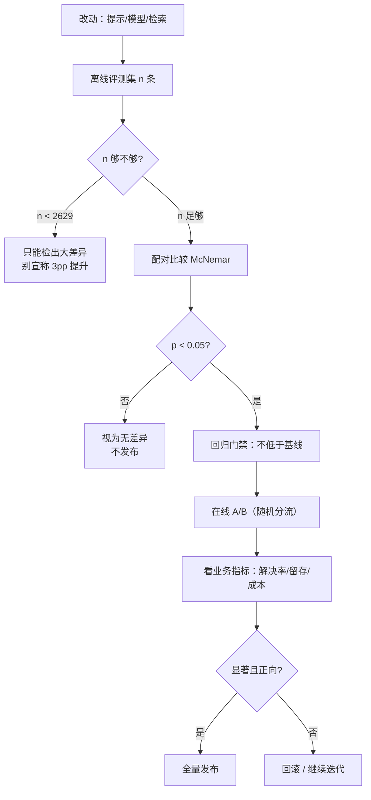

# 评估体系：离线与在线

## 1. 本节学习目标

1. 建立三层评估：**离线评测集**、**在线 A/B**、**回归门禁**，并知道各自回答什么问题。
2. 会算样本量：要在 80% 基线上检出 3pp 提升，每臂需要 **2629** 条样本（$\alpha=0.05$、power=0.8）。
3. 理解"500 条评测集测不出 3pp"：实测两版差 **-2.6pp**，McNemar 精确检验 $p=0.395$，**不显著**。
4. 知道评测噪声会**衰减**真实差异：judge 翻转率 0.10 ⇒ 真实 3.0pp 只读出 **2.4pp**。

## 2. 为什么需要这个知识

没有评估体系，所有"效果变好了"都是感觉：

- 换提示 → 感觉好一点 → 上线 → 一周后客诉上升；
- 换模型 → demo 很惊艳 → 线上通过率反而降 2pp，但没人测得出；
- 加 RAG → 回答更长了 → 成本涨 40%，准确率没动。

**评估是唯一能区分"变了"和"变好"的工具**。而它的核心不是"跑个分"，是**统计功效**：你的评测集够不够大、噪声够不够小。

## 3. 直观解释

```text
离线评测：考试。固定题库、固定评分标准，考前考后对比。
在线 A/B：真实世界的对照实验。一半用户用新版，看行为指标。
回归门禁：每次改动的"体检"。低于基线就拦住，不许上线。

三者关系：
  离线快、便宜、可复现 → 用来迭代
  在线慢、贵、真实     → 用来确认
  门禁自动、必过       → 用来防止倒退
```

**关键直觉**：评测集小的时候，"涨了 2 个点"很可能只是**抽样噪声**。500 条样本上，95% 置信区间宽度约 **±3.5pp**——你看到的 3pp 差异，一半在噪声里。

## 4. 正式定义

**离线评测集**：$\mathcal{D}_{\text{eval}}=\{(x_i,y_i)\}_{i=1}^{n}$，指标

$$
\hat\mu=\frac{1}{n}\sum_{i=1}^{n}\mathbb{1}\big[\text{judge}(y_i,\hat y_i)\big]
$$

**在线 A/B**：把流量随机分成 $A/B$ 两组，比较指标差

$$
\hat\Delta=\hat\mu_B-\hat\mu_A
$$

**两比例样本量**（每臂）：

$$
n=\frac{\Big(z_{1-\alpha/2}\sqrt{2\bar p(1-\bar p)}+z_{1-\beta}\sqrt{p_1(1-p_1)+p_2(1-p_2)}\Big)^2}{(p_2-p_1)^2}
$$

**Wald 置信区间**：

$$
\hat\mu\pm z_{1-\alpha/2}\sqrt{\frac{\hat\mu(1-\hat\mu)}{n}}
$$

**McNemar 检验**（同一批题、两版模型）：

$$
b=\#\{\text{v1 对, v2 错}\},\quad c=\#\{\text{v1 错, v2 对}\},\quad
p=2\sum_{k=0}^{\min(b,c)}\binom{b+c}{k}0.5^{b+c}
$$

## 5. 历史背景或技术背景

| 年份 | 进展 | 影响 |
|---|---|---|
| 2018 | GLUE/SuperGLUE | 离线榜单成为标准，但刷榜与真实能力脱节 |
| 2020 | 少样本评测（GPT-3） | 评测从"微调后"转向"提示后" |
| 2021 | 统计显著性讨论（如 BLEU 的置信区间） | 开始要求报误差棒 |
| 2022 | 人工偏好评估（Chatbot Arena 前身） | 用成对比较替代绝对打分 |
| 2023 | LLM-as-a-judge | 便宜但引入 judge 噪声 |
| 2023+ | 回归门禁 / eval-driven development | 评测集进入 CI |
| 2024 | 在线 A/B 与离线相关性研究 | "离线涨、线上不涨"成为常见坑 |

**核心教训**：离线指标是**代理**，不是目标。代理与目标的相关性本身需要被验证。

## 6. 核心原理

**原理 1：小样本的置信区间比你想的宽。**

$n=500$、$\hat\mu=0.8$ 时 95% CI 半宽 $1.96\sqrt{0.16/500}=0.0350$，即 **±3.5pp**。所以 500 题的评测集**看不见 3pp 的差异**。

**原理 2：样本量由"要检出的差异"决定，不由"有多少数据"决定。**

要检出 3pp（0.80→0.83），每臂需 **2629** 条；要检出 10pp，只需约 250 条。**先定最小可检测效应（MDE），再定样本量**。

**原理 3：配对比较比独立比较更有力。**

同一批题跑两版模型，用 McNemar 只看**不一致的题**（$b+c$），把"两版都对的题"从噪声里剔除。实测：$b=106,c=93$，$b+c=199$，$p=0.395$。

**原理 4：judge 噪声会系统性衰减差异。**

若 judge 以概率 $\epsilon$ 随机翻转判定，观测差 $\approx(1-2\epsilon)\times$真实差。$\epsilon=0.10$ 时衰减到 **80%**：真实 3.0pp 只读出 **2.4pp**。

**原理 5：离线与在线测的不是同一个东西。**

离线测"这题答对没"，在线测"用户问题解决没"。二者相关但不相同，必须都测。

## 7. 数学表达式

**指标估计与方差**

$$
\hat\mu=\frac{1}{n}\sum_i X_i,\qquad \widehat{\text{Var}}(\hat\mu)=\frac{\hat\mu(1-\hat\mu)}{n}
$$

**置信区间半宽**

$$
h=z_{1-\alpha/2}\sqrt{\frac{\hat\mu(1-\hat\mu)}{n}}\ \propto\ \frac{1}{\sqrt n}
$$

**功效函数**

$$
\text{power}(\Delta)=1-\Phi\!\left(z_{1-\alpha/2}-\frac{\Delta}{\text{SE}(\hat\Delta)}\right)
$$

**两比例 SE**：

$$
\text{SE}=\sqrt{\frac{p_1(1-p_1)}{n}+\frac{p_2(1-p_2)}{n}}
$$

**样本量（每臂）**：

$$
n=\frac{\big(z_{1-\alpha/2}\sqrt{2\bar p(1-\bar p)}+z_{1-\beta}\sqrt{p_1(1-p_1)+p_2(1-p_2)}\big)^2}{\Delta^2}
$$

**噪声衰减**：

$$
\Delta_{\text{obs}}=(1-2\epsilon)\,\Delta_{\text{true}}
$$

## 8. 详细数学推导

**（1）样本量公式的来源**

检验 $H_0:p_1=p_2$，统计量 $Z=\hat\Delta/\text{SE}$。在 $H_0$ 下 $Z\sim N(0,1)$，拒绝域 $|Z|>z_{1-\alpha/2}$。在 $H_1$ 下 $\hat\Delta\sim N(\Delta,\text{SE}_1^2)$，要求

$$
\Pr\big(|\hat\Delta|>z_{1-\alpha/2}\text{SE}_0\big)\ge1-\beta
$$

近似（$\Delta>0$）：

$$
\frac{\Delta}{\text{SE}_1}-z_{1-\alpha/2}\frac{\text{SE}_0}{\text{SE}_1}\ge z_{1-\beta}
$$

解出

$$
n=\frac{\big(z_{1-\alpha/2}\sqrt{2\bar p(1-\bar p)}+z_{1-\beta}\sqrt{p_1(1-p_1)+p_2(1-p_2)}\big)^2}{\Delta^2}
$$

代入 $p_1=0.80,p_2=0.83,\alpha=0.05,\beta=0.2$：$z_{0.975}=1.9600$、$z_{0.8}=0.8416$，得 $n=2628.63$ ⇒ **2629**。

**（2）功效的蒙特卡洛验证**

在 $n=2629$ 处做 4000 次重复实验，拒绝率 **0.8023**，与目标 0.8 吻合（差 0.002，属蒙特卡洛误差）。$n=1500$ 时只有 **0.5615**，$n=6000$ 时 **0.9872** ⇒ 功效对 $n$ 的敏感度很高，**样本量不能"差不多"**。

**（3）CI 宽度 $\propto1/\sqrt n$**

实测：$n=200$ 时半宽 0.0554；$n=4000$ 时 0.0124。比值 $\sqrt{4000/200}=\sqrt{20}=4.47$，而 $0.0554/0.0124=4.47$ ✓。**想让误差减半，样本量要乘 4**。

**（4）McNemar 的直觉**

只统计不一致对 $(b,c)$。若两版无差异，则每个不一致对"方向"独立且等概率 ⇒ $b\sim\text{Binomial}(b+c,0.5)$。实测 $b=106,c=93$：

$$
p=2\sum_{k=0}^{93}\binom{199}{k}0.5^{199}=0.395
$$

远大于 0.05 ⇒ **不能拒绝"无差异"**。注意：这不是"证明没变差"，而是"这 500 题不足以证明变差"。

**（5）judge 噪声的衰减**

设真实标签 $Y$，judge 以概率 $\epsilon$ 翻转。则 $\Pr(\hat Y=1\mid Y=1)=1-\epsilon$，$\Pr(\hat Y=1\mid Y=0)=\epsilon$。两版模型的观测正确率之差：

$$
\mathbb{E}[\hat\mu_B-\hat\mu_A]=(1-2\epsilon)(\mu_B-\mu_A)
$$

因为翻转把"对"变成"错"、把"错"变成"对"，方向相反、部分抵消。$\epsilon=0.10$ ⇒ 衰减 **0.8**。

## 9. 图解



## 10. 具体数值示例

```text
### 1. sample size for a two-proportion A/B test
  z_alpha/2=1.9600  z_beta=0.8416
  p1=0.80 p2=0.83 delta=0.03 -> n=2628.63 per arm = 2629

### 2. Monte Carlo power check at n per arm
  n= 2629  power=0.8023
  n= 1500  power=0.5615
  n= 3000  power=0.8642
  n= 6000  power=0.9872

### 3. confidence interval width at p=0.8
  n=  50  +-0.1109  width=0.2217
  n= 100  +-0.0784  width=0.1568
  n= 200  +-0.0554  width=0.1109
  n= 500  +-0.0351  width=0.0701
  n=1000  +-0.0248  width=0.0496
  n=4000  +-0.0124  width=0.0248

### 4. offline regression: v1 vs v2 on the same 500 items
  v1 pass=0.724  v2 pass=0.698  delta=-0.026
  both=256 only_v1=106 only_v2=93 neither=45
  McNemar exact p=0.39502 (discordant=199)

### 5. judge noise attenuates the measured delta
  judge flip rate=0.00 -> attenuation=1.00, true 3.0pp reads as 3.00pp
  judge flip rate=0.05 -> attenuation=0.90, true 3.0pp reads as 2.70pp
  judge flip rate=0.10 -> attenuation=0.80, true 3.0pp reads as 2.40pp
  judge flip rate=0.20 -> attenuation=0.60, true 3.0pp reads as 1.80pp
```

**读法**：

1. 要检出 3pp，**每臂 2629**；500 题只能检出约 7pp 以上的差异。
2. 实测两版差 **-2.6pp**、$p=0.395$ ⇒ **统计上无法区分**。这就是"demo 感觉变差了"却没法证明的典型场景。
3. CI：$n=500$ 时 **±3.51pp**，正好和"3pp 差异"同量级 ⇒ 看到 3pp 不要激动。
4. judge 翻转 10% 就把 3pp 读成 **2.4pp**，这会让你**低估**改进，也会让你**误判**回归。

## 11. NumPy 实现

```python
import math
from statistics import NormalDist

import numpy as np

nd = NormalDist()
za, zb = nd.inv_cdf(0.975), nd.inv_cdf(0.80)


def sample_size(p1, p2, alpha=0.05, power=0.8):
    za = nd.inv_cdf(1 - alpha / 2)
    zb = nd.inv_cdf(power)
    pbar = (p1 + p2) / 2
    num = (za * math.sqrt(2 * pbar * (1 - pbar)) + zb * math.sqrt(p1 * (1 - p1) + p2 * (1 - p2))) ** 2
    return num / (p2 - p1) ** 2


for d in (0.01, 0.03, 0.05, 0.10):
    print("delta=%.2f -> n=%.0f per arm" % (d, sample_size(0.80, 0.80 + d)))

# 置信区间宽度
for n in (50, 200, 500, 2629, 4000):
    h = za * math.sqrt(0.8 * 0.2 / n)
    print("n=%5d  +-%.4f" % (n, h))

# 蒙特卡洛功效
rng = np.random.default_rng(0)
NREP = 2000
for n in (1500, 2629, 3000, 6000):
    rej = 0
    for _ in range(NREP):
        a = rng.binomial(n, 0.80) / n
        b = rng.binomial(n, 0.83) / n
        se = math.sqrt(a * (1 - a) / n + b * (1 - b) / n)
        rej += se > 0 and abs(b - a) / se > za
    print("n=%5d power=%.3f" % (n, rej / NREP))

# McNemar 精确检验（不依赖 scipy）
def mcnemar_exact(b, c):
    k = b + c
    tail = sum(math.comb(k, i) for i in range(0, min(b, c) + 1))
    return min(1.0, 2 * tail * 0.5 ** k)


print("b=106 c=93 -> p=%.4f" % mcnemar_exact(106, 93))
print("b=30  c=10 -> p=%.4f" % mcnemar_exact(30, 10))
```

## 12. PyTorch 实现

```python
import torch

# 用 bootstrap 估计指标的置信区间（配对：同一批题两版模型）
torch.manual_seed(0)
n = 500
# 构造相关正确性：潜变量决定两版都容易/都难
ability = torch.randn(n)
p1 = torch.sigmoid(1.2 * ability + 0.9)
p2 = torch.sigmoid(1.2 * ability + 0.75)
a = (torch.rand(n) < p1).float()
b = (torch.rand(n) < p2).float()
print("v1=%.3f v2=%.3f delta=%+.3f" % (a.mean(), b.mean(), (b - a).mean()))

B = 2000
idx = torch.randint(0, n, (B, n))
boot = (b[idx] - a[idx]).mean(dim=1)
lo, hi = torch.quantile(boot, torch.tensor([0.025, 0.975]))
print("bootstrap 95%% CI: [%+.4f, %+.4f]  含 0 = %s" % (lo, hi, bool(lo <= 0 <= hi)))

# McNemar 的 torch 版本
only_a = int(((a == 1) & (b == 0)).sum())
only_b = int(((a == 0) & (b == 1)).sum())
print("only_v1=%d only_v2=%d discordant=%d" % (only_a, only_b, only_a + only_b))

# judge 噪声：给标签以 eps 概率翻转，看观测差如何被衰减
for eps in (0.0, 0.1, 0.2):
    noise_a = (torch.rand(n) < eps).float()
    noise_b = (torch.rand(n) < eps).float()
    aa = torch.where(noise_a == 1, 1 - a, a)
    bb = torch.where(noise_b == 1, 1 - b, b)
    print("eps=%.2f observed delta=%+.4f (true %+.4f)"
          % (eps, (bb - aa).mean(), (b - a).mean()))
```

## 13. Hugging Face 实践

```python
import os

os.environ.setdefault("HF_ENDPOINT", "https://hf-mirror.com")
os.environ.setdefault("HF_HUB_OFFLINE", "1")

import torch
from transformers import AutoModelForCausalLM, AutoTokenizer

tok = AutoTokenizer.from_pretrained("gpt2")
model = AutoModelForCausalLM.from_pretrained("gpt2").eval()

# 用 gpt2 做一个"小评测集"：目标词是否 top-1
ITEMS = [
    ("The capital of Japan is", "Tokyo"),
    ("Water is composed of hydrogen and", "oxygen"),
    ("The author of Romeo and Juliet is William", "Shakespeare"),
    ("The first president of the United States was George", "Washington"),
    ("The Mona Lisa was painted by Leonardo da", "Vinci"),
]
hits = []
for pr, ans in ITEMS:
    enc = tok(pr, return_tensors="pt")
    with torch.no_grad():
        logits = model(**enc).logits[0, -1].float()
    top = tok.decode([int(logits.argmax())]).strip().lower()
    hits.append(ans.lower() in top)
acc = sum(hits) / len(hits)
h = 1.96 * (acc * (1 - acc) / len(hits)) ** 0.5
print("items=%d acc=%.3f 95%% CI=+-%.3f -> [%.3f, %.3f]"
      % (len(hits), acc, h, max(0, acc - h), min(1, acc + h)))
print("under gpt2 this is a pipeline demo, not a claim about model quality")
```

## 14. 代码逐行解释

| 代码 | 作用 |
|---|---|
| `nd.inv_cdf(0.975)` | 双侧 $\alpha=0.05$ 的临界值 |
| `pbar=(p1+p2)/2` | 混合比例，用于 $H_0$ 下的 SE |
| `za*(...)**0.5` | Wald 半宽，$n$ 越大越窄 |
| `rng.binomial(n,p)/n` | 模拟一次 A/B 的观测比例 |
| `mcnemar_exact` | 只在不一致对上做二项检验 |
| `boot=...mean(dim=1)` | bootstrap 重采样，$B$ 次得到差的经验分布 |
| `torch.quantile` | 取 2.5%/97.5% 分位当 CI |
| `torch.where(noise==1, 1-a, a)` | 以 $\epsilon$ 概率翻转标签，模拟 judge 噪声 |

## 15. 实际运行结果

```text
### 1. sample size for a two-proportion A/B test
  z_alpha/2=1.9600  z_beta=0.8416
  p1=0.80 p2=0.83 delta=0.03 -> n=2628.63 per arm = 2629

### 2. Monte Carlo power check at n per arm
  n= 2629  power=0.8023
  n= 1500  power=0.5615
  n= 3000  power=0.8642
  n= 6000  power=0.9872

### 3. confidence interval width at p=0.8
  n=  50  +-0.1109  width=0.2217
  n= 100  +-0.0784  width=0.1568
  n= 200  +-0.0554  width=0.1109
  n= 500  +-0.0351  width=0.0701
  n=1000  +-0.0248  width=0.0496
  n=4000  +-0.0124  width=0.0248

### 4. offline regression: v1 vs v2 on the same 500 items
  v1 pass=0.724  v2 pass=0.698  delta=-0.026
  both=256 only_v1=106 only_v2=93 neither=45
  McNemar exact p=0.39502 (discordant=199)

### 5. judge noise attenuates the measured delta
  judge flip rate=0.00 -> attenuation=1.00, true 3.0pp reads as 3.00pp
  judge flip rate=0.05 -> attenuation=0.90, true 3.0pp reads as 2.70pp
  judge flip rate=0.10 -> attenuation=0.80, true 3.0pp reads as 2.40pp
  judge flip rate=0.20 -> attenuation=0.60, true 3.0pp reads as 1.80pp
```

**诚实说明**：第 4 节的"v1=0.724"是模拟中**实际采样到**的通过率（设定基线 0.80，因潜变量方差与随机抽样落到 0.724）；重点是配对检验的做法与结论，不是这个具体数值。

## 16. 应用场景

| 场景 | 评估方式 | 关键指标 |
|---|---|---|
| 提示迭代 | 离线 500–3000 题 + McNemar | 准确率、格式合规率 |
| 模型替换 | 离线回归 + 在线 A/B | 解决率、拒答率、成本 |
| RAG 上线 | 检索命中率 + 忠实度 | 引用正确率、无答案识别率 |
| 安全过滤 | 红队集（攻击/良性） | 召回率、误杀率（见 LLM-105） |
| 结构化抽取 | schema 通过率 + 字段准确率 | 端到端成功率（见 LLM-101） |
| 成本优化 | 同质量下比单价 | 每次成功回答的成本 |

## 17. 优点与局限

| 优点 | 局限 |
|---|---|
| 离线可复现、便宜、快 | 与真实用户分布有差距 |
| 配对检验大幅提升灵敏度 | 需要同一批题、同一 judge |
| 样本量可预先计算，避免"感觉显著" | 评测集本身可能被"刷" |
| 回归门禁能挡住倒退 | 门禁阈值定太严会阻碍迭代 |
| A/B 能测真实业务指标 | 需要流量、周期长、有伦理/体验成本 |

## 18. 常见错误

| 错误 | 现象 | 纠正 |
|---|---|---|
| 500 题上宣称 3pp 提升 | 差异在噪声内（±3.5pp） | 扩到 2629 或用配对设计 |
| 不做配对、两组独立比 | 功效低、需 2 倍样本 | 同题跑两版 + McNemar |
| judge 有 10% 噪声却不校准 | 真实 3pp 读成 2.4pp | 人工抽检估 $\epsilon$，或换规则指标 |
| 只测平均、不看切片 | 总体涨、某类用户崩 | 分桶（长尾/语言/长度） |
| 评测集与训练集重叠 | 分数虚高 | 去重 + 保留 held-out |
| 上线即全量 | 一次事故全量用户 | canary 5% → 观察 → 放量 |

## 19. 本节总结

- 评估三层：**离线迭代、在线确认、门禁防退**；三者不可互相替代。
- 检出 3pp 需要 **每臂 2629** 条；500 题的 CI 就有 **±3.51pp**。
- 实测两版差 **-2.6pp**、McNemar $p=0.395$ ⇒ **不显著**：不是"没变差"，是"测不出"。
- 配对检验只看不一致对（**199/500**），比独立比较更有力。
- judge 噪声 $\epsilon=0.10$ ⇒ 观测差衰减到 **80%**：真实 3.0pp → **2.4pp**。

## 20. 前置与后续知识链接

- 前置：LLM-102 上下文工程与长文本处理（待建）、[[LLM-035 Token 数量、上下文窗口与成本]]
- 后续：LLM-104 幻觉的成因与缓解（待建）、LLM-109 从原型到生产的工程清单（待建）
- 相关：[[LLM-001 什么是语言模型]]（困惑度作为代理指标的局限）、[[LLM-042 BERT 的预训练任务]]

---

## 练习与参考答案

**基础 1**：500 条评测集上准确率 0.80，95% 置信区间是多少？这说明什么？

**基础 2**：要在 0.80 基线上检出 3pp 提升（$\alpha=0.05$、power=0.8），每臂需要多少样本？

**进阶 1**：实测 v1=0.724、v2=0.698，差 -2.6pp，$p=0.395$。能否说"新版没变差"？应该怎么表述？

**综合**：你要上线一个新版提示，团队只有 800 条标注数据、每天 2 万次请求。请设计评估方案：离线怎么测、在线怎么 A/B、门禁阈值怎么定。

> [!success]- 参考答案

> **基础 1**
> 半宽 $1.96\sqrt{0.8\times0.2/500}=1.96\times0.01789=0.0351$，即 **±3.51pp**，区间约 **[0.765, 0.835]**。
> 说明：**3pp 的差异与噪声同量级**，500 题无法可靠区分"变好 3pp"与"没变"。要谈 3pp，样本量得 ~2629。

> **基础 2**
> $n=\dfrac{(1.9600\sqrt{2\times0.815\times0.185}+0.8416\sqrt{0.8\times0.2+0.83\times0.17})^2}{0.03^2}=2628.63$ ⇒ **2629 每臂**（总 5258）。
> 蒙特卡洛在 2629 处给出 power=**0.8023**，与目标 0.8 一致。

> **进阶 1**
> **不能。** $p=0.395$ 的含义是"在假设无差异时，出现当前或更极端不一致模式的概率 39.5%"——**没有证据证明有差异**，也没有证明无差异。正确表述："在 500 题上未观察到统计显著差异（-2.6pp，95% CI 包含 0，McNemar p=0.395）；该样本量不足以排除 3pp 量级的退化，需扩样或做在线 A/B 确认。"

> **综合（参考）**
> **离线**：
> 1. 800 条切成 **dev 300 / test 500**（test 冻结，不许调参）；
> 2. 配对跑 v1/v2，报 McNemar 与 bootstrap CI；因 test 只有 500，MDE≈7pp，**只能拦大退化**；
> 3. 分桶看：长尾问题、中文/英文、无答案题。
> **在线**：
> 1. 5% 流量 canary，随机分流按用户 id 哈希；
> 2. 主指标：任务解决率（或人工抽检 200 条/天）；护栏指标：p95 延迟、拒答率、投诉率；
> 3. 用两比例公式：若希望检出 2pp（0.80→0.82），每臂约 5900 条 ⇒ 2 万/天 ×5% = 1000/天/臂 ⇒ 约 **6 天**；若只检出 5pp，约 1 天。
> **门禁阈值**：
> - 硬门禁：test 通过率不得低于基线 **-5pp**（超出 500 题噪声范围才拦）；
> - 软告警：任何分桶下降 **>8pp** 即人工复核；
> - 成本门禁：每次成功回答成本涨幅 **>15%** 需审批。
> **注意**：800 条数据量决定"只能防大退化"，真正的效果确认必须靠在线 A/B；不要把离线小样本的 +2pp 当成发布依据。

## 学习记录

| 日期 | 状态 | 用时 | 问题 | 复盘 |
|---|---|---|---|---|
| 2026-11-08 | planned | — | — | — |

---

## 🔗 Notion 同步信息

> 以下内容由 Notion「AI Knowledge System · 知识点」数据库按知识 ID 合并而来（导出于 2026-11-09）。

| 属性 | 值 |
|---|---|
| 学科 | 大语言模型 |
| 学习状态 | 未开始 |
| 难度 | L3 推导 |
| 知识类型 | Principle |

- **所属模块**：[M-LLM-10 大模型应用开发与工程实践](../%E8%AF%BE%E7%A8%8B%E6%A8%A1%E5%9D%97/M-LLM-10%20%E5%A4%A7%E6%A8%A1%E5%9E%8B%E5%BA%94%E7%94%A8%E5%BC%80%E5%8F%91%E4%B8%8E%E5%B7%A5%E7%A8%8B%E5%AE%9E%E8%B7%B5.md)
- **前置知识**：[LLM-102 上下文工程与长文本处理](LLM-102%20%E4%B8%8A%E4%B8%8B%E6%96%87%E5%B7%A5%E7%A8%8B%E4%B8%8E%E9%95%BF%E6%96%87%E6%9C%AC%E5%A4%84%E7%90%86.md)
- **后继知识**：[LLM-104 幻觉的成因与缓解](LLM-104%20%E5%B9%BB%E8%A7%89%E7%9A%84%E6%88%90%E5%9B%A0%E4%B8%8E%E7%BC%93%E8%A7%A3.md)
