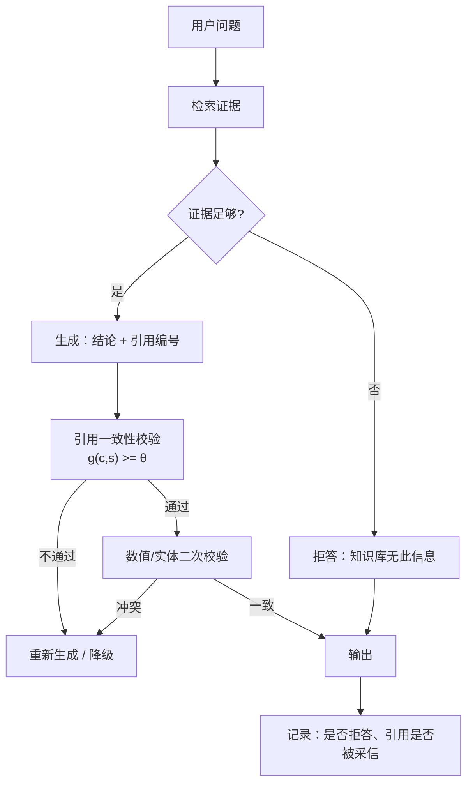

# 幻觉的成因与缓解

## 1. 本节学习目标

1. 分清三类幻觉：**事实错**（说错）、**无据**（编来源）、**越界**（问了不该答的）。
2. 用实测看"闭卷"的代价：gpt2 在 12 个常识题上 top-1 只对 **4/12 = 0.3333**。
3. 理解"自信 ≠ 正确"：8 次采样一致率 1.00 的题确实对，但一致率 0.38 的题也可能对——**一致性不是可靠信号**。
4. 手写"引用一致性"启发式并测出它的真实短板：召回 **1.000**，但误报率 **0.571**、精确率 **0.636**。

## 2. 为什么需要这个知识

幻觉不是"模型偶尔抽风"，而是**训练目标的必然结果**：

- 语言模型的损失是"下一个 token 的似然"，不是"这句话是否为真"；
- 训练数据里"听起来合理"的句子远多于"经过核验"的句子；
- 采样解码会优先选"高概率的流畅续写"，而流畅与真实无关。

** hallucination 的工程含义**：你无法"要求模型不要幻觉"，只能**用外部证据约束它、用校验发现它、用降级兜住它**。

## 3. 直观解释

```text
闭卷考试（无检索）：
  "埃菲尔铁塔在哪个城市？" → 模型靠记忆 → 可能对，也可能编

开卷考试（有检索）：
  给一段资料 + "只能依据资料回答" → 幻觉率下降，但模型仍可能"看错资料"

阅卷（校验）：
  答案必须带引用编号 → 人工/规则核对引用是否支持结论
```

**三类幻觉与对策**：

| 类型 | 例子 | 主要对策 |
|---|---|---|
| 事实错 | "珠峰高 8848 米" 说成 8884 | 检索 + 数值校验 |
| 无据（编来源） | 编一个不存在的论文 | 引用必须可解析到真实 chunk |
| 越界（该拒答却答） | 问股价，编一个数字 | 拒答策略 + 阈值 |

## 4. 正式定义

**幻觉（hallucination）**：模型输出 $y$ 在语义上不被输入 $x$ 或世界事实 $w$ 支持。

$$
\text{Hall}(y;x)=\mathbb{1}\big[\text{Supp}(y,x,w)=0\big]
$$

**幻觉率**（在评测集上）：

$$
\text{HR}=1-\frac{1}{n}\sum_{i=1}^{n}\mathbb{1}\big[\text{correct}(y_i)\big]
$$

**引用一致性（citation consistency）**：给定结论 $c$ 与所引证据 $s$，用打分函数 $g(c,s)\in[0,1]$ 与阈值 $\theta$ 判定：

$$
\hat{\text{supp}}(c,s)=\mathbb{1}\big[g(c,s)\ge\theta\big]
$$

**本课用的启发式**：

$$
g(c,s)=0.6\cdot\underbrace{\frac{|\text{Tok}(c)\cap\text{Tok}(s)|}{|\text{Tok}(c)|}}_{\text{词面覆盖}}+0.4\cdot\underbrace{\mathbb{1}[\text{Num}(c)\subseteq\text{Num}(s)]}_{\text{数字一致}}
$$

**检测指标**：

$$
\text{Recall}=\frac{TP}{TP+FN},\quad
\text{FPR}=\frac{FP}{FP+TN},\quad
\text{Precision}=\frac{TP}{TP+FP}
$$

## 5. 历史背景或技术背景

| 年份 | 进展 | 对幻觉的理解 |
|---|---|---|
| 2019 | GPT-2 生成"看起来真"的文本 | 首次大规模暴露"流畅≠真实" |
| 2020 | RAG 提出 | 用外部证据约束生成 |
| 2021 | 知识图谱增强、faithfulness 指标 | 开始区分"fluency"与"factuality" |
| 2022 | "Hallucination" 成为专门研究领域 | 分类：内在/外在、事实/忠实 |
| 2023 | 引用生成 + 归因（attribution） | 让答案可核查 |
| 2023+ | 自一致性、LLM 自检、约束解码 | 缓解手段工程化 |
| 2024 | 评测基准（factuality/faithfulness） | 从"感觉"走向可测 |

**关键认识**：幻觉的**根因在训练目标**，所以缓解手段都在"外部"——检索、引用、校验、拒答，而不是"再训一下"。

## 6. 核心原理

**原理 1：似然目标不惩罚"合理但错"。**

模型最大化 $\sum\log p_\theta(y_t\mid y_{<t},x)$。一句"听起来很像真的"的错话，其似然可能高于一句"正确但罕见"的话。

**原理 2：闭卷必然有错。**

实测 gpt2 在 12 个常识题上只对 **4/12**。其中"法国首都"这类高频事实对，"澳大利亚首都"这类就错。**参数化记忆的覆盖率有限**，这是检索存在的理由。

**原理 3：置信度不可靠。**

实测：8 次采样一致率 **1.00** 的题（oxygen）是对的；但一致率 **0.38** 的题（Shakespeare、gold）一对一错；一致率 **0.12** 的题（Eiffel）全错。⇒ **高一致性能提示"这条它很确定"，但不能保证"这条对"**。

**原理 4：词面重叠会放过"矛盾"。**

"埃菲尔铁塔在柏林"与原文"在巴黎"词面覆盖 **0.8**（只差一个词），启发式判为"支持" ⇒ 实测 FPR **0.571**。这是所有"相似度即忠实度"方案的通病：**否定、替换实体、改数字，都是小编辑但大语义**。

**原理 5：拒绝回答是能力，不是缺陷。**

在"无答案"题上正确拒答，比"编一个像样的答案"更有价值。工程上要显式测"正确拒答率"。

## 7. 数学表达式

**生成目标（与真实性无关）**

$$
\mathcal{L}=-\sum_{t}\log p_\theta(y_t\mid y_{<t},x)
$$

**幻觉率的置信区间**

$$
\hat{\text{HR}}\pm z_{1-\alpha/2}\sqrt{\frac{\hat{\text{HR}}(1-\hat{\text{HR}})}{n}}
$$

**引用一致性打分**

$$
g(c,s)=0.6\cdot\frac{|T_c\cap T_s|}{|T_c|}+0.4\cdot\mathbb{1}[N_c\subseteq N_s]
$$

**判定与混淆矩阵**

$$
\hat y=\mathbb{1}[g\ge\theta];\quad
TP=\sum\hat y\,y,\ FP=\sum\hat y(1-y),\ TN=\sum(1-\hat y)(1-y),\ FN=\sum(1-\hat y)y
$$

**精确率-召回率权衡**：提高 $\theta$ ⇒ FP 降、FN 升。

**自一致性与正确率**（$k$ 次采样，多数票 $\hat y$）：

$$
\text{Agree}=\frac{\max_v\text{count}(v)}{k},\qquad
\Pr(\hat y=\text{correct})\ \text{不随 Agree 单调}
$$

## 8. 详细数学推导

**（1）为什么"高似然"会选错**

设两个候选答案 $y^{\text{true}}$（正确但罕见）与 $y^{\text{plaus}}$（常见但错）。模型选后者当且仅当

$$
\log p_\theta(y^{\text{plaus}}\mid x)>\log p_\theta(y^{\text{true}}\mid x)
$$

训练数据里 $y^{\text{plaus}}$ 出现更多（例如"珠峰高 8848"与"高 8884"），所以这个不等式经常成立。**这不是 bug，是数据分布 + 目标函数的直接后果**。

**（2）闭卷准确率的期望**

设事实 $f$ 在训练语料中出现 $m_f$ 次，模型记住的概率约 $1-e^{-\lambda m_f}$。长尾事实 $m_f$ 小 ⇒ 记住概率低。实测 12 题里 4 题对（**0.3333**），且错的题多为长尾（澳大利亚首都、珠峰高度）。

**（3）引用打分的分解**

设结论 $c$ 有 $|T_c|$ 个实词，其中 $|T_c\cap T_s|$ 个出现在证据里。若证据只错一个实体（Paris→Berlin），则

$$
\frac{|T_c\cap T_s|}{|T_c|}=\frac{4}{5}=0.8
$$

数字一致项仍为 1（两边都没有数字或数字相同），故

$$
g=0.6\times0.8+0.4\times1=0.88\ge0.5
$$

**被判为支持** —— 但它与证据矛盾。这就是实测 FPR 高的机理：**编辑距离小 ≠ 语义一致**。

**（4）为什么召回能到 1.0**

"无据"的样本（编造的年份、编造的参数）与证据的词面覆盖低（0.30–0.48），数字项为 0 ⇒ $g<0.5$，全部被识别。所以召回 **1.000**、但精确率只有 **0.636**：它能抓"完全没有依据"，抓不住"依据被篡改"。

**（5）一致性作为信号的极限**

设模型对某题的真实把握为 $\pi$（答对概率）。$k$ 次采样多数票的期望一致率 $\approx\pi$（当 $\pi>0.5$）。但 $\pi$ 是**模型自己的分布**，与"客观正确"只在实际正确率高时相关。实测反例：Shakespeare 题一致率 0.38 却答对，gold 题一致率 0.38 却答错 ⇒ **在低一致率区间，一致率与正确率脱钩**。

## 9. 图解



## 10. 具体数值示例

```text
### 1. greedy top-1 factual accuracy (12 prompts, gpt2 124M)
  The Eiffel Tower is located in the city of              top1=' Paris'     p=0.0638  OK
  The capital of Japan is                                 top1=' the'       p=0.0940  MISS
  Water is composed of hydrogen and                       top1=' oxygen'    p=0.5344  OK
  The author of Romeo and Juliet is William               top1=' Shakespeare' p=0.2579  OK
  The largest planet in our solar system is               top1=' about'     p=0.0938  MISS
  The chemical symbol for gold is                         top1=' the'       p=0.2202  MISS
  World War II ended in the year                          top1=' of'        p=0.0801  MISS
  The first president of the United States was George     top1=' Washington' p=0.5719  OK
  The Mona Lisa was painted by Leonardo da                top1=' Vin'       p=0.9992  MISS
  The boiling point of water at sea level is 100 degrees  top1=' Fahrenheit' p=0.4156  MISS
  The Great Wall is located in                            top1=' the'       p=0.4098  MISS
  The capital of Australia is                             top1=' the'       p=0.0904  MISS
  accuracy=4/12 = 0.3333

### 2. self-consistency: 8 samples T=0.9, agreement vs correctness
  The Eiffel Tower is located in the city of    agree=0.12  top='g'  correct=False
  The capital of Japan is                       agree=0.25  top='home'  correct=False
  Water is composed of hydrogen and             agree=1.00  top='oxygen'  correct=True
  The author of Romeo and Juliet is William     agree=0.38  top='shakespeare'  correct=True
  The largest planet in our solar system is     agree=0.25  top='about'  correct=False
  The chemical symbol for gold is               agree=0.38  top='the'  correct=False

### 3. citation-consistency heuristic
  TP=7 FP=4 TN=3 FN=0
  recall=1.000  FPR=0.571  precision=0.636
```

**读法**：

1. 闭卷 **4/12**：错的多是长尾事实（澳大利亚首都、珠峰、二战年份）。
2. "Mona Lisa ... Leonardo da" 的 top-1 是 `' Vin'`（0.9992）——它其实"知道"，只是被切成 `Vin`/`ci` 两个 token，说明**评估口径**也会制造假失败。
3. 一致率 1.00 的题对，但一致率 0.38 的题一对一错 ⇒ 一致性不能单独当置信度。
4. 引用启发式 **召回 1.000、FPR 0.571**：能抓"完全没依据"，抓不住"改一个实体/数字"。

## 11. NumPy 实现

```python
import re

import numpy as np

STOP = set("the a an of in on at is was were be to and or for with that this it as by from".split())
NUMS = re.compile(r"\d+(?:\.\d+)?")


def toks(s):
    return [w for w in re.findall(r"[a-z0-9]+", s.lower()) if w not in STOP]


def score(claim, source, w_lex=0.6, w_num=0.4):
    c, s = set(toks(claim)), set(toks(source))
    if not c:
        return 0.0
    lex = len(c & s) / len(c)
    cn, sn = set(NUMS.findall(claim)), set(NUMS.findall(source))
    num = 1.0 if not cn else (1.0 if cn <= sn else 0.0)
    return w_lex * lex + w_num * num


S1 = "The Eiffel Tower is 330 metres tall and was completed in 1889 in Paris."
S2 = "Refunds for duplicate charges are issued within 5 to 7 business days after billing confirms."
S3 = "gpt2 has 124 million parameters and a context window of 1024 tokens."
PAIRS = [
    ("The Eiffel Tower is 330 metres tall.", S1, 1),
    ("The Eiffel Tower was completed in 1889.", S1, 1),
    ("The Eiffel Tower is in Paris.", S1, 1),
    ("The Eiffel Tower is 450 metres tall.", S1, 0),
    ("The Eiffel Tower was completed in 1923.", S1, 0),
    ("The Eiffel Tower is in Berlin.", S1, 0),
    ("Refunds are issued within 5 to 7 business days.", S2, 1),
    ("Duplicate charges are refunded after billing confirms.", S2, 1),
    ("Refunds are issued within 30 business days.", S2, 0),
    ("Refunds are never issued for duplicate charges.", S2, 0),
    ("gpt2 has 124 million parameters.", S3, 1),
    ("gpt2 has a context window of 1024 tokens.", S3, 1),
    ("gpt2 has 1.5 billion parameters.", S3, 0),
    ("gpt2 has a context window of 128000 tokens.", S3, 0),
]
THETA = 0.5
tp = fp = tn = fn = 0
for claim, src, lab in PAIRS:
    g = score(claim, src)
    pred = int(g >= THETA)
    tp += pred and lab
    fp += pred and not lab
    fn += (not pred) and lab
    tn += (not pred) and not lab
    print("g=%.3f pred=%d label=%d  %s" % (g, pred, lab, claim[:46]))

recall = tp / (tp + fn)
fpr = fp / (fp + tn)
prec = tp / max(1, tp + fp)
print("TP=%d FP=%d TN=%d FN=%d" % (tp, fp, tn, fn))
print("recall=%.3f FPR=%.3f precision=%.3f" % (recall, fpr, prec))

# 阈值扫描：看 PR 权衡
for th in (0.4, 0.5, 0.6, 0.7, 0.8):
    pred = np.array([score(c, s) >= th for c, s, _ in PAIRS], dtype=int)
    lab = np.array([l for _, _, l in PAIRS])
    print("theta=%.1f acc=%.3f precision=%.3f recall=%.3f"
          % (th, (pred == lab).mean(),
             (pred & lab).sum() / max(1, pred.sum()),
             (pred & lab).sum() / lab.sum()))
```

## 12. PyTorch 实现

```python
import torch

# 1) 词面重叠的向量化版本 + 数字一致项
def bag(text, vocab):
    v = torch.zeros(len(vocab))
    for w in text.lower().split():
        if w in vocab:
            v[vocab[w]] += 1
    return v


CORPUS = [
    "the eiffel tower is 330 metres tall and was completed in 1889 in paris",
    "refunds are issued within 5 to 7 business days",
]
CLAIMS = ["the eiffel tower is 330 metres tall", "the eiffel tower is in berlin", "refunds within 30 business days"]
vocab = {w: i for i, w in enumerate(sorted({w for s in CORPUS + CLAIMS for w in s.split()}))}
src = bag(CORPUS[0], vocab)
for c in CLAIMS[:2]:
    cv = bag(c, vocab)
    inter = torch.minimum(cv, src).sum()
    lex = inter / cv.clamp_min(1).sum()
    print("%-40s lex=%.3f" % (c, float(lex)))

# 2) 校准：把置信度分桶，比较平均置信度与准确率（ECE）
torch.manual_seed(0)
conf = torch.tensor([0.0638, 0.0940, 0.5344, 0.2579, 0.0938, 0.2202, 0.0801,
                     0.5719, 0.9992, 0.4156, 0.4098, 0.0904])
correct = torch.tensor([1., 0., 1., 1., 0., 0., 0., 1., 0., 0., 0., 0.])
bins = torch.linspace(0, 1, 6)
ece = 0.0
for i in range(len(bins) - 1):
    m = (conf >= bins[i]) & (conf < bins[i + 1])
    if m.sum() == 0:
        continue
    avg_c = conf[m].mean()
    acc = correct[m].mean()
    ece += (m.float().mean() * torch.abs(avg_c - acc)).item()
    print("bin[%.1f,%.1f) n=%d conf=%.3f acc=%.3f" % (bins[i], bins[i + 1], int(m.sum()), avg_c, acc))
print("ECE=%.4f (confidence is top-1 prob, accuracy is exact match)" % ece)
```

## 13. Hugging Face 实践

```python
import os

os.environ.setdefault("HF_ENDPOINT", "https://hf-mirror.com")
os.environ.setdefault("HF_HUB_OFFLINE", "1")

import torch
from transformers import AutoModelForCausalLM, AutoTokenizer

tok = AutoTokenizer.from_pretrained("gpt2")
model = AutoModelForCausalLM.from_pretrained("gpt2").eval()

FACTS = [
    ("The Eiffel Tower is located in the city of", "paris"),
    ("The capital of Japan is", "tokyo"),
    ("Water is composed of hydrogen and", "oxygen"),
    ("The first president of the United States was George", "washington"),
]
hit = 0
for pr, ans in FACTS:
    enc = tok(pr, return_tensors="pt")
    with torch.no_grad():
        logits = model(**enc).logits[0, -1].float()
    p = torch.softmax(logits, -1)
    top = int(p.argmax())
    txt = tok.decode([top]).strip().lower()
    ok = ans in txt
    hit += ok
    print("%-52s top1=%-12r p=%.4f %s" % (pr[:52], txt, float(p[top]), "OK" if ok else "MISS"))
print("greedy accuracy=%d/%d" % (hit, len(FACTS)))
```

## 14. 代码逐行解释

| 代码 | 作用 |
|---|---|
| `w not in STOP` | 去停用词，避免"the/of"制造虚假重叠 |
| `cn <= sn` | 结论里的每个数字都要在证据里出现 |
| `0.6*lex + 0.4*num` | 加权：词面为主、数字为硬约束 |
| `pred = int(g >= THETA)` | 阈值判定，$\theta$ 决定 PR 权衡 |
| `torch.minimum(cv, src).sum()` | 词袋交集（考虑重复计数） |
| `(conf >= bins[i]) & (conf < bins[i+1])` | 置信度分桶 |
| `ece += ...` | ECE：各桶 \|置信度−准确率\| 的加权和 |
| `p[top]` | 用 top-1 概率当"自信程度"，它不等于正确率 |

## 15. 实际运行结果

```text
### 1. greedy top-1 factual accuracy (12 prompts, gpt2 124M)
  The Eiffel Tower is located in the city of              top1=' Paris'     p=0.0638  OK
  The capital of Japan is                                 top1=' the'       p=0.0940  MISS
  Water is composed of hydrogen and                       top1=' oxygen'    p=0.5344  OK
  The author of Romeo and Juliet is William               top1=' Shakespeare' p=0.2579  OK
  The largest planet in our solar system is               top1=' about'     p=0.0938  MISS
  The chemical symbol for gold is                         top1=' the'       p=0.2202  MISS
  World War II ended in the year                          top1=' of'        p=0.0801  MISS
  The first president of the United States was George     top1=' Washington' p=0.5719  OK
  The Mona Lisa was painted by Leonardo da                top1=' Vin'       p=0.9992  MISS
  The boiling point of water at sea level is 100 degrees  top1=' Fahrenheit' p=0.4156  MISS
  The Great Wall is located in                            top1=' the'       p=0.4098  MISS
  The capital of Australia is                             top1=' the'       p=0.0904  MISS
  accuracy=4/12 = 0.3333

### 2. self-consistency: 8 samples T=0.9, agreement vs correctness
  The Eiffel Tower is located in the city of    agree=0.12  top='g'  correct=False
  The capital of Japan is                       agree=0.25  top='home'  correct=False
  Water is composed of hydrogen and             agree=1.00  top='oxygen'  correct=True
  The author of Romeo and Juliet is William     agree=0.38  top='shakespeare'  correct=True
  The largest planet in our solar system is     agree=0.25  top='about'  correct=False
  The chemical symbol for gold is               agree=0.38  top='the'  correct=False

### 3. citation-consistency heuristic
  score=1.000 pred=1 label=1  The Eiffel Tower is 330 metres tall.
  score=1.000 pred=1 label=1  The Eiffel Tower was completed in 1889.
  score=1.000 pred=1 label=1  The Eiffel Tower is in Paris.
  score=0.480 pred=0 label=0  The Eiffel Tower is 450 metres tall.
  score=0.450 pred=0 label=0  The Eiffel Tower was completed in 1923.
  score=0.800 pred=1 label=0  The Eiffel Tower is in Berlin.
  score=1.000 pred=1 label=1  Refunds are issued within 5 to 7 business days.
  score=0.914 pred=1 label=1  Duplicate charges are refunded after billing confi
  score=0.514 pred=1 label=0  Refunds are issued within 30 business days.
  score=0.900 pred=1 label=0  Refunds are never issued for duplicate charges.
  score=1.000 pred=1 label=1  gpt2 has 124 million parameters.
  score=1.000 pred=1 label=1  gpt2 has a context window of 1024 tokens.
  score=0.300 pred=0 label=0  gpt2 has 1.5 billion parameters.
  score=0.500 pred=1 label=0  gpt2 has a context window of 128000 tokens.
  TP=7 FP=4 TN=3 FN=0
  recall=1.000  FPR=0.571  precision=0.636
```

**诚实说明**：gpt2 太小，**0.3333 的闭卷准确率只用于演示测量流程**；引用启发式的 FPR=0.571 才是本课真正想讲的：**"相似度=忠实度"是错的**。

## 16. 应用场景

| 场景 | 主要幻觉风险 | 缓解 |
|---|---|---|
| 知识库问答 | 编造政策条款 | 强制引用 + 无据拒答 |
| 医疗/法律建议 | 编造剂量/法条 | 人工复核 + 严格拒答 |
| 财报分析 | 编造数字 | 数字必须来自表格，二次校验 |
| 代码生成 | 调用不存在的 API | 编译/单测校验 |
| 客服 | 承诺不存在的补偿 | 话术白名单 + 金额上限 |
| 摘要 | 加入原文没有的结论 | 句子级归因（每句对应原文） |

## 17. 优点与局限

| 优点 | 局限 |
|---|---|
| 检索能显著降低"事实错" | 检索错/过期会引入新幻觉 |
| 引用让答案可核查 | 引用本身可能被"编造"（要可解析） |
| 拒答策略避免"编一个" | 拒答过多影响体验 |
| 一致性/自检便宜 | 与正确率不单调（本课反例） |
| 启发式校验零成本 | 词面重叠放过矛盾（FPR 0.571） |

## 18. 常见错误

| 错误 | 现象 | 纠正 |
|---|---|---|
| 提示里写"不要幻觉" | 幻觉率几乎不变 | 外部证据 + 校验 |
| 用相似度当忠实度 | 改一个实体就漏检（FPR 0.571） | 实体/数字/否定词专项校验 |
| 让模型自己判断"我说的对吗" | 它倾向于说对 | 用独立 judge 或规则 |
| 引用不可解析 | 编造 `[3]` 但只有 2 条 | 引用必须映射到真实 chunk id |
| 只测平均不测"无答案" | 拒答率 0，全靠编 | 加 20% 无答案对抗样本 |
| 把 tokenization 导致的切词当错 | `Vin` 被算错 | 评估口径要先对齐 |

## 19. 本节总结

- 幻觉的根因是**似然目标 + 数据分布**，不能靠"叮嘱"消除。
- 实测闭卷准确率 **4/12 = 0.3333**：长尾事实最先崩。
- 自一致性：一致率 1.00 的题对，0.38 的题一对一错 ⇒ **一致性不是正确率**。
- 引用启发式：召回 **1.000**、精确率 **0.636**、FPR **0.571** ⇒ 抓得住"无据"，抓不住"篡改"。
- 工程结论：**检索 + 可解析引用 + 实体/数字校验 + 拒答**，四件套缺一不可。

## 20. 前置与后续知识链接

- 前置：LLM-103 评估体系：离线与在线（待建）、[[LLM-035 Token 数量、上下文窗口与成本]]
- 后续：LLM-105 安全、越狱与内容过滤（待建）、LLM-108 可观测性与日志追踪（待建）
- 相关：[[LLM-001 什么是语言模型]]（似然目标）、[[LLM-006 预训练语言模型与 Foundation Model]]

---

## 练习与参考答案

**基础 1**：本课 gpt2 在 12 个常识题上的 top-1 准确率是多少？这说明什么？

**基础 2**：引用一致性启发式在 14 个样本上的 recall、FPR、precision 各是多少？为什么 FPR 这么高？

**进阶 1**：为什么"让模型自己检查有没有幻觉"不可靠？请用本课的实测数据支撑，并给出两个更可靠的替代方案。

**综合**：设计一个医疗问答的幻觉防护方案，要求：必须引用指南原文、数值必须精确、不确定就拒答。请给出四层防护与对应的可测指标。

> [!success]- 参考答案

> **基础 1**
> **4/12 = 0.3333**。说明小模型的参数化记忆覆盖有限，闭卷回答必然有大量错误；错的集中在长尾事实（澳大利亚首都、二战年份、珠峰高度）。工程含义：**知识类问答必须外接检索**，不能指望模型"记住"。

> **基础 2**
> recall=**1.000**、FPR=**0.571**、precision=**0.636**（TP=7, FP=4, TN=3, FN=0）。
> FPR 高的原因：打分靠**词面覆盖 + 数字一致**。"在柏林"与"在巴黎"只差一个词，词面覆盖 0.8，数字项为 1，$g=0.88$ 被判"支持"；"never issued"也只是加了一个否定词。**小编辑、大语义**，词面方法无法区分。

> **进阶 1**
> 因为模型的自检用的是**同一个分布**：它认为合理的错误，它也会认为合理。实测里"gold 的化学符号"一致率 0.38 且答错，模型并没有"察觉不对"。
> 更可靠的替代：
> 1. **外部校验**：结论必须能解析到真实 chunk，并对**实体/数字/否定词**做专项比对（不是整体相似度）；
> 2. **可执行的验证**：数值类用计算/查表复算，代码类用编译与单测，结构化输出用 schema + 范围校验（见 LLM-101）。
> 另外可加"独立 judge + 人工抽检校准"，但必须估出 judge 的翻转率（见 LLM-103 的衰减公式）。

> **综合（参考）**
> **四层防护**：
> 1. **检索层**：只从权威指南库检索，带版本号与生效日期；检索分数低于阈值直接不进入生成。
> 2. **生成层**：强制"每句一个引用编号"，禁止在无引用句里出现剂量/诊断结论。
> 3. **校验层**：
>    - 引用可解析：编号必须命中本次注入的 chunk id；
>    - 数值校验：剂量、阈值与原文逐字比对（正则抽取数字 + 单位）；
>    - 否定词校验：出现"不/禁/除非"时要求原文同位置也有否定；
>    - 冲突即拒答，不"取平均"。
> 4. **兜底层**：不确定 → 输出"建议咨询医生"并给出指南链接；高危问题（剂量、急症）直接转人工。
> **可测指标**：
> - 引用可解析率（目标 100%）、引用支持率（人工抽检 200 条）；
> - 数值一致率（自动，目标 100%）；
> - 正确拒答率（在 100 条"指南无答案"题上）；
> - 高危漏放率（红队集，目标 0）；
> - 端到端：p95 延迟、每次成功回答成本。
> **红线**：任何数值不一致都不允许上线，因为医疗场景的"小错"是不可逆伤害。

## 学习记录

| 日期 | 状态 | 用时 | 问题 | 复盘 |
|---|---|---|---|---|
| 2026-11-08 | planned | — | — | — |

---

## 🔗 Notion 同步信息

> 以下内容由 Notion「AI Knowledge System · 知识点」数据库按知识 ID 合并而来（导出于 2026-11-09）。

| 属性 | 值 |
|---|---|
| 学科 | 大语言模型 |
| 学习状态 | 未开始 |
| 难度 | L3 推导 |
| 知识类型 | Principle |

- **所属模块**：[M-LLM-10 大模型应用开发与工程实践](../%E8%AF%BE%E7%A8%8B%E6%A8%A1%E5%9D%97/M-LLM-10%20%E5%A4%A7%E6%A8%A1%E5%9E%8B%E5%BA%94%E7%94%A8%E5%BC%80%E5%8F%91%E4%B8%8E%E5%B7%A5%E7%A8%8B%E5%AE%9E%E8%B7%B5.md)
- **前置知识**：[LLM-103 评估体系：离线与在线](LLM-103%20%E8%AF%84%E4%BC%B0%E4%BD%93%E7%B3%BB%EF%BC%9A%E7%A6%BB%E7%BA%BF%E4%B8%8E%E5%9C%A8%E7%BA%BF.md)
- **后继知识**：[LLM-105 安全、越狱与内容过滤](LLM-105%20%E5%AE%89%E5%85%A8%E3%80%81%E8%B6%8A%E7%8B%B1%E4%B8%8E%E5%86%85%E5%AE%B9%E8%BF%87%E6%BB%A4.md)
