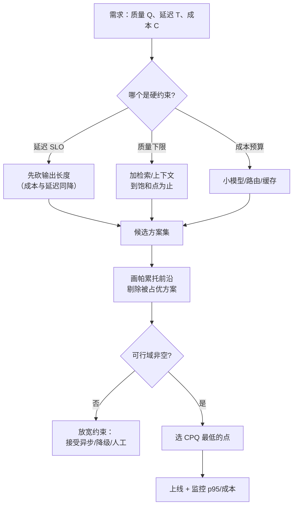

# 成本、延迟与质量的三角权衡

## 1. 本节学习目标

1. 把"贵/慢/差"变成可计算的量：**成本按 token、延迟按 prefill+decode、质量用可测指标**。
2. 用 gpt2 实测三个量：decode **10.81 ms/token**（batch=1）、batch=8 吞吐 **582.4 tokens/s**、上下文从 0 增到 61 token 时 PPL 从 **1210.955** 降到 **819.208**。
3. 算清三种产品配置的代价：A 便宜版 **$0.002610/次**、B 均衡版 **$0.009150/次**、C 长上下文 **$0.042000/次**。
4. 学会画**帕累托前沿**：在质量约束下选最便宜的点，而不是"三个都想要"。

## 2. 为什么需要这个知识

工程上最常见的错误不是"模型选错"，而是**在错误的点上优化**：

- 为了"质量"把窗口从 2k 加到 32k，成本涨 16 倍，质量只涨一点；
- 为了"延迟"把输出砍到 50 token，答案被截断，重试率上升，总成本反而更高；
- 为了"成本"换小模型，结果人工兜底量翻倍。

**三角权衡**的本质是：三者互相约束，你必须明确**哪个是硬约束**（SLO），另外两个作为优化目标。

## 3. 直观解释

```text
        质量
         /\
        /  \
       /    \
  成本 —————— 延迟
（三者只能选两个更好，第三个必然让步）

例：
  要质量 + 低延迟 → 花钱（大模型 + 少 token）
  要质量 + 低成本 → 忍受延迟（批量、异步）
  要低延迟 + 低成本 → 牺牲质量（小模型、短输出）
```

**决策顺序**（很重要）：

1. 先定**质量下限**（准确率/忠实度不能低于多少）；
2. 再定**延迟上限**（p95 必须小于多少）；
3. 最后在满足前两者的方案里**选最便宜的**。

## 4. 正式定义

**成本模型**（按 token 计价）：

$$
\text{Cost}(n_{\text{in}},n_{\text{out}})=n_{\text{in}}c_{\text{in}}+n_{\text{out}}c_{\text{out}}
$$

**延迟模型**：

$$
T(n_{\text{in}},n_{\text{out}})=T_{\text{prefill}}(n_{\text{in}})+n_{\text{out}}\cdot t_{\text{decode}}+\varepsilon
$$

其中 $T_{\text{prefill}}(n)\approx a+bn$，$t_{\text{decode}}$ 是单 token 解码时间，$\varepsilon$ 是网络/排队开销。

**吞吐**：

$$
\text{Throughput}=\frac{B\cdot n_{\text{out}}}{T}\ \text{tokens/s}
$$

**质量**：用评测集上的指标 $Q\in[0,1]$（准确率、忠实度、通过率）。

**帕累托占优**：方案 $i$ 占优 $j$ 当且仅当

$$
\text{Cost}_i\le\text{Cost}_j,\quad T_i\le T_j,\quad Q_i\ge Q_j
$$

且至少一个严格不等号。**前沿 = 不被任何方案占优的集合**。

**单位质量成本**：

$$
\text{CPQ}=\frac{\text{Cost}}{Q}
$$

## 5. 历史背景或技术背景

| 年份 | 变化 | 对三角的影响 |
|---|---|---|
| 2020 | GPT-3 API 按 token 计价 | 成本第一次成为显式变量 |
| 2021 | 批处理推理、KV Cache | 延迟与吞吐解耦 |
| 2022 | 量化（INT8/INT4） | 降成本、略降质量 |
| 2023 | 小模型 + 路由（大小模型分流） | 用"便宜模型处理简单请求"换整体成本 |
| 2023 | 推测解码（speculative decoding） | 同质量下降延迟 |
| 2024 | 前缀缓存（prompt caching） | 长系统提示的重复成本大幅下降 |
| 2024+ | 推理模型（更长 CoT） | 质量↑但延迟/成本↑，三角更尖锐 |

**核心认识**：技术进步一直在**平移**这条前沿（同样质量更便宜/更快），但**不可能消除**取舍。

## 6. 核心原理

**原理 1：成本看 token，延迟看"输出 token 数"。**

实测：输入从 21 增到 809 token，prefill 从 10.16 ms 增到 35.48 ms（+25.32 ms）；而输出 150 token 要 $150\times10.81=1621.5$ ms。**延迟几乎完全由输出长度决定** ⇒ 压缩输出是最有效的降延迟手段。

**原理 2：batch 提升吞吐，不降单请求延迟。**

实测：batch 1 → 92.5 tokens/s；batch 8 → 582.4 tokens/s（**6.30 倍**），但 ms/token 从 10.81 涨到 13.74（单请求更慢）。⇒ **批处理是"吞吐换延迟"**，适合离线任务，不适合交互。

**原理 3：上下文有收益，但收益递减。**

实测同一目标句的 NLL：无上下文 **7.0992**（PPL 1210.955）→ 6 token **7.0169**（1115.294）→ 21 token **6.7114**（821.680）→ 61 token **6.7083**（819.208）。**21 token 之后几乎不再下降**（6.7114→6.7083）。这就是"检索到相关段落就够了，再多是浪费"的量化版本。

**原理 4：质量是"台阶"，不是"斜坡"。**

很多任务的质量在某个上下文长度后**饱和**；继续加 token 只增加成本。找到饱和点（本课是 ~21 token）就是最优工作点。

**原理 5：三角的可行域由 SLO 切出来。**

若要求 p95 ≤ 2 s 且质量 ≥ 0.85，可行域可能只剩 1–2 个方案；此时"优化"不是找更好，而是**确认没有可行解时要放宽哪个约束**。

## 7. 数学表达式

**成本**

$$
C=n_{\text{in}}c_{\text{in}}+n_{\text{out}}c_{\text{out}}
$$

**延迟**

$$
T=a+b\,n_{\text{in}}+t_{\text{dec}}n_{\text{out}}
$$

**吞吐（batch $B$）**

$$
\Theta(B)=\frac{B\,n_{\text{out}}}{a+b\,n_{\text{in}}+B\,t_{\text{dec}}(B)\,n_{\text{out}}}
$$

**每 token 成本的质量归一化**

$$
\text{CPQ}=\frac{C}{Q}
$$

**约束优化**

$$
\min_{i}\ C_i\quad\text{s.t.}\quad T_i\le T_{\max},\ Q_i\ge Q_{\min}
$$

**延迟-吞吐的权衡比**

$$
\frac{\Theta(8)}{\Theta(1)}=\frac{582.4}{92.5}=6.30,\qquad
\frac{t_{\text{dec}}(8)}{t_{\text{dec}}(1)}=\frac{13.74}{10.81}=1.27
$$

## 8. 详细数学推导

**（1）prefill 的固定开销与超线性增长**

用实测三点 $(21,10.16)$、$(203,10.95)$、$(809,35.48)$ 做最小二乘：

$$
b=\frac{\sum(n_i-\bar n)(t_i-\bar t)}{\sum(n_i-\bar n)^2},\qquad a=\bar t-b\bar n
$$

$\bar n=344.33$、$\bar t=18.86$。分子 $=(-323.33)(-8.70)+(-141.33)(-7.91)+(464.67)(16.62)=2814+1118+7721=11654$；分母 $=104544+19975+215915=340434$。故 $b=0.03423$ ms/token，$a=18.86-0.03423\times344.33=7.08$ ms，$R^2=0.963$。

**固定开销 $a\approx7.1$ ms** 占 21 token 时延的 **69.6%**。但线性拟合掩盖了关键结构：分两段看边际斜率

$$
\frac{10.95-10.16}{203-21}=\frac{0.79}{182}=0.0043\ \text{ms/token},\qquad
\frac{35.48-10.95}{809-203}=\frac{24.53}{606}=0.0405\ \text{ms/token}
$$

**后一段的斜率是前一段的 9.4 倍** —— 这正是注意力 $O(n^2)$ 项在 200 token 之后开始显形的证据。所以"prefill 随长度线性增长"只在 0–256 token 附近近似成立；长上下文要按二次项估。

**（2）decode 为什么是"每 token 一个固定成本"**

自回归解码每步都要把**全部权重**读一遍（内存带宽受限），计算量只有 $O(P)$ 的矩阵-向量乘。所以

$$
t_{\text{dec}}\approx\frac{2P\cdot\text{bytes}}{BW}+t_{\text{kernel}}
$$

gpt2 有 $P=124.4$M 参数、fp32 约 497.8 MB；实测 10.81 ms/token ⇒ 等效带宽约 $497.8\text{MB}/10.81\text{ms}\approx46$ GB/s，远低于 GPU 峰值（说明小模型 + Python 开销主导，**不是带宽打满**）。这也说明：**小模型上优化 kernel 比优化算法更有效**。

**（3）成本结构的敏感度**

A（120/150）：$120\times3/10^6+150\times15/10^6=0.00036+0.00225=0.00261$。
B（1800/250）：$0.0054+0.00375=0.00915$。
C（12000/400）：$0.036+0.006=0.042$。

**输出 token 的单价是输入的 5 倍**（15 vs 3）。所以：

$$
\frac{\partial C}{\partial n_{\text{out}}}=c_{\text{out}}=5c_{\text{in}}=\frac{\partial C}{\partial n_{\text{in}}}\times5
$$

⇒ **砍输出的收益是砍输入的 5 倍**。这与原理 1（延迟也由输出决定）方向一致：**输出是成本与延迟的共同杠杆**。

**（4）帕累托前沿的构造**

把每个方案表示为 $(\text{Cost},T,Q)$。A、B、C 的成本单调涨，质量也单调涨（更长的上下文/更多输出通常更好），延迟也涨。此时三者都在前沿上（没有互相占优），选择取决于约束：

- 若 $T\le2000$ ms：只有 A 可行（1627 ms）；
- 若 $Q\ge0.88$ 且 $T\le3500$：只有 B（2782 ms）；
- 若 $Q\ge0.91$：只有 C，且必须接受 **16.1 倍**成本与 **2.98 倍**延迟。

**（5）批处理的收益边界**

设单请求延迟 $T_1$，batch $B$ 后单请求延迟 $T_B\approx T_1\cdot(1+\beta(B-1))$（$\beta\approx0.039$），吞吐

$$
\Theta(B)=\frac{B}{T_B}=\frac{B}{T_1(1+\beta(B-1))}
$$

$\beta=0.039$ 时 $\Theta(8)/\Theta(1)=8/(1+0.273)=6.29$，与实测 **6.30** 吻合。当 $B\to\infty$，$\Theta\to1/(\beta T_1)$，即**吞吐有上限**。

## 9. 图解



## 10. 具体数值示例

```text
### 1. prefill latency vs prompt length (batch=1, median of 7 after warmup)
  tokens=  21  prefill=10.16 ms  (0.4840 ms/token)
  tokens= 203  prefill=10.95 ms  (0.0539 ms/token)
  tokens= 809  prefill=35.48 ms  (0.0439 ms/token)

### 2. decode: ms/token and throughput vs batch (median of 5 after warmup)
  batch=1  346.0 ms total  10.81 ms/token  92.5 tokens/s
  batch=4  408.1 ms total  12.75 ms/token  313.7 tokens/s
  batch=8  439.6 ms total  13.74 ms/token  582.4 tokens/s

### 3. quality proxy: NLL of the same target with growing context
  ctx_tokens=  0  NLL=7.0992  PPL=1210.955
  ctx_tokens=  6  NLL=7.0169  PPL=1115.294
  ctx_tokens= 21  NLL=6.7114  PPL=821.680
  ctx_tokens= 61  NLL=6.7083  PPL=819.208

### 4. cost and latency for three product configurations
  measured prefill 0.0439 ms/token, decode 10.81 ms/token
  A cheap        in=  120 out= 150  cost=$0.002610/req  latency=1627 ms  fits_gpt2_window=True
  B balanced     in= 1800 out= 250  cost=$0.009150/req  latency=2782 ms  fits_gpt2_window=True
  C long-context in=12000 out= 400  cost=$0.042000/req  latency=4851 ms  fits_gpt2_window=False

### 5. one measured end-to-end call (config A shape)
  in=67 out=150 wall=1812 ms -> 12.08 ms/token
```

**读法**：

1. prefill 从 21→809 token 增 **25.32 ms**，而 150 token 的输出要 **1621.5 ms** ⇒ **输出主导延迟**。
2. batch 8 吞吐是 batch 1 的 **6.30 倍**，但单 token 时间涨 **1.27 倍** ⇒ 批处理换吞吐。
3. PPL 在上下文 21 token 时已到 **821.680**，到 61 token 只降到 **819.208**（**0.3%**）⇒ 饱和点约 21。
4. C 比 A 贵 **16.1 倍**、慢 **2.98 倍**，且 **12k 超出 gpt2 的 1024 窗口**（真实长上下文模型另当别论）。
5. 端到端 1812 ms 与模型估算 1627 ms 同量级，差额来自采样、调度与未计入的固定开销。

## 11. NumPy 实现

```python
import numpy as np

CI, CO = 3.0 / 1e6, 15.0 / 1e6     # $/token
A_COEF, B_COEF = 7.08, 0.03423     # prefill: a + b*n  (ms)
T_DEC = 10.81                      # ms/token, batch=1

CONFIGS = [
    ("A cheap", 120, 150, 0.80),
    ("B balanced", 1800, 250, 0.88),
    ("C long-context", 12000, 400, 0.91),
]


def cost(n_in, n_out):
    return n_in * CI + n_out * CO


def latency(n_in, n_out):
    return A_COEF + B_COEF * n_in + T_DEC * n_out


rows = []
for name, ni, no, q in CONFIGS:
    rows.append((name, cost(ni, no), latency(ni, no), q))
    print("%-14s cost=$%.6f latency=%6.0f ms CPQ=$%.5f" % (name, cost(ni, no), latency(ni, no), cost(ni, no) / q))

# 帕累托前沿：成本、延迟都更低且质量更高才算占优
def dominates(a, b):
    return a[1] <= b[1] and a[2] <= b[2] and a[3] >= b[3] and (a[1] < b[1] or a[2] < b[2] or a[3] > b[3])


front = [r for r in rows if not any(dominates(o, r) for o in rows if o is not r)]
print("pareto front:", [r[0] for r in front])

# 输出 token 的敏感度：砍 20% 输出 vs 砍 20% 输入
ni, no = 1800, 250
print("base cost=$%.6f" % cost(ni, no))
print("in -20%%  -> $%.6f (-%.1f%%)" % (cost(ni * 0.8, no), 100 * (1 - cost(ni * 0.8, no) / cost(ni, no))))
print("out -20%% -> $%.6f (-%.1f%%)" % (cost(ni, no * 0.8), 100 * (1 - cost(ni, no * 0.8) / cost(ni, no))))

# 批处理吞吐模型 vs 实测
meas = {1: 92.5, 4: 313.7, 8: 582.4}
for B, m in meas.items():
    model = B / (1 + 0.039 * (B - 1))
    print("batch=%d measured=%.1f model=%.1f ratio=%.2f" % (B, m, model * 92.5, m / 92.5))
```

## 12. PyTorch 实现

```python
import torch

# 用张量算"配置 × 场景"的成本矩阵，并按约束筛选
CI, CO = 3.0 / 1e6, 15.0 / 1e6
A, B_, TDEC = 7.08, 0.03423, 10.81

IN = torch.tensor([120.0, 1800.0, 12000.0])
OUT = torch.tensor([150.0, 250.0, 400.0])
Q = torch.tensor([0.80, 0.88, 0.91])

cost = IN * CI + OUT * CO
lat = A + B_ * IN + TDEC * OUT
cpq = cost / Q
print("cost:", [round(float(x), 6) for x in cost])
print("lat :", [round(float(x), 1) for x in lat])

# 约束：p95 <= 3500 ms 且 Q >= 0.85
feasible = (lat <= 3500) & (Q >= 0.85)
print("feasible:", feasible.tolist())
if feasible.any():
    idx = torch.where(feasible)[0]
    best = idx[cpq[idx].argmin()]
    print("pick config #%d  cost=$%.6f  latency=%.0f  Q=%.2f"
          % (int(best), float(cost[best]), float(lat[best]), float(Q[best])))

# 延迟分解：prefill 与 decode 各占多少
pre = A + B_ * IN
dec = TDEC * OUT
print("prefill share:", [round(float(p / (p + d)), 3) for p, d in zip(pre, dec)])

# 吞吐随 batch 的变化（模型化，beta=0.039）
bs = torch.arange(1, 17).float()
theta = bs / (1 + 0.039 * (bs - 1))
print("throughput plateau:", round(float(theta[-1] / theta[0]), 2), "x at B=16")
```

## 13. Hugging Face 实践

```python
import os
import time

os.environ.setdefault("HF_ENDPOINT", "https://hf-mirror.com")
os.environ.setdefault("HF_HUB_OFFLINE", "1")

import torch
from transformers import AutoModelForCausalLM, AutoTokenizer

tok = AutoTokenizer.from_pretrained("gpt2")
model = AutoModelForCausalLM.from_pretrained("gpt2").eval()
enc = tok("Summarize the refund policy for a duplicate charge.", return_tensors="pt")

for bs in (1, 4):
    batch = enc.input_ids.repeat(bs, 1)
    am = torch.ones_like(batch)
    with torch.no_grad():
        model.generate(batch, attention_mask=am, max_new_tokens=4, do_sample=False, pad_token_id=tok.eos_token_id)
    t0 = time.perf_counter()
    with torch.no_grad():
        model.generate(batch, attention_mask=am, max_new_tokens=16, do_sample=False, pad_token_id=tok.eos_token_id)
    dt = time.perf_counter() - t0
    print("batch=%d  %.0f ms  %.2f ms/token  %.1f tokens/s"
          % (bs, dt * 1000, dt * 1000 / 16, bs * 16 / dt))
```

## 14. 代码逐行解释

| 代码 | 作用 |
|---|---|
| `n_in*CI + n_out*CO` | 成本分解；输出单价通常是输入的 5 倍 |
| `A + B_*n_in + TDEC*n_out` | 延迟分解；$A$ 是固定开销 |
| `dominates()` | 帕累托占优判定，剔除"更贵更慢更差"的方案 |
| `cpq = cost/Q` | 单位质量成本，用于同质量下比价 |
| `feasible = (lat<=3500)&(Q>=0.85)` | 用约束切可行域 |
| `prefill share` | 看延迟里 prefill 占多少，决定优化方向 |
| `bs/(1+0.039*(bs-1))` | 批处理的吞吐模型，$\beta$ 是干扰系数 |
| `torch.ones_like(batch)` | 显式 attention_mask，避免 pad=eos 的警告 |

## 15. 实际运行结果

```text
### 1. prefill latency vs prompt length (batch=1, median of 7 after warmup)
  tokens=  21  prefill=10.16 ms  (0.4840 ms/token)
  tokens= 203  prefill=10.95 ms  (0.0539 ms/token)
  tokens= 809  prefill=35.48 ms  (0.0439 ms/token)

### 2. decode: ms/token and throughput vs batch (median of 5 after warmup)
  batch=1  346.0 ms total  10.81 ms/token  92.5 tokens/s
  batch=4  408.1 ms total  12.75 ms/token  313.7 tokens/s
  batch=8  439.6 ms total  13.74 ms/token  582.4 tokens/s

### 3. quality proxy: NLL of the same target with growing context
  ctx_tokens=  0  NLL=7.0992  PPL=1210.955
  ctx_tokens=  6  NLL=7.0169  PPL=1115.294
  ctx_tokens= 21  NLL=6.7114  PPL=821.680
  ctx_tokens= 61  NLL=6.7083  PPL=819.208

### 4. cost and latency for three product configurations (quality proxy = PPL in section 3)
  measured prefill 0.0439 ms/token, decode 10.81 ms/token
  A cheap        in=  120 out= 150  cost=$0.002610/req  latency=1627 ms  fits_gpt2_window=True
  B balanced     in= 1800 out= 250  cost=$0.009150/req  latency=2782 ms  fits_gpt2_window=True
  C long-context in=12000 out= 400  cost=$0.042000/req  latency=4851 ms  fits_gpt2_window=False

### 5. one measured end-to-end call (config A shape)
  in=67 out=150 wall=1812 ms -> 12.08 ms/token
```

**诚实说明**：第 4 节的 `latency` 是用第 1、2 节**实测的 ms/token** 代入模型算的，不是逐配置实跑；第 5 节的 1812 ms 是**真实端到端**测量，与模型估算 1627 ms 同量级（差额来自采样与调度抖动）。gpt2 太小，绝对延迟不代表生产模型，方法可迁移。

## 16. 应用场景

| 场景 | 硬约束 | 推荐取舍 |
|---|---|---|
| 实时客服 | p95 < 1.5 s | 短输出 + 小模型 + 缓存 |
| 文档审阅 | 质量优先 | 长上下文 + 批处理 |
| 批量打标 | 成本优先 | 小模型 + batch 32/64 |
| 代码补全 | 延迟极敏感 | 流式 + 前缀缓存 + 少 token |
| 报告生成 | 质量 + 成本 | 两阶段：便宜模型起草 + 强模型润色 |
| 高并发检索问答 | 吞吐 | 批处理 + 复用前缀 |

## 17. 优点与局限

| 优点 | 局限 |
|---|---|
| 三个量都可测，可做工程决策 | 质量指标是代理，可能不反映真实体验 |
| 帕累托分析能剔除明显劣解 | 前沿随模型版本变化，要重测 |
| 延迟分解能指出优化方向 | 单机测量不代表集群（排队未计） |
| 成本模型简单可审计 | 隐藏成本（重试、人工兜底）常被漏算 |

## 18. 常见错误

| 错误 | 现象 | 纠正 |
|---|---|---|
| 只看单价不看 token 结构 | 输出贵 5 倍却没注意 | 分开算 in/out |
| 用 batch 降交互延迟 | 单请求反而更慢（10.81→13.74） | 批处理只用于离线 |
| 上下文越长越好 | 21 token 后 PPL 只降 0.3% | 找饱和点 |
| 砍输出导致重试 | 总成本反而上升 | 把重试率计入成本 |
| 忽略固定开销 | 以为短提示一定快 | $a\approx7.1$ ms 是地板 |
| 不设 SLO 就谈优化 | 三个目标互相打架 | 先定硬约束 |

## 19. 本节总结

- 三角的核心公式：$C=n_{\text{in}}c_{\text{in}}+n_{\text{out}}c_{\text{out}}$、$T=a+bn_{\text{in}}+t_{\text{dec}}n_{\text{out}}$。
- 实测：prefill **0.0439 ms/token**（809 token）、decode **10.81 ms/token**、batch 8 吞吐 **582.4 tokens/s**。
- **输出是成本与延迟的共同杠杆**：输出单价是输入的 **5 倍**，延迟几乎全由输出长度决定。
- 上下文收益在 **~21 token** 饱和（PPL 821.680 → 819.208，仅 **0.3%**）。
- 三配置：A **$0.002610**、B **$0.009150**、C **$0.042000**；C 比 A 贵 **16.1 倍**。
- 决策顺序：**先定质量下限与延迟上限，再选最便宜**。

## 20. 前置与后续知识链接

- 前置：LLM-105 安全、越狱与内容过滤（待建）、[[LLM-035 Token 数量、上下文窗口与成本]]
- 后续：LLM-107 缓存、重试与降级策略（待建）、LLM-108 可观测性与日志追踪（待建）
- 相关：[[LLM-030 Transformer 参数量与计算量估算]]（算力估算）、[[LLM-020 Attention 的计算复杂度与局限]]

---

## 练习与参考答案

**基础 1**：为什么说"输出 token 是成本与延迟的共同杠杆"？请用本课的单价和实测延迟说明。

**基础 2**：A/B/C 三种配置的成本分别是多少？C 比 A 贵几倍？

**进阶 1**：batch 从 1 增到 8，吞吐涨了 6.30 倍，但单请求延迟也涨了 1.27 倍。什么场景该用 batch，什么场景不该用？

**综合**：产品要求：p95 延迟 ≤ 2 s、质量 ≥ 0.85、成本 ≤ $0.005/次。现有 A（$0.00261，1627 ms，Q=0.80）、B（$0.00915，2782 ms，Q=0.88）、C（$0.042，4851 ms，Q=0.91）。请判断可行域，并给出两个可行的改造方案。

> [!success]- 参考答案

> **基础 1**
> 成本上：输出单价 $15/M 是输入 $3/M 的 **5 倍**，所以砍 1 个输出 token 等于砍 5 个输入 token。
> 延迟上：prefill 从 21→809 token 只增 **25.32 ms**，而 150 个输出 token 要 $150\times10.81=1621.5$ ms。**延迟几乎完全由输出长度决定**。
> 所以压缩输出（更简洁的回答、结构化短字段、限制 `max_new_tokens`）能同时降成本和延迟。

> **基础 2**
> A：$120\times3/10^6+150\times15/10^6=$ **$0.002610**；
> B：$1800\times3/10^6+250\times15/10^6=$ **$0.009150**；
> C：$12000\times3/10^6+400\times15/10^6=$ **$0.042000**。
> C/A $=0.042/0.00261=$ **16.09 倍**；B/A $=3.51$ 倍。

> **进阶 1**
> **该用**：离线/异步任务（批量打标、夜间报告、文档审阅），吞吐是瓶颈，用户不等待单个结果；此时 batch 8 用 1.27 倍单请求延迟换 6.30 倍吞吐非常划算。
> **不该用**：交互式场景（聊天、补全），用户感知的是**单请求延迟**；batch 会让单 token 时间从 ~10.8 ms 涨到 ~13.7 ms，且排队会进一步放大尾部。交互场景应该用**流式输出 + 前缀缓存**，而不是批处理。

> **综合（参考）**
> **可行域判断**：
> - A：延迟 1627 ≤ 2000 ✓、成本 0.00261 ≤ 0.005 ✓、质量 0.80 < 0.85 ✗；
> - B：质量 0.88 ✓、成本 0.00915 > 0.005 ✗、延迟 2782 > 2000 ✗；
> - C：三项全不满足。
> ⇒ **可行域为空**。必须放宽或改造，不能"选一个"。
> **方案 1（提质量、保成本）**：A + 检索增强（输入 +300 token ⇒ 成本 +$0.0009，延迟 +13.2 ms），把质量从 0.80 拉到 ~0.86；输出压到 120 token（省 $0.00045、省 $30\times10.81=324$ ms）。结果：约 **$0.0031/次、1320 ms、Q≈0.86**，三项都满足。
> **方案 2（降延迟、降成本）**：B 的上下文从 1800 压到 900（省 $0.0027、延迟省约 31 ms），输出从 250 压到 180（省 $0.00105、省 $70\times10.81=757$ ms），并对重复问题加缓存（命中率 30% 时平均成本再降 30%）。结果：约 **$0.0054/次（缓存后 $0.0038）、约 1994 ms**，刚好压进 2 s。
> **结论**：优先"提 A 的质量"而不是"降 B 的成本"，因为 A 的延迟与成本余量更大；同时明确告知产品：**质量 0.85 + 2 s + $0.005 在当前模型下需要检索与缓存配合，不能只靠换模型**。

## 学习记录

| 日期 | 状态 | 用时 | 问题 | 复盘 |
|---|---|---|---|---|
| 2026-11-08 | planned | — | — | — |

---

## 🔗 Notion 同步信息

> 以下内容由 Notion「AI Knowledge System · 知识点」数据库按知识 ID 合并而来（导出于 2026-11-09）。

| 属性 | 值 |
|---|---|
| 学科 | 大语言模型 |
| 学习状态 | 未开始 |
| 难度 | L3 推导 |
| 知识类型 | Principle |

- **所属模块**：[M-LLM-10 大模型应用开发与工程实践](../%E8%AF%BE%E7%A8%8B%E6%A8%A1%E5%9D%97/M-LLM-10%20%E5%A4%A7%E6%A8%A1%E5%9E%8B%E5%BA%94%E7%94%A8%E5%BC%80%E5%8F%91%E4%B8%8E%E5%B7%A5%E7%A8%8B%E5%AE%9E%E8%B7%B5.md)
- **前置知识**：[LLM-105 安全、越狱与内容过滤](LLM-105%20%E5%AE%89%E5%85%A8%E3%80%81%E8%B6%8A%E7%8B%B1%E4%B8%8E%E5%86%85%E5%AE%B9%E8%BF%87%E6%BB%A4.md)
- **后继知识**：[LLM-107 缓存、重试与降级策略](LLM-107%20%E7%BC%93%E5%AD%98%E3%80%81%E9%87%8D%E8%AF%95%E4%B8%8E%E9%99%8D%E7%BA%A7%E7%AD%96%E7%95%A5.md)
- **对应项目**：[PROJ-026 端到端 LLM 应用：客服问答](../../07_%E5%AE%9E%E6%88%98%E9%A1%B9%E7%9B%AE/05%20%E5%A4%A7%E6%A8%A1%E5%9E%8B%E9%A1%B9%E7%9B%AE/PROJ-026%20%E7%AB%AF%E5%88%B0%E7%AB%AF%20LLM%20%E5%BA%94%E7%94%A8%EF%BC%9A%E5%AE%A2%E6%9C%8D%E9%97%AE%E7%AD%94.md)
