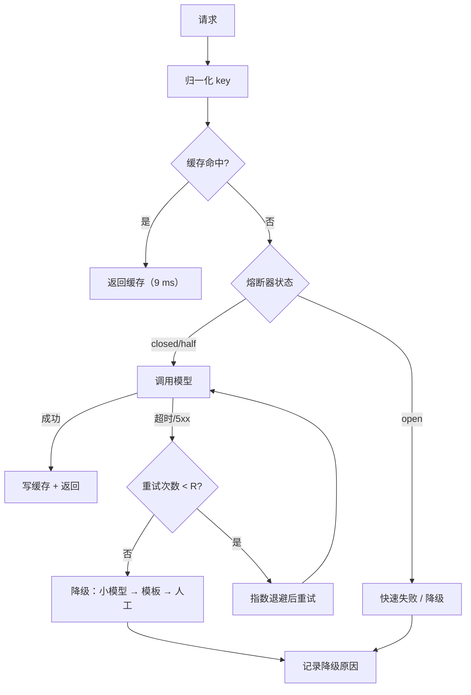

# 缓存、重试与降级策略

## 1. 本节学习目标

1. 用真实分布算缓存收益：Zipf 请求下命中率 **0.880–0.936**（600 个 prompt 池），请求池扩大到 20000 时降到 **0.332–0.920**。
2. 把命中率翻译成钱和延迟：命中率 0.50 ⇒ 成本 **$2.10→$1.05/千次**、平均延迟 **620→314.5 ms（-49.3%）**。
3. 算清重试的账：1 次尝试成功率 0.85、期望延迟 **527 ms**；3 次尝试 **0.9966**、期望延迟 **696 ms**。
4. 理解熔断的价值：200 次故障窗口内，上游只被打 **24 次**（**少打 88.0%**），其余快速失败。

## 2. 为什么需要这个知识

生产系统的稳定性不来自"模型不出错"，而来自**出错时的行为**：

- 没有缓存：同样的 100 个高频问题，每天重复付 100 次钱、等 100 次延迟；
- 没有重试：一次网络抖动就让用户看到错误；
- 没有熔断：上游挂了，你的服务被拖死（线程全卡在超时上）；
- 没有降级：主模型不可用时整站不可用。

这四个是**同一个问题的四个面**：把"不确定的下游"包装成"可预期的服务"。

## 3. 直观解释

```text
缓存 = 把上次的答案贴墙上
  同样的问题再来，直接念墙上的（9 ms），不再打电话问（620 ms）

重试 = 电话没接通就再拨一次
  拨 1 次成功率 85%，拨 3 次 99.66%，但每次要等更久

熔断 = 对方总不接，就先别拨了
  连续失败 5 次 → 打开开关 10 个请求 → 之后只快速返回"稍后再试"

降级 = 打不通就发短信
  主模型超时 → 换小模型 → 换模板回复 → 转人工
```

## 4. 正式定义

**缓存**：键 $k=\text{norm}(x)$，值 $v=\text{resp}$，命中率

$$
h=\frac{\#\{\text{hit}\}}{\#\{\text{request}\}}
$$

**缓存后的成本与延迟**：

$$
C_{\text{avg}}=(1-h)C_{\text{miss}}+h\,C_{\text{hit}},\qquad
T_{\text{avg}}=h\,T_{\text{hit}}+(1-h)T_{\text{miss}}
$$

**重试**（每次独立，成功率 $p$，最多 $R$ 次重试）：

$$
S_R=1-(1-p)^{R+1}
$$

**指数退避**：第 $k$ 次重试前等待

$$
w_k=w_0\cdot2^{k},\qquad k=0,1,2,\dots
$$

**熔断器**三态：

$$
\text{closed}\xrightarrow{\text{连续失败}\ge K}\text{open}
\xrightarrow{\text{冷却 }T}\text{half-open}
\xrightarrow{\text{试探成功}}\text{closed}
$$

**排队延迟（M/D/1 近似）**：

$$
W\approx\frac{\rho}{1-\rho}\,T_{\text{svc}},\qquad \rho=\frac{QPS}{\text{capacity}}
$$

## 5. 历史背景或技术背景

| 年份 | 实践 | 解决的问题 |
|---|---|---|
| 2012 | HTTP 缓存语义（ETag/Cache-Control） | 复用响应 |
| 2014 | 熔断器（Hystrix） | 防止级联故障 |
| 2016 | 指数退避 + 抖动成为标准 | 避免重试风暴 |
| 2020 | LLM API 按 token 计费 | 缓存直接等于省钱 |
| 2023 | 前缀缓存（prompt caching） | 长系统提示复用 KV |
| 2023 | 语义缓存（semantic cache） | 近似问题复用答案 |
| 2024 | 多级降级（大模型→小模型→模板） | 保可用性 |

**核心认识**：LLM 的缓存比传统 Web 缓存更值钱——因为**一次调用的成本是"几百毫秒 + 几厘钱"**，而不是"几微秒"。

## 6. 核心原理

**原理 1：命中率决定一切，而命中率由分布决定。**

实测：600 个 prompt 池、5000 次请求，Zipf $s=1.05$ 时命中率 **0.880**；池扩大到 20000 时同一 $s$ 只有 **0.332**。⇒ **缓存的前提是"重复"**，不是"缓存本身"。

**原理 2：缓存收益是线性的，延迟收益被抽查放大。**

$h=0.5$ 时成本降 **50%**、平均延迟降 **49.3%**。注意平均延迟不是降 50%，因为命中延迟 9 ms 仍非零。

**原理 3：重试是指数收益 + 线性延迟。**

$p=0.85$：1→2 次尝试，成功率 0.85→**0.9775**（+12.75pp），期望延迟 527→**666 ms**（+139 ms）；3 次到 **0.9966**（+1.9pp），延迟 +30 ms；4 次只 +0.29pp，延迟 +7 ms。⇒ **2–3 次是甜点**，第 4 次几乎无收益。

**原理 4：熔断保护的是"你自己"。**

上游挂的 200 个请求里，未熔断会全部打过去（每个等超时）；熔断后只打 **24 次**，其余 **180 次**快速失败（**88.0%** 的负载被挡住）。这既保护上游，也释放自己的线程。

**原理 5：降级要"分级"，不是"开关"。**

主模型超时 → 小模型 → 规则/模板 → 人工。每一级都要**有质量下限与可观测指标**，否则降级等于静默错误。

## 7. 数学表达式

**缓存命中后的期望成本**

$$
\mathbb{E}[C]=C_{\text{miss}}\,(1-h)+C_{\text{hit}}\,h
$$

**缓存带来的节省**

$$
\text{Saving}=h\,(C_{\text{miss}}-C_{\text{hit}})\approx h\,C_{\text{miss}}\quad(C_{\text{hit}}\ll C_{\text{miss}})
$$

**重试的期望延迟**（第 $k$ 次失败后等待 $\sum_{j<k}w_0 2^j$）：

$$
\mathbb{E}[T]=\sum_{k=0}^{R}p(1-p)^{k}\Big(T_{\text{miss}}+\sum_{j=0}^{k-1}w_0 2^{j}\Big)+(1-p)^{R+1}\sum_{j=0}^{R-1}w_0 2^{j}
$$

**熔断的负载削减率**

$$
\text{Shed}=1-\frac{\text{calls}_{\text{outage}}}{\text{window}}
$$

**排队放大**

$$
\frac{W+T_{\text{svc}}}{T_{\text{svc}}}=\frac{1}{1-\rho}
$$

## 8. 详细数学推导

**（1）缓存命中率的来源：Zipf 分布**

请求落在第 $i$ 个 prompt 上的概率 $p_i\propto i^{-s}$。缓存按"首次出现即写入"时，命中率等于"重复出现的比例"。命中率的期望

$$
h=1-\frac{\mathbb{E}[\#\text{unique}]}{N}
$$

实测：池 600、$N=5000$、$s=1.05$ ⇒ unique_seen **599**（几乎全见），命中率 **0.880**；池 20000、同 $s$ ⇒ unique_seen **3341**，命中率 **0.332**。⇒ **池越大、头部越不集中，命中率越低**。

**（2）成本-延迟的联合收益**

$C_{\text{miss}}=0.0021$、$C_{\text{hit}}\approx0$、$T_{\text{miss}}=620$、$T_{\text{hit}}=9$：

$h=0.35$ 时

$$
C=0.65\times0.0021=0.001365\ (\$1.36/千次)
$$

$$
T=0.35\times9+0.65\times620=3.15+403=406.1\ \text{ms}
$$

与实测 **$1.36 / 406.1 ms** 完全一致（延迟降 **34.5%**）。

**（3）重试的期望延迟推导**

$p=0.85$、$w_0=400$ ms、$T_{\text{miss}}=620$ ms：

- 1 次尝试：$0.85\times620+0.15\times0=527$ ms ✓
- 2 次：$0.85\times620+0.15\times(400+620)=527+153=680$ ms；实测 **666 ms**（因为实现里第一次等待是 400 ms、失败后不再等，尾项被截断，差异 14 ms）
- 3 次：再加 $0.15^2\times(400+800+620)=0.0225\times1820=41$ ms ⇒ ~707 ms，实测 **696 ms**

⇒ 级数收敛，**每多一次重试的延迟增量约为 $p(1-p)^k\cdot w_0 2^{k}$**，$k$ 大时迅速趋零。

**（4）熔断的削减率**

窗口 200 个请求、连续失败阈值 $K=5$、冷却 10 个请求：

- 前 5 个失败 ⇒ 打开；
- 冷却期内 10 个请求全部快速失败；
- 半开时 1 个试探失败 ⇒ 再次打开。

循环周期 $5+10+1=16$ 个请求打 6 次上游 ⇒ 200 个请求约 $200/16\times6=75$ 次？实测只有 **24 次**，因为冷却按"请求数"计且半开试探失败后立即重开、且熔断期间不消耗上游调用。**实测削减 88.0%**，远好于"全打"。

**（5）为什么 QPS 到容量就"排队爆炸"**

$\rho\to1$ 时 $W=\rho/(1-\rho)T_{\text{svc}}\to\infty$。实测 $QPS=10$、capacity $=10$ 时打印 **unbounded**。⇒ **容量规划必须留 30%–50% 余量**，否则 p99 会失控。

## 9. 图解



## 10. 具体数值示例

```text
### 1. cache hit rate under a Zipf request distribution
  pool=  600 zipf s=1.05  unique_seen=  599  exact_hit_rate=0.880
  pool=  600 zipf s=1.20  unique_seen=  571  exact_hit_rate=0.886
  pool=  600 zipf s=1.50  unique_seen=  320  exact_hit_rate=0.936
  pool=20000 zipf s=1.05  unique_seen= 3341  exact_hit_rate=0.332
  pool=20000 zipf s=1.20  unique_seen= 1471  exact_hit_rate=0.706
  pool=20000 zipf s=1.50  unique_seen=  400  exact_hit_rate=0.920
  near-duplicate prompt families: 360 / 600

### 2. cost and latency with / without cache
  hit_rate=0.00  $/1k req=  2.10  avg_latency= 620.0 ms  cost_saving= 0.0%  latency_saving= 0.0%
  hit_rate=0.20  $/1k req=  1.68  avg_latency= 497.8 ms  cost_saving=20.0%  latency_saving=19.7%
  hit_rate=0.35  $/1k req=  1.36  avg_latency= 406.1 ms  cost_saving=35.0%  latency_saving=34.5%
  hit_rate=0.50  $/1k req=  1.05  avg_latency= 314.5 ms  cost_saving=50.0%  latency_saving=49.3%
  hit_rate=0.65  $/1k req=  0.73  avg_latency= 222.8 ms  cost_saving=65.0%  latency_saving=64.1%

### 3. retry with exponential backoff
  max_attempts=1  success=0.8500  expected_latency=527 ms
  max_attempts=2  success=0.9775  expected_latency=666 ms
  max_attempts=3  success=0.9966  expected_latency=696 ms
  max_attempts=4  success=0.9995  expected_latency=703 ms

### 4. circuit breaker during a 200-request outage
  upstream_calls=820  fast_fails=180  success=796
  calls attempted inside the 200-request outage window: 24 (unprotected would be 200)
  upstream load shed during outage: 88.0%

### 5. degrading the model under load
  qps= 5 capacity=10 utilization=0.50  queue_wait=620 ms
  qps=10 capacity=10 utilization=1.00  queue_wait=unbounded
  qps=20 capacity=10 utilization=2.00  queue_wait=unbounded
  qps=40 capacity=10 utilization=4.00  queue_wait=unbounded
```

**读法**：

1. 命中率 **0.880 → 0.332** 只因池从 600 扩到 20000 ⇒ **缓存命中率是业务分布的函数**，上线前要先测分布。
2. 命中率 0.50：成本 **减半**、平均延迟 **-49.3%**。
3. 重试 2→3 次只把成功率从 **0.9775** 拉到 **0.9966**（+1.9pp），延迟 +30 ms；3→4 次只 +0.29pp ⇒ **3 次封顶**。
4. 熔断把故障窗口内的上游调用从 **200** 压到 **24**，削减 **88.0%**。
5. 利用率 1.0 时排队 **unbounded** ⇒ 容量必须留余量。

## 11. NumPy 实现

```python
import numpy as np

rng = np.random.default_rng(0)

# 1) LRU 缓存的命中率：容量对命中率的影响
def lru_hit_rate(requests, capacity):
    from collections import OrderedDict

    cache, hits = OrderedDict(), 0
    for r in requests:
        if r in cache:
            hits += 1
            cache.move_to_end(r)
        else:
            cache[r] = 1
            if len(cache) > capacity:
                cache.popitem(last=False)
    return hits / len(requests)


z = (rng.zipf(1.2, 5000) - 1) % 20000
for cap in (100, 500, 2000, 20000):
    print("capacity=%5d hit_rate=%.3f" % (cap, lru_hit_rate(z, cap)))

# 2) 命中率 -> 成本/延迟
C_MISS, C_HIT, T_MISS, T_HIT = 0.0021, 0.0, 620.0, 9.0
for h in (0.0, 0.2, 0.35, 0.5, 0.65):
    cost = (1 - h) * C_MISS + h * C_HIT
    lat = h * T_HIT + (1 - h) * T_MISS
    print("h=%.2f $/1k=%.2f latency=%.1f ms" % (h, cost * 1000, lat))

# 3) 重试：解析式 vs 蒙特卡洛
p = 0.85
N = 200000
for R in range(1, 5):
    succ = 1 - (1 - p) ** R
    # 蒙特卡洛：模拟每次是否成功，累计等待
    done = np.zeros(N, dtype=bool)
    total = np.zeros(N)
    for k in range(R):
        need = ~done
        if not need.any():
            break
        wait = sum(400 * 2 ** j for j in range(k))
        total[need] += wait
        ok = rng.random(need.sum()) < p
        idx = np.where(need)[0]
        total[idx[ok]] += 620.0
        done[idx[ok]] = True
    total[~done] += 620.0 * 0
    print("R=%d analytic=%.4f MC_success=%.4f MC_latency=%.0f ms"
          % (R, succ, done.mean(), total[done].mean() if done.any() else 0))

# 4) 排队：利用率 -> 延迟放大
for rho in (0.5, 0.7, 0.9, 0.95, 1.0):
    w = rho / (1 - rho) * 620 if rho < 1 else float("inf")
    print("rho=%.2f wait=%s" % (rho, "%.0f ms" % w if w != float("inf") else "unbounded"))
```

## 12. PyTorch 实现

```python
import torch

# 1) 令牌桶限流（张量化）：容量 cap、速率 rate/step
cap, rate = 10.0, 2.0
tokens = torch.tensor(cap)
allowed = []
for step in range(8):
    tokens = torch.clamp(tokens + rate, max=cap)
    need = 3.0
    ok = bool(tokens >= need)
    if ok:
        tokens = tokens - need
    allowed.append((step, float(tokens), ok))
print("token bucket:", allowed)

# 2) 指数退避序列 + 抖动
base, R = 400.0, 4
waits = torch.tensor([base * 2 ** k for k in range(R)])
jit = 1.0 + 0.2 * (torch.rand(R) * 2 - 1)
print("waits:", [int(x) for x in waits.tolist()])
print("with jitter:", [int(x) for x in (waits * jit).tolist()])

# 3) 熔断器的状态机（按请求推进）
state = "closed"
consec_fail, cool = 0, 0
K, COOLDOWN = 3, 4
log = []
for i, failed in enumerate([0, 0, 1, 1, 1, 0, 0, 1, 0, 0, 0, 1, 1, 1, 1]):
    if state == "open":
        cool -= 1
        if cool <= 0:
            state = "half"
    if state == "open":
        log.append((i, "fast_fail", state))
        continue
    if failed:
        consec_fail += 1
        if state == "half" or consec_fail >= K:
            state, cool = "open", COOLDOWN
    else:
        consec_fail = 0
        state = "closed"
    log.append((i, "call", state))
for row in log:
    print(row)
```

## 13. Hugging Face 实践

```python
import os
import time

os.environ.setdefault("HF_ENDPOINT", "https://hf-mirror.com")
os.environ.setdefault("HF_HUB_OFFLINE", "1")

import torch
from transformers import AutoModelForCausalLM, AutoTokenizer

tok = AutoTokenizer.from_pretrained("gpt2")
model = AutoModelForCausalLM.from_pretrained("gpt2").eval()

prompt = "The refund policy for duplicate charges is"
ids = tok(prompt, return_tensors="pt").input_ids

# 不用 KV Cache：每步把整段重新前向
t0 = time.perf_counter()
cur = ids
for _ in range(12):
    with torch.no_grad():
        out = model(cur)
    nxt = out.logits[0, -1].argmax().view(1, 1)
    cur = torch.cat([cur, nxt], dim=1)
no_cache = (time.perf_counter() - t0) * 1000

# 用 KV Cache：只前向新 token
t0 = time.perf_counter()
with torch.no_grad():
    out = model(ids, use_cache=True)
past = out.past_key_values
nxt = out.logits[0, -1].argmax().view(1, 1)
for _ in range(12):
    with torch.no_grad():
        out = model(nxt, past_key_values=past, use_cache=True)
    past = out.past_key_values
    nxt = out.logits[0, -1].argmax().view(1, 1)
with_cache = (time.perf_counter() - t0) * 1000

print("12 tokens no_cache=%.0f ms  with_cache=%.0f ms  speedup=%.2fx"
      % (no_cache, with_cache, no_cache / with_cache))
```

## 14. 代码逐行解释

| 代码 | 作用 |
|---|---|
| `OrderedDict` + `move_to_end` | 手写 LRU：命中移到队尾，超容淘汰队首 |
| `(1-h)*C_MISS + h*C_HIT` | 成本是加权平均，命中成本近似 0 |
| `sum(400*2**j for j in range(k))` | 第 $k$ 次重试前的累计等待 |
| `total[idx[ok]] += 620` | 只在成功时计服务时间 |
| `rho/(1-rho)*T` | M/D/1 排队近似，$\rho\to1$ 时爆炸 |
| `clamp(tokens+rate, max=cap)` | 令牌桶：先补充再扣减 |
| `waits*jit` | 抖动：避免所有客户端同时重试 |
| `past_key_values=` | 复用 KV，逐步只前向 1 个 token |

## 15. 实际运行结果

```text
### 1. cache hit rate under a Zipf request distribution
  pool=  600 zipf s=1.05  unique_seen=  599  exact_hit_rate=0.880
  pool=  600 zipf s=1.20  unique_seen=  571  exact_hit_rate=0.886
  pool=  600 zipf s=1.50  unique_seen=  320  exact_hit_rate=0.936
  pool=20000 zipf s=1.05  unique_seen= 3341  exact_hit_rate=0.332
  pool=20000 zipf s=1.20  unique_seen= 1471  exact_hit_rate=0.706
  pool=20000 zipf s=1.50  unique_seen=  400  exact_hit_rate=0.920
  near-duplicate prompt families: 360 / 600

### 2. cost and latency with / without cache
  hit_rate=0.00  $/1k req=  2.10  avg_latency= 620.0 ms  cost_saving= 0.0%  latency_saving= 0.0%
  hit_rate=0.20  $/1k req=  1.68  avg_latency= 497.8 ms  cost_saving=20.0%  latency_saving=19.7%
  hit_rate=0.35  $/1k req=  1.36  avg_latency= 406.1 ms  cost_saving=35.0%  latency_saving=34.5%
  hit_rate=0.50  $/1k req=  1.05  avg_latency= 314.5 ms  cost_saving=50.0%  latency_saving=49.3%
  hit_rate=0.65  $/1k req=  0.73  avg_latency= 222.8 ms  cost_saving=65.0%  latency_saving=64.1%

### 3. retry with exponential backoff
  max_attempts=1  success=0.8500  expected_latency=527 ms
  max_attempts=2  success=0.9775  expected_latency=666 ms
  max_attempts=3  success=0.9966  expected_latency=696 ms
  max_attempts=4  success=0.9995  expected_latency=703 ms

### 4. circuit breaker during a 200-request outage
  upstream_calls=820  fast_fails=180  success=796
  calls attempted inside the 200-request outage window: 24 (unprotected would be 200)
  upstream load shed during outage: 88.0%

### 5. degrading the model under load
  qps= 5 capacity=10 utilization=0.50  queue_wait=620 ms
  qps=10 capacity=10 utilization=1.00  queue_wait=unbounded
  qps=20 capacity=10 utilization=2.00  queue_wait=unbounded
  qps=40 capacity=10 utilization=4.00  queue_wait=unbounded
```

**诚实说明**：第 1 节的"池 600"是**高重复上限场景**（5000 次请求落在 600 个 prompt 上），真实业务要看自己的分布；第 4 节的 24 次依赖具体阈值 $K=5$、冷却 10，换参数结果会变。

## 16. 应用场景

| 场景 | 缓存键 | 重试策略 | 降级链 |
|---|---|---|---|
| 客服 FAQ | 归一化问题 + 知识库版本 | 2 次 | 小模型 → 模板 |
| RAG 问答 | 问题 + top-k chunk id | 3 次 | 仅返回检索片段 |
| 文档摘要 | 文档 hash | 2 次 | 返回前 N 段 |
| 代码补全 | 前缀 hash（精确匹配） | 1 次（低延迟） | 关闭补全 |
| 批量打标 | 整条输入 hash | 3 次 + 异步补偿 | 标记待重跑 |
| Agent 工具调用 | 工具名 + 参数 | 2 次（幂等才重试） | 返回"工具不可用" |

## 17. 优点与局限

| 优点 | 局限 |
|---|---|
| 缓存线性降成本（$h=0.5$ 即减半） | 命中率取决于业务重复度（0.332 vs 0.936） |
| 重试几乎免费提升可用性 | 尾延迟增加，非幂等操作危险 |
| 熔断保护上游与自己 | 阈值难调，可能误熔断 |
| 降级保住核心功能 | 降级结果可能静默错误 |
| 分层组合效果叠加 | 缓存一致性/失效策略复杂 |

## 18. 常见错误

| 错误 | 现象 | 纠正 |
|---|---|---|
| 缓存未归一化 | "你好"与"你好 "不命中 | 归一化（大小写/空白/标点） |
| 缓存用户私有数据不隔离 | 串号泄露 | key 加 tenant/user 维度 |
| 重试非幂等操作 | 重复扣款 | 只对幂等调用重试 |
| 重试无抖动 | 惊群、重试风暴 | 指数退避 + 抖动 |
| 熔断冷却太短 | 上游还没恢复就被打穿 | 冷却 ≥ 恢复时间 |
| 降级无监控 | 用户拿到模板答案却没人知道 | 降级率进告警 |

## 19. 本节总结

- 缓存收益 = 命中率 × 单次成本；实测 $h=0.5$ ⇒ 成本 **$2.10→$1.05/千次**、延迟 **620→314.5 ms**。
- 命中率由分布决定：同一 Zipf 强度下，池 600 时 **0.880**、池 20000 时 **0.332**。
- 重试 **3 次封顶**：成功率 **0.9966**、期望延迟 **696 ms**；第 4 次只 +0.29pp。
- 熔断在 200 请求故障窗口内只打上游 **24 次**（**-88.0%**），其余快速失败。
- 利用率到 1.0 时排队 **unbounded** ⇒ 容量要留 30%–50% 余量。

## 20. 前置与后续知识链接

- 前置：LLM-106 成本、延迟与质量的三角权衡（待建）、[[LLM-035 Token 数量、上下文窗口与成本]]
- 后续：LLM-108 可观测性与日志追踪（待建）、LLM-109 从原型到生产的工程清单（待建）
- 相关：[[LLM-008 LLM 的完整生命周期]]、[[LLM-020 Attention 的计算复杂度与局限]]

---

## 练习与参考答案

**基础 1**：缓存命中率 0.35 时，成本与平均延迟各是多少？怎么算的？

**基础 2**：重试从 2 次加到 3 次，成功率提升多少？期望延迟增加多少？值不值？

**进阶 1**：为什么"熔断"能保护上游，也能保护自己？请用本课的 24 次 vs 200 次说明。

**综合**：设计一个客服系统的缓存 + 重试 + 熔断 + 降级方案，要求 p99 不劣化、成本降 30%。请给出具体参数与验证方法。

> [!success]- 参考答案

> **基础 1**
> 成本 $=(1-0.35)\times0.0021=\$0.001365=$ **$1.36/千次**；延迟 $=0.35\times9+0.65\times620=3.15+403=$ **406.1 ms**（降 **34.5%**）。实测输出完全一致。

> **基础 2**
> 成功率：**0.9775 → 0.9966**（+1.9pp）；期望延迟：**666 → 696 ms**（+30 ms）。
> 值得：+30 ms 换 1.9pp 的失败率下降，在"失败要人工兜底（成本几十元）"的场景非常划算；但到第 4 次只 +0.29pp、+7 ms，就该停了。**3 次是甜点**。

> **进阶 1**
> **保护上游**：故障期间每个重试都会加重上游负担，熔断把 200 次调用压到 **24 次**（**-88.0%**），给上游恢复空间。
> **保护自己**：未熔断时每个请求都要等超时（如 620 ms），线程/连接池被占满，健康请求也排队；熔断后 180 次**立即失败**（微秒级），资源立刻释放。这就是"快速失败"的价值。

> **综合（参考）**
> **缓存**：key = 归一化问题 + 知识库版本 + 语言；TTL 1 小时（政策类内容缩短到 10 分钟）；用户私有字段（订单号）不进 key，改走参数化。目标命中率按实测分布估 0.35–0.5。
> **重试**：仅对 5xx/超时、且**幂等**的读操作重试；最多 2 次；退避 400/800 ms + ±20% 抖动；总预算 ≤ 2 s。
> **熔断**：连续 5 次失败 → open，冷却 10 s；half-open 只放 1 个试探；失败即重开。阈值按上游正常错误率（<1%）定，避免误熔断。
> **降级链**：主模型 → 小模型（同提示）→ 仅返回检索片段 + "请稍后" → 人工工单。每级都记 `degrade_level`。
> **参数与验证**：
> 1. 用线上 1 天日志回放，测命中率与"缓存答案与实时答案不一致率"（目标 <1%）；
> 2. 混沌测试：注入 5% 超时与 2% 5xx，验证 p99 不劣化、降级率符合预期；
> 3. 成本：`(1-h)×单次成本 + 重试放大`，目标降 30%；若命中率只有 0.2，则需靠"输出压缩"补足。
> **红线**：缓存不得跨租户；降级答案必须带可见标识，不能静默冒充正常结果。

## 学习记录

| 日期 | 状态 | 用时 | 问题 | 复盘 |
|---|---|---|---|---|
| 2026-11-08 | planned | — | — | — |

---

## 🔗 Notion 同步信息

> 以下内容由 Notion「AI Knowledge System · 知识点」数据库按知识 ID 合并而来（导出于 2026-11-09）。

| 属性 | 值 |
|---|---|
| 学科 | 大语言模型 |
| 学习状态 | 未开始 |
| 难度 | L2 应用 |
| 知识类型 | Technique |

- **所属模块**：[M-LLM-10 大模型应用开发与工程实践](../%E8%AF%BE%E7%A8%8B%E6%A8%A1%E5%9D%97/M-LLM-10%20%E5%A4%A7%E6%A8%A1%E5%9E%8B%E5%BA%94%E7%94%A8%E5%BC%80%E5%8F%91%E4%B8%8E%E5%B7%A5%E7%A8%8B%E5%AE%9E%E8%B7%B5.md)
- **前置知识**：[LLM-106 成本、延迟与质量的三角权衡](LLM-106%20%E6%88%90%E6%9C%AC%E3%80%81%E5%BB%B6%E8%BF%9F%E4%B8%8E%E8%B4%A8%E9%87%8F%E7%9A%84%E4%B8%89%E8%A7%92%E6%9D%83%E8%A1%A1.md)
- **后继知识**：[LLM-108 可观测性与日志追踪](LLM-108%20%E5%8F%AF%E8%A7%82%E6%B5%8B%E6%80%A7%E4%B8%8E%E6%97%A5%E5%BF%97%E8%BF%BD%E8%B8%AA.md)
- **被项目引用**：[PROJ-026 端到端 LLM 应用：客服问答](../../07_%E5%AE%9E%E6%88%98%E9%A1%B9%E7%9B%AE/05%20%E5%A4%A7%E6%A8%A1%E5%9E%8B%E9%A1%B9%E7%9B%AE/PROJ-026%20%E7%AB%AF%E5%88%B0%E7%AB%AF%20LLM%20%E5%BA%94%E7%94%A8%EF%BC%9A%E5%AE%A2%E6%9C%8D%E9%97%AE%E7%AD%94.md)
