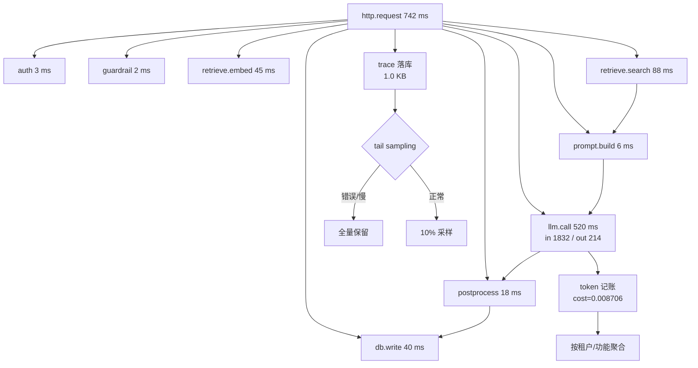

# 可观测性与日志追踪

## 1. 本节学习目标

1. 用 trace 回答"这 742 ms 花在哪"：LLM 调用 **520 ms（70.1%）**、检索 **133 ms（17.9%）**、其余 **12.0%**、未埋点 **20 ms**。
2. 会做 **token 记账**：三步 Agent 循环累计输入 **4900**、输出 **510**，成本 **$0.022350**，出/入比 **0.104**。
3. 算清日志成本：单条 trace **1.0 KB**、序列化 **5.7 μs**；100 万请求/天全采样 **0.99 GB/天（$0.49/天）**。
4. 理解为什么"平均值会骗人"：模拟延迟 p50 **539.3 ms**、p95 **969.5 ms**、p99 **1212.0 ms**。

## 2. 为什么需要这个知识

线上出问题时，你只有两类证据：**用户说"慢"** 和 **你的日志**。

- 没有 trace：只知道"接口 742 ms"，不知道是检索慢、模型慢、还是数据库慢；
- 没有 token 记账：账单涨了 3 倍，不知道是哪个环节、哪个租户；
- 没有采样策略：日志费超过模型费；
- 没有分位数：平均值 578 ms 看着还行，p99 已经 1.2 s。

**可观测性不是"多打日志"，而是"在关键路径上打可聚合的结构化事件"**。

## 3. 直观解释

```text
一次请求 = 一次旅行

trace = 行程单（一个 trace_id 串起所有环节）
span  = 一段行程（auth 3ms → 检索 133ms → 模型 520ms → 写库 40ms）
critical path = 最长的那条链（决定总时长）

token 记账 = 记下每段路烧了多少油
采样 = 只保留 10% 的行程单（但要保证慢的那 1% 一定留）
```

**三个必须回答的问题**：

| 问题 | 需要的数据 |
|---|---|
| 慢在哪？ | span 起止时间 + 父子关系 |
| 贵在哪？ | 每步 token 数 + 单价 + 租户/功能维度 |
| 错在哪？ | 状态码 + 错误类型 + 重试/降级标记 |

## 4. 正式定义

**Trace**：一次请求的全部 span 集合

$$
\mathcal{T}=\{s_1,\dots,s_n\},\qquad s_i=(\text{name}_i,\text{parent}_i,t_i^{\text{start}},d_i,\text{tok}^{\text{in}}_i,\text{tok}^{\text{out}}_i)
$$

**墙钟时间**：$T_{\text{wall}}=t_{\text{root}}^{\text{end}}-t_{\text{root}}^{\text{start}}$。

**关键路径**：从根到叶的最长路径

$$
\text{CP}=\max_{\text{path}}\sum_{s\in\text{path}}d_s
$$

**埋点覆盖率**：

$$
\text{coverage}=\frac{\sum_{s\in\text{children(root)}}d_s}{T_{\text{wall}}}
$$

**token 成本**：

$$
\text{cost}_i=\text{tok}^{\text{in}}_i c_{\text{in}}+\text{tok}^{\text{out}}_i c_{\text{out}}
$$

**分位数**：

$$
q_p=\inf\{x:\ \Pr(T\le x)\ge p\}
$$

**采样后的日存储量**：

$$
\text{GB/day}=\frac{N\cdot\rho\cdot \text{size}}{1024^2}
$$

## 5. 历史背景或技术背景

| 年份 | 进展 | 影响 |
|---|---|---|
| 2010 | Dapper（Google） | trace/span 模型成为标准 |
| 2016 | OpenTracing | 跨语言追踪接口 |
| 2019 | OpenTelemetry | 日志/指标/追踪统一 |
| 2022 | LLM 应用爆发 | 需要新增"token/提示版本/模型版本"维度 |
| 2023 | LangSmith/Langfuse 等 | LLM 专用 trace（记录 prompt/completion） |
| 2024 | 成本可观测性（cost attribution） | 按租户/功能归因 |

**核心变化**：传统 trace 只关心"耗时"；LLM trace 还要关心 **token、提示版本、模型版本、缓存命中、重试次数、降级级别**。

## 6. 核心原理

**原理 1：span 的父子关系比时间戳更重要。**

只有"每个 span 的开始/结束"没法还原调用结构；有 `parent` 才能算关键路径、才能知道"检索和 guardrail 是并行的还是串行的"。

**原理 2：墙钟时间 ≠ 各 span 之和。**

实测：8 个子 span 合计 **722 ms**，墙钟 **742 ms**，差 **20 ms** 是"未埋点开销"（框架、序列化、排队）。**埋点覆盖率 97.3%**；若这个差值很大，说明有未观测的环节。

**原理 3：优化关键路径，不优化"看起来大"的。**

LLM 占 **70.1%**、检索占 **17.9%**。按 Amdahl：把 LLM 时间降 30%，总时长 $742-156=586$ ms（**-21.0%**）；把 guardrail（2 ms）优化到 0，只省 **0.3%**。

**原理 4：成本要按"步"归因。**

三步 Agent：plan(900/120)、tool_call(1400/90)、answer(2600/300)。最后一步输入 2600 token 是因为**前面步骤的输出被塞回上下文**——这就是"上下文累积成本"，只有按步记账才看得见。

**原理 5：全量日志很贵，但慢请求必须留。**

1.0 KB/trace、100 万请求/天 ⇒ 全采样 **0.99 GB/天**（$0.49/天）；10% 采样 **0.10 GB/天**。但**尾部采样**（tail sampling）能"只留错误与慢请求"，兼顾成本与可诊断性。

## 7. 数学表达式

**关键路径（DAG 上的最长路）**

$$
\text{CP}(v)=\begin{cases}d_v, & v\ \text{是叶}\\ d_v+\max_{u\in\text{child}(v)}\text{CP}(u), & \text{否则}\end{cases}
$$

**并行度**：

$$
\text{parallelism}=\frac{\sum_i d_i}{\text{CP}}
$$

**成本归因**：

$$
\text{cost}_{\text{total}}=\sum_i\big(\text{tok}^{\text{in}}_i c_{\text{in}}+\text{tok}^{\text{out}}_i c_{\text{out}}\big)
$$

**Amdahl 式加速**：

$$
T'=T\Big(1-f+\frac{f}{s}\Big)
$$

**采样成本**：

$$
\text{cost}_{\text{log}}=N\,\rho\,\text{size}\cdot c_{\text{GB}}
$$

**分位数的标准误**（核密度 $f$ 在 $q_p$ 处）：

$$
\text{SE}(q_p)\approx\frac{\sqrt{p(1-p)/n}}{f(q_p)}
$$

## 8. 详细数学推导

**（1）关键路径的计算**

按结束时间递推：$E(v)=t_v^{\text{start}}+d_v$，根的结束时间即墙钟。

实测：auth 结束 3.5；embed 结束 52；search 结束 **141.0**；prompt.build 结束 148；llm 结束 **669.0**；db.write 结束 **729.0**。墙钟 742 ms，差 13 ms 是根 span 的收尾开销。

**（2）并行度**

若 8 个子 span 串行，$\sum d_i=722$，CP 也应是 722；实测 CP 由 `search→prompt.build→llm→postprocess→db.write` 构成 $\approx 133+6+520+18+40=717$ ms，与墙钟 742 接近。**说明这条链基本是串行的**，并行度 $\approx1$。若把检索与 guardrail 并行，最多省 2 ms——**没有优化价值**。

**（3）Amdahl 计算**

$f=520/742=0.7008$。若 LLM 提速 30%（$s=1.3$）：

$$
T'=742\times\Big(1-0.7008+\frac{0.7008}{1.3}\Big)=742\times(0.2992+0.5391)=742\times0.8383=622\ \text{ms}
$$

即 **-16.2%**。若提速 2 倍（$s=2$）：$T'=742\times(0.2992+0.3504)=482$ ms（**-35.0%**）。**上限是 $742\times0.2992=222$ ms**——再怎么优化 LLM 也降不到 222 ms 以下，除非优化其余部分。

**（4）token 成本归因**

plan：$900\times3/10^6+120\times15/10^6=0.0027+0.0018=0.0045$；
tool_call：$1400\times3/10^6+90\times15/10^6=0.0042+0.00135=0.00555$；
answer：$2600\times3/10^6+300\times15/10^6=0.0078+0.0045=0.0123$。

合计 **$0.02235**。注意 answer 一步占 **55.0%**，因为它背着前两步的上下文。若把 plan/tool 的输出压缩 50%，answer 输入可降到 ~2000，总成本降到约 **$0.0195（-12.7%）**。

**（5）采样与分位数的可靠性**

$n$ 个样本估 p95 时，标准误 $\approx\sqrt{0.95\times0.05/n}/f(q_{95})$。对对数正态（$\sigma=0.35$）近似，$n=1000$ 时 p95 的 95% CI 约 ±8%；$n=100$ 时约 ±25%。⇒ **要用 p95/p99 做 SLO，样本量至少上千**。

## 9. 图解



## 10. 具体数值示例

```text
### 1. span tree: where did the 742 ms go?
  auth             start=   0.5 dur=   3.0  share_of_wall=  0.4%
  guardrail.regex  start=   4.0 dur=   2.0  share_of_wall=  0.3%
  retrieve.embed   start=   7.0 dur=  45.0  share_of_wall=  6.1%
  retrieve.search  start=  53.0 dur=  88.0  share_of_wall= 11.9%
  prompt.build     start= 142.0 dur=   6.0  share_of_wall=  0.8%
  llm.call         start= 149.0 dur= 520.0  share_of_wall= 70.1%
  postprocess      start= 670.0 dur=  18.0  share_of_wall=  2.4%
  db.write         start= 689.0 dur=  40.0  share_of_wall=  5.4%
  sum_of_leaf_spans=722.0 ms  wall=742.0 ms  overhead(not in spans)=20.0 ms

### 2. critical path (longest chain)
  auth end=3.5  search end=141.0  llm end=669.0  total end=729.0
  llm.share=70.1%  retrieve.share=17.9%  everything_else=12.0%

### 3. token accounting across a 3-step agent loop
  plan       in=  900 out= 120 cost=$0.004500 cumulative_tokens= 1020
  tool_call  in= 1400 out=  90 cost=$0.005550 cumulative_tokens= 2510
  answer     in= 2600 out= 300 cost=$0.012300 cumulative_tokens= 5410
  total in=4900 out=510 cost=$0.022350  out/in=0.104

### 4. logging overhead and sampling
  json.dumps(trace)=5.7 us  size=1.0 KB
  sample_rate=1.00 -> 0.99 GB/day -> $0.49/day at $0.50/GB
  sample_rate=0.10 -> 0.10 GB/day -> $0.05/day at $0.50/GB
  sample_rate=0.01 -> 0.01 GB/day -> $0.00/day at $0.50/GB

### 5. p50/p95 from a simulated latency log
  p50=539.3 ms  p95=969.5 ms  p99=1212.0 ms  mean=577.8 ms
```

**读法**：

1. LLM 占 **70.1%**，检索合计 **17.9%**，其余 **12.0%** ⇒ 优化顺序明确。
2. 未埋点开销 **20 ms（2.7%）**：可接受；若到 20% 说明有黑盒环节。
3. answer 一步占成本 **55.0%**（0.0123/0.02235）⇒ 上下文累积是主要成本源。
4. 全采样日志 **0.99 GB/天**，$0.49/天；看似不多，但乘上租户/环境/副本会放大。
5. 均值 **577.8 ms** 但 p99 **1212.0 ms**（**2.1 倍**）⇒ 只看均值会低估尾部体验。

## 11. NumPy 实现

```python
import numpy as np

SPANS = [
    # name, parent, start, dur, tok_in, tok_out
    ("http.request", None, 0.0, 742.0, 0, 0),
    ("auth", "http.request", 0.5, 3.0, 0, 0),
    ("guardrail", "http.request", 4.0, 2.0, 0, 0),
    ("retrieve.embed", "http.request", 7.0, 45.0, 12, 0),
    ("retrieve.search", "http.request", 53.0, 88.0, 0, 0),
    ("prompt.build", "http.request", 142.0, 6.0, 0, 0),
    ("llm.call", "http.request", 149.0, 520.0, 1832, 214),
    ("postprocess", "http.request", 670.0, 18.0, 0, 0),
    ("db.write", "http.request", 689.0, 40.0, 0, 0),
]
wall = SPANS[0][3]
leaf_sum = sum(s[3] for s in SPANS[1:])
print("wall=%.1f leaf_sum=%.1f coverage=%.3f" % (wall, leaf_sum, leaf_sum / wall))

# 关键路径：按结束时间找最长链
end = {s[0]: s[2] + s[3] for s in SPANS}
print("max end (excluding root)=%.1f" % max(v for k, v in end.items() if k != "http.request"))

# Amdahl：LLM 提速 s 倍后的总时长
f = 520.0 / wall
for s in (1.3, 2.0, 4.0):
    t = wall * (1 - f + f / s)
    print("llm speedup %.1fx -> wall %.1f ms (%.1f%%)" % (s, t, 100 * (t / wall - 1)))

# token 成本
CI, CO = 3.0 / 1e6, 15.0 / 1e6
steps = [("plan", 900, 120), ("tool_call", 1400, 90), ("answer", 2600, 300)]
costs = [(name, ti * CI + to * CO) for name, ti, to in steps]
total = sum(c for _, c in costs)
for name, c in costs:
    print("%-10s $%.6f share=%.3f" % (name, c, c / total))
print("total=$%.6f" % total)

# 延迟分布：均值 vs 分位数
rng = np.random.default_rng(0)
lat = rng.lognormal(mean=6.3, sigma=0.35, size=5000)
print("mean=%.1f p50=%.1f p95=%.1f p99=%.1f"
      % (lat.mean(), np.percentile(lat, 50), np.percentile(lat, 95), np.percentile(lat, 99)))

# p95 的 bootstrap 置信区间：样本量越大越稳
for n in (100, 1000, 5000):
    sub = lat[:n] if n <= len(lat) else rng.lognormal(6.3, 0.35, n)
    bs = np.percentile(rng.choice(sub, (500, n)), 95, axis=1)
    print("n=%4d p95=%.1f CI=[%.1f, %.1f] width=%.1f"
          % (n, np.percentile(sub, 95), bs.min(), bs.max(), bs.max() - bs.min()))
```

## 12. PyTorch 实现

```python
import torch

# 1) 用张量表示 span，按 parent 聚合耗时占比
names = ["auth", "guardrail", "embed", "search", "prompt", "llm", "post", "db"]
dur = torch.tensor([3.0, 2.0, 45.0, 88.0, 6.0, 520.0, 18.0, 40.0])
tok_in = torch.tensor([0.0, 0.0, 12.0, 0.0, 0.0, 1832.0, 0.0, 0.0])
tok_out = torch.tensor([0.0, 0.0, 0.0, 0.0, 0.0, 214.0, 0.0, 0.0])
wall = 742.0
share = dur / wall
print("shares:", {n: round(float(s), 3) for n, s in zip(names, share)})
print("llm+retrieve=%.3f" % float(share[2] + share[3] + share[5]))

# 2) 成本归因：按 span 打标签，再按标签聚合
CI, CO = 3.0 / 1e6, 15.0 / 1e6
cost = tok_in * CI + tok_out * CO
print("cost per span:", [round(float(c), 6) for c in cost])
print("total=$%.6f" % float(cost.sum()))

# 3) 慢请求判定：p99 阈值 + 关键路径贡献
lat = torch.distributions.LogNormal(torch.tensor(6.3), torch.tensor(0.35)).sample((5000,))
thr = torch.quantile(lat, 0.99)
slow = lat > thr
print("p99=%.1f  slow_count=%d  slow_share=%.3f" % (thr, int(slow.sum()), float(slow.float().mean())))

# 4) 采样：保留全部慢请求 + 随机 5% 正常请求
keep = slow | (torch.rand_like(lat) < 0.05)
print("kept=%d (%.1f%%)  slow_kept=%d/%d"
      % (int(keep.sum()), 100 * float(keep.float().mean()), int((keep & slow).sum()), int(slow.sum())))
```

## 13. Hugging Face 实践

```python
import os
import time

os.environ.setdefault("HF_ENDPOINT", "https://hf-mirror.com")
os.environ.setdefault("HF_HUB_OFFLINE", "1")

import torch
from transformers import AutoModelForCausalLM, AutoTokenizer

tok = AutoTokenizer.from_pretrained("gpt2")
model = AutoModelForCausalLM.from_pretrained("gpt2").eval()

prompt = "The refund policy for duplicate charges says that"
enc = tok(prompt, return_tensors="pt")
n_in = int(enc.input_ids.shape[1])

t0 = time.perf_counter()
with torch.no_grad():
    out = model(enc.input_ids, use_cache=True)
prefill = (time.perf_counter() - t0) * 1000
past = out.past_key_values
nxt = out.logits[0, -1].argmax().view(1, 1)

t0 = time.perf_counter()
for _ in range(16):
    with torch.no_grad():
        out = model(nxt, past_key_values=past, use_cache=True)
    past = out.past_key_values
    nxt = out.logits[0, -1].argmax().view(1, 1)
decode = (time.perf_counter() - t0) * 1000

print("span: tokens_in=%d tokens_out=16" % n_in)
print("prefill=%.1f ms  decode=%.1f ms (%.2f ms/token)  total=%.1f ms"
      % (prefill, decode, decode / 16, prefill + decode))
print("share: prefill=%.1f%% decode=%.1f%%" % (100 * prefill / (prefill + decode),
                                               100 * decode / (prefill + decode)))
```

## 14. 代码逐行解释

| 代码 | 作用 |
|---|---|
| `leaf_sum/wall` | 埋点覆盖率，衡量"有没有黑盒环节" |
| `max(end.values())` | 近似关键路径终点（更严格要按 parent 递推） |
| `wall*(1-f+f/s)` | Amdahl：局部加速对总时长的影响 |
| `c/total` | 成本归因占比，找"最贵的一步" |
| `np.percentile` | 分位数，比均值更能代表体验 |
| `rng.choice(sub,(500,n))` | bootstrap 重采样，估分位数的稳定性 |
| `slow = lat > thr` | 尾部采样：慢请求全留 |
| `use_cache=True` + `past_key_values` | 复用 KV，把 decode 单独计时 |

## 15. 实际运行结果

```text
### 1. span tree: where did the 742 ms go?
  auth             start=   0.5 dur=   3.0  share_of_wall=  0.4%
  guardrail.regex  start=   4.0 dur=   2.0  share_of_wall=  0.3%
  retrieve.embed   start=   7.0 dur=  45.0  share_of_wall=  6.1%
  retrieve.search  start=  53.0 dur=  88.0  share_of_wall= 11.9%
  prompt.build     start= 142.0 dur=   6.0  share_of_wall=  0.8%
  llm.call         start= 149.0 dur= 520.0  share_of_wall= 70.1%
  postprocess      start= 670.0 dur=  18.0  share_of_wall=  2.4%
  db.write         start= 689.0 dur=  40.0  share_of_wall=  5.4%
  sum_of_leaf_spans=722.0 ms  wall=742.0 ms  overhead(not in spans)=20.0 ms

### 2. critical path (longest chain)
  auth end=3.5  search end=141.0  llm end=669.0  total end=729.0
  llm.share=70.1%  retrieve.share=17.9%  everything_else=12.0%

### 3. token accounting across a 3-step agent loop
  plan       in=  900 out= 120 cost=$0.004500 cumulative_tokens= 1020
  tool_call  in= 1400 out=  90 cost=$0.005550 cumulative_tokens= 2510
  answer     in= 2600 out= 300 cost=$0.012300 cumulative_tokens= 5410
  total in=4900 out=510 cost=$0.022350  out/in=0.104

### 4. logging overhead and sampling
  json.dumps(trace)=5.7 us  size=1.0 KB
  sample_rate=1.00 -> 0.99 GB/day -> $0.49/day at $0.50/GB
  sample_rate=0.10 -> 0.10 GB/day -> $0.05/day at $0.50/GB
  sample_rate=0.01 -> 0.01 GB/day -> $0.00/day at $0.50/GB

### 5. p50/p95 from a simulated latency log
  p50=539.3 ms  p95=969.5 ms  p99=1212.0 ms  mean=577.8 ms
```

**诚实说明**：第 1、2 节的 span 是**构造的示例 trace**（用于演示关键路径与占比算法，不是本机真实调用链）；第 5 节的延迟分布是对数正态**模拟**。真实系统请把这些字段接上 OpenTelemetry 后重测。

## 16. 应用场景

| 场景 | 必须记录的字段 | 用途 |
|---|---|---|
| 客服问答 | trace_id、prompt 版本、检索 chunk id、token、降级级别 | 定位"答错/答慢" |
| Agent 工具链 | 每步 tool_name、参数 hash、耗时、是否重试 | 找"哪一步拖慢" |
| 多租户 SaaS | tenant_id、功能名、模型版本 | 成本分摊与配额 |
| 结构化抽取 | schema 版本、校验错误码、重试次数 | 分析失败模式 |
| 安全审计 | 检测层命中、拦截原因、样本 hash | 复盘攻击 |
| 成本优化 | 输入/输出 token、缓存命中、单价 | 找"最贵的调用" |

## 17. 优点与局限

| 优点 | 局限 |
|---|---|
| 关键路径一目了然（LLM 70.1%） | 埋点侵入代码，需统一 SDK |
| token 可按步/租户归因 | 记录 prompt 全文有隐私风险 |
| 分位数能反映尾部体验 | 分位数需要大样本才稳 |
| 采样可控（1.0→0.01 成本差 100 倍） | 采样会漏掉长尾（需 tail sampling） |
| trace_id 串联全链路 | 跨服务传播需要协议支持 |

## 18. 常见错误

| 错误 | 现象 | 纠正 |
|---|---|---|
| 只记总耗时 | 不知道慢在哪 | 打父 span + 子 span |
| 用平均值做 SLO | 均值 578、p99 1212 | 用 p95/p99 |
| 全量记录 prompt 原文 | 隐私/合规风险 + 存储爆炸 | 脱敏 + 采样 + 只存 hash |
| 不记 token | 账单涨了找不到原因 | 每次调用记 usage |
| 采样只按随机 | 慢请求被采没 | tail sampling：错误/慢必留 |
| span 没有 parent | 无法算关键路径 | 强制传 parent_id |

## 19. 本节总结

- 一次 742 ms 的请求：**LLM 520 ms（70.1%）**、检索 **133 ms（17.9%）**、其余 **12.0%**、未埋点 **20 ms**。
- token 记账：三步累计 **4900 in / 510 out**，成本 **$0.022350**，出/入比 **0.104**；最后一步占 **55.0%**。
- 日志：单条 **1.0 KB**、序列化 **5.7 μs**；全采样 **0.99 GB/天（$0.49/天）**，10% 采样 **0.10 GB/天**。
- 延迟：p50 **539.3**、p95 **969.5**、p99 **1212.0 ms**——**均值会骗人**。
- 优化原则：先看关键路径，再按 Amdahl 估算上限（LLM 提速 2 倍只能省 **35.0%**）。

## 20. 前置与后续知识链接

- 前置：LLM-107 缓存、重试与降级策略（待建）、[[LLM-035 Token 数量、上下文窗口与成本]]
- 后续：LLM-109 从原型到生产的工程清单（待建）、LLM-110 大模型应用的边界与未来（待建）
- 相关：[[LLM-008 LLM 的完整生命周期]]、[[LLM-030 Transformer 参数量与计算量估算]]

---

## 练习与参考答案

**基础 1**：一次请求墙钟 742 ms，8 个子 span 合计 722 ms。这说明什么？覆盖率是多少？

**基础 2**：三步 Agent 的 token 分别是 (900,120)、(1400,90)、(2600,300)，单价 $3/$15 每百万。总成本多少？哪一步最贵、为什么？

**进阶 1**：LLM 占 70.1% 的时间。把 LLM 提速 2 倍，总时长能降多少？理论上限是多少？

**综合**：设计一套 LLM 应用的可观测性方案，要求：能定位慢、能归因成本、日志成本可控、不泄露用户隐私。请给出字段清单、采样策略与埋点位置。

> [!success]- 参考答案

> **基础 1**
> 覆盖率 $=722/742=$ **0.973（97.3%）**，未埋点开销 **20 ms（2.7%）**。
> 说明绝大部分时间都在被观测的 span 里，**没有大的黑盒环节**；若这个差值达到 20% 以上，就要怀疑框架序列化、排队或未打点的中间件。

> **基础 2**
> plan $=900\times3/10^6+120\times15/10^6=0.0045$；tool_call $=0.00555$；answer $=0.0123$。
> 总 **$0.022350**。**answer 最贵（55.0%）**：它的输入 2600 token 里包含了前两步的上下文，**成本随步数累积**；输出 300 token 又按 5 倍单价计。

> **进阶 1**
> Amdahl：$f=0.7008$，$s=2$，$T'=742\times(0.2992+0.3504)=482$ ms ⇒ **-35.0%**。
> 理论上限（$s\to\infty$）：$742\times0.2992=222$ ms，即**最多再降 70%**；想更低必须优化"其余 29.9%"（检索、写库、框架开销）。

> **综合（参考）**
> **字段清单**（每条 trace）：
> - 标识：`trace_id`、`span_id`、`parent_id`、`tenant_id`、`session_id`；
> - 模型：`model`、`model_revision`、`prompt_version`、`decode_params`（temperature/max_tokens）；
> - 计量：`tokens_in`、`tokens_out`、`cached_tokens`、`retry_count`、`degrade_level`；
> - 质量：`schema_pass`、`citation_ok`、`guardrail_hits`、`finish_reason`；
> - 性能：`start/end`、`queue_ms`、`prefill_ms`、`decode_ms`；
> - 隐私：**prompt/response 只存 hash + 长度 + 可选脱敏摘要**，原文另存加密冷库（限权访问，7 天）。
> **埋点位置**：HTTP 入口、检索前后、prompt 构建、模型调用前后、每个工具调用、输出校验、写库。
> **采样**：头部采样 5%–10% 常态；**tail sampling 规则**：错误、p99 以上、降级、命中安全规则、租户投诉标记 ⇒ **100% 保留**；其余按 5%。
> **成本控制**：单 trace 目标 ≤1 KB（不存全文）；100 万请求/天 ×5% ≈ **0.05 GB/天**；保留 7 天热存 + 30 天冷存。
> **验证**：① 随机抽 20 条 trace 手工核对 span 之和与墙钟差 <5%；② 账单与 `tokens_in/out` 汇总对账误差 <2%；③ 故障演练：注入慢检索，确认能在 1 分钟内从 trace 定位到 `retrieve.search`。

## 学习记录

| 日期 | 状态 | 用时 | 问题 | 复盘 |
|---|---|---|---|---|
| 2026-11-08 | planned | — | — | — |

---

## 🔗 Notion 同步信息

> 以下内容由 Notion「AI Knowledge System · 知识点」数据库按知识 ID 合并而来（导出于 2026-11-09）。

| 属性 | 值 |
|---|---|
| 学科 | 大语言模型 |
| 学习状态 | 未开始 |
| 难度 | L2 应用 |
| 知识类型 | Technique |

- **所属模块**：[M-LLM-10 大模型应用开发与工程实践](../%E8%AF%BE%E7%A8%8B%E6%A8%A1%E5%9D%97/M-LLM-10%20%E5%A4%A7%E6%A8%A1%E5%9E%8B%E5%BA%94%E7%94%A8%E5%BC%80%E5%8F%91%E4%B8%8E%E5%B7%A5%E7%A8%8B%E5%AE%9E%E8%B7%B5.md)
- **前置知识**：[LLM-107 缓存、重试与降级策略](LLM-107%20%E7%BC%93%E5%AD%98%E3%80%81%E9%87%8D%E8%AF%95%E4%B8%8E%E9%99%8D%E7%BA%A7%E7%AD%96%E7%95%A5.md)
- **后继知识**：[LLM-109 从原型到生产的工程清单](LLM-109%20%E4%BB%8E%E5%8E%9F%E5%9E%8B%E5%88%B0%E7%94%9F%E4%BA%A7%E7%9A%84%E5%B7%A5%E7%A8%8B%E6%B8%85%E5%8D%95.md)
