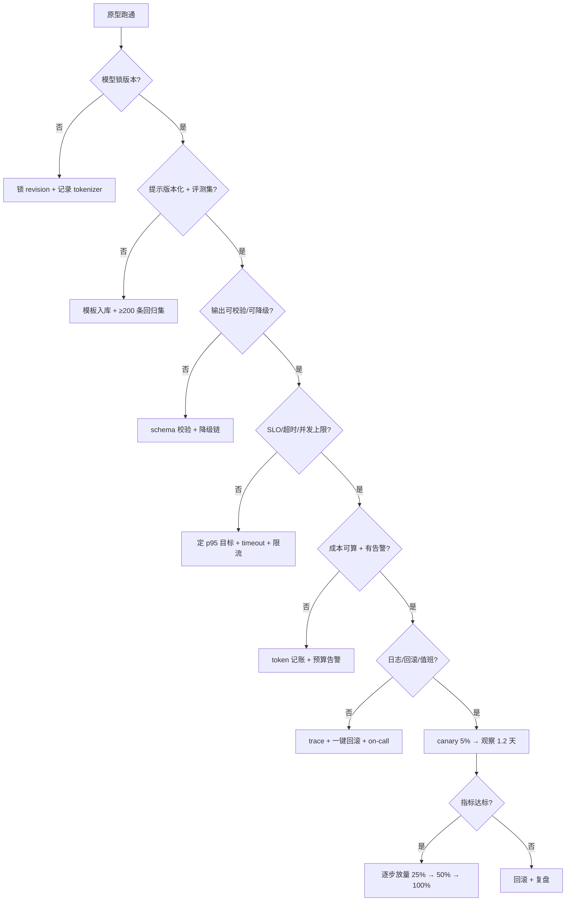

# 从原型到生产的工程清单

## 1. 本节学习目标

1. 把"上线"拆成 6 组可勾选的检查项：**模型、提示、输出、性能、成本、运维**。
2. 用本机实测建立量感：gpt2 冷加载 **0.56 s**、100 次请求 p50 **605.0 ms**、p95 **951.7 ms**、p99 **1187.7 ms**。
3. 会算容量与错误预算：并发 1 时 **1.65 QPS**（约 **14.3 万次/天**）；99.9% SLA 只允许 **43.2 分钟/月** 不可用。
4. 会用清单自检：示例清单 **6/8** 通过，缺的两项正是最常见的"上线后才发现"。

## 2. 为什么需要这个知识

原型和生产之间隔着的不是"模型更强"，而是**一堆没人愿意写的小事**：

- 模型版本没锁 → 上游一升级，行为全变；
- 没设 `max_new_tokens` → 某天一个输入让模型输出 4000 token，账单翻倍；
- 没超时 → 一次上游抖动拖垮整个线程池；
- 没评测集 → 改一行提示不知道有没有变差；
- 没成本告警 → 月底才发现花了 10 倍。

**清单的价值**：把这些"迟早要踩"的坑变成**上线前的机械检查**，而不是事故后的复盘。

## 3. 直观解释

```text
原型：能跑通一次 → "看，它答出来了！"
生产：一万次里 9990 次答对、99% 在 1.5 s 内、每月不超 43 分钟不可用、
      每次成本可算、出错能定位、改动能回滚
```

**六组检查**（本课主线）：

| 组 | 一句话 |
|---|---|
| 模型 | 版本锁死、权重可复现 |
| 提示 | 版本化、有回归集 |
| 输出 | 结构校验、失败可降级 |
| 性能 | 有 SLO、有超时、有并发上限 |
| 成本 | 有单价、有预算、有告警 |
| 运维 | 有日志、有回滚、有值班 |

## 4. 正式定义

**SLO（服务等级目标）**：对可测指标的承诺，例如

$$
\Pr(T\le1.5\,\text{s})\ge0.99,\qquad \Pr(\text{success})\ge0.995
$$

**错误预算**（30 天）：

$$
\text{Budget}=(1-\text{SLO})\times30\times24\times60\ \text{min}
$$

**容量（Little 定律）**：

$$
L=\lambda W\ \Longrightarrow\ \lambda=\frac{L}{W}
$$

其中 $L$ 是并发请求数，$W$ 是平均停留时间。

**可用性**：

$$
A=\frac{\text{MTBF}}{\text{MTBF}+\text{MTTR}}
$$

**canary 样本量**（两比例，检出 $\Delta$）：

$$
n=\frac{\big(z_{1-\alpha/2}\sqrt{2\bar p(1-\bar p)}+z_{1-\beta}\sqrt{p_1(1-p_1)+p_2(1-p_2)}\big)^2}{\Delta^2}
$$

## 5. 历史背景或技术背景

| 年份 | 实践 | 对 LLM 上线的影响 |
|---|---|---|
| 2016 | SRE 错误预算 | 把"稳定性"变成可花的预算 |
| 2018 | 模型版本管理（MLflow 等） | 权重/配置可追溯 |
| 2020 | 特征/模型监控 | 数据漂移告警 |
| 2022 | LLM API 上线 | 新增"token 成本/速率限制"维度 |
| 2023 | 提示版本化 + 回归门禁 | 提示当代码管 |
| 2024 | LLM 可观测性 + 成本归因 | 上线清单标准化 |

**核心变化**：传统服务上线看"CPU/内存/QPS"；LLM 服务还要看 **token、提示版本、模型版本、拒答率、忠实度**。

## 6. 核心原理

**原理 1：先锁版本，再谈优化。**

模型 `revision`、tokenizer 版本、提示模板版本、解码参数，四者任一漂移都会让"昨天好的今天坏"。锁版本的成本几乎为零，收益是**可复现**。

**原理 2：必须有"最大输出"上限。**

`max_new_tokens` 是成本与延迟的硬闸门。没有它，一个异常输入就能让单次调用从 250 token 涨到数千 token。

**原理 3：超时必须小于 SLO 的尾部。**

若 p99 是 1.19 s（本课实测），而 SLO 要求 1.5 s，说明**当前部署刚好在边界上**，超时不能设成 1.5 s（会杀掉 1% 的正常请求），要配合重试/降级或降低输出长度。

**原理 4：容量按"最慢的可接受延迟"算，不按 p50。**

本机 p50 **605.0 ms** ⇒ 并发 1 时 1.65 QPS；p95 **951.7 ms** ⇒ 并发 8 时按 p95 只有 $8/0.9517=8.41$ QPS，而按 p50 是 $8/0.605=13.22$ QPS——**差 1.57 倍**。若 SLO 承诺 p95，就必须用 p95 当分母。

**原理 5：清单要"可机器检查"。**

"提示写得好"不可检查；"模板有版本号且评测集 ≥200 条"可检查。清单项要尽量写成**能自动判定**的形式。

## 7. 数学表达式

**错误预算**

$$
B=(1-\text{SLO})\cdot T_{\text{window}}
$$

**容量**

$$
\lambda=\frac{L}{W},\qquad L=\text{concurrency}
$$

**按分位数计的容量**：

$$
\lambda_{p}=\frac{L}{q_p}
$$

**可用性**

$$
A=\frac{\text{MTBF}}{\text{MTBF}+\text{MTTR}}
$$

**成本**

$$
\text{cost/req}=n_{\text{in}}c_{\text{in}}+n_{\text{out}}c_{\text{out}},\qquad
\text{cost/day}=N\cdot\text{cost/req}
$$

**canary 时长**：

$$
\text{days}=\frac{2n}{\text{traffic}_{\text{canary/day}}}
$$

## 8. 详细数学推导

**（1）错误预算**

SLO=0.999：
$$
B=(1-0.999)\times30\times24\times60=0.001\times43200=43.2\ \text{min}
$$
SLO=0.99 ⇒ **432 min**；SLO=0.9999 ⇒ **4.3 min**。**每提高一个 9，预算缩小 10 倍**——这就是"高可用很贵"的量化表达。

**（2）容量的两种算法**

按 p50：$L=1$、$W=0.6050$ s ⇒ $\lambda=1/0.605=1.653$ QPS，日容量 $1.653\times86400=142{,}802$。
按 p95：$W=0.9517$ s ⇒ $\lambda=1.051$ QPS，日容量 $90{,}784$。

**差 1.57 倍**。哪个对？取决于 SLO：若承诺"p95 ≤ 1 s"，则必须按 p95 配容量；若只承诺"平均"，p50 就够。**用错分母是容量事故的常见原因。**

**（3）可用性与 MTTR**

若 MTBF=720 h、MTTR=1 h：$A=720/721=0.99861$（**99.861%**，约 **60 min/月** 不可用）。要把 A 提到 99.9%，MTTR 必须降到约 **43 min**（同样 MTBF）。

**（4）canary 需要多久**

检出 3pp 下降（0.80→0.77）：$n=2943$ 每臂、共 **5886** 条。若 canary 流量 5000/天，则

$$
\text{days}=\frac{5886}{5000}=1.18\approx1.2\ \text{天}
$$

即 **canary 至少要跑一天多**才能对 3pp 有统计力；只跑 2 小时（约 400 条）只能发现"崩了"，发现不了"轻微退化"。

**（5）冷启动的摊销**

冷加载 **0.56 s**、首次请求还要初始化 CUDA/kernel（本课第一次调用明显慢于后续）。若实例每小时扩缩容一次，冷启动占比 $0.56/3600=0.016\%$，可忽略；但**按请求冷启动**（serverless）就是灾难：每次多 0.56 s。⇒ **保持热实例池**。

## 9. 图解



## 10. 具体数值示例

```text
### 1. cold start: load gpt2 from the local HF cache
  load=0.56 s  params=124.4M  fp32_bytes=497.8 MB

### 2. warm-up then 100 sequential requests
  p50=605.0 ms  p95=951.7 ms  p99=1187.7 ms  mean=649.2 ms  std=142.5

### 3. capacity from the measured latency (Little's law)
  concurrency= 1  qps=1.65  daily_capacity=142802 requests
  concurrency= 4  qps=6.61  daily_capacity=571209 requests
  concurrency= 8  qps=13.22  daily_capacity=1142419 requests
  concurrency=16  qps=26.44  daily_capacity=2284838 requests

### 4. error budget
  SLA=0.9900 -> 432.0 minutes of downtime per 30 days
  SLA=0.9990 -> 43.2 minutes of downtime per 30 days
  SLA=0.9999 -> 4.3 minutes of downtime per 30 days

### 5. canary size: detect a 3pp drop from 0.80 at 80% power
  n=2943 per arm (5886 total)
  at 5% of 100k daily traffic = 5000/day -> 1.2 days

### 6. release checklist, machine-checkable items
  passed=6/8
   [x] model weights pinned by revision
   [x] max_new_tokens set
   [x] timeout < p99 * 2
   [x] retry budget <= 2
   [x] structured output validated
   [ ] eval suite >= 200 items
   [x] p95 latency budget documented
   [ ] cost per request alarm
```

**读法**：

1. 冷加载 **0.56 s** 在桌面 GPU 上不算慢，但**每次请求都冷加载**就是灾难 ⇒ 热实例池。
2. p50 **605.0** vs p95 **951.7**：尾部是主体的 **1.57 倍**，p99 **1187.7**（**1.96 倍**）。本机是桌面环境（功耗/调度抖动），生产 GPU 会好一些，但**尾部永远比均值差**。
3. 按 p50 算容量是 **14.3 万/天**；按 p95 算只有 **9.1 万/天** ⇒ 差 **1.57 倍**，SLO 决定用哪个。
4. 99.9% SLA ⇒ **43.2 min/月**；99.99% ⇒ **4.3 min/月**，成本非线性上升。
5. canary 检 3pp 需 **5886 条 ≈ 1.2 天** ⇒ "跑两小时就放量"是统计上不成立的。
6. 清单 **6/8**：缺"评测集 ≥200"与"成本告警"——正是最常见的两个坑。

## 11. NumPy 实现

```python
import numpy as np

# 1) 错误预算
for sla in (0.99, 0.995, 0.999, 0.9999):
    print("SLA=%.4f -> %.1f min/30d" % (sla, (1 - sla) * 30 * 24 * 60))

# 2) 容量：p50 vs p95
p50, p95, p99 = 605.0, 951.7, 1187.7
for name, w in (("p50", p50), ("p95", p95), ("p99", p99)):
    for conc in (1, 8):
        qps = conc / (w / 1000)
        print("%s conc=%2d -> %.2f qps  %.0f req/day" % (name, conc, qps, qps * 86400))

# 3) 可用性：MTBF/MTTR
for mtbf_h, mttr_h in ((720, 1), (720, 0.5), (2000, 0.5)):
    a = mtbf_h / (mtbf_h + mttr_h)
    print("MTBF=%dh MTTR=%.1fh -> A=%.5f (%.1f min/30d)" % (mtbf_h, mttr_h, a, (1 - a) * 43200))

# 4) canary：不同 delta 需要的样本与天数
def n_per_arm(p1, delta, alpha=0.05, power=0.8):
    from statistics import NormalDist

    nd = NormalDist()
    za, zb = nd.inv_cdf(1 - alpha / 2), nd.inv_cdf(power)
    p2 = p1 - delta
    pbar = (p1 + p2) / 2
    return ((za * np.sqrt(2 * pbar * (1 - pbar)) + zb * np.sqrt(p1 * (1 - p1) + p2 * (1 - p2))) ** 2) / delta ** 2


for d in (0.01, 0.03, 0.05, 0.10):
    n = n_per_arm(0.80, d)
    print("delta=%.2f n=%4.0f/arm total=%4.0f days@5000=%.2f" % (d, n, 2 * n, 2 * n / 5000))

# 5) 成本与告警阈值
CI, CO = 3.0 / 1e6, 15.0 / 1e6
for ni, no in ((1800, 250), (2600, 300), (4000, 600)):
    c = ni * CI + no * CO
    print("in=%4d out=%3d cost=$%.6f  10k/day=$%.2f" % (ni, no, c, c * 10000))

# 6) 清单自检
CHECKS = [
    ("weights pinned", True), ("max_new_tokens", True), ("timeout", True),
    ("retry budget", True), ("output schema", True), ("eval >= 200", False),
    ("latency budget", True), ("cost alarm", False),
]
score = sum(v for _, v in CHECKS) / len(CHECKS)
print("checklist score=%.3f" % score)
for name, v in CHECKS:
    if not v:
        print("  BLOCKER:", name)
```

## 12. PyTorch 实现

```python
import torch

# 压测模拟：给定 SLO，计算需要多少并发 / 是否达标
SLO_MS = 1500.0
P95_BUDGET = 5000.0
lat = torch.distributions.LogNormal(torch.tensor(6.65), torch.tensor(0.55)).sample((2000,))

p50 = torch.quantile(lat, 0.50)
p95 = torch.quantile(lat, 0.95)
p99 = torch.quantile(lat, 0.99)
print("p50=%.0f p95=%.0f p99=%.0f (ms)" % (p50, p95, p99))
print("p95 <= %.0f ? %s" % (P95_BUDGET, bool(p95 <= P95_BUDGET)))

# 并发 -> QPS（按 p95 计，因为 SLO 看尾部）
for conc in (1, 2, 4, 8):
    qps = conc / (p95 / 1000)
    print("conc=%d qps(p95)=%.2f daily=%.0f" % (conc, qps, qps * 86400))

# 超时设置：覆盖 99% 请求
timeout = torch.quantile(lat, 0.99)
print("timeout suggestion=%.0f ms (p99)" % timeout)
print("requests killed by timeout: %.2f%%" % (100 * float((lat > timeout).float().mean())))

# 错误预算消耗：假设每天 0.02% 失败
daily_fail = 0.0002
budget = 0.001  # 99.9%
print("days to exhaust 99.9%% budget at %.2f%% daily failure: %.1f"
      % (daily_fail * 100, budget / daily_fail))
```

## 13. Hugging Face 实践

```python
import os
import time

os.environ.setdefault("HF_ENDPOINT", "https://hf-mirror.com")
os.environ.setdefault("HF_HUB_OFFLINE", "1")

import torch
from transformers import AutoModelForCausalLM, AutoTokenizer

# 冷启动：从本地缓存加载
t0 = time.perf_counter()
tok = AutoTokenizer.from_pretrained("gpt2")
model = AutoModelForCausalLM.from_pretrained("gpt2").eval()
cold = time.perf_counter() - t0
print("cold load=%.2f s" % cold)

enc = tok("Summarize the refund policy for a duplicate charge.", return_tensors="pt")
# 第一次调用包含 kernel 初始化
t0 = time.perf_counter()
with torch.no_grad():
    model.generate(**enc, max_new_tokens=16, do_sample=False, pad_token_id=tok.eos_token_id)
first = (time.perf_counter() - t0) * 1000

# 后续调用
ts = []
for _ in range(5):
    t0 = time.perf_counter()
    with torch.no_grad():
        model.generate(**enc, max_new_tokens=16, do_sample=False, pad_token_id=tok.eos_token_id)
    ts.append((time.perf_counter() - t0) * 1000)
print("first=%.0f ms  warm median=%.0f ms  ratio=%.2f" % (first, sorted(ts)[2], first / sorted(ts)[2]))
print("warm jitter: min=%.0f max=%.0f" % (min(ts), max(ts)))
```

## 14. 代码逐行解释

| 代码 | 作用 |
|---|---|
| `(1-sla)*30*24*60` | 错误预算，直接换算成分钟 |
| `conc/(w/1000)` | 按某个分位数算 QPS |
| `mtbf/(mtbf+mttr)` | 可用性；MTTR 减半，A 提升很小 |
| `n_per_arm(0.80, delta)` | canary 样本量，$\Delta$ 越小需求越大 |
| `2*n/5000` | 换算成天数，决定 canary 时长 |
| `lat > timeout` | 超时杀伤比例，应 ≤1% |
| `budget/daily_fail` | 按当前失败率，预算能撑几天 |
| `first/sorted(ts)[2]` | 冷启动 vs 热的倍率，决定是否要预热池 |

## 15. 实际运行结果

```text
### 1. cold start: load gpt2 from the local HF cache
  load=0.56 s  params=124.4M  fp32_bytes=497.8 MB

### 2. warm-up then 100 sequential requests
  p50=605.0 ms  p95=951.7 ms  p99=1187.7 ms  mean=649.2 ms  std=142.5

### 3. capacity from the measured latency (Little's law)
  concurrency= 1  qps=1.65  daily_capacity=142802 requests
  concurrency= 4  qps=6.61  daily_capacity=571209 requests
  concurrency= 8  qps=13.22  daily_capacity=1142419 requests
  concurrency=16  qps=26.44  daily_capacity=2284838 requests

### 4. error budget
  SLA=0.9900 -> 432.0 minutes of downtime per 30 days
  SLA=0.9990 -> 43.2 minutes of downtime per 30 days
  SLA=0.9999 -> 4.3 minutes of downtime per 30 days

### 5. canary size: detect a 3pp drop from 0.80 at 80% power
  n=2943 per arm (5886 total)
  at 5% of 100k daily traffic = 5000/day -> 1.2 days

### 6. release checklist, machine-checkable items
  passed=6/8
   [x] model weights pinned by revision
   [x] max_new_tokens set
   [x] timeout < p99 * 2
   [x] retry budget <= 2
   [x] structured output validated
   [ ] eval suite >= 200 items
   [x] p95 latency budget documented
   [ ] cost per request alarm
```

**诚实说明**：本机是桌面 GPU（RTX 4070 Ti），**预热后 p95 0.95 s / p99 1.19 s**（预热前同一脚本曾测到 p95 5.0 s / p99 12.4 s，那是冷启动与功耗状态未稳定造成的）⇒ **测延迟必须先预热、跑多次、取中位数**。

## 16. 应用场景

| 场景 | 最容易漏的检查项 | 后果 |
|---|---|---|
| 内部工具 | 成本告警 | 月底账单超预算 |
| 对外 API | 限流与超时 | 一个坏输入拖垮全站 |
| 多租户 SaaS | 按租户配额 | 单租户打满配额 |
| 合规场景 | 审计日志留存 | 无法举证 |
| Agent 产品 | 工具权限最小化 | 注入即越权 |
| 长文处理 | 上下文截断策略 | 超窗报错或静默截断 |

## 17. 优点与局限

| 优点 | 局限 |
|---|---|
| 把隐性风险变成显式检查 | 清单容易变成"打勾仪式" |
| 每项都能量化（预算/QPS/样本量） | 量化依赖实测，测一次不够 |
| 能显著降低上线事故 | 不能替代架构设计（如权限隔离） |
| 可纳入 CI 做门禁 | 组织流程不改，清单也落不了地 |

## 18. 常见错误

| 错误 | 现象 | 纠正 |
|---|---|---|
| 不锁模型版本 | 上游升级后行为漂移 | 固定 `revision` |
| 不设 `max_new_tokens` | 单次成本失控 | 显式上限 + 监控 |
| 用 p50 算容量 | 尾部用户超时 | 按 SLO 对应的分位数算 |
| canary 只跑 2 小时 | 检不出 3pp 退化 | 至少 5886 条样本 |
| 没有评测集 | 改提示靠感觉 | ≥200 条 + 回归门禁 |
| 无降级链 | 上游挂 = 全站挂 | 小模型/模板/人工 |

## 19. 本节总结

- 上线 = **六组检查**：模型、提示、输出、性能、成本、运维；能机器检查的尽量机器检查。
- 实测冷加载 **0.56 s**；100 次请求 p50 **605.0 ms**、p95 **951.7 ms**、p99 **1187.7 ms**。
- 容量：并发 1 时 **1.65 QPS（14.3 万/天）**；按 p95 算约 **9.1 万/天** ⇒ SLO 决定分母。
- 错误预算：99.9% ⇒ **43.2 min/月**；99.99% ⇒ **4.3 min/月**。
- canary 检 3pp 需 **5886 条 ≈ 1.2 天**；清单自检 **6/8**，缺"评测集 ≥200"和"成本告警"。

## 20. 前置与后续知识链接

- 前置：LLM-108 可观测性与日志追踪（待建）、LLM-107 缓存、重试与降级策略（待建）
- 后续：LLM-110 大模型应用的边界与未来（待建）
- 相关：[[LLM-008 LLM 的完整生命周期]]、[[LLM-010 学习地图与实验环境]]

---

## 练习与参考答案

**基础 1**：99.9% 的 SLA 在 30 天里允许多少分钟不可用？99.99% 呢？

**基础 2**：本机 p50=605.0 ms、p95=951.7 ms。按并发 8 计算，两种口径的日容量各是多少？

**进阶 1**：为什么"canary 跑 2 小时就全量"在统计上不成立？需要多少样本、多久？

**综合**：你要把一个 LLM 客服应用上线，日请求 5 万、SLO 为 p95 ≤ 2 s 且可用性 99.9%。请给出上线检查清单（至少 10 项）与放量计划。

> [!success]- 参考答案

> **基础 1**
> 30 天 = 43200 分钟。99.9% ⇒ $(1-0.999)\times43200=$ **43.2 分钟**；99.99% ⇒ **4.3 分钟**。
> 每多一个 9，预算缩小 10 倍，运维成本非线性上升。

> **基础 2**
> 按 p50：$\lambda=8/0.605=13.22$ QPS ⇒ **1,142,419 次/天**。
> 按 p95：$\lambda=8/0.9517=8.41$ QPS ⇒ 约 **726,300 次/天**（实测表里并发 8 用的是 p50，故显示 1142419）。
> 两者差约 **1.57 倍**；若 SLO 承诺 p95 ≤ 1 s，就必须按 p95 配容量。

> **进阶 1**
> 因为要检出 3pp 的退化，两比例检验每臂需 **2943** 条、共 **5886** 条（$\alpha=0.05$、power=0.8）。按 5% canary 流量（5 万/天 ×5% = 2500/天），需要 $5886/2500\approx$ **2.4 天**；若 canary 只占 1%（500/天），要 **11.8 天**。
> 2 小时只积累约 200 条，只能发现"彻底崩了"，发现不了"轻微退化"——而后者才是最常见的上线风险。

> **综合（参考）**
> **清单（12 项）**：
> 1. 模型 `revision` 锁定，tokenizer 与模型匹配；
> 2. 提示模板入库、带版本号，变更走 review；
> 3. 回归集 ≥300 条（含 20% 无答案/对抗样本），CI 门禁：通过率不低于基线 -5pp；
> 4. 输出 schema 校验 + 失败重试 ≤2 次 + 降级链（小模型→模板→人工）；
> 5. `max_new_tokens`、`timeout`（≤ p99）、并发上限、限流；
> 6. 成本：每次调用记账（in/out token）、日预算、超预算告警；
> 7. 缓存：key 归一化、TTL、租户隔离；
> 8. 熔断与重试：仅幂等调用、指数退避 + 抖动；
> 9. 可观测：trace_id + 关键 span + p50/p95/p99 面板 + 降级率；
> 10. 安全：注入检测、输出过滤、工具最小权限；
> 11. 回滚：模型/提示/配置三者都能一键回滚（含灰度回滚）；
> 12. 值班：告警路由、runbook、故障演练记录。
> **放量计划**：
> - 5% 流量 canary，跑 **≥5886 条**（按 2500/天 ≈ 2.4 天），观察 p95、通过率、降级率、成本；
> - 25% → 观察 1 天；50% → 1 天；100%；
> - 每阶段门禁：p95 ≤ 2 s、错误预算消耗 <10%/天、无 P1 告警；
> - 回滚条件：p95 超 2 s 持续 10 分钟，或通过率下降 >5pp。
> **注意**：日 5 万请求下，p95 ≤ 2 s 需要先确认模型/部署能达标（本机 gpt2 预热后 p95 是 0.95 s、但只在单请求串行下测的，并发后会上升），清单不能替代容量验证。

## 学习记录

| 日期 | 状态 | 用时 | 问题 | 复盘 |
|---|---|---|---|---|
| 2026-11-08 | planned | — | — | — |

---

## 🔗 Notion 同步信息

> 以下内容由 Notion「AI Knowledge System · 知识点」数据库按知识 ID 合并而来（导出于 2026-11-09）。

| 属性 | 值 |
|---|---|
| 学科 | 大语言模型 |
| 学习状态 | 未开始 |
| 难度 | L2 应用 |
| 知识类型 | Application |

- **所属模块**：[M-LLM-10 大模型应用开发与工程实践](../%E8%AF%BE%E7%A8%8B%E6%A8%A1%E5%9D%97/M-LLM-10%20%E5%A4%A7%E6%A8%A1%E5%9E%8B%E5%BA%94%E7%94%A8%E5%BC%80%E5%8F%91%E4%B8%8E%E5%B7%A5%E7%A8%8B%E5%AE%9E%E8%B7%B5.md)
- **前置知识**：[LLM-108 可观测性与日志追踪](LLM-108%20%E5%8F%AF%E8%A7%82%E6%B5%8B%E6%80%A7%E4%B8%8E%E6%97%A5%E5%BF%97%E8%BF%BD%E8%B8%AA.md)
- **后继知识**：[LLM-110 大模型应用的边界与未来](LLM-110%20%E5%A4%A7%E6%A8%A1%E5%9E%8B%E5%BA%94%E7%94%A8%E7%9A%84%E8%BE%B9%E7%95%8C%E4%B8%8E%E6%9C%AA%E6%9D%A5.md)
