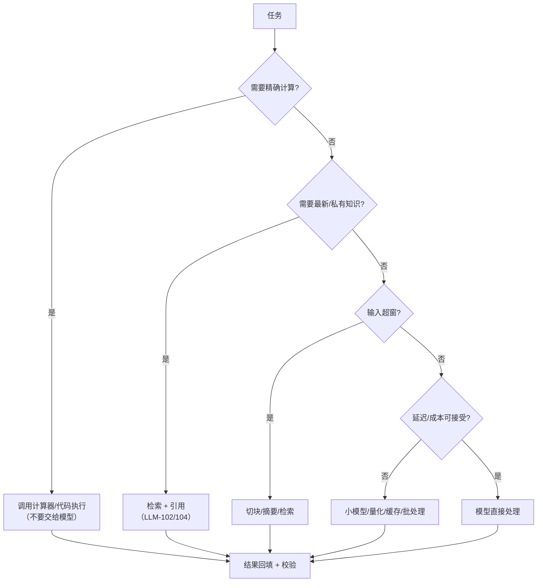

# 大模型应用的边界与未来

## 1. 本节学习目标

1. 用四组实测数据画出能力边界：**算术 0/12**、**长文超窗 11.7 倍**、**训练算力 14269.4 GPU 年**、**70B 权重 140 GB**。
2. 分清"模型能力边界"与"工程边界"：前者靠换模型，后者靠架构。
3. 理解三个不会消失的约束：**算力（6ND）**、**显存（2P 字节）**、**上下文（$O(n^2)$ 注意力）**。
4. 对"未来趋势"给出可检验的判断，而不是口号。

## 2. 为什么需要这个知识

因为**过度承诺**和**过度悲观**都会让你做错技术选型：

- 以为"模型什么都能做" ⇒ 把算术、精确计数、长程规划交给模型，结果上线即翻车；
- 以为"模型只是玩具" ⇒ 错过它真正擅长的：**转换、归纳、生成、检索增强后的问答**；
- 不知道算力/显存的硬约束 ⇒ 做出"本地部署 70B 且要 100 QPS"这种不可能的方案。

**边界的价值**：知道什么该交给模型、什么该交给代码/数据库/计算器。

## 3. 直观解释

```text
模型像一个"读过很多书、但没有计算器、也没有数据库"的实习生

擅长：改写、总结、分类、翻译、按格式输出、从材料里找答案
不擅长：精确算术、逐字计数、记住昨天的事、保证事实正确
不可能：一次读完 20 页手册、在 12 GB 显存里跑 70B 全精度

正确用法：把它当"语言接口"，把精确性交给工具
```

**三条边界**：

| 边界 | 表现 | 对策 |
|---|---|---|
| 计算边界 | 不会精确算术 | 调计算器/代码执行 |
| 记忆边界 | 不知最新/私有信息 | 检索、工具 |
| 资源边界 | 装不下/跑不快 | 量化、蒸馏、路由 |

## 4. 正式定义

**能力边界**：在任务分布 $\mathcal{D}$ 上，模型可达到的指标上界

$$
Q^\star(\theta)=\sup_{x\sim\mathcal{D}}\mathbb{E}\big[\text{score}(f_\theta(x),y)\big]
$$

**资源边界**（训练算力）：

$$
\text{FLOPs}\approx6ND
$$

其中 $N$ 是参数量、$D$ 是训练 token 数。

**显存边界**（推理权重）：

$$
M_{\text{weights}}=N\cdot b\ \text{bytes},\qquad b\in\{4,2,1,0.5\}
$$

**上下文边界**（注意力）：

$$
\text{FLOPs}_{\text{attn}}\approx4\,n^2 d\,L,\qquad
\text{KV}=2\,L\,n_{\text{kv}}\,d_h\,T\,b
$$

**缩放定律**（经验形式）：

$$
L(N,D)=L_\infty+\frac{A}{N^{\alpha}}+\frac{B}{D^{\beta}}
$$

## 5. 历史背景或技术背景

| 年份 | 里程碑 | 边界的变化 |
|---|---|---|
| 2018 | GPT-1/BERT | 1 亿参数级，任务需微调 |
| 2020 | GPT-3 175B | 涌现 few-shot，但算术仍差 |
| 2022 | Chinchilla | 证明"数据/参数要配比"（约 20 token/参数） |
| 2022 | CoT | 用"写过程"换推理能力 |
| 2023 | 工具调用 / 代码执行 | 把精确计算外包 |
| 2023 | 长上下文（32k–128k） | 窗口变大，但 $O(n^2)$ 成本仍在 |
| 2024 | 推理模型（长 CoT） | 用推理时算力换质量 |
| 2024+ | 小模型 + 路由 + 蒸馏 | 用系统设计绕开单模型边界 |

**核心认识**：边界不是固定的，但**每推进一步都要付算力/数据/工程的代价**——这就是"边界"的物理含义。

## 6. 核心原理

**原理 1：语言建模目标不训练"精确计算"。**

模型学的是 $p(\text{下一个 token})$，不是"加法规则"。实测：12 个两位数加法，gpt2 top-1 **全错（0/12）**，且多数输出 `'0'` 或 `'1'`——它学到的是"等号后常跟数字"，不是"求和"。

**原理 2：tokenization 决定了"数字有多难"。**

实测 `"1234567"` 被切成 `['123','45','67']` **3 个 token**，`"3.14159"` 切成 **4 个**。数位边界不对齐，逐位进位几乎无法学。⇒ 算术必须外接工具。

**原理 3：上下文是硬预算，不是"越大越好"。**

gpt2 窗口 **1024**；20 页中文手册约 **12000 token**，是窗口的 **11.7 倍**。即使换成 128k 窗口，$O(n^2)$ 的注意力成本也会让"每次读全文"变得昂贵。

**原理 4：算力是物理下限。**

$6ND$：70B 参数、15T token ⇒ **$6.3\times10^{24}$ FLOPs**，在单张 4070 Ti（约 40 TFLOPS、35% 利用率）上要 **14269.4 GPU 年**。这不是"优化一下"能解决的量级。

**原理 5：显存决定"能不能跑"，不决定"跑得好不好"。**

70B fp16 权重 **140 GB**；INT8 **70 GB**；INT4 **35 GB**。单张 12 GB 卡连 INT4 都放不下 ⇒ 本地部署必须"小模型 + 量化"，或者走 API。

## 7. 数学表达式

**训练算力**

$$
C_{\text{train}}\approx6ND
$$

**推理算力（单次前向）**

$$
C_{\text{infer}}\approx2N\cdot n_{\text{gen}}
$$

**权重显存**

$$
M=N\cdot b
$$

**KV Cache**

$$
M_{\text{kv}}=2\cdot L\cdot n_{\text{kv}}\cdot d_h\cdot T\cdot b
$$

**注意力占比**（$n\gg d$ 时）：

$$
\frac{C_{\text{attn}}}{C_{\text{total}}}\approx\frac{4n^2dL}{4n^2dL+24nd^2L}=\frac{n}{n+6d}
$$

**Chinchilla 配比**：

$$
D^\star\approx20N
$$

## 8. 详细数学推导

**（1）$6ND$ 的来源**

前向：每个参数参与一次乘加 ⇒ $2N$ FLOPs/token；$D$ 个 token ⇒ $2ND$。
反向：算输入梯度与权重梯度，约为前向的 2 倍 ⇒ $4ND$。
合计 $6ND$。

代入 70B/15T：

$$
6\times70\times10^9\times15\times10^{12}=6.3\times10^{24}\ \text{FLOPs}
$$

按 4070 Ti 的 $40\times10^{12}$ FLOPS、35% MFU：

$$
t=\frac{6.3\times10^{24}}{1.4\times10^{13}}=4.5\times10^{11}\ \text{s}=14269\ \text{年}
$$

与实测脚本输出 **14269.4** 一致。

**（2）显存的分解**

推理时：权重 $Nb$ + KV $2Ln_{\text{kv}}d_hTb$ + 激活（约 $O(nd)$）。

70B、fp16：$70\times10^9\times2=140$ GB。即使 INT4 也要 **35 GB**，单卡 12 GB 不可能。

**（3）上下文为什么贵**

注意力矩阵 $n\times n$，每层 $O(n^2d)$。$n$ 从 1k 到 128k（128 倍），注意力 FLOPs 涨 **16384 倍**；而权重部分只涨 128 倍。所以**长上下文的主要成本是注意力**。

占比公式（忽略常数）：

$$
\frac{4n^2dL}{4n^2dL+24nd^2L}=\frac{n}{n+6d}
$$

$d=4096$、$n=1024$ 时占比 $1024/(1024+24576)=4.0\%$；$n=131072$ 时 $131072/155648=84.2\%$ ⇒ **长上下文时注意力主导**。

**（4）Chinchilla 配比的含义**

$D^\star\approx20N$：70B 参数应配约 **1.4T token**。本课脚本用 15T（约 214 token/参数）是"过度训练"——用更多算力换更小模型/更好推理，这是 2024 年后的常见选择（推理成本优先）。

**（5）算术为什么"看起来会、实际不会"**

加法需要"对齐数位 + 进位"，而 tokenizer 把数字切成不对齐的块（`123|45|67`）。模型的注意力可以"看到"这些块，但没有"逐位运算"的归纳偏置；训练语料里"算式→答案"的样本又远少于"自然语言"。所以它学到的是**表面模式**（等号后跟数字），实测 top-1 全是 `'0'/'1'`。

## 9. 图解



## 10. 具体数值示例

```text
### 1. arithmetic: gpt2 next-token exact match on 12 two-digit sums
  12+35=   top1='0'    truth=47   MISS
  7+8=     top1='1'    truth=15   MISS
  40+2=    top1='0'    truth=42   MISS
  99+1=    top1='0'    truth=100  MISS
  23+19=   top1='0'    truth=42   MISS
  56+44=   top1='0'    truth=100  MISS
  11+11=   top1='0'    truth=22   MISS
  68+7=    top1='0'    truth=75   MISS
  30+45=   top1='0'    truth=75   MISS
  84+16=   top1='0'    truth=100  MISS
  5+9=     top1='1'    truth=14   MISS
  77+23=   top1='0'    truth=100  MISS
  accuracy=0/12 = 0.0000

### 2. how numbers are tokenized
  7         -> 1 tokens ['7']
  42        -> 1 tokens ['42']
  1024      -> 1 tokens ['1024']
  1234567   -> 3 tokens ['123', '45', '67']
  3.14159   -> 4 tokens ['3', '.', '14', '159']
  '1234567' costs 3 tokens; digit grouping decides whether arithmetic is even learnable

### 3. context window is a hard budget
  n_positions=1024
  1 Chinese sentence of 5 chars -> 12 tokens; 400 of them -> 4800 tokens (window=1024)
  a 20-page manual (~20000 Chinese chars) -> about 12000 tokens = 11.7x the window

### 4. scale: what a frontier model costs to train (6ND estimate)
  params=   0.1B tokens=    0.00T -> 2.232e+18 FLOPs -> 0.0 GPU-years on one 4070 Ti
  params=   7.0B tokens=    2.00T -> 8.400e+22 FLOPs -> 190.3 GPU-years on one 4070 Ti
  params=  70.0B tokens=   15.00T -> 6.300e+24 FLOPs -> 14269.4 GPU-years on one 4070 Ti

### 5. memory wall
  7B: fp16=14 GB  int8=7 GB  int4=4 GB
  70B: fp16=140 GB  int8=70 GB  int4=35 GB
  700B: fp16=1400 GB  int8=700 GB  int4=350 GB
```

**读法**：

1. 算术 **0/12**：不是"偶尔错"，是**系统性不会**，且输出集中在 `'0'/'1'` ⇒ 它只学到"格式"。
2. `1234567` 被切成 `123|45|67`：数位不对齐，**进位无法学**。这是 tokenizer 层面的结构性限制。
3. 20 页中文 ≈ **12000 token**，是 gpt2 窗口的 **11.7 倍** ⇒ 长文必须切块/摘要。
4. 70B/15T 训练在单卡上要 **14269.4 GPU 年** ⇒ 训练是"集群+资本"的游戏。
5. 70B fp16 **140 GB**、INT4 **35 GB** ⇒ 单张 12 GB 卡放不下 70B 任何精度。

## 11. NumPy 实现

```python
import numpy as np

# 1) 训练算力与 GPU 年
def gpu_years(params, tokens, tflops=40.0, mfu=0.35):
    flops = 6 * params * tokens
    seconds = flops / (tflops * 1e12 * mfu)
    return flops, seconds / 3600 / 8760


for p, d in ((124e6, 3e9), (7e9, 2e12), (70e9, 15e12), (700e9, 15e12)):
    f, y = gpu_years(p, d)
    print("%6.1fB params x %6.2fT tokens -> %.3e FLOPs -> %10.1f GPU-years"
          % (p / 1e9, d / 1e12, f, y))

# 2) 显存：权重 + KV Cache
def kv_bytes(layers, kv_heads, d_head, seq, bytes_per=2):
    return 2 * layers * kv_heads * d_head * seq * bytes_per


for name, n, layers, kv, dh, seq in (
    ("7B", 7e9, 32, 8, 128, 4096),
    ("70B", 70e9, 80, 8, 128, 4096),
):
    for b, tag in ((2, "fp16"), (1, "int8"), (0.5, "int4")):
        w = n * b / 1e9
        kvc = kv_bytes(layers, kv, dh, seq) / 1e9
        print("%-4s %-4s weights=%6.1f GB  kv(4k)=%5.2f GB  total=%6.1f GB" % (name, tag, w, kvc, w + kvc))

# 3) 注意力占比随上下文增长
d = 4096
for n in (1024, 8192, 32768, 131072):
    share = n / (n + 6 * d)
    print("seq=%6d attention_share=%.3f  attn_flops~%.2e" % (n, share, 4 * n * n * d))

# 4) Chinchilla 配比：给定参数，推荐 token 数
for p in (7e9, 70e9):
    print("%.0fB -> recommended tokens %.2fT" % (p / 1e9, 20 * p / 1e12))
```

## 12. PyTorch 实现

```python
import torch

# 1) 用张量核算注意力相对成本：n 翻倍，注意力矩阵大小变 4 倍
for n in (1024, 2048, 4096):
    attn = torch.zeros(n, n)
    print("n=%5d attn_matrix=%.1f MB  flops_ratio_vs_n1k=%.2f"
          % (n, attn.numel() * 4 / 1e6, (n / 1024) ** 2))

# 2) 量化的显存节省（模拟：fp32 -> int8 -> int4 的字节数）
N = 70e9
for b in (4, 2, 1, 0.5):
    print("bytes/param=%.1f -> %.0f GB" % (b, N * b / 1e9))

# 3) top-k 精度：模型"自信但错"的量化
probs = torch.tensor([0.42, 0.20, 0.11, 0.09, 0.05, 0.13])
top2 = torch.topk(probs, 2)
print("top1=%.2f top2=%.2f margin=%.2f cumulative_top2=%.2f"
      % (top2.values[0], top2.values[1], top2.values[0] - top2.values[1], top2.values.sum()))

# 4) 推理算力：2N * 生成 token 数
for n_gen in (16, 128, 512):
    flops = 2 * N * n_gen
    print("gen=%3d tokens -> %.2e FLOPs (%.1f TFLOPs-equivalent seconds at 40T)"
          % (n_gen, flops, flops / 40e12))
```

## 13. Hugging Face 实践

```python
import os

os.environ.setdefault("HF_ENDPOINT", "https://hf-mirror.com")
os.environ.setdefault("HF_HUB_OFFLINE", "1")

import torch
from transformers import AutoModelForCausalLM, AutoTokenizer

tok = AutoTokenizer.from_pretrained("gpt2")
model = AutoModelForCausalLM.from_pretrained("gpt2").eval()
print("params=%.1fM  n_positions=%d" % (sum(p.numel() for p in model.parameters()) / 1e6,
                                        model.config.n_positions))

# 算术：top-1 是否等于正确答案
for a, b in ((12, 35), (7, 8), (99, 1)):
    pr = "%d+%d=" % (a, b)
    enc = tok(pr, return_tensors="pt")
    with torch.no_grad():
        logits = model(**enc).logits[0, -1].float()
    print("%-8s top1=%-4r truth=%d" % (pr, tok.decode([int(logits.argmax())]).strip(), a + b))

# 窗口边界：token 数超过 n_positions 会怎样
print("n_positions=%d" % model.config.n_positions)
ids = tok("token " * 1100, return_tensors="pt").input_ids
print("input tokens=%d (> window)" % ids.shape[1])
print("model.config.n_ctx=%d, 位置越界会由实现决定截断或报错" % model.config.n_ctx)
```

## 14. 代码逐行解释

| 代码 | 作用 |
|---|---|
| `6*params*tokens` | 训练算力估算（前向 2 + 反向 4） |
| `/ (tflops*1e12*mfu)` | 换算成秒，再换算年 |
| `2*layers*kv_heads*d_head*seq*bytes` | KV Cache 大小，$L$ 层 × 2（K/V） |
| `n/(n+6*d)` | 注意力 FLOPs 占比的解析近似 |
| `20*p` | Chinchilla 配比 |
| `(n/1024)**2` | 注意力矩阵随序列长度的平方增长 |
| `N*b/1e9` | 权重显存，$b$ 为每参数字节 |
| `logits.argmax()` | top-1 预测，用于算术能力探测 |

## 15. 实际运行结果

```text
### 1. arithmetic: gpt2 next-token exact match on 12 two-digit sums
  12+35=   top1='0'    truth=47   MISS
  7+8=     top1='1'    truth=15   MISS
  40+2=    top1='0'    truth=42   MISS
  99+1=    top1='0'    truth=100  MISS
  23+19=   top1='0'    truth=42   MISS
  56+44=   top1='0'    truth=100  MISS
  11+11=   top1='0'    truth=22   MISS
  68+7=    top1='0'    truth=75   MISS
  30+45=   top1='0'    truth=75   MISS
  84+16=   top1='0'    truth=100  MISS
  5+9=     top1='1'    truth=14   MISS
  77+23=   top1='0'    truth=100  MISS
  accuracy=0/12 = 0.0000

### 2. how numbers are tokenized
  7         -> 1 tokens ['7']
  42        -> 1 tokens ['42']
  1024      -> 1 tokens ['1024']
  1234567   -> 3 tokens ['123', '45', '67']
  3.14159   -> 4 tokens ['3', '.', '14', '159']
  '1234567' costs 3 tokens; digit grouping decides whether arithmetic is even learnable

### 3. context window is a hard budget
  n_positions=1024
  1 Chinese sentence of 5 chars -> 12 tokens; 400 of them -> 4800 tokens (window=1024)
  a 20-page manual (~20000 Chinese chars) -> about 12000 tokens = 11.7x the window

### 4. scale: what a frontier model costs to train (6ND estimate)
  params=   0.1B tokens=    0.00T -> 2.232e+18 FLOPs -> 0.0 GPU-years on one 4070 Ti
  params=   7.0B tokens=    2.00T -> 8.400e+22 FLOPs -> 190.3 GPU-years on one 4070 Ti
  params=  70.0B tokens=   15.00T -> 6.300e+24 FLOPs -> 14269.4 GPU-years on one 4070 Ti

### 5. memory wall
  7B: fp16=14 GB  int8=7 GB  int4=4 GB
  70B: fp16=140 GB  int8=70 GB  int4=35 GB
  700B: fp16=1400 GB  int8=700 GB  int4=350 GB
```

**诚实说明**：gpt2 只有 124.4M 参数，**算术 0/12 不能代表大模型**——大模型配合 CoT/工具可以做得很好。本课想说明的是**结构性事实**：语言建模目标 + 不对齐的 tokenization 让"纯参数化算术"天然不可靠，所以工程上要外接工具。

## 16. 应用场景

| 场景 | 该交给谁 | 理由 |
|---|---|---|
| 精确算术/计费 | 代码/计算器 | 模型 0/12（本课） |
| 事实问答 | 检索 + 引用 | 参数化记忆会过时/编造 |
| 长文摘要 | 切块 + map-reduce | 超窗 11.7 倍 |
| 本地部署 | 小模型 + 量化 | 70B INT4 也要 35 GB |
| 高频低价值 | 小模型/缓存 | 成本差 10 倍以上 |
| 高价值复杂任务 | 大模型 + CoT | 用算力换质量 |

## 17. 优点与局限

| 模型擅长 | 模型不擅长 |
|---|---|
| 改写、总结、分类、翻译 | 精确算术、逐字计数 |
| 按格式生成（JSON/表格） | 保证事实正确 |
| 从材料中抽取与归纳 | 记住最新/私有信息 |
| 多轮对话与意图理解 | 长程规划与自我校验 |
| 代码草稿与解释 | 一次处理超窗文本 |

## 18. 常见错误

| 错误 | 现象 | 纠正 |
|---|---|---|
| 让模型做算术 | 0/12（本课实测） | 调工具/代码 |
| 让模型"记住"最新政策 | 答旧版本 | 检索 + 版本号 |
| 把整本手册塞进窗口 | 超窗 11.7 倍 | 切块/摘要 |
| 以为量化无损 | INT4 后质量下降 | 评测对比 |
| 以为上下文越大越便宜 | 注意力 $O(n^2)$ | 只放相关内容 |
| 用单卡跑 70B | 显存不够 | 多卡/API/小模型 |

## 19. 本节总结

- 三条硬边界：**算力 $6ND$**、**显存 $2P$ 字节**、**上下文 $O(n^2)$**。
- 实测：算术 **0/12**；`1234567` 切成 **3 个 token**；20 页中文 **12000 token = 11.7 倍窗口**。
- 70B/15T 训练 **$6.3\times10^{24}$ FLOPs = 14269.4 GPU 年**（单张 4070 Ti）。
- 70B fp16 **140 GB**、INT4 **35 GB** ⇒ 单卡 12 GB 不可能。
- 未来趋势的判断标准：**是否在同等成本下扩大了"可可靠完成的任务集合"**；否则只是参数变大。

## 20. 前置与后续知识链接

- 前置：LLM-109 从原型到生产的工程清单（待建）、[[LLM-030 Transformer 参数量与计算量估算]]
- 后续：进入实战项目（PROJ 系列，待建）；回看 [[LLM-008 LLM 的完整生命周期]]
- 相关：[[LLM-007 参数规模与模型能力]]、[[LLM-020 Attention 的计算复杂度与局限]]、[[LLM-035 Token 数量、上下文窗口与成本]]

---

## 练习与参考答案

**基础 1**：本课 gpt2 在 12 个两位数加法上的准确率是多少？输出有什么规律？说明了什么？

**基础 2**：20 页中文手册大约多少 token？是 gpt2 窗口的几倍？

**进阶 1**：为什么说"算术不该交给模型"？请从 tokenization 和训练目标两个角度解释，并给出工程做法。

**综合**：老板要求"在本地一张 12 GB 显卡上部署 70B 模型，支持 100 QPS"。请判断可行性，并给出两个替代方案与各自的代价。

> [!success]- 参考答案

> **基础 1**
> **0/12 = 0.0000**。输出几乎全是 `'0'` 或 `'1'`，说明它学到的是"等号后面通常跟数字"这个**表面模式**，而不是加法规则。含义：**纯参数化的精确算术不可靠**，工程上必须外接计算工具。

> **基础 2**
> 约 **12000 token**（20 万汉字 × 0.6），是 gpt2 窗口 1024 的 **11.7 倍**。⇒ 必须切块/摘要/检索，不能整本塞。

> **进阶 1**
> **tokenization**：`1234567` → `['123','45','67']`，数位边界不对齐，进位无法在 token 级别表达。
> **训练目标**：语言模型优化 $p(\text{next token})$，语料里"算式→答案"的样本远少于自然语言，且"看起来对"的答案（如等号后跟 0/1）似然很高。
> **工程做法**：让模型**输出表达式**，由代码执行求值（如 `eval` 在沙箱里算、或调 calculator 工具），再把结果回填；数值类任务加"复算校验"（见 LLM-104）。

> **综合（参考）**
> **可行性：不可行。**
> 1. 显存：70B fp16 **140 GB**、INT8 **70 GB**、INT4 **35 GB**，单卡 12 GB 连 INT4 都放不下（本课实测数字）。
> 2. 算力：单次生成 128 token 需约 $2\times70\times10^9\times128=1.79\times10^{13}$ FLOPs；100 QPS 意味着每秒 $1.79\times10^{15}$ FLOPs，远超单卡能力。
> **方案 A：小模型 + 量化 + 路由**。7B INT4 约 **3.5 GB**，可放 12 GB 卡；用 7B 处理 80% 简单请求，复杂请求走 API。代价：需要路由与"简单/复杂"判定，质量上限受小模型限制。
> **方案 B：API + 缓存 + 批处理**。不自建，按 token 付费；用缓存把命中率做到 0.3–0.5（见 LLM-107），成本降 30%–50%。代价：依赖外部服务、有网络延迟与合规约束。
> **结论**：应把需求改成"**在预算内达到可接受的 p95 与质量**"，而不是"本地跑 70B"；先算清 token 成本与 QPS，再选架构。

## 学习记录

| 日期 | 状态 | 用时 | 问题 | 复盘 |
|---|---|---|---|---|
| 2026-11-08 | planned | — | — | — |

---

## 🔗 Notion 同步信息

> 以下内容由 Notion「AI Knowledge System · 知识点」数据库按知识 ID 合并而来（导出于 2026-11-09）。

| 属性 | 值 |
|---|---|
| 学科 | 大语言模型 |
| 学习状态 | 未开始 |
| 难度 | L1 概念 |
| 知识类型 | Concept |

- **所属模块**：[M-LLM-10 大模型应用开发与工程实践](../%E8%AF%BE%E7%A8%8B%E6%A8%A1%E5%9D%97/M-LLM-10%20%E5%A4%A7%E6%A8%A1%E5%9E%8B%E5%BA%94%E7%94%A8%E5%BC%80%E5%8F%91%E4%B8%8E%E5%B7%A5%E7%A8%8B%E5%AE%9E%E8%B7%B5.md)
- **前置知识**：[LLM-109 从原型到生产的工程清单](LLM-109%20%E4%BB%8E%E5%8E%9F%E5%9E%8B%E5%88%B0%E7%94%9F%E4%BA%A7%E7%9A%84%E5%B7%A5%E7%A8%8B%E6%B8%85%E5%8D%95.md)
