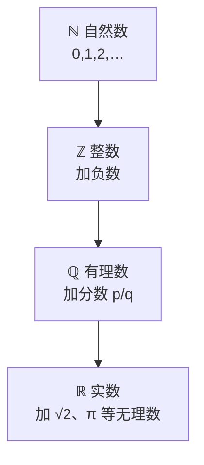

# MATH-001 数与代数基础

## 1. 知识概览

| 项 | 内容 |
|---|---|
| 知识 ID | `MATH-001` |
| 英文名称 | Numbers and Algebra |
| 所属模块 | M-MATH-01 基础数学与函数 |
| 难度等级 | L1 概念 |
| 前置知识 | 无（本库起点） |
| 所属知识体系 | 数系 → 代数式 → 方程 |
| **AI 应用场景** | 损失值、超参数、比例与归一化、学习率的数量级判断 |
| **预计学习时间** | 45 分钟 |

**为什么从这里开始**：后面所有数学（矩阵、导数、概率）都建立在"数能怎么算"之上。这一篇的唯一目标是把数的家族理清，并学会"式子的变形"与"方程求解"这两件基本动作。

## 2. 直观理解

想象你在整理抽屉：

- **自然数**（0, 1, 2, …）：数东西用。数不了"欠了 3 块"。
- **整数**（…, −2, −1, 0, 1, 2, …）：加入欠账（负数）。
- **有理数**（1/3、0.25、−7/2）：加入"分不整"的情况。
- **实数**：加入 √2、π 这些"写不成两个整数之比"的数。

**代数式**就是"还没算出的算式"，如 $2x^2 - 5x + 1$。**方程**是"带等号的代数式"，求解就是找出让等式成立的那个 $x$。

**这套东西在 AI 里天天出现**：学习率取 $10^{-3}$，准确率是 $0.87$，损失从 $2.3$ 降到 $0.4$——都是数的比较与比例。

## 3. 正式数学定义

**数系与包含关系**

$$
\mathbb{N} \subset \mathbb{Z} \subset \mathbb{Q} \subset \mathbb{R}
$$

| 记号 | 名称 | 定义 |
|---|---|---|
| $\mathbb{N}$ | 自然数 | $0,1,2,\dots$ |
| $\mathbb{Z}$ | 整数 | 自然数与它们的相反数 |
| $\mathbb{Q}$ | 有理数 | $\dfrac{p}{q}$，$p,q\in\mathbb{Z}$，$q\neq 0$ |
| $\mathbb{R}$ | 实数 | 有理数 + 无理数（如 $\sqrt{2}$、$\pi$） |

**绝对值**

$$
|x| = \begin{cases} x, & x \ge 0 \\ -x, & x < 0 \end{cases}
$$

几何意义：$|x|$ 是数轴上 $x$ 到原点的距离，因此 $|a-b|$ 是两点距离。

**代数式与方程**

- 代数式：由数与字母经过加、减、乘、除、乘方、开方组成的式子，如 $3x^2 - \dfrac{1}{x}$。
- 方程：含未知数的等式，如 $2x + 3 = 11$。
- 解：使等式成立的未知数取值。

**等式与不等式的基本性质**

| 性质 | 等式 | 不等式（$c>0$ / $c<0$） |
|---|---|---|
| 同加同减 | 两边加同一数仍成立 | 仍成立 |
| 同乘同除 | 两边乘同一非零数仍成立 | $c>0$ 方向不变；$c<0$ **方向反转** |

## 4. 数学推导

### 4.1 二次方程求根公式（配方法）

**起点**：一般二次方程

$$
ax^2 + bx + c = 0, \qquad a \neq 0
$$

**第 1 步**：两边除以 $a$（依据：$a\neq 0$，等式两边可同除非零数）

$$
x^2 + \frac{b}{a}x + \frac{c}{a} = 0
$$

**第 2 步**：把常数项移到右边

$$
x^2 + \frac{b}{a}x = -\frac{c}{a}
$$

**第 3 步**：两边加上 $\left(\dfrac{b}{2a}\right)^2$，凑成完全平方（依据：$(x+k)^2 = x^2+2kx+k^2$）

$$
x^2 + \frac{b}{a}x + \left(\frac{b}{2a}\right)^2 = \left(\frac{b}{2a}\right)^2 - \frac{c}{a}
$$

**第 4 步**：左边写成平方

$$
\left(x + \frac{b}{2a}\right)^2 = \frac{b^2 - 4ac}{4a^2}
$$

**第 5 步**：两边开方（依据：$u^2 = d$ 且 $d\ge 0$ 时 $u = \pm\sqrt{d}$）

$$
x + \frac{b}{2a} = \pm\frac{\sqrt{b^2 - 4ac}}{2a}
$$

**第 6 步**：移项得求根公式

$$
\boxed{\,x = \frac{-b \pm \sqrt{b^2 - 4ac}}{2a}\,}
$$

**判别式与解的情况**

$$
\Delta = b^2 - 4ac
$$

| $\Delta$ | 实数解 |
|---|---|
| $>0$ | 两个不同实根 |
| $=0$ | 一个重根 $x = -\dfrac{b}{2a}$ |
| $<0$ | 无实根（有共轭复根） |

**适用条件**：$a\neq 0$（否则退化为一次方程）；若 $\Delta<0$ 而只在实数范围内讨论，则判定无解。

### 4.2 为什么 $0.1 + 0.2 \neq 0.3$

**起点**：计算机用二进制浮点数存小数。

**第 1 步**：$0.1$ 的二进制是无限循环小数

$$
0.1_{10} = 0.0001100110011\ldots_2
$$

**第 2 步**：float64 只保留 53 位有效二进制位，所以存进去的是**近似值** $\tilde{0.1}$。

**第 3 步**：$\tilde{0.1} + \tilde{0.2}$ 的误差累积后不再是 $\tilde{0.3}$，两者相差约 $5.55\times10^{-17}$。

**结论**：浮点数不能直接用 `==` 比较相等，应判断 $|a-b| < \varepsilon$。

## 5. 几何直观与图解



数轴上，每往内一层都是"补上一种原来算不出来的结果"：

```text
<----|----|----|----|----|----|---->
   -2   -1    0    1    2    3
        |x| = 距离，所以 |-2| = 2
```

## 6. 计算示例

**例 1**：求 $2x^2 - 5x + 1$ 在 $x = 3$ 处的值。

$$
2(3)^2 - 5(3) + 1 = 18 - 15 + 1 = 4
$$

**例 2**：解 $2x + 3 = 11$。

$$
2x = 11 - 3 = 8 \;\Rightarrow\; x = 4
$$

**例 3**：解 $x^2 - 5x + 6 = 0$。

- 方法一（因式分解）：$(x-2)(x-3) = 0 \Rightarrow x = 2$ 或 $x = 3$。
- 方法二（求根公式）：$a=1, b=-5, c=6$，

$$
x = \frac{5 \pm \sqrt{25 - 24}}{2} = \frac{5 \pm 1}{2} \Rightarrow x = 3 \text{ 或 } x = 2
$$

**自检**：把 $x=2$ 代回，$4 - 10 + 6 = 0$ ✓；把 $x=3$ 代回，$9 - 15 + 6 = 0$ ✓。

## 7. Python 辅助验证

**依赖**：仅标准库 + NumPy（本机 NumPy 2.5.4）。

```powershell
python math001_basics.py
```

```python
from fractions import Fraction

import math
import numpy as np

print("分数 1/3 =", Fraction(1, 3), "≈", round(float(Fraction(1, 3)), 6))
print("0.1 + 0.2 =", 0.1 + 0.2)
print("与 0.3 相等吗:", 0.1 + 0.2 == 0.3)
print("误差是否大于 0:", math.fsum([0.1, 0.2]) - 0.3 > 0)
print("|-7| =", abs(-7))
print("2x²-5x+1 在 x=3 处 =", 2 * 3**2 - 5 * 3 + 1)
print("解 2x+3=11 → x =", (11 - 3) / 2)
print("x²-5x+6=0 的根:", np.roots([1, -5, 6]).round(6).tolist())
```

**实际运行结果**

```
分数 1/3 = 1/3 ≈ 0.333333
0.1 + 0.2 = 0.30000000000000004
与 0.3 相等吗: False
误差是否大于 0: True
|-7| = 7
2x²-5x+1 在 x=3 处 = 4
解 2x+3=11 → x = 4.0
x²-5x+6=0 的根: [3.0, 2.0]
```

**代码解析**

- `Fraction` 用**有理数**精确表示 $1/3$，输出就是 `1/3`，不经浮点。
- `0.1 + 0.2` 打印出 `0.30000000000000004`，直接印证 4.2 的推导。
- `np.roots` 求多项式全部根，系数按**从高次到低次**给。

## 8. 知识关联

| 类型 | 链接 |
|---|---|
| 前置数学 | 无 |
| 后续数学 | [[MATH-002 多项式与因式分解]]、[[MATH-003 指数、根式与对数]] |
| 相关 Python | [[PY-002 基本数据类型]]（float 与 int）、[[PY-003 运算符]] |
| 相关机器学习 | 待关联（数据归一化、学习率数量级） |
| 相关深度学习 | 待关联（浮点精度与 loss 数值） |
| 相关大语言模型 | 待关联（logits 的数值范围） |

## 9. 实战练习

**基础 1**：计算 $|-9| + |3 - 8|$。

**基础 2**：解不等式 $3x - 5 > 7$，并在数轴上表示解集。

**进阶 1**：判断方程 $x^2 + 2x + 5 = 0$ 有没有实根，并说明理由。

**综合 1**：已知某模型准确率为 $0.876$，样本数 $500$，估计正确分类的样本数；若把结果四舍五入到整数，误差是多少？

## 10. 参考答案

> [!success]- 基础 1
> $|-9| = 9$，$|3-8| = |-5| = 5$，所以和为 $9 + 5 = 14$。
>
> **易错**：把 $|3-8|$ 写成 $|3|+|8| = 11$——绝对值不满足"分别取再加"。

> [!success]- 基础 2
> $3x - 5 > 7 \Rightarrow 3x > 12 \Rightarrow x > 4$。
>
> 数轴表示：在 $4$ 处画**空心点**（不含 4），向右画箭头。
>
> **易错**：两边同除以正数 3，方向不变；若除以负数则必须反转。

> [!success]- 进阶 1
> $\Delta = b^2 - 4ac = 2^2 - 4\cdot1\cdot5 = 4 - 20 = -16 < 0$。
>
> 所以**没有实根**（在复数范围内有共轭复根 $-1 \pm 2i$）。
>
> **易错**：只算 $\Delta$ 就下结论，忘了说明"$\Delta<0$ ⇒ 无实根"这个条件只对实系数一元二次方程成立。

> [!success]- 综合 1
> 正确数 $= 0.876 \times 500 = 438$。
>
> 结果正好是整数，四舍五入后仍是 438，误差为 $0$。
>
> 若改为 $0.8763 \times 500 = 438.15$，则取整 438，误差 $0.15$ 个样本（说明"样本数必须是整数"，这类小数结果意味着要对准确率先取整或说明口径）。

## 11. 常见错误

| 类型 | 错误表现 | 原因 | 纠正 |
|---|---|---|---|
| 理解错误 | 认为 $\mathbb{Q}$ 就是"所有小数" | 混淆小数与有理数 | 无限不循环小数（$\pi$、$\sqrt2$）不是有理数 |
| 理解错误 | 认为 $|-5| = -5$ | 绝对值必非负 | $|x|\ge 0$，$|-5| = 5$ |
| 公式错误 | 求根公式写成 $\dfrac{b\pm\sqrt{\Delta}}{2a}$ | 漏负号 | 分子是 $-b$ |
| 计算错误 | 不等式两边乘 $-1$ 不反转方向 | 忽略性质 | $a<b \Rightarrow -a > -b$ |
| 条件错误 | $a=0$ 时仍套求根公式 | 不是二次方程 | 先判 $a\neq 0$ |
| 计算错误 | 用 `==` 比较浮点 | 二进制近似 | 判 $|a-b|<\varepsilon$ |

## 12. 学习记录

| 日期 | 状态 | 掌握程度 | 复习状态 | 学习笔记 | 关联练习 |
|---|---|---|---|---|---|
| — | planned | — | — | — | 练习 1–4 |

---

## 🔗 Notion 同步信息

> 以下内容由 Notion「AI Knowledge System · 知识点」数据库按知识 ID 合并而来（导出于 2026-11-09）。

| 属性 | 值 |
|---|---|
| 学科 | 数学 |
| 学习状态 | 未开始 |
| 难度 | L1 概念 |
| 知识类型 | Concept |
| 学习目标 | 理解数系、绝对值、代数式与方程，能解一元一次/二次方程。 |

- **所属模块**：[M-MATH-01 基础数学与函数](../%E8%AF%BE%E7%A8%8B%E6%A8%A1%E5%9D%97/M-MATH-01%20%E5%9F%BA%E7%A1%80%E6%95%B0%E5%AD%A6%E4%B8%8E%E5%87%BD%E6%95%B0.md)
- **后继知识**：[MATH-002 多项式与因式分解](MATH-002%20%E5%A4%9A%E9%A1%B9%E5%BC%8F%E4%B8%8E%E5%9B%A0%E5%BC%8F%E5%88%86%E8%A7%A3.md) · [MATH-003 指数、根式与对数](MATH-003%20%E6%8C%87%E6%95%B0%E3%80%81%E6%A0%B9%E5%BC%8F%E4%B8%8E%E5%AF%B9%E6%95%B0.md)
- **被引用为数学**：[MATH-002 多项式与因式分解](MATH-002%20%E5%A4%9A%E9%A1%B9%E5%BC%8F%E4%B8%8E%E5%9B%A0%E5%BC%8F%E5%88%86%E8%A7%A3.md) · [MATH-003 指数、根式与对数](MATH-003%20%E6%8C%87%E6%95%B0%E3%80%81%E6%A0%B9%E5%BC%8F%E4%B8%8E%E5%AF%B9%E6%95%B0.md)
