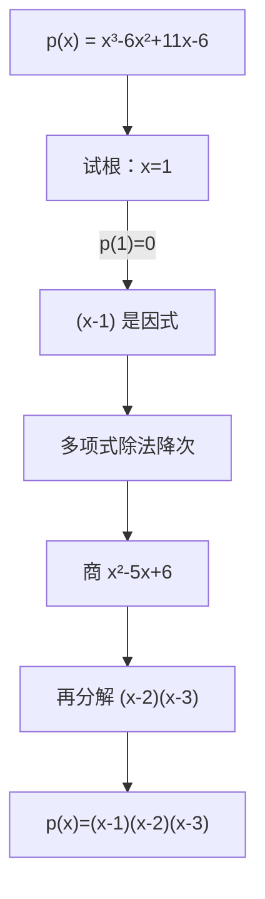

# MATH-002 多项式与因式分解

## 1. 知识概览

| 项 | 内容 |
|---|---|
| 知识 ID | `MATH-002` |
| 英文名称 | Polynomials and Factorization |
| 所属模块 | M-MATH-01 基础数学与函数 |
| 难度等级 | L1 概念 |
| 前置知识 | [[MATH-001 数与代数基础]] |
| 所属知识体系 | 代数变形 → 多项式 → 因式分解 |
| **AI 应用场景** | 特征多项式（求特征值）、损失函数的低阶近似、Taylor 展开 |
| **预计学习时间** | 50 分钟 |

**为什么学它**：求特征值本质是解**特征多项式** $\det(A - \lambda I) = 0$；Taylor 展开是把复杂函数用多项式逼近。多项式是"最容易算的函数"，也是理解后面一切近似的基础。

## 2. 直观理解

多项式就是"只用加法和乘法搭出来的式子"：

$$
3x^3 - 2x + 7
$$

- 每一项都是"系数 × $x$ 的整数次幂"。
- **次数**是最高次幂（这里是 3）。
- **因式分解**是把一个多项式写成几个多项式相乘，像把 $12$ 拆成 $3\times4$。

为什么要拆？因为**乘起来等于 0 ⟺ 至少一个因子为 0**。所以分解后，解方程就变成"分别让每个因子为 0"。

## 3. 正式数学定义

**多项式**

$$
p(x) = a_n x^n + a_{n-1}x^{n-1} + \cdots + a_1 x + a_0, \qquad a_n \neq 0
$$

| 符号 | 名称 | 说明 |
|---|---|---|
| $a_k$ | 系数 | 实数（本库默认 $\mathbb{R}$） |
| $n$ | 次数 $\deg p$ | 最高非零次幂 |
| $a_n$ | 首项系数 | 决定两端走向 |
| $a_0$ | 常数项 | $p(0)$ |

**带余除法**：对任意多项式 $p(x)$ 与 $d(x)\neq 0$，存在唯一的一对 $q(x)$（商）与 $r(x)$（余式）使得

$$
p(x) = d(x)\,q(x) + r(x), \qquad \deg r < \deg d
$$

**余数定理**：$p(x)$ 除以 $x-a$ 的余数等于 $p(a)$。

**因式定理**：$x-a$ 是 $p(x)$ 的因式 $\iff p(a) = 0$。

## 4. 数学推导

### 4.1 余数定理的证明

**起点**：带余除法，取除式为 $x-a$（一次，故余式次数 $<1$，即常数 $r$）

$$
p(x) = (x-a)\,q(x) + r
$$

**第 1 步**：两边令 $x = a$（依据：等式对一切 $x$ 成立，故对 $x=a$ 也成立）

$$
p(a) = (a-a)\,q(a) + r = 0 \cdot q(a) + r = r
$$

**第 2 步**：即得 $r = p(a)$。

**结论**：$p(a)=0 \iff$ 余数为 0 $\iff$ $(x-a)$ 整除 $p(x)$。这给出了"试根 + 降次"的因式分解路线。

**适用条件**：$p$ 是多项式，$a$ 是任意实数。

### 4.2 二次三项式的因式分解（十字相乘）

**起点**：$ax^2 + bx + c$，要找 $m,n,p,q$ 使

$$
ax^2 + bx + c = (mx + n)(px + q)
$$

**第 1 步**：右边展开

$$
(mx+n)(px+q) = mp\,x^2 + (mq + np)\,x + nq
$$

**第 2 步**：对比系数

$$
mp = a, \qquad mq + np = b, \qquad nq = c
$$

**第 3 步**：实际做法——把 $a$ 与 $c$ 各拆成两数之积，交叉相乘后相加，看是否等于 $b$。

以 $x^2 - 5x + 6$ 为例：$a = 1 = 1\times1$，$c = 6$ 试 $(-2)\times(-3)$，交叉和 $1\cdot(-3) + 1\cdot(-2) = -5 = b$ ✓

$$
x^2 - 5x + 6 = (x-2)(x-3)
$$

**适用条件**：整系数二次式在有理数范围内可分解时有效；若判别式不是完全平方数，则需要保留根式或判为不可有理分解。

## 5. 几何直观与图解



**几何意义**：$p(a)=0$ 表示函数图像在 $x=a$ 处**穿过或触及 x 轴**。上面这个三次多项式在 $x=1,2,3$ 三处与 x 轴相交。

## 6. 计算示例

**例**：分解 $p(x) = x^3 - 6x^2 + 11x - 6$。

**第 1 步 · 试根**：常数项 $-6$ 的因数 $\pm1, \pm2, \pm3, \pm6$ 是候选。

$$
p(1) = 1 - 6 + 11 - 6 = 0 \;\checkmark
$$

**第 2 步 · 除以 $(x-1)$**（综合除法，系数 $1, -6, 11, -6$）：

```text
1 |  1   -6   11   -6
  |       1   -5    6
  --------------------
     1   -5    6    0
```

商为 $x^2 - 5x + 6$，余数 $0$。

**第 3 步 · 继续分解**：$x^2 - 5x + 6 = (x-2)(x-3)$。

**结果**

$$
p(x) = (x-1)(x-2)(x-3)
$$

**自检**：展开 $(x-1)(x-2) = x^2 - 3x + 2$，再乘 $(x-3)$ 得 $x^3 - 6x^2 + 11x - 6$ ✓

## 7. Python 辅助验证

**依赖**：NumPy 2.5.4。

```powershell
python math002_poly.py
```

```python
import numpy as np

# x³ - 6x² + 11x - 6，系数按从高次到低次
p = [1, -6, 11, -6]

print("次数:", len(p) - 1)
print("x=3 时 p(3) =", np.polyval(p, 3))
print("全部根:", np.roots(p).round(6).tolist())

q, r = np.polydiv(p, [1, -1])
print("除以 (x-1) 的商:", q.round(6).tolist())
print("余数:", r.round(6).tolist())
```

**实际运行结果**

```
次数: 3
x=3 时 p(3) = 0
全部根: [3.0, 2.0, 1.0]
除以 (x-1) 的商: [1.0, -5.0, 6.0]
余数: [0.0]
```

**代码解析**

- 系数顺序是**从高次到低次**，缺项要补 0（如 $x^3 - 1$ 写成 `[1, 0, 0, -1]`）。
- `polyval` 算值，`p(3)=0` 印证余数定理。
- `roots` 直接给出三个根 $1,2,3$，与手算一致。
- `polydiv` 的余数 `[0.0]` 说明整除，即 $(x-1)$ 确实是因式。

## 8. 知识关联

| 类型 | 链接 |
|---|---|
| 前置数学 | [[MATH-001 数与代数基础]] |
| 后续数学 | [[MATH-004 函数概念与图像]]、`MATH-223 特征值与特征向量`（特征多项式，待建） |
| 相关 Python | [[PY-003 运算符]]、[[PY-067 聚合与统计]]（NumPy 数值计算） |
| 相关机器学习 | 待关联（特征多项式用于 PCA） |
| 相关深度学习 | 待关联（低阶展开近似复杂激活函数） |
| 相关大语言模型 | 待关联 |

## 9. 实战练习

**基础 1**：用余数定理求 $p(x) = x^3 - 2x^2 + 4$ 除以 $x - 3$ 的余数。

**基础 2**：分解 $x^2 + 3x - 4$。

**进阶 1**：已知 $x=2$ 是 $x^3 - 4x^2 + x + 6$ 的一个根，把它完全分解。

**综合 1**：用 Python 验证进阶 1 的分解结果（给出代码与输出）。

## 10. 参考答案

> [!success]- 基础 1
> 由余数定理，余数 $= p(3)$：
>
> $$p(3) = 27 - 18 + 4 = 13$$
>
> **易错**：把"除以 $x-3$"当成"代入 $x=-3$"。除式是 $x-a$ 时代入 $a=3$。

> [!success]- 基础 2
> 找两数，积为 $-4$、和为 $3$：$4$ 与 $-1$。
>
> $$x^2 + 3x - 4 = (x+4)(x-1)$$
>
> **自检**：展开得 $x^2 - x + 4x - 4 = x^2 + 3x - 4$ ✓

> [!success]- 进阶 1
> **第 1 步**：确认根，$2^3 - 4\cdot2^2 + 2 + 6 = 8 - 16 + 8 = 0$ ✓
>
> **第 2 步**：除以 $(x-2)$，系数 $1,-4,1,6$：
>
> ```text
> 2 |  1   -4    1    6
>   |       2   -4   -6
>   --------------------
>      1   -2   -3    0
> ```
>
> 商 $x^2 - 2x - 3$。
>
> **第 3 步**：$x^2 - 2x - 3 = (x-3)(x+1)$。
>
> 所以
>
> $$p(x) = (x-2)(x-3)(x+1)$$
>
> **易错**：降次后忘记继续分解；或综合除法时漏掉缺项的 0。

> [!success]- 综合 1
> 用 `np.roots` 与 `np.polydiv` 验证：
>
> ```text
> import numpy as np
> p = [1, -4, 1, 6]
> print(np.roots(p).round(6).tolist())
> print(np.polydiv(p, [1, -2])[0].round(6).tolist())
> ```
>
> 输出：
>
> ```text
> [-1.0, 3.0, 2.0]
> [1.0, -2.0, -3.0]
> ```
>
> 根为 $-1, 2, 3$，商为 $x^2-2x-3$，与手算完全一致。

## 11. 常见错误

| 类型 | 错误表现 | 原因 | 纠正 |
|---|---|---|---|
| 理解错误 | 认为次数就是项数 | 只看最高次幂 | $x^3 - x^3 + x$ 的次数是 1，不是 3 |
| 公式错误 | 余数定理代入 $x=-a$ | 除式混淆 | 除以 $x-a$ 时代入 $a$ |
| 计算错误 | 综合除法漏补 0 | 缺项未补 | 如 $x^3-1$ 要写 $[1,0,0,-1]$ |
| 计算错误 | 分解后不验算 | 展开习惯缺失 | 一定乘回去 |
| 条件错误 | 任意二次式都硬套十字相乘 | 有理分解不一定存在 | 先算 $\Delta$，非完全平方则不可有理分解 |
| 概念错误 | 把"根"与"因式"混为一谈 | 关系不清 | 根 $a$ ↔ 因式 $(x-a)$，一一对应 |

## 12. 学习记录

| 日期 | 状态 | 掌握程度 | 复习状态 | 学习笔记 | 关联练习 |
|---|---|---|---|---|---|
| — | planned | — | — | — | 练习 1–4 |

---

## 🔗 Notion 同步信息

> 以下内容由 Notion「AI Knowledge System · 知识点」数据库按知识 ID 合并而来（导出于 2026-11-09）。

| 属性 | 值 |
|---|---|
| 学科 | 数学 |
| 学习状态 | 未开始 |
| 难度 | L1 概念 |
| 知识类型 | Technique |
| 学习目标 | 理解多项式、余数定理与因式定理，能分解多项式。 |

- **所属模块**：[M-MATH-01 基础数学与函数](../%E8%AF%BE%E7%A8%8B%E6%A8%A1%E5%9D%97/M-MATH-01%20%E5%9F%BA%E7%A1%80%E6%95%B0%E5%AD%A6%E4%B8%8E%E5%87%BD%E6%95%B0.md)
- **前置知识**：[MATH-001 数与代数基础](MATH-001%20%E6%95%B0%E4%B8%8E%E4%BB%A3%E6%95%B0%E5%9F%BA%E7%A1%80.md)
- **后继知识**：[MATH-004 函数概念与图像](MATH-004%20%E5%87%BD%E6%95%B0%E6%A6%82%E5%BF%B5%E4%B8%8E%E5%9B%BE%E5%83%8F.md)
- **关联Python**：[PY-003 运算符](../../01_Python%E5%9F%BA%E7%A1%80/01%20%E8%AF%AD%E6%B3%95%E4%B8%8E%E7%B1%BB%E5%9E%8B/PY-003%20%E8%BF%90%E7%AE%97%E7%AC%A6.md)
- **关联数学**：[MATH-001 数与代数基础](MATH-001%20%E6%95%B0%E4%B8%8E%E4%BB%A3%E6%95%B0%E5%9F%BA%E7%A1%80.md)
- **被引用为数学**：[MATH-004 函数概念与图像](MATH-004%20%E5%87%BD%E6%95%B0%E6%A6%82%E5%BF%B5%E4%B8%8E%E5%9B%BE%E5%83%8F.md)
