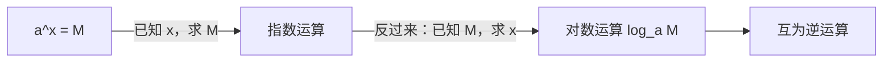

# MATH-003 指数、根式与对数

## 1. 知识概览

| 项 | 内容 |
|---|---|
| 知识 ID | `MATH-003` |
| 英文名称 | Exponents, Radicals and Logarithms |
| 所属模块 | M-MATH-01 基础数学与函数 |
| 难度等级 | L2 应用 |
| 前置知识 | [[MATH-001 数与代数基础]] |
| 所属知识体系 | 幂运算 → 根式 → 对数（指数的逆） |
| **AI 应用场景** | Softmax 的指数、交叉熵的 log、学习率的 $10^{-3}$、参数量级 |
| **预计学习时间** | 50 分钟 |

**为什么学它**：机器学习里到处是 $e$ 和 $\log$——Softmax 用 $e^{z}$ 把分数变成概率，交叉熵用 $-\log p$ 衡量"惊讶程度"，学习率用 $10^{-3}$ 这样的量级。**不懂指数与对数，看不懂损失函数。**

## 2. 直观理解

**指数**是"重复相乘"的简写：

$$
2^5 = 2\times2\times2\times2\times2 = 32
$$

**根式**是指数的反向问题："谁的平方等于 9？"

$$
\sqrt{9} = 3 \quad\Longleftrightarrow\quad 3^2 = 9
$$

**对数**又是指数的反向问题："$2$ 的几次方等于 8？"

$$
\log_2 8 = 3 \quad\Longleftrightarrow\quad 2^3 = 8
$$

一句话：**指数问"底数乘几次得到幂"，对数问"要达到这个幂，底数得乘几次"**。这是一对互逆运算，像"前进"与"倒带"。

## 3. 正式数学定义

**整数与实数指数**（$a>0$，$a\neq1$）

$$
a^n = \underbrace{a\cdot a\cdots a}_{n\text{ 个}}, \quad a^0 = 1, \quad a^{-n} = \frac{1}{a^n}, \quad a^{1/n} = \sqrt[n]{a}, \quad a^{m/n} = \sqrt[n]{a^m}
$$

**指数运算律**

$$
a^{m}a^{n} = a^{m+n}, \qquad \frac{a^m}{a^n} = a^{m-n}, \qquad (a^m)^n = a^{mn}, \qquad (ab)^n = a^n b^n
$$

**对数定义**（$a>0$，$a\neq 1$，$M>0$）

$$
\log_a M = x \quad\Longleftrightarrow\quad a^x = M
$$

| 名称 | 记号 | 说明 |
|---|---|---|
| 常用对数 | $\lg M = \log_{10}M$ | 数量级 |
| 自然对数 | $\ln M = \log_e M$ | $e\approx2.71828$，微积分与 ML 默认 |
| 二进制对数 | $\log_2 M$ | 信息论、比特 |

**对数运算律**

$$
\log_a(MN) = \log_a M + \log_a N
$$

$$
\log_a\frac{M}{N} = \log_a M - \log_a N
$$

$$
\log_a M^k = k\log_a M
$$

**换底公式**

$$
\log_a M = \frac{\log_b M}{\log_b a}
$$

## 4. 数学推导

### 4.1 为什么 $\log_a(MN) = \log_a M + \log_a N$

**起点**：令 $u = \log_a M$，$v = \log_a N$。由对数定义

$$
a^u = M, \qquad a^v = N
$$

**第 1 步**：两式相乘（依据：等式两边可分别相乘）

$$
MN = a^u \cdot a^v
$$

**第 2 步**：用指数律合并（依据：$a^u a^v = a^{u+v}$）

$$
MN = a^{u+v}
$$

**第 3 步**：两边取 $\log_a$（依据：$\log_a a^x = x$）

$$
\log_a(MN) = u + v = \log_a M + \log_a N
$$

**结论**：乘法在对数世界里变成加法。这正是"对数把乘积变成求和"的来源，也是交叉熵能写成"逐项相加"的原因。

**适用条件**：$M>0$，$N>0$，$a>0$ 且 $a\neq1$。

### 4.2 换底公式的推导

**起点**：设 $x = \log_a M$，即 $a^x = M$。

**第 1 步**：两边取以 $b$ 为底的对数

$$
\log_b(a^x) = \log_b M
$$

**第 2 步**：用幂的对数律把 $x$ 提到前面

$$
x\log_b a = \log_b M
$$

**第 3 步**：两边除以 $\log_b a$（依据：$\log_b a \neq 0$，因为 $a\neq1$）

$$
x = \frac{\log_b M}{\log_b a}
$$

**结论**：换底公式成立。**实际用途**：计算器只有 $\ln$ 和 $\lg$，算 $\log_2 8$ 时用 $\dfrac{\ln 8}{\ln 2}$。

## 5. 几何直观与图解



**图像关系**：$y = a^x$ 与 $y = \log_a x$ 的图像关于直线 $y = x$ **对称**——这是"互为反函数"的几何表现（见 [[MATH-004 函数概念与图像]]）。

```text
y = 2^x        y = log2 x
   |  /           |        /
   | /            |      /
   |/             |    /
 --+------        --+------*
```

## 6. 计算示例

**例 1**：计算 $\log_2 8$。

$$
2^3 = 8 \;\Rightarrow\; \log_2 8 = 3
$$

**例 2**：计算 $\log_2(4\times 8)$，用两种方法验证。

- 直接：$4\times8 = 32$，$2^5 = 32$，得 $5$。
- 用运算律：$\log_2 4 + \log_2 8 = 2 + 3 = 5$ ✓

**例 3**：化简 $\log_a \dfrac{M^2}{N}$。

$$
\log_a \frac{M^2}{N} = \log_a M^2 - \log_a N = 2\log_a M - \log_a N
$$

**例 4**：用换底公式算 $\log_3 10$。

$$
\log_3 10 = \frac{\ln 10}{\ln 3} \approx \frac{2.302585}{1.098612} \approx 2.0959
$$

## 7. Python 辅助验证

**依赖**：仅标准库 `math`。

```powershell
python math003_exp_log.py
```

```python
import math

print("e ≈", round(math.exp(1), 6))
print("ln e =", round(math.log(math.e), 10))
print("log2 8 =", round(math.log(8, 2), 10))
print("log10 1000 =", round(math.log10(1000), 10))
print("√2 ≈", round(2 ** 0.5, 6))
print("∛8 =", round(8 ** (1 / 3), 10))
print("e^(ln 3) =", round(math.exp(math.log(3)), 10))
print("log(4*8) == log4+log8:",
      round(math.log(32, 2), 10) == round(math.log(4, 2) + math.log(8, 2), 10))
```

**实际运行结果**

```
e ≈ 2.718282
ln e = 1.0
log2 8 = 3.0
log10 1000 = 3.0
√2 ≈ 1.414214
∛8 = 2.0
e^(ln 3) = 3.0
log(4*8) == log4+log8: True
```

**代码解析**

- `math.log(x, base)` 是**任意底**对数；`math.log(x)` 是自然对数。
- `math.log10` 专门算常用对数，精度比换底更好。
- `8 ** (1/3)` 在浮点下得 `2.0`；注意负数开奇次根不能直接这样写。
- 最后一行验证了 4.1 的推导：$\log(4\cdot8) = \log 4 + \log 8$。

## 8. 知识关联

| 类型 | 链接 |
|---|---|
| 前置数学 | [[MATH-001 数与代数基础]] |
| 后续数学 | [[MATH-004 函数概念与图像]]、[[MATH-005 基本初等函数]]、`MATH-506 信息量与熵`（待建） |
| 相关 Python | [[PY-003 运算符]]、[[PY-059 NumPy 与列表的区别]]（`np.log`/`np.exp`） |
| 相关机器学习 | 待关联（Softmax 的 $e^{z}$、交叉熵的 $-\log p$） |
| 相关深度学习 | 待关联（log-sum-exp 技巧） |
| 相关大语言模型 | 待关联（词概率的负对数似然） |

## 9. 实战练习

**基础 1**：计算 $2^{-3}$ 与 $16^{1/2}$。

**基础 2**：化简 $\lg 2 + \lg 5$。

**进阶 1**：用换底公式求 $\log_5 2$，保留 4 位小数。

**综合 1**：某模型对正确词的预测概率为 $p = 0.01$，交叉熵损失定义为 $-\ln p$，求损失；如果 $p$ 提升到 $0.9$，损失变成多少？说明两者的差别。

## 10. 参考答案

> [!success]- 基础 1
> $2^{-3} = \dfrac{1}{2^3} = \dfrac{1}{8} = 0.125$。
>
> $16^{1/2} = \sqrt{16} = 4$。
>
> **易错**：把负指数当成"结果取负"，$2^{-3} \neq -8$。

> [!success]- 基础 2
> $\lg 2 + \lg 5 = \lg(2\times5) = \lg 10 = 1$。
>
> **要点**：这是对数运算律最典型的用法——把"两个难算的对数相加"变成"1"。

> [!success]- 进阶 1
> $$\log_5 2 = \frac{\ln 2}{\ln 5} \approx \frac{0.693147}{1.609438} \approx 0.4307$$
>
> 校验：$5^{0.4307} \approx 2$ ✓

> [!success]- 综合 1
> $p=0.01$：$-\ln 0.01 = -\ln(10^{-2}) = 2\ln 10 \approx 4.6052$。
>
> $p=0.9$：$-\ln 0.9 \approx 0.1054$。
>
> **含义**：预测概率越低，损失越大；从 4.61 降到 0.11，说明模型"惊讶程度"大幅下降。这正是交叉熵能作为分类损失的原因。
>
> **易错**：用 $\log_{10}$ 代替 $\ln$ 会让数值差一个常数倍，损失函数通常统一用 $\ln$（自然对数）。

## 11. 常见错误

| 类型 | 错误表现 | 原因 | 纠正 |
|---|---|---|---|
| 理解错误 | 认为 $\log_a(M+N) = \log_a M + \log_a N$ | 混淆加法与乘法 | 只有**乘积**能拆 |
| 公式错误 | 换底写成 $\dfrac{\log_b a}{\log_b M}$ | 分子分母颠倒 | 分子是"目标真数"，分母是"原底数" |
| 计算错误 | $a^{m}\cdot a^{n}$ 写成 $a^{mn}$ | 指数律记混 | 同底相乘指数**相加** |
| 条件错误 | 对负数取对数 | 定义域 $M>0$ | 先检查真数为正 |
| 计算错误 | 负底数开偶次根 | 实数范围无意义 | $a^{1/n}$ 要求 $a\ge0$（$n$ 偶） |
| 精度错误 | 用 `log(x)/log(base)` 且 base 很接近 1 | 数值误差放大 | 优先用 `math.log(x, base)` |

## 12. 学习记录

| 日期 | 状态 | 掌握程度 | 复习状态 | 学习笔记 | 关联练习 |
|---|---|---|---|---|---|
| — | planned | — | — | — | 练习 1–4 |

---

## 🔗 Notion 同步信息

> 以下内容由 Notion「AI Knowledge System · 知识点」数据库按知识 ID 合并而来（导出于 2026-11-09）。

| 属性 | 值 |
|---|---|
| 学科 | 数学 |
| 学习状态 | 未开始 |
| 难度 | L2 应用 |
| 知识类型 | Technique |
| 学习目标 | 掌握指数律、根式与对数运算，理解两者互逆。 |

- **所属模块**：[M-MATH-01 基础数学与函数](../%E8%AF%BE%E7%A8%8B%E6%A8%A1%E5%9D%97/M-MATH-01%20%E5%9F%BA%E7%A1%80%E6%95%B0%E5%AD%A6%E4%B8%8E%E5%87%BD%E6%95%B0.md)
- **前置知识**：[MATH-001 数与代数基础](MATH-001%20%E6%95%B0%E4%B8%8E%E4%BB%A3%E6%95%B0%E5%9F%BA%E7%A1%80.md)
- **关联Python**：[PY-003 运算符](../../01_Python%E5%9F%BA%E7%A1%80/01%20%E8%AF%AD%E6%B3%95%E4%B8%8E%E7%B1%BB%E5%9E%8B/PY-003%20%E8%BF%90%E7%AE%97%E7%AC%A6.md)
- **关联数学**：[MATH-001 数与代数基础](MATH-001%20%E6%95%B0%E4%B8%8E%E4%BB%A3%E6%95%B0%E5%9F%BA%E7%A1%80.md)
