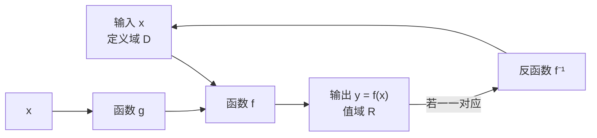

# MATH-004 函数概念与图像

## 1. 知识概览

| 项 | 内容 |
|---|---|
| 知识 ID | `MATH-004` |
| 英文名称 | Functions and Their Graphs |
| 所属模块 | M-MATH-01 基础数学与函数 |
| 难度等级 | L2 应用 |
| 前置知识 | [[MATH-002 多项式与因式分解]] |
| 所属知识体系 | 函数定义 → 定义域/值域 → 图像 → 复合与反函数 |
| **AI 应用场景** | 模型即函数 $f_\theta: x \mapsto \hat y$；激活函数；损失函数；复合函数＝多层网络 |
| **预计学习时间** | 55 分钟 |

**为什么学它**：**一个神经网络就是一个函数**。输入 $x$ 经参数 $\theta$ 映射到输出 $\hat y$，写作 $\hat y = f_\theta(x)$。多层网络就是把多个函数**复合**起来。不懂函数的定义域、单调性、复合与反函数，就看不懂"为什么 ReLU 不再是线性的"这类问题。

## 2. 直观理解

函数是一台**自动售货机**：

- 投进一个商品编号（输入 $x$），出来一件商品（输出 $y$）。
- 关键规矩：**同一个编号，每次必须出同一种商品**。如果投 1 号有时出可乐、有时出雪碧，那就不是函数。

**定义域**是"机器认的编号"，**值域**是"机器能出的商品"。

**复合**是两台机器串起来：第一台的输出，直接当第二台的输入。

**反函数**是"倒着走"：知道出了什么商品，反推投了哪个编号——只有当"每种商品只有一个编号对应"时，才倒得回去。

## 3. 正式数学定义

**函数**：设 $A$、$B$ 是非空数集，若对 $A$ 中每个 $x$，按某对应法则 $f$ 都有**唯一**的 $y\in B$ 与之对应，则称 $f$ 是定义在 $A$ 上的函数，记作

$$
y = f(x), \quad x \in A
$$

| 术语 | 记号 | 含义 |
|---|---|---|
| 定义域 | $D_f$ | 允许的输入集合 |
| 值域 | $R_f = \{f(x) \mid x\in D_f\}$ | 实际能取到的输出 |
| 自变量 | $x$ | 输入 |
| 因变量 | $y$ | 输出 |

**复合函数**：设 $u = g(x)$ 的值域落在 $f$ 的定义域内，则

$$
(f\circ g)(x) = f(g(x))
$$

**反函数**：若 $f$ 是**一一对应**（既单射又满射到值域），则存在 $f^{-1}$ 满足

$$
f^{-1}(f(x)) = x, \qquad f(f^{-1}(y)) = y
$$

**单调性**：对 $x_1 < x_2$，

- 若 $f(x_1) < f(x_2)$，称 $f$ **严格递增**；
- 若 $f(x_1) > f(x_2)$，称 $f$ **严格递减**。

**奇偶性**（定义域关于原点对称）：

$$
f(-x) = f(x) \Rightarrow \text{偶函数}, \qquad f(-x) = -f(x) \Rightarrow \text{奇函数}
$$

## 4. 数学推导

### 4.1 复合函数的定义域

**问题**：已知 $f(u) = \sqrt{u}$，$g(x) = 1 - x^{2}$，求 $h(x) = f(g(x))$ 的定义域。

**起点**：$h(x) = \sqrt{1 - x^{2}}$。要使它有意义，必须**同时**满足两个条件。

**第 1 步**：内层 $g$ 必须有定义。$g(x) = 1-x^2$ 对一切实数有定义，条件为空。

**第 2 步**：外层 $f$ 要求输入非负（根号下不能为负）

$$
g(x) \ge 0 \;\Longrightarrow\; 1 - x^{2} \ge 0
$$

**第 3 步**：解不等式

$$
x^{2} \le 1 \;\Longrightarrow\; -1 \le x \le 1
$$

**结论**：$D_h = [-1, 1]$。

**通用做法**：**由外向内层层限制**——先写外层对输入的要求，再把内层表达式代进去解。

### 4.2 为什么 $y = f(x)$ 与 $y = f^{-1}(x)$ 的图像关于 $y=x$ 对称

**起点**：设点 $(a, b)$ 在 $y = f(x)$ 的图像上，即 $b = f(a)$。

**第 1 步**：由反函数定义，两边作用 $f^{-1}$

$$
f^{-1}(b) = f^{-1}(f(a)) = a
$$

**第 2 步**：这说明点 $(b, a)$ 在 $y = f^{-1}(x)$ 的图像上。

**第 3 步**：而 $(a,b)$ 与 $(b,a)$ 恰好关于直线 $y = x$ 对称（交换坐标即镜像）。

**结论**：两图像关于 $y = x$ 对称。

**前提**：$f$ 必须在所讨论区间上**一一对应**；如 $y = x^2$ 在整个 $\mathbb{R}$ 上没有反函数，但限制在 $x\ge0$ 上就有（即 $\sqrt{x}$）。

## 5. 几何直观与图解



**图像变换速查**（以 $y = f(x)$ 为基准）：

| 变换 | 表达式 | 效果 |
|---|---|---|
| 上下平移 | $f(x) + k$ | 上移 $k$（$k>0$） |
| 左右平移 | $f(x - h)$ | 右移 $h$（注意是减号） |
| 纵向拉伸 | $a f(x)$ | $|a|>1$ 拉长，$0<|a|<1$ 压缩 |
| 关于 x 轴翻折 | $-f(x)$ | 上下翻转 |
| 关于 y 轴翻折 | $f(-x)$ | 左右翻转 |

## 6. 计算示例

**例 1**：求 $f(x) = \dfrac{1}{x-2}$ 的定义域与在 $x=1,3,4$ 处的值。

- 定义域：分母不为 0，即 $x \neq 2$，$D_f = \mathbb{R}\setminus\{2\}$。
- $f(1) = \dfrac{1}{-1} = -1$，$f(3) = 1$，$f(4) = 0.5$。

**例 2**：设 $g(x) = x^2$，$h(x) = x+1$，求 $g(h(2))$。

$$
h(2) = 3,\quad g(3) = 9
$$

注意 $g(h(x)) = (x+1)^2$ 与 $h(g(x)) = x^2+1$ **一般不等**——复合不满足交换律。

**例 3**：验证 $f(x) = x^3$ 是奇函数，$g(x) = x^2$ 是偶函数。

$$
f(-x) = (-x)^3 = -x^3 = -f(x) \;\Rightarrow\; \text{奇}
$$

$$
g(-x) = (-x)^2 = x^2 = g(x) \;\Rightarrow\; \text{偶}
$$

## 7. Python 辅助验证

**依赖**：仅标准库 `math`。

```powershell
python math004_function.py
```

```python
import math


def f(x):
    return 1 / (x - 2)


print("f(1), f(3), f(4) =", [round(f(x), 4) for x in (1, 3, 4)])

try:
    f(2)
except ZeroDivisionError:
    print("x = 2 不在定义域（分母为 0）")

g = lambda x: x ** 2
h = lambda x: x + 1
print("g(h(x)) 在 x=1,2,3:", [g(h(x)) for x in (1, 2, 3)])
print("h(g(x)) 在 x=1,2,3:", [h(g(x)) for x in (1, 2, 3)])

print("√x 在 x=1,4,9:", [round(math.sqrt(x), 6) for x in (1, 4, 9)])
print("偶函数检验 g(-x)==g(x):", [g(-x) == g(x) for x in (2,)])
print("奇函数检验 f(-x)==-f(x):", [(-x) ** 3 == -(x ** 3) for x in (2,)])
```

**实际运行结果**

```
f(1), f(3), f(4) = [-1.0, 1.0, 0.5]
x = 2 不在定义域（分母为 0）
g(h(x)) 在 x=1,2,3: [4, 9, 16]
h(g(x)) 在 x=1,2,3: [2, 5, 10]
√x 在 x=1,4,9: [1.0, 2.0, 3.0]
偶函数检验 g(-x)==g(x): [True]
奇函数检验 f(-x)==-f(x): [True]
```

**代码解析**

- `f(2)` 触发 `ZeroDivisionError`，用异常演示"超出定义域"。
- $g(h(x))$ 与 $h(g(x))$ 结果不同，直接证明复合不可交换。
- 奇偶性用数值等式检验；注意这**不是证明**，只是验证（证明要靠代数推导）。

## 8. 知识关联

| 类型 | 链接 |
|---|---|
| 前置数学 | [[MATH-002 多项式与因式分解]]、[[MATH-003 指数、根式与对数]] |
| 后续数学 | [[MATH-005 基本初等函数]]、`MATH-120 极限与连续`（待建）、`MATH-122 求导法则与链式法则`（待建） |
| 相关 Python | [[PY-009 函数]]、[[PY-026 lambda 与高阶函数]] |
| 相关机器学习 | 待关联（模型＝函数、损失函数） |
| 相关深度学习 | 待关联（复合函数＝多层网络、激活函数） |
| 相关大语言模型 | 待关联（logits → 概率的映射） |

## 9. 实战练习

**基础 1**：求 $f(x) = \sqrt{x-3}$ 的定义域。

**基础 2**：判断 $f(x) = x^4 + 2x^2$ 的奇偶性。

**进阶 1**：设 $f(x) = 2x+1$，求 $f^{-1}(x)$，并验证 $f^{-1}(f(3)) = 3$。

**综合 1**：已知 $g(x) = x-1$，$f(u) = \dfrac{1}{u}$，写出 $f(g(x))$ 并求其定义域。

## 10. 参考答案

> [!success]- 基础 1
> 根号内非负：$x - 3 \ge 0 \Rightarrow x \ge 3$。
>
> 所以 $D_f = [3, +\infty)$。
>
> **易错**：写成 $x > 3$，把端点 3 漏掉——$\sqrt{0}$ 是有定义的。

> [!success]- 基础 2
> $f(-x) = (-x)^4 + 2(-x)^2 = x^4 + 2x^2 = f(x)$，所以是**偶函数**。
>
> **易错**：只看最高次是偶数就下结论；应代入验证（这里恰好是对的，但方法要对）。

> [!success]- 进阶 1
> 令 $y = 2x+1$，解出 $x = \dfrac{y-1}{2}$，交换字母得
>
> $$f^{-1}(x) = \frac{x-1}{2}$$
>
> 验证：$f(3) = 7$，$f^{-1}(7) = \dfrac{7-1}{2} = 3$ ✓

> [!success]- 综合 1
> $$f(g(x)) = \frac{1}{x-1}$$
>
> 定义域需两层同时满足：$g(x)$ 对一切实数有定义；外层要求 $g(x)\neq 0$，即 $x \neq 1$。
>
> 所以 $D = \mathbb{R}\setminus\{1\}$。
>
> **易错**：只写"分母不为 0"，却没把它翻译成对 $x$ 的限制。

## 11. 常见错误

| 类型 | 错误表现 | 原因 | 纠正 |
|---|---|---|---|
| 理解错误 | 认为 $y^2 = x$ 中 $y$ 是 $x$ 的函数 | 一个 $x$ 对应两个 $y$ | 违反"唯一性" |
| 计算错误 | 求 $f(x-h)$ 平移方向搞反 | 符号直觉错 | $f(x-h)$ 是**右**移 $h$ |
| 理解错误 | 认为 $f(g(x)) = g(f(x))$ | 复合不可交换 | 分别代入算一遍 |
| 条件错误 | 讨论奇偶性不看定义域对称 | 定义域前提缺失 | 先检查 $D$ 是否关于原点对称 |
| 条件错误 | 对 $y=x^2$ 直接求反函数 | 非一一对应 | 限制定义域后再求 |
| 计算错误 | 求复合定义域只看外层 | 漏内层限制 | 由外向内层层限制 |

## 12. 学习记录

| 日期 | 状态 | 掌握程度 | 复习状态 | 学习笔记 | 关联练习 |
|---|---|---|---|---|---|
| — | planned | — | — | — | 练习 1–4 |

---

## 🔗 Notion 同步信息

> 以下内容由 Notion「AI Knowledge System · 知识点」数据库按知识 ID 合并而来（导出于 2026-11-09）。

| 属性 | 值 |
|---|---|
| 学科 | 数学 |
| 学习状态 | 未开始 |
| 难度 | L2 应用 |
| 知识类型 | Concept |
| 学习目标 | 理解函数、定义域值域、复合与反函数、单调与奇偶。 |

- **所属模块**：[M-MATH-01 基础数学与函数](../%E8%AF%BE%E7%A8%8B%E6%A8%A1%E5%9D%97/M-MATH-01%20%E5%9F%BA%E7%A1%80%E6%95%B0%E5%AD%A6%E4%B8%8E%E5%87%BD%E6%95%B0.md)
- **前置知识**：[MATH-002 多项式与因式分解](MATH-002%20%E5%A4%9A%E9%A1%B9%E5%BC%8F%E4%B8%8E%E5%9B%A0%E5%BC%8F%E5%88%86%E8%A7%A3.md)
- **后继知识**：[MATH-005 基本初等函数](MATH-005%20%E5%9F%BA%E6%9C%AC%E5%88%9D%E7%AD%89%E5%87%BD%E6%95%B0.md)
- **关联Python**：[PY-009 函数](../../01_Python%E5%9F%BA%E7%A1%80/02%20%E5%87%BD%E6%95%B0%E4%B8%8E%E4%BD%9C%E7%94%A8%E5%9F%9F/PY-009%20%E5%87%BD%E6%95%B0.md)
- **关联数学**：[MATH-002 多项式与因式分解](MATH-002%20%E5%A4%9A%E9%A1%B9%E5%BC%8F%E4%B8%8E%E5%9B%A0%E5%BC%8F%E5%88%86%E8%A7%A3.md)
- **被引用为数学**：[MATH-005 基本初等函数](MATH-005%20%E5%9F%BA%E6%9C%AC%E5%88%9D%E7%AD%89%E5%87%BD%E6%95%B0.md)
