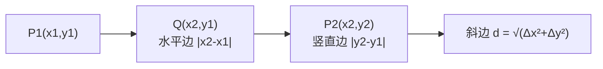

# MATH-006 坐标几何与数列极限

## 1. 知识概览

| 项 | 内容 |
|---|---|
| 知识 ID | `MATH-006` |
| 英文名称 | Coordinate Geometry and Limits of Sequences |
| 所属模块 | M-MATH-01 基础数学与函数 |
| 难度等级 | L2 应用 |
| 前置知识 | [[MATH-005 基本初等函数]] |
| 所属知识体系 | 坐标系 → 直线 → 数列 → 极限（通向微积分） |
| **AI 应用场景** | 样本距离（KNN、聚类）、梯度步长衰减、学习率调度、$e$ 的来源 |
| **预计学习时间** | 55 分钟 |

**为什么学它**：**距离**是 KNN、K-means、Embedding 相似度的基础；**数列极限**是"无穷步之后会发生什么"的数学语言，梯度下降的收敛性就是用极限描述的。这一篇是 0xx 段的收官，也是走向 1xx（微积分）的桥。

## 2. 直观理解

**坐标系**像地图：每个点用"横走多少、竖走多少"两个数定位。

**斜率**是"每往右走一格，往上爬多少"——爬升的陡峭程度。

**数列**是一列按顺序排好的数：$1,\ \tfrac12,\ \tfrac13,\ \tfrac14,\dots$。

**极限**问的是：这个数列**越往后越靠近哪个数**？上面这列越来越靠近 $0$，但永远不等于 $0$——这就是"极限是 0"的直观含义。

生活类比：你每天走剩下路程的一半，走得完吗？永远差一半，但**剩余距离趋于 0**。

## 3. 正式数学定义

**两点距离**（平面直角坐标系）

$$
d = \sqrt{(x_2 - x_1)^2 + (y_2 - y_1)^2}
$$

**斜率**

$$
k = \frac{y_2 - y_1}{x_2 - x_1} \qquad (x_1 \neq x_2)
$$

**直线方程**

- 点斜式：$y - y_1 = k(x - x_1)$
- 斜截式：$y = kx + b$
- 一般式：$Ax + By + C = 0$

**等差数列**：$a_n = a_1 + (n-1)d$；前 $n$ 项和

$$
S_n = \frac{n(a_1 + a_n)}{2}
$$

**等比数列**：$a_n = a_1 q^{n-1}$；前 $n$ 项和（$q \neq 1$）

$$
S_n = \frac{a_1(1 - q^n)}{1 - q}
$$

**数列极限**：若当 $n \to \infty$ 时 $a_n$ 无限接近常数 $A$，称 $\lim\limits_{n\to\infty} a_n = A$。

严格定义（$\varepsilon$-$N$）：对任意 $\varepsilon > 0$，存在 $N$，使 $n > N$ 时 $|a_n - A| < \varepsilon$。

**两个重要极限**

$$
\lim_{n\to\infty}\frac{1}{n} = 0, \qquad \lim_{n\to\infty}\left(1 + \frac{1}{n}\right)^{n} = e \approx 2.71828
$$

## 4. 数学推导

### 4.1 两点距离公式（勾股定理）

**起点**：两点 $P_1(x_1,y_1)$、$P_2(x_2,y_2)$。

**第 1 步**：过 $P_1$ 作水平线、过 $P_2$ 作竖直线，交于 $Q(x_2, y_1)$，构成直角三角形。

**第 2 步**：两条直角边长

$$
|P_1Q| = |x_2 - x_1|, \qquad |QP_2| = |y_2 - y_1|
$$

**第 3 步**：由勾股定理 $c^2 = a^2 + b^2$

$$
d^2 = (x_2-x_1)^2 + (y_2-y_1)^2
$$

**第 4 步**：开方（距离非负）

$$
d = \sqrt{(x_2-x_1)^2 + (y_2-y_1)^2}
$$

**适用条件**：欧氏距离；若用曼哈顿距离则是 $|x_2-x_1| + |y_2-y_1|$，两者在 KNN 中结果可能不同。

### 4.2 等差数列求和（倒序相加）

**起点**：$S_n = a_1 + (a_1+d) + \cdots + (a_1 + (n-1)d)$。

**第 1 步**：把式子倒着写一遍

$$
S_n = a_n + (a_n - d) + \cdots + a_1
$$

**第 2 步**：两式逐项相加，每对的和都是 $a_1 + a_n$，共 $n$ 对

$$
2S_n = n(a_1 + a_n)
$$

**第 3 步**：两边除以 2

$$
S_n = \frac{n(a_1 + a_n)}{2}
$$

**验证**：$1 + 2 + \cdots + 100 = \dfrac{100(1+100)}{2} = 5050$ ✓

### 4.3 等比数列求和（错位相减）

**起点**：$S_n = a_1 + a_1 q + a_1 q^2 + \cdots + a_1 q^{n-1}$，$q\neq1$。

**第 1 步**：两边乘 $q$

$$
qS_n = a_1 q + a_1 q^2 + \cdots + a_1 q^{n}
$$

**第 2 步**：两式相减，中间项全部抵消

$$
S_n - qS_n = a_1 - a_1 q^n
$$

**第 3 步**：左边提 $S_n$，右边提 $a_1$，再除以 $(1-q)$

$$
S_n = \frac{a_1(1 - q^n)}{1 - q}
$$

**适用条件**：$q \neq 1$；当 $q=1$ 时 $S_n = na_1$。当 $|q|<1$ 且 $n\to\infty$，$q^n\to0$，得无穷级数和 $S = \dfrac{a_1}{1-q}$。

## 5. 几何直观与图解



数列极限的直观：

```text
a_n = 1/n
1.0  0.5  0.33  0.25  0.2  ...  → 0
|----|----|----|----|----|----|----> n
越往右，点越贴近 0，但永远不落在 0 上
```

## 6. 计算示例

**例 1**：求 $P_1(1,2)$ 与 $P_2(4,6)$ 的距离与所在直线斜率。

$$
d = \sqrt{3^2 + 4^2} = 5, \qquad k = \frac{4}{3} \approx 1.3333
$$

直线：$y - 2 = \dfrac43(x-1)$，即 $y = \dfrac43x + \dfrac23 \approx 1.3333x + 0.6667$。

**例 2**：$1+2+\cdots+100$。

$$
S_{100} = \frac{100 \times 101}{2} = 5050
$$

**例 3**：$1 + 2 + 4 + \cdots + 2^9$（共 10 项，$a_1=1, q=2$）。

$$
S_{10} = \frac{1(1 - 2^{10})}{1-2} = 2^{10} - 1 = 1023
$$

**例 4**：观察 $\left(1+\frac1n\right)^n$ 随 $n$ 增大如何趋近 $e$。

| $n$ | $10$ | $100$ | $1000$ |
|---|---|---|---|
| 值 | $2.593742$ | $2.704814$ | $2.716924$ |

逐步逼近 $e \approx 2.718282$，但永远小于 $e$。

## 7. Python 辅助验证

**依赖**：`math` + NumPy 2.5.4。

```powershell
python math006_coord_seq.py
```

```python
import math

x1, y1, x2, y2 = 1, 2, 4, 6
d = math.hypot(x2 - x1, y2 - y1)
k = (y2 - y1) / (x2 - x1)
print("距离:", round(d, 4), "斜率:", round(k, 4))
print("截距 b:", round(y1 - k * x1, 4))

n = 100
print("1+...+100 =", n * (1 + n) // 2)

print("等比和:", sum(2 ** i for i in range(10)),
      "公式:", (2 ** 10 - 1) // (2 - 1))

print("1/n 在 n=1,10,1000:", [round(1 / x, 6) for x in (1, 10, 1000)])
print("(1+1/n)^n 在 n=10,100,1000:",
      [round((1 + 1 / x) ** x, 6) for x in (10, 100, 1000)])
```

**实际运行结果**

```
距离: 5.0 斜率: 1.3333
截距 b: 0.6667
1+...+100 = 5050
等比和: 1023 公式: 1023
1/n 在 n=1,10,1000: [1.0, 0.1, 0.001]
(1+1/n)^n 在 n=10,100,1000: [2.593742, 2.704814, 2.716924]
```

**代码解析**

- `math.hypot(dx, dy)` 直接算 $\sqrt{dx^2+dy^2}$，比手写更稳（内部防溢出）。
- 整数除法 `//` 用于求和公式，避免出现 `.0`。
- 两处极限用**数值观察**呈现，不是证明；严格证明需要 $\varepsilon$-$N$ 语言。

## 8. 知识关联

| 类型 | 链接 |
|---|---|
| 前置数学 | [[MATH-005 基本初等函数]]、[[MATH-201 向量与空间基础]]（距离的向量形式） |
| 后续数学 | `MATH-120 极限与连续`（待建）、[[MATH-217 矩阵运算与维度]] |
| 相关 Python | [[PY-009 函数]]、[[PY-062 索引与切片]]（数组索引对应坐标） |
| 相关机器学习 | 待关联（KNN 的欧氏距离、K-means 的簇中心距离） |
| 相关深度学习 | 待关联（学习率衰减、梯度范数） |
| 相关大语言模型 | 待关联（Embedding 的余弦相似度） |

## 9. 实战练习

**基础 1**：求 $A(-1, 3)$ 到 $B(2, 7)$ 的距离。

**基础 2**：求等差数列 $3, 7, 11, \dots$ 的第 10 项与前 10 项和。

**进阶 1**：求 $1 + \tfrac12 + \tfrac14 + \cdots$ 的无穷级数和，并说明收敛条件。

**综合 1**：有 5 个点 $(0,0),(1,0),(0,1),(2,2),(3,3)$，求离原点最近与最远的点及其距离。

## 10. 参考答案

> [!success]- 基础 1
> $$d = \sqrt{(2-(-1))^2 + (7-3)^2} = \sqrt{9 + 16} = 5$$

> [!success]- 基础 2
> $a_1 = 3$，$d = 4$，所以 $a_{10} = 3 + 9\times4 = 39$。
>
> $$S_{10} = \frac{10(3 + 39)}{2} = \frac{10 \times 42}{2} = 210$$
>
> **易错**：把 $d$ 算成 4 之外的数，或用 $a_n$ 当 $a_1$ 代入和公式。

> [!success]- 进阶 1
> $a_1 = 1$，$q = \tfrac12$，$|q| < 1$ 故收敛：
>
> $$S = \frac{a_1}{1-q} = \frac{1}{1 - 0.5} = 2$$
>
> **收敛条件**：$|q| < 1$。若 $|q| \ge 1$，级数发散（$q=1$ 时累加到无穷，$q=-1$ 时在两项间振荡）。

> [!success]- 综合 1
> 各点到原点距离：
>
> | 点 | 距离 |
> |---|---|
> | $(0,0)$ | $0$ |
> | $(1,0)$ | $1$ |
> | $(0,1)$ | $1$ |
> | $(2,2)$ | $\sqrt8 \approx 2.8284$ |
> | $(3,3)$ | $\sqrt{18} \approx 4.2426$ |
>
> 最近：$(0,0)$，距离 $0$；最远：$(3,3)$，距离 $\sqrt{18}\approx4.2426$。
>
> **注意**：$(0,0)$ 距离为 0 是特例，实际业务里常先排除"自身"再找最近邻。

## 11. 常见错误

| 类型 | 错误表现 | 原因 | 纠正 |
|---|---|---|---|
| 公式错误 | 距离写成 $\sqrt{(x_2-x_1)+(y_2-y_1)}$ | 漏平方 | 是平方和再开方 |
| 计算错误 | 斜率分母为 0 仍计算 | 竖直线无斜率 | 竖直线另记为 $x = c$ |
| 公式错误 | 等差和写成 $n(a_1+a_n)$ | 漏除 2 | 除以 2 |
| 条件错误 | 等比和公式用在 $q=1$ | 分母为 0 | $q=1$ 时 $S_n = na_1$ |
| 概念错误 | 认为极限"等于"某一项 | 极限是趋势 | $a_n \neq A$ 但趋近 $A$ |
| 概念错误 | 认为 $(1+1/n)^n$ 会超过 $e$ | 单调递增趋近 | 始终小于 $e$，只从下方逼近 |

## 12. 学习记录

| 日期 | 状态 | 掌握程度 | 复习状态 | 学习笔记 | 关联练习 |
|---|---|---|---|---|---|
| — | planned | — | — | — | 练习 1–4 |

---

## 🔗 Notion 同步信息

> 以下内容由 Notion「AI Knowledge System · 知识点」数据库按知识 ID 合并而来（导出于 2026-11-09）。

| 属性 | 值 |
|---|---|
| 学科 | 数学 |
| 学习状态 | 未开始 |
| 难度 | L2 应用 |
| 知识类型 | Concept |

- **所属模块**：[M-MATH-01 基础数学与函数](../%E8%AF%BE%E7%A8%8B%E6%A8%A1%E5%9D%97/M-MATH-01%20%E5%9F%BA%E7%A1%80%E6%95%B0%E5%AD%A6%E4%B8%8E%E5%87%BD%E6%95%B0.md)
- **前置知识**：[MATH-005 基本初等函数](MATH-005%20%E5%9F%BA%E6%9C%AC%E5%88%9D%E7%AD%89%E5%87%BD%E6%95%B0.md)
- **后继知识**：[MATH-120 极限与连续](MATH-120%20%E6%9E%81%E9%99%90%E4%B8%8E%E8%BF%9E%E7%BB%AD.md)
- **关联Python**：[PY-009 函数](../../01_Python%E5%9F%BA%E7%A1%80/02%20%E5%87%BD%E6%95%B0%E4%B8%8E%E4%BD%9C%E7%94%A8%E5%9F%9F/PY-009%20%E5%87%BD%E6%95%B0.md)
- **关联数学**：[MATH-005 基本初等函数](MATH-005%20%E5%9F%BA%E6%9C%AC%E5%88%9D%E7%AD%89%E5%87%BD%E6%95%B0.md)
- **被引用为数学**：[MATH-120 极限与连续](MATH-120%20%E6%9E%81%E9%99%90%E4%B8%8E%E8%BF%9E%E7%BB%AD.md)
