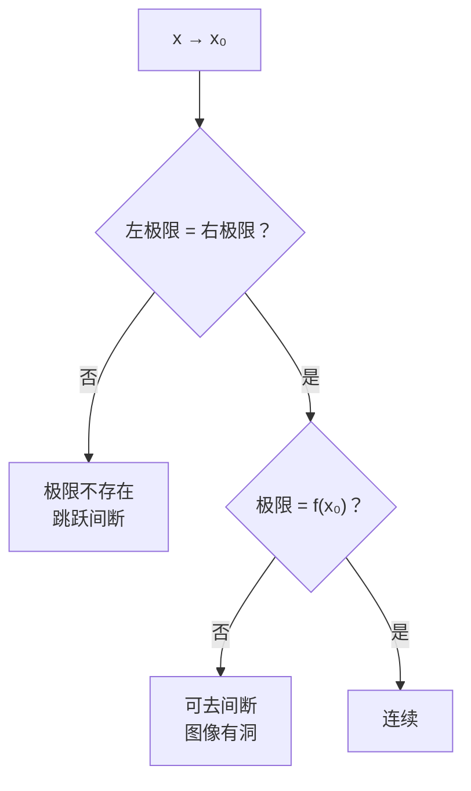

# MATH-120 极限与连续

## 1. 知识概览

| 项 | 内容 |
|---|---|
| 知识 ID | `MATH-120` |
| 英文名称 | Limits and Continuity |
| 所属模块 | M-MATH-03 微积分 |
| 难度等级 | L2 应用 |
| 前置知识 | [[MATH-006 坐标几何与数列极限]] |
| 所属知识体系 | 数列极限 → 函数极限 → 连续性 → 导数 |
| **AI 应用场景** | 导数与梯度的定义基底、损失函数的连续性、可微性讨论 |
| **预计学习时间** | 55 分钟 |

**为什么学它**：**导数是极限**。$f'(x)=\lim_{h\to0}\frac{f(x+h)-f(x)}{h}$。不理解极限，导数就只是"背公式"；理解了极限，梯度下降"往哪走、走多小步"才有意义。

## 2. 直观理解

**极限**是"越来越靠近，但不一定到达"。

- 数列极限：$1, \tfrac12, \tfrac13, \dots$ 越来越靠近 $0$。
- 函数极限：$x$ 越来越靠近 $2$ 时，$f(x)=x^2$ 越来越靠近 $4$——**与 $x=2$ 时 $f$ 取什么值无关**。

**连续性**是"图像不断线"：笔不离纸就能画完。

生活类比：温度随时间变化是连续的——不会从 20℃ 瞬间跳到 100℃。但股价可能"跳空"，那就是间断。

## 3. 正式数学定义

**数列极限**（$\varepsilon$-$N$）：对任意 $\varepsilon>0$，存在 $N$，使 $n>N$ 时 $|a_n - A|<\varepsilon$，记 $\lim\limits_{n\to\infty}a_n=A$。

**函数极限**（$\varepsilon$-$\delta$）：对任意 $\varepsilon>0$，存在 $\delta>0$，使 $0<|x-x_0|<\delta$ 时 $|f(x)-A|<\varepsilon$，记 $\lim\limits_{x\to x_0}f(x)=A$。

> 注意 $0<|x-x_0|$：**不要求 $x=x_0$ 处有定义**。

**左极限 / 右极限**

$$
\lim_{x\to x_0^-}f(x), \qquad \lim_{x\to x_0^+}f(x)
$$

$$
\lim_{x\to x_0}f(x) \text{ 存在} \iff \text{左右极限存在且相等}
$$

**连续**：$f$ 在 $x_0$ 连续 $\iff$

$$
\lim_{x\to x_0}f(x) = f(x_0)
$$

需要三件事同时成立：$f(x_0)$ 有定义、极限存在、两者相等。

**两个重要极限**

$$
\lim_{x\to0}\frac{\sin x}{x} = 1, \qquad \lim_{x\to0}(1+x)^{1/x} = e
$$

## 4. 数学推导

### 4.1 为什么 $\lim_{x\to0}\dfrac{\sin x}{x}=1$（夹逼）

**起点**：在单位圆中，设圆心角 $x\in(0, \tfrac{\pi}{2})$。

**第 1 步**：比较三个面积——三角形 $OAB$、扇形 $OAB$、三角形 $OAC$。

$$
S_{\triangle OAB} = \frac12\sin x, \qquad S_{\text{扇形}} = \frac12 x, \qquad S_{\triangle OAC} = \frac12\tan x
$$

**第 2 步**：由包含关系（三角形 ⊂ 扇形 ⊂ 大三角形）

$$
\frac12\sin x < \frac12 x < \frac12\tan x
$$

**第 3 步**：同除以 $\frac12\sin x>0$

$$
1 < \frac{x}{\sin x} < \frac{1}{\cos x}
$$

**第 4 步**：取倒数（不等式反向）

$$
\cos x < \frac{\sin x}{x} < 1
$$

**第 5 步**：令 $x\to0^+$，$\cos x\to1$，两端都趋于 1，由夹逼定理

$$
\lim_{x\to0^+}\frac{\sin x}{x} = 1
$$

由于 $\frac{\sin x}{x}$ 是偶函数，左极限同为 1，故双边极限为 1。

### 4.2 连续性为何要求"极限 = 函数值"

**起点**：$f$ 在 $x_0$ 连续的定义。

**第 1 步**：若只有 $\lim_{x\to x_0}f(x)=A$ 但 $f(x_0)\neq A$（或未定义），则图像在 $x_0$ 处**有洞**，笔必须抬起——不连续。这类叫**可去间断点**。

**第 2 步**：若左右极限存在但不相等，图像**跳跃**，叫**跳跃间断点**。

**第 3 步**：若某侧趋于无穷，图像**断开飞走**，叫**无穷间断点**。

**结论**：连续性把"极限值"和"实际取值"钉在一起，缺一不可。

## 5. 几何直观与图解



```text
可去间断:       跳跃间断:
   ●              ●
  ╱              ╱
 ╱      ○       ╱
╱              ○
```

## 6. 计算示例

**例 1**：求 $\lim\limits_{x\to2}x^2$。

直接代入（多项式处处连续）：$2^2 = 4$。

**例 2**：求 $\lim\limits_{x\to1}\dfrac{x^2-1}{x-1}$。

在 $x=1$ 处无定义，但可约分：

$$
\frac{x^2-1}{x-1} = x+1 \;(x\neq1) \;\Rightarrow\; \lim_{x\to1} = 2
$$

这是**可去间断**：极限存在，函数值不存在。

**例 3**：$f(x)=\dfrac1x$ 在 $x=0$ 处。

左极限 $-\infty$，右极限 $+\infty$，不相等 ⇒ 极限不存在（无穷间断）。

**例 4**：数值验证 $\lim\limits_{x\to0}\dfrac{\sin x}{x}$。

| $x$ | $0.1$ | $0.01$ | $0.001$ |
|---|---|---|---|
| $\sin x/x$ | $0.998334$ | $0.999983$ | $1.0$ |

## 7. Python 辅助验证

**依赖**：`math`。

```powershell
python math120_limit.py
```

```python
import math

print("sin(x)/x 在 x=0.1,0.01,0.001:",
      [round(math.sin(x) / x, 6) for x in (0.1, 0.01, 0.001)])
print("(1-cos x)/x² 在 x=0.1,0.01:",
      [round((1 - math.cos(x)) / x**2, 6) for x in (0.1, 0.01)])
print("(1+1/n)^n 在 n=1e3,1e6:",
      [round((1 + 1 / x) ** x, 6) for x in (1e3, 1e6)])


def f(x):
    return 1 / x


print("x→0+:", f(1e-6), " x→0-:", f(-1e-6))


def g(x):
    return (x**2 - 1) / (x - 1)


print("g(0.999), g(1.001):", round(g(0.999), 3), round(g(1.001), 3))
```

**实际运行结果**

```
sin(x)/x 在 x=0.1,0.01,0.001: [0.998334, 0.999983, 1.0]
(1-cos x)/x² 在 x=0.1,0.01: [0.499583, 0.499996]
(1+1/n)^n 在 n=1e3,1e6: [2.716924, 2.71828]
x→0+: 1000000.0  x→0-: -1000000.0
g(0.999), g(1.001): 1.999 2.001
```

**代码解析**

- 三处极限都用**数值逼近**展示趋势，不是证明。
- $\frac{1-\cos x}{x^2}\to\frac12$，说明"分子趋于 0 的速度是分母的平方级"。
- `f(1e-6)` 与 `f(-1e-6)` 符号相反且绝对值很大，正是"左右极限不等 ⇒ 极限不存在"。
- $g$ 在 $x=1$ 处无定义，但两侧逼近 2，典型可去间断。

## 8. 知识关联

| 类型 | 链接 |
|---|---|
| 前置数学 | [[MATH-006 坐标几何与数列极限]]、[[MATH-005 基本初等函数]] |
| 后续数学 | [[MATH-121 导数]]、`MATH-122 求导法则与链式法则`（待建） |
| 相关 Python | [[PY-009 函数]] |
| 相关机器学习 | 待关联（损失函数的连续性、可微性） |
| 相关深度学习 | 待关联（ReLU 在 0 处不可微） |
| 相关大语言模型 | 待关联 |

## 9. 实战练习

**基础 1**：求 $\lim\limits_{x\to3}(2x+1)$。

**基础 2**：求 $\lim\limits_{x\to2}\dfrac{x^2-4}{x-2}$。

**进阶 1**：判断 $f(x)=\dfrac{|x|}{x}$ 在 $x=0$ 处的极限是否存在。

**综合 1**：设 $f(x)=\begin{cases}x^2 & x<1\\ 2x-1 & x\ge1\end{cases}$，判断 $f$ 在 $x=1$ 处是否连续。

## 10. 参考答案

> [!success]- 基础 1
> 一次函数处处连续，直接代入：$2(3)+1 = 7$。

> [!success]- 基础 2
> 约分：$\dfrac{(x-2)(x+2)}{x-2} = x+2$（$x\neq2$），极限 $= 4$。
>
> **易错**：直接代入得 $\frac00$ 就下结论"无意义"——需先约分。

> [!success]- 进阶 1
> 右极限 $x\to0^+$ 时 $|x|=x$，$f=1$；左极限 $x\to0^-$ 时 $|x|=-x$，$f=-1$。
>
> 左右不等 ⇒ **极限不存在**（跳跃间断）。

> [!success]- 综合 1
> 左极限：$\lim_{x\to1^-}x^2 = 1$。
>
> 右极限与函数值：$\lim_{x\to1^+}(2x-1) = 1$，$f(1) = 1$。
>
> 三者相等 ⇒ **连续**。

## 11. 常见错误

| 类型 | 错误表现 | 原因 | 纠正 |
|---|---|---|---|
| 概念错误 | 认为极限必须等于函数值 | 混淆极限与连续 | 极限只看"附近" |
| 计算错误 | 直接代入得 $\frac00$ 就判无极限 | 未约分/未化简 | 先化简或洛必达 |
| 概念错误 | 只算右极限就下结论 | 漏左极限 | 双侧都要看 |
| 概念错误 | 把 $\infty$ 当极限值 | 无穷是发散记号 | 严格说不存在有限极限 |
| 计算错误 | $\lim(1+1/x)^x$ 用 $x\to0$ 的公式 | 两个重要极限记混 | 注意变量趋向 |

## 12. 学习记录

| 日期 | 状态 | 掌握程度 | 复习状态 | 学习笔记 | 关联练习 |
|---|---|---|---|---|---|
| — | planned | — | — | — | 练习 1–4 |

---

## 🔗 Notion 同步信息

> 以下内容由 Notion「AI Knowledge System · 知识点」数据库按知识 ID 合并而来（导出于 2026-11-09）。

| 属性 | 值 |
|---|---|
| 学科 | 数学 |
| 学习状态 | 未开始 |
| 难度 | L2 应用 |
| 知识类型 | Concept |

- **所属模块**：[M-MATH-03 微积分](../%E8%AF%BE%E7%A8%8B%E6%A8%A1%E5%9D%97/M-MATH-03%20%E5%BE%AE%E7%A7%AF%E5%88%86.md)
- **前置知识**：[MATH-006 坐标几何与数列极限](MATH-006%20%E5%9D%90%E6%A0%87%E5%87%A0%E4%BD%95%E4%B8%8E%E6%95%B0%E5%88%97%E6%9E%81%E9%99%90.md)
- **关联Python**：[PY-009 函数](../../01_Python%E5%9F%BA%E7%A1%80/02%20%E5%87%BD%E6%95%B0%E4%B8%8E%E4%BD%9C%E7%94%A8%E5%9F%9F/PY-009%20%E5%87%BD%E6%95%B0.md)
- **关联数学**：[MATH-006 坐标几何与数列极限](MATH-006%20%E5%9D%90%E6%A0%87%E5%87%A0%E4%BD%95%E4%B8%8E%E6%95%B0%E5%88%97%E6%9E%81%E9%99%90.md)
