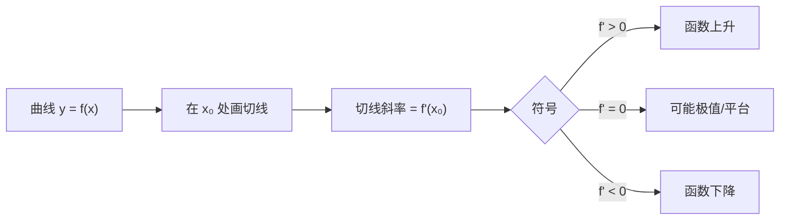

# MATH-121 导数

## 1. 通俗概念解释

导数回答一个问题：**当前这一刻，变化有多快？**

- 开车：里程表给出"一共走了多远"，导数给出"此刻车速"。
- 爬山：高度是位置函数，导数是"脚下的坡度"。

坡度为正 → 往上走；为负 → 往下走；为零 → 脚下是平的（可能是山顶、谷底或平台）。

## 2. 数学定义

函数 $f$ 在 $x_0$ 处的导数定义为

$$
f'(x_0) = \lim_{h \to 0} \frac{f(x_0+h) - f(x_0)}{h}
$$

若该极限存在，称 $f$ 在 $x_0$ 可导。几何上，$f'(x_0)$ 是曲线在 $(x_0, f(x_0))$ 处**切线的斜率**。

## 3. 公式推导

**基本求导法则**（由定义直接推出）：

$$
(x^n)' = n x^{n-1}, \qquad (e^x)' = e^x, \qquad (\ln x)' = \frac{1}{x}
$$

**和、积、商法则**：

$$
(f+g)' = f' + g', \qquad
(fg)' = f'g + fg', \qquad
\left(\frac{f}{g}\right)' = \frac{f'g - fg'}{g^2}
$$

**链式法则（最重要）**：若 $y = f(u)$，$u = g(x)$，则

$$
\frac{dy}{dx} = \frac{dy}{du}\cdot\frac{du}{dx} = f'(g(x))\cdot g'(x)
$$

推导直觉：$h$ 很小时

$$
\frac{f(g(x+h)) - f(g(x))}{h}
= \frac{f(g(x+h)) - f(g(x))}{g(x+h)-g(x)} \cdot \frac{g(x+h)-g(x)}{h}
$$

第一项趋向 $f'(g(x))$，第二项趋向 $g'(x)$。

**为什么链式法则是深度学习的命根子**：神经网络的输出是"层层复合"的函数，求梯度必须从后往前一层层乘导数——这就是反向传播。

## 4. 几何直观



## 5. 具体数值示例

取 $f(x) = x^2$，求 $x = 2$ 处的导数。

用定义近似（取越来越小的 $h$）：

| $h$ | $\dfrac{(2+h)^2 - 4}{h}$ |
|---|---|
| $1$ | $5$ |
| $0.1$ | $4.1$ |
| $0.01$ | $4.01$ |
| $0.001$ | $4.001$ |

趋势清楚地指向 $4$。而用公式：$(x^2)' = 2x$，在 $x=2$ 处得 $2\times2 = 4$。两者一致。

**切线方程**：过 $(2,4)$ 且斜率 4 →

$$
y - 4 = 4(x - 2) \;\Rightarrow\; y = 4x - 4
$$

## 6. 计算步骤

1. 判断函数是基本初等函数还是复合函数。
2. 基本函数直接套公式。
3. 复合函数由外向内拆：先对外层求导，再乘内层导数（链式）。
4. 代入具体点求数值。
5. 检查：结果的正负是否符合图像趋势。

## 7. Python 应用示例

```python
def f(x):
    return x ** 2

def numerical_derivative(f, x, h=1e-6):
    return (f(x + h) - f(x - h)) / (2 * h)

def analytic_derivative(x):
    return 2 * x

x0 = 2
print("数值导数:", round(numerical_derivative(f, x0), 6))
print("解析导数:", analytic_derivative(x0))

for h in (1, 0.1, 0.01, 0.001):
    approx = (f(x0 + h) - f(x0)) / h
    print(f"h={h:<6} 单侧差分={approx:.4f}")

print("切线在 x=3 处的值:", 4 * 3 - 4)
```

## 8. 基础练习

1. 求 $f(x)=x^3$ 的导数，并算 $x=2$ 处的值。
2. 求 $f(x)=3x^2+2x+1$ 的导数。
3. 求 $f(x)=(2x+1)^3$ 的导数（提示：链式法则）。

## 9. 进阶练习

1. 用定义证明 $(x^2)' = 2x$。
2. 求 $f(x)=e^{x^2}$ 的导数，并说明哪一步用了链式法则。

## 10. 参考答案

**基础**

1. $f'(x)=3x^2$，$f'(2)=12$。
2. $f'(x)=6x+2$。
3. 外层 $u^3$ 导数为 $3u^2$，内层 $2x+1$ 导数为 $2$，故 $f'(x)=6(2x+1)^2$。

**进阶**

1. $\frac{(x+h)^2-x^2}{h}=\frac{2xh+h^2}{h}=2x+h \to 2x$。
2. $f'(x)=e^{x^2}\cdot 2x$；链式法则用在内层 $u=x^2$ 的导数 $2x$ 上。

## 11. 常见错误

| 错误 | 说明 | 正确做法 |
|---|---|---|
| 忘记链式法则的内层导数 | $(e^{2x})'$ 写成 $e^{2x}$ | 应为 $2e^{2x}$ |
| 把 $f'(x)$ 当成 $f(x)$ 的平方 | 记号混淆 | $f'$ 表示导数 |
| 认为导数为 0 一定是极值 | 也可能是拐点/平台 | 需看二阶导或两侧符号 |
| 数值求导用太小的 $h$ | 浮点相减会损失精度 | $h$ 取 $10^{-6}$ 左右，用中心差分 |

## 12. 与机器学习、深度学习的联系

| 用到的地方 | 具体形式 |
|---|---|
| 梯度下降 | 沿负导数方向更新参数 |
| 损失函数优化 | 求 $\partial L/\partial w$ 决定往哪走 |
| 反向传播 | 链式法则逐层回传梯度 |
| 激活函数选择 | ReLU 导数简单（0/1），sigmoid 导数会饱和导致梯度消失 |
| 二阶方法 | 用二阶导（Hessian）判断曲率 |

---

## 关联与记录

- **前置**：无（只需基本函数知识）
- **后继**：[[MATH-721 梯度下降]]
- **被谁用**：见 Backlinks（反向传播、梯度下降）
- **所属模块**：`M-MATH-01 数学基础`

| 日期 | 动作 | 用时 | 结果 | 复盘 |
|---|---|---|---|---|
| 2026-11-01 | 建立笔记 | — | 待学 | — |

---

## 🔗 Notion 同步信息

> 以下内容由 Notion「AI Knowledge System · 知识点」数据库按知识 ID 合并而来（导出于 2026-11-09）。

| 属性 | 值 |
|---|---|
| 学科 | 数学 |
| 学习状态 | 未开始 |
| 难度 | L2 应用 |
| 知识类型 | Concept |
| 学习目标 | 理解导数定义与链式法则，会求常见函数的导数。 |

- **所属模块**：[M-MATH-03 微积分](../%E8%AF%BE%E7%A8%8B%E6%A8%A1%E5%9D%97/M-MATH-03%20%E5%BE%AE%E7%A7%AF%E5%88%86.md)
- **后继知识**：[MATH-721 梯度下降](../07%20%E6%9C%80%E4%BC%98%E5%8C%96%E6%96%B9%E6%B3%95/MATH-721%20%E6%A2%AF%E5%BA%A6%E4%B8%8B%E9%99%8D.md) · [MATH-122 求导法则与链式法则](MATH-122%20%E6%B1%82%E5%AF%BC%E6%B3%95%E5%88%99%E4%B8%8E%E9%93%BE%E5%BC%8F%E6%B3%95%E5%88%99.md)
- **被引用为数学**：[MATH-451 最小二乘与回归统计](../04%20%E6%95%B0%E7%90%86%E7%BB%9F%E8%AE%A1/MATH-451%20%E6%9C%80%E5%B0%8F%E4%BA%8C%E4%B9%98%E4%B8%8E%E5%9B%9E%E5%BD%92%E7%BB%9F%E8%AE%A1.md) · [MATH-721 梯度下降](../07%20%E6%9C%80%E4%BC%98%E5%8C%96%E6%96%B9%E6%B3%95/MATH-721%20%E6%A2%AF%E5%BA%A6%E4%B8%8B%E9%99%8D.md) · [MATH-122 求导法则与链式法则](MATH-122%20%E6%B1%82%E5%AF%BC%E6%B3%95%E5%88%99%E4%B8%8E%E9%93%BE%E5%BC%8F%E6%B3%95%E5%88%99.md) · [LLM-024 位置编码](../../05_%E5%A4%A7%E8%AF%AD%E8%A8%80%E6%A8%A1%E5%9E%8B/04%20Transformer%E6%9E%B6%E6%9E%84/LLM-024%20%E4%BD%8D%E7%BD%AE%E7%BC%96%E7%A0%81.md)
