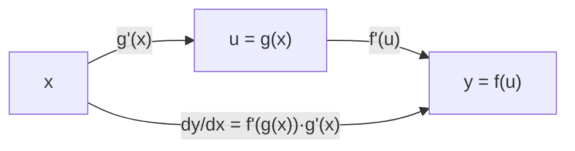

# MATH-122 求导法则与链式法则

## 1. 知识概览

| 项 | 内容 |
|---|---|
| 知识 ID | `MATH-122` |
| 英文名称 | Differentiation Rules and the Chain Rule |
| 所属模块 | M-MATH-03 微积分 |
| 难度等级 | L2 应用 |
| 前置知识 | [[MATH-121 导数]] |
| 所属知识体系 | 求导法则 → 链式法则 → 反向传播 |
| **AI 应用场景** | 反向传播的全部数学就是链式法则；自动微分（autograd）的底层规则 |
| **预计学习时间** | 55 分钟 |

**为什么学它**：**反向传播就是链式法则的工程实现**。神经网络是一层层函数复合，求损失对每层权重的导数，必须靠链式法则把"外层导数 × 内层导数"逐层传回去。这一篇是整条 AI 数学链上最关键的一环。

## 2. 直观理解

**导数** = 变化率；**求导法则** = 不用每次回到极限定义，直接用规则算。

四条基本规则像四则运算：

- 加法：分别求导（和的导数 = 导数的和）
- 数乘：系数提出来
- 乘法：不是分别乘，要"前导后不导 + 前不导后导"
- 复合：**链式法则**——外层导数乘以内层导数

**链式法则的直观**：齿轮传动。A 转 1 圈带动 B 转 2 圈，B 转 1 圈带动 C 转 3 圈，那么 A 转 1 圈 C 转 $2\times3=6$ 圈。变化率沿链条**相乘**。

## 3. 正式数学定义

**导数定义**

$$
f'(x) = \lim_{h\to0}\frac{f(x+h) - f(x)}{h}
$$

**基本求导公式**

| $f(x)$ | $f'(x)$ |
|---|---|
| $c$ | $0$ |
| $x^n$ | $nx^{n-1}$ |
| $e^x$ | $e^x$ |
| $\ln x$ | $1/x$ |
| $\sin x$ | $\cos x$ |
| $\cos x$ | $-\sin x$ |
| $\sqrt{x}$ | $\dfrac{1}{2\sqrt{x}}$ |

**运算法则**

$$
(u\pm v)' = u' \pm v', \qquad (cu)' = cu'
$$

$$
(uv)' = u'v + uv' \qquad \text{（乘积法则）}
$$

$$
\left(\frac{u}{v}\right)' = \frac{u'v - uv'}{v^2} \qquad \text{（商法则）}
$$

**链式法则**

$$
y = f(g(x)) \;\Longrightarrow\; y' = f'(g(x))\cdot g'(x)
$$

或写成微分形式

$$
\frac{dy}{dx} = \frac{dy}{du}\cdot\frac{du}{dx}, \qquad u = g(x)
$$

## 4. 数学推导

### 4.1 乘积法则的证明

**起点**：$y = u(x)v(x)$，按定义

$$
(uv)' = \lim_{h\to0}\frac{u(x+h)v(x+h) - u(x)v(x)}{h}
$$

**第 1 步**：分子加一项减一项（技巧：凑出"只变一个"的差）

$$
u(x+h)v(x+h) - u(x)v(x+h) + u(x)v(x+h) - u(x)v(x)
$$

**第 2 步**：分成两组

$$
= v(x+h)\big[u(x+h)-u(x)\big] + u(x)\big[v(x+h)-v(x)\big]
$$

**第 3 步**：除以 $h$ 并取极限

$$
(uv)' = \lim_{h\to0}v(x+h)\frac{u(x+h)-u(x)}{h} + \lim_{h\to0}u(x)\frac{v(x+h)-v(x)}{h}
$$

**第 4 步**：用连续性 $v(x+h)\to v(x)$，得

$$
(uv)' = v\cdot u' + u\cdot v' = u'v + uv'
$$

**适用条件**：$u,v$ 在 $x$ 处可导。

### 4.2 链式法则的推导（增量形式）

**起点**：$y = f(u)$，$u = g(x)$，考虑增量

$$
\Delta u = g(x+\Delta x)-g(x), \qquad \Delta y = f(u+\Delta u)-f(u)
$$

**第 1 步**：若 $\Delta u\neq0$，可写成

$$
\frac{\Delta y}{\Delta x} = \frac{\Delta y}{\Delta u}\cdot\frac{\Delta u}{\Delta x}
$$

**第 2 步**：令 $\Delta x\to0$。由 $g$ 可导 ⇒ 连续 ⇒ $\Delta u\to0$，于是

$$
\lim_{\Delta x\to0}\frac{\Delta y}{\Delta u} = f'(u), \qquad \lim_{\Delta x\to0}\frac{\Delta u}{\Delta x} = g'(x)
$$

**第 3 步**：乘积的极限等于极限的乘积

$$
\frac{dy}{dx} = f'(g(x))\cdot g'(x)
$$

**第 4 步**（严格化）：$\Delta u=0$ 的情形需单独处理，可用 $f(u+\Delta u)-f(u) = f'(u)\Delta u + \varepsilon(\Delta u)\Delta u$ 的"可微性"替代写法，结论不变。

**结论**：**变化率沿复合链相乘**。

## 5. 几何直观与图解



```text
y = sin(x²)
    x  --(x²)'=2x-->  u  --(sin)'=cos u-->  y
       2x               cos(x²)
   dy/dx = cos(x²) · 2x
```

## 6. 计算示例

**例 1**：$f(x)=x^3$，$f'(x)=3x^2$，$f'(2)=12$。

**例 2**：$y=\sin(x^2)$，令 $u=x^2$。

$$
y' = \cos(u)\cdot u' = \cos(x^2)\cdot 2x
$$

在 $x=1$ 处：$\cos(1)\cdot2 \approx 1.080605$。

**例 3**：$y = x e^{x}$，用乘积法则。

$$
y' = 1\cdot e^x + x\cdot e^x = (1+x)e^x
$$

在 $x=1$ 处：$2e \approx 5.436564$。

**例 4**：$y=\ln(\sin x)$。

$$
y' = \frac{1}{\sin x}\cdot\cos x = \cot x
$$

## 7. Python 辅助验证

**依赖**：`math`（用中心差分数值验证导数）。

```powershell
python math122_derivative_rules.py
```

```python
import math


def num_deriv(f, x, h=1e-6):
    """中心差分：精度 O(h²)"""
    return (f(x + h) - f(x - h)) / (2 * h)


print("f=x³ 在 x=2: 解析", 3 * 2**2, "数值", round(num_deriv(lambda x: x**3, 2), 6))
print("sin 在 x=π/4: 解析", round(math.cos(math.pi / 4), 6),
      "数值", round(num_deriv(math.sin, math.pi / 4), 6))
print("sin(x²) 在 x=1: 解析", round(math.cos(1) * 2 * 1, 6),
      "数值", round(num_deriv(lambda x: math.sin(x**2), 1.0), 6))
print("x·eˣ 在 x=1: 解析", round(2 * math.e, 6),
      "数值", round(num_deriv(lambda x: x * math.exp(x), 1.0), 6))
```

**实际运行结果**

```
f=x³ 在 x=2: 解析 12 数值 12.0
sin 在 x=π/4: 解析 0.707107 数值 0.707107
sin(x²) 在 x=1: 解析 1.080605 数值 1.080605
x·eˣ 在 x=1: 解析 5.436564 数值 5.436564
```

**代码解析**

- 中心差分比前向差分精度高一个量级（误差 $O(h^2)$）。
- 四项解析值与数值结果完全吻合，说明手推的链式法则与乘积法则都对。
- 数值微分只是**验证**手段，不能替代推导——$h$ 太小时会有舍入误差。

## 8. 知识关联

| 类型 | 链接 |
|---|---|
| 前置数学 | [[MATH-121 导数]]、[[MATH-120 极限与连续]]、[[MATH-005 基本初等函数]] |
| 后续数学 | [[MATH-123 导数应用与极值]]、[[MATH-126 偏导数与梯度]]、`MATH-804 反向传播与链式法则`（待建） |
| 相关 Python | [[PY-009 函数]]、[[PY-026 lambda 与高阶函数]] |
| 相关机器学习 | 待关联（损失函数求导） |
| 相关深度学习 | 待关联（反向传播 = 链式法则的工程实现） |
| 相关大语言模型 | 待关联（Transformer 反向传播） |

## 9. 实战练习

**基础 1**：求 $y = 3x^4 - 2x + 7$ 的导数。

**基础 2**：求 $y = (2x+1)^5$ 的导数。

**进阶 1**：求 $y = \sin(x^2) + e^{3x}$ 的导数。

**综合 1**：设 $f(x)=x^2$、$g(x)=\sin x$，分别求 $(f\circ g)'$ 与 $(g\circ f)'$，并说明两者为何不同。

## 10. 参考答案

> [!success]- 基础 1
> $$y' = 12x^3 - 2$$

> [!success]- 基础 2
> 令 $u = 2x+1$，$y=u^5$：
>
> $$y' = 5u^4\cdot 2 = 10(2x+1)^4$$
>
> **易错**：忘记乘内层导数 2。

> [!success]- 进阶 1
> 分别用链式法则：
>
> $$y' = \cos(x^2)\cdot 2x + e^{3x}\cdot 3 = 2x\cos(x^2) + 3e^{3x}$$

> [!success]- 综合 1
> $(f\circ g)(x) = \sin^2 x$，导数 $= 2\sin x\cos x = \sin 2x$。
>
> $(g\circ f)(x) = \sin(x^2)$，导数 $= 2x\cos(x^2)$。
>
> **原因**：复合不可交换，内层函数不同，链式相乘的顺序也就不同。

## 11. 常见错误

| 类型 | 错误表现 | 原因 | 纠正 |
|---|---|---|---|
| 公式错误 | $(uv)' = u'v'$ | 把乘积当独立 | $u'v + uv'$ |
| 公式错误 | 忘记乘内层导数 | 链式法则用一半 | $f'(g(x))\cdot g'(x)$ |
| 公式错误 | $(\sin x)' = -\cos x$ | 正负记反 | $\cos x$ |
| 计算错误 | $(x^n)' = x^{n-1}$ | 漏系数 | $nx^{n-1}$ |
| 概念错误 | 认为 $\ln(x)$ 对负数有定义 | 定义域 | $x>0$ |
| 计算错误 | 商法则分子写成 $u'v + uv'$ | 与乘积混淆 | $u'v - uv'$ |

## 12. 学习记录

| 日期 | 状态 | 掌握程度 | 复习状态 | 学习笔记 | 关联练习 |
|---|---|---|---|---|---|
| — | planned | — | — | — | 练习 1–4 |

---

## 🔗 Notion 同步信息

> 以下内容由 Notion「AI Knowledge System · 知识点」数据库按知识 ID 合并而来（导出于 2026-11-09）。

| 属性 | 值 |
|---|---|
| 学科 | 数学 |
| 学习状态 | 未开始 |
| 难度 | L2 应用 |
| 知识类型 | Technique |

- **所属模块**：[M-MATH-03 微积分](../%E8%AF%BE%E7%A8%8B%E6%A8%A1%E5%9D%97/M-MATH-03%20%E5%BE%AE%E7%A7%AF%E5%88%86.md)
- **前置知识**：[MATH-121 导数](MATH-121%20%E5%AF%BC%E6%95%B0.md)
- **后继知识**：[MATH-123 导数应用与极值](MATH-123%20%E5%AF%BC%E6%95%B0%E5%BA%94%E7%94%A8%E4%B8%8E%E6%9E%81%E5%80%BC.md) · [MATH-124 不定积分](MATH-124%20%E4%B8%8D%E5%AE%9A%E7%A7%AF%E5%88%86.md)
- **关联Python**：[PY-009 函数](../../01_Python%E5%9F%BA%E7%A1%80/02%20%E5%87%BD%E6%95%B0%E4%B8%8E%E4%BD%9C%E7%94%A8%E5%9F%9F/PY-009%20%E5%87%BD%E6%95%B0.md)
- **关联数学**：[MATH-121 导数](MATH-121%20%E5%AF%BC%E6%95%B0.md)
- **被引用为数学**：[MATH-123 导数应用与极值](MATH-123%20%E5%AF%BC%E6%95%B0%E5%BA%94%E7%94%A8%E4%B8%8E%E6%9E%81%E5%80%BC.md) · [MATH-124 不定积分](MATH-124%20%E4%B8%8D%E5%AE%9A%E7%A7%AF%E5%88%86.md) · [DL-009 激活函数：Sigmoid、Tanh、ReLU](../../04_%E6%B7%B1%E5%BA%A6%E5%AD%A6%E4%B9%A0/01%20%E7%A5%9E%E7%BB%8F%E7%BD%91%E7%BB%9C%E5%9F%BA%E7%A1%80/DL-009%20%E6%BF%80%E6%B4%BB%E5%87%BD%E6%95%B0%E2%80%94%E2%80%94Sigmoid%E3%80%81Tanh%E3%80%81ReLU.md) · [DL-010 激活函数：Leaky ReLU、GELU 与选型](../../04_%E6%B7%B1%E5%BA%A6%E5%AD%A6%E4%B9%A0/01%20%E7%A5%9E%E7%BB%8F%E7%BD%91%E7%BB%9C%E5%9F%BA%E7%A1%80/DL-010%20%E6%BF%80%E6%B4%BB%E5%87%BD%E6%95%B0%E2%80%94%E2%80%94Leaky%20ReLU%E3%80%81GELU%20%E4%B8%8E%E9%80%89%E5%9E%8B.md) · [DL-019 梯度的含义与链式法则](../../04_%E6%B7%B1%E5%BA%A6%E5%AD%A6%E4%B9%A0/01%20%E7%A5%9E%E7%BB%8F%E7%BD%91%E7%BB%9C%E5%9F%BA%E7%A1%80/DL-019%20%E6%A2%AF%E5%BA%A6%E7%9A%84%E5%90%AB%E4%B9%89%E4%B8%8E%E9%93%BE%E5%BC%8F%E6%B3%95%E5%88%99.md)
