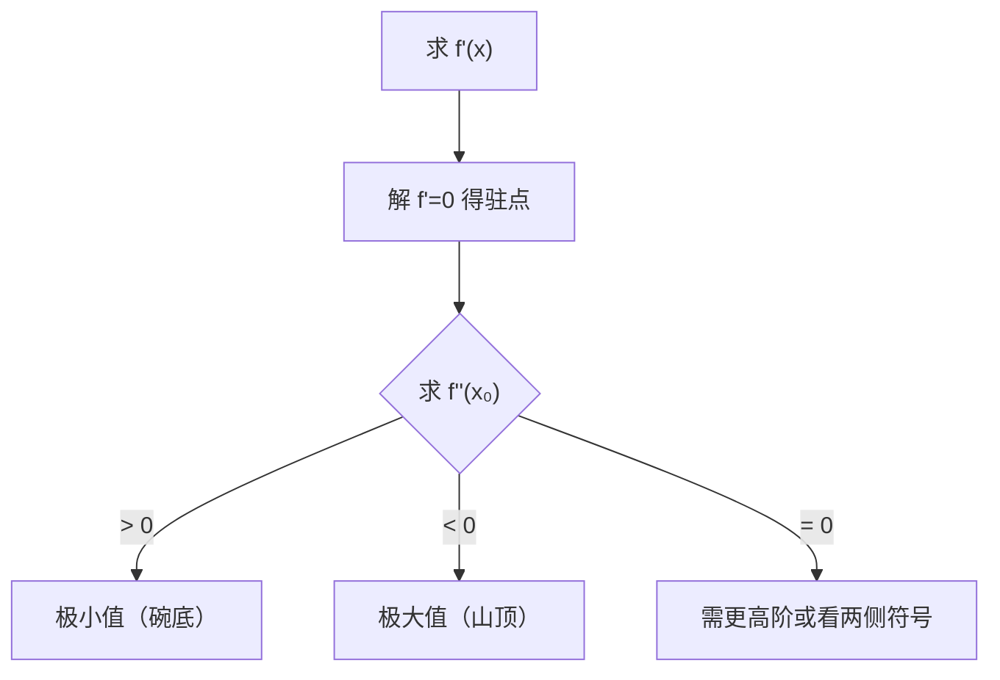

# MATH-123 导数应用与极值

## 1. 知识概览

| 项 | 内容 |
|---|---|
| 知识 ID | `MATH-123` |
| 英文名称 | Applications of Derivatives and Extrema |
| 所属模块 | M-MATH-03 微积分 |
| 难度等级 | L3 推导 |
| 前置知识 | [[MATH-122 求导法则与链式法则]] |
| 所属知识体系 | 单调性 → 驻点 → 极值判定 → 最值 |
| **AI 应用场景** | 损失函数的极小值点、鞍点识别、训练收敛判断、学习率过大会越过的点 |
| **预计学习时间** | 55 分钟 |

**为什么学它**：训练模型就是**找损失函数的极小值**。判断"这里是不是极小值"用二阶导数（或 Hessian），而训练卡住不动可能是掉进了**鞍点**——这些概念全部来自这一篇。

## 2. 直观理解

导数告诉你"往哪走会上升"：

- $f' > 0$：曲线上升
- $f' < 0$：曲线下降
- $f' = 0$：**可能**是山顶、谷底或平地

$f'=0$ 的点只是**候选**（叫驻点），要用二阶导数判断类型：

- $f'' > 0$：像碗底 → **极小值**
- $f'' < 0$：像山顶 → **极大值**
- $f'' = 0$：可能是鞍点，要继续看更高阶

生活类比：蒙着眼在山里找最低点。脚下是平地（$f'=0$），但周围是往上还是往下，取决于地形弯曲方向（$f''$）。

## 3. 正式数学定义

**单调性判定**

$$
f'(x) > 0 \;\forall x\in I \;\Rightarrow\; f \text{ 在 } I \text{ 上严格递增}
$$

**驻点（临界点）**：满足 $f'(x)=0$ 的点。

**极值的第一充分条件**：$f'$ 在 $x_0$ 左正右负 ⇒ 极大；左负右正 ⇒ 极小；两侧同号 ⇒ 非极值。

**极值的第二充分条件**（$f'(x_0)=0$ 且 $f''$ 存在）

$$
f''(x_0) > 0 \Rightarrow x_0 \text{ 是极小值点}
$$

$$
f''(x_0) < 0 \Rightarrow x_0 \text{ 是极大值点}
$$

$$
f''(x_0) = 0 \Rightarrow \text{判别失效，需更高阶}
$$

**闭区间最值**：在"驻点 + 端点"中取最大与最小。

## 4. 数学推导

### 4.1 为什么 $f'=0$ 且 $f''>0$ 是极小值

**起点**：$f'(x_0)=0$，$f''(x_0)>0$。

**第 1 步**：在 $x_0$ 处做二阶 Taylor 展开

$$
f(x_0+h) = f(x_0) + f'(x_0)h + \tfrac12 f''(x_0)h^2 + o(h^2)
$$

**第 2 步**：代入 $f'(x_0)=0$

$$
f(x_0+h) - f(x_0) = \tfrac12 f''(x_0)h^2 + o(h^2)
$$

**第 3 步**：因为 $f''(x_0)>0$，当 $|h|$ 足够小时，右端由二次项主导，且 $h^2>0$

$$
f(x_0+h) - f(x_0) > 0
$$

**第 4 步**：即 $x_0$ 附近函数值都大于 $f(x_0)$，所以是**极小值**。

**结论**：二阶导数衡量"弯曲方向"，正弯曲（碗形）就有极小值。

### 4.2 为什么 $f''=0$ 时判别失效

**举例**：

- $f_1(x)=x^4$：$f''(0)=0$，但 $x=0$ 是**极小值**（$x^4\ge0$）。
- $f_2(x)=-x^4$：$f''(0)=0$，但 $x=0$ 是**极大值**。
- $f_3(x)=x^3$：$f''(0)=0$，$x=0$ 不是极值（**鞍点**）。

三者二阶导数都为 0，结论却全不同——所以二阶判别在 $f''=0$ 时没有信息量。这时要看**三阶/四阶导数**，或直接用"两侧符号"判断。

## 5. 几何直观与图解



```text
      ╱╲ 极大        极小 ╱╲        鞍点
     ╱  ╲ f''<0        ╱  ╲ f''>0    ╱
    ╱    ╲            ╱    ╲         ╱____
```

## 6. 计算示例

**例**：求 $f(x) = x^3 - 3x^2 + 2$ 的单调区间与极值。

**第 1 步**：求导

$$
f'(x) = 3x^2 - 6x = 3x(x-2)
$$

**第 2 步**：驻点 $x=0$、$x=2$。

**第 3 步**：二阶导 $f''(x)=6x-6$。

- $f''(0) = -6 < 0$ ⇒ $x=0$ 极大值，$f(0)=2$。
- $f''(2) = 6 > 0$ ⇒ $x=2$ 极小值，$f(2) = 8 - 12 + 2 = -2$。

**第 4 步**：单调区间

| 区间 | $f'$ 符号 | 单调性 |
|---|---|---|
| $(-\infty,0)$ | $+$ | 递增 |
| $(0,2)$ | $-$ | 递减 |
| $(2,+\infty)$ | $+$ | 递增 |

**第 5 步**：若限定在 $[-1,3]$ 上求最值，比较驻点与端点：

$$
f(-1) = -2,\quad f(0) = 2,\quad f(2) = -2,\quad f(3) = 2
$$

最大值 $2$（在 $x=0$ 与 $x=3$），最小值 $-2$（在 $x=-1$ 与 $x=2$）。

## 7. Python 辅助验证

**依赖**：NumPy 2.5.4。

```powershell
python math123_extrema.py
```

```python
import numpy as np


def f(x):
    return x**3 - 3 * x**2 + 2


crit = np.roots([3, -6, 0])          # f'(x) = 3x² - 6x
print("驻点:", np.sort(crit).round(6).tolist())

for x in np.sort(crit):
    d2 = 6 * x - 6                    # f''(x) = 6x - 6
    kind = "极小" if d2 > 0 else ("极大" if d2 < 0 else "鞍点")
    print(f"x={x:.0f} f={f(x):.0f} f''={d2:.0f} → {kind}")

print("端点 f(-1), f(3):", f(-1), f(3))
```

**实际运行结果**

```
驻点: [0.0, 2.0]
x=0 f=2 f''=-6 → 极大
x=2 f=-2 f''=6 → 极小
端点 f(-1), f(3): -2 2
```

**代码解析**

- `np.roots([3,-6,0])` 解 $3x^2-6x=0$，得到两个驻点。
- 用 $f''$ 的符号自动判定类型，与手算一致。
- 端点值也打印出来——**闭区间最值必须比较端点**，只看驻点会漏。

## 8. 知识关联

| 类型 | 链接 |
|---|---|
| 前置数学 | [[MATH-122 求导法则与链式法则]]、[[MATH-121 导数]] |
| 后续数学 | [[MATH-126 偏导数与梯度]]、`MATH-701 优化问题与凸性`（待建）、`MATH-721 梯度下降` |
| 相关 Python | [[PY-009 函数]]、[[PY-067 聚合与统计]] |
| 相关机器学习 | 待关联（损失函数极小值、学习率过大越过最优点） |
| 相关深度学习 | 待关联（鞍点、局部极小、Hessian 判定） |
| 相关大语言模型 | 待关联（训练曲线判断） |

## 9. 实战练习

**基础 1**：求 $f(x)=x^2-4x+1$ 的极小值点与极小值。

**基础 2**：判断 $f(x)=x^3$ 在 $x=0$ 处是否有极值。

**进阶 1**：求 $f(x)=x^3-3x$ 的单调区间与极值。

**综合 1**：某损失函数 $L(w)=(w-3)^2+1$，求最优点；若学习率过大导致 $w$ 从 3 跳到 9，说明会发生什么。

## 10. 参考答案

> [!success]- 基础 1
> $f'(x)=2x-4=0 \Rightarrow x=2$。$f''=2>0$ ⇒ 极小值点。
>
> $f(2) = 4 - 8 + 1 = -3$。

> [!success]- 基础 2
> $f'(x)=3x^2=0 \Rightarrow x=0$，但 $f''(0)=0$ 判别失效。
>
> 看两侧：$x<0$ 时 $f<0$，$x>0$ 时 $f>0$，**函数单调递增穿过 0**，所以 $x=0$ **不是极值点**（是鞍点/拐点）。

> [!success]- 进阶 1
> $f'(x)=3x^2-3=3(x-1)(x+1)$，驻点 $x=\pm1$。
>
> $f''(x)=6x$：$f''(-1)=-6<0$ 极大，$f(-1)=2$；$f''(1)=6>0$ 极小，$f(1)=-2$。
>
> 单调：$(-\infty,-1)$ 增，$(-1,1)$ 减，$(1,+\infty)$ 增。

> [!success]- 综合 1
> $L'(w)=2(w-3)=0 \Rightarrow w=3$，$L''=2>0$ ⇒ 全局最小，$L(3)=1$。
>
> 学习率过大时，从 $w=3$ 一步跳到 $w=9$：$L(9)=37$，损失反而暴涨，甚至下一步跳得更远——**发散**。
>
> **结论**：最优点的位置由导数决定，但能否停在最优点由学习率决定。

## 11. 常见错误

| 类型 | 错误表现 | 原因 | 纠正 |
|---|---|---|---|
| 概念错误 | 认为 $f'=0$ 就是极值 | 驻点只是候选 | 还要看二阶或两侧符号 |
| 计算错误 | 求最值只看驻点 | 漏端点 | 闭区间必须比端点 |
| 判断错误 | $f''=0$ 直接判非极值 | 判别失效不等于没有 | 看更高阶或两侧 |
| 概念错误 | 极值点与最值点混用 | 局部 vs 全局 | 极值是局部概念 |
| 计算错误 | 二阶导求错 | 求导链式漏 | 逐项检查 |

## 12. 学习记录

| 日期 | 状态 | 掌握程度 | 复习状态 | 学习笔记 | 关联练习 |
|---|---|---|---|---|---|
| — | planned | — | — | — | 练习 1–4 |

---

## 🔗 Notion 同步信息

> 以下内容由 Notion「AI Knowledge System · 知识点」数据库按知识 ID 合并而来（导出于 2026-11-09）。

| 属性 | 值 |
|---|---|
| 学科 | 数学 |
| 学习状态 | 未开始 |
| 难度 | L3 推导 |
| 知识类型 | Technique |

- **所属模块**：[M-MATH-03 微积分](../%E8%AF%BE%E7%A8%8B%E6%A8%A1%E5%9D%97/M-MATH-03%20%E5%BE%AE%E7%A7%AF%E5%88%86.md)
- **前置知识**：[MATH-122 求导法则与链式法则](MATH-122%20%E6%B1%82%E5%AF%BC%E6%B3%95%E5%88%99%E4%B8%8E%E9%93%BE%E5%BC%8F%E6%B3%95%E5%88%99.md)
- **关联Python**：[PY-009 函数](../../01_Python%E5%9F%BA%E7%A1%80/02%20%E5%87%BD%E6%95%B0%E4%B8%8E%E4%BD%9C%E7%94%A8%E5%9F%9F/PY-009%20%E5%87%BD%E6%95%B0.md)
- **关联数学**：[MATH-122 求导法则与链式法则](MATH-122%20%E6%B1%82%E5%AF%BC%E6%B3%95%E5%88%99%E4%B8%8E%E9%93%BE%E5%BC%8F%E6%B3%95%E5%88%99.md)
