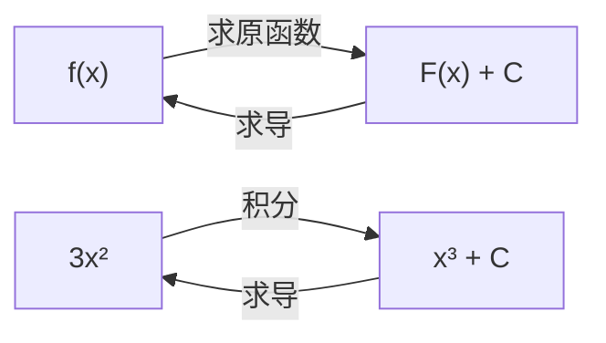

# MATH-124 不定积分

## 1. 知识概览

| 项 | 内容 |
|---|---|
| 知识 ID | `MATH-124` |
| 英文名称 | Indefinite Integrals |
| 所属模块 | M-MATH-03 微积分 |
| 难度等级 | L2 应用 |
| 前置知识 | [[MATH-122 求导法则与链式法则]] |
| 所属知识体系 | 原函数 → 不定积分 → 基本公式 → 换元与分部 |
| **AI 应用场景** | 概率密度的归一化、期望的计算、连续分布的累积概率 |
| **预计学习时间** | 50 分钟 |

**为什么学它**：积分是导数的逆运算。概率论里"密度函数积分得到概率"、连续分布的期望 $\int x f(x)\,dx$，都靠积分。不定积分是定积分与概率计算的基础。

## 2. 直观理解

**求导**是"已知位置求速度"；**积分**是"已知速度求位置"。

- 求导把 $x^3$ 变成 $3x^2$。
- 积分反过来：$3x^2$ 的原函数是 $x^3 + C$。

**为什么有 $+C$**：常数的导数是 0，所以"加任何常数"求导后都一样。积分只能确定"形状"，不能确定"高度"。

生活类比：知道每天走了多少步（速度），能算出"总共走了多少"，但不知道**起点在哪**——那个未知起点就是 $C$。

## 3. 正式数学定义

**原函数**：若 $F'(x) = f(x)$，称 $F$ 是 $f$ 的一个原函数。

**不定积分**：$f$ 的全部原函数

$$
\int f(x)\,dx = F(x) + C
$$

**线性性质**

$$
\int [\alpha f(x) + \beta g(x)]\,dx = \alpha\int f\,dx + \beta\int g\,dx
$$

**基本积分表**

| $f(x)$ | $\int f(x)\,dx$ |
|---|---|
| $x^n$（$n\neq-1$） | $\dfrac{x^{n+1}}{n+1} + C$ |
| $\dfrac1x$ | $\ln|x| + C$ |
| $e^x$ | $e^x + C$ |
| $\sin x$ | $-\cos x + C$ |
| $\cos x$ | $\sin x + C$ |
| $\dfrac{1}{1+x^2}$ | $\arctan x + C$ |

**第一换元法（凑微分）**

$$
\int f(g(x))g'(x)\,dx = \int f(u)\,du, \qquad u = g(x)
$$

**分部积分**

$$
\int u\,dv = uv - \int v\,du
$$

## 4. 数学推导

### 4.1 分部积分公式的推导

**起点**：乘积求导法则

$$
(uv)' = u'v + uv'
$$

**第 1 步**：两边对 $x$ 积分

$$
uv = \int u'v\,dx + \int uv'\,dx
$$

**第 2 步**：移项

$$
\int uv'\,dx = uv - \int u'v\,dx
$$

**第 3 步**：写成微分形式（$dv = v'dx$，$du = u'dx$）

$$
\int u\,dv = uv - \int v\,du
$$

**结论**：把"难积的 $\int uv'$"换成"好积的 $\int u'v$"。选择谁当 $u$ 是关键——通常取"求导后变简单的"（如 $\ln x$、$x^n$）。

### 4.2 换元法为什么成立

**起点**：要算 $\int f(g(x))g'(x)\,dx$。

**第 1 步**：令 $u = g(x)$，则 $du = g'(x)\,dx$（微分形式）。

**第 2 步**：代入原式

$$
\int f(g(x))g'(x)\,dx = \int f(u)\,du
$$

**第 3 步**：求出右端后，把 $u$ 换回 $g(x)$。

**验证方式**：对结果求导，应得回被积函数。这是检验积分唯一可靠的办法。

## 5. 几何直观与图解



```text
 F(x)+C 是一条"可上下平移"的曲线族
   ╱  C=2
  ╱   C=0
 ╱    C=-1
所有曲线形状相同，只是高度不同
```

## 6. 计算示例

**例 1**：$\int 2x\,dx = x^2 + C$。

**验证**：$(x^2)' = 2x$ ✓

**例 2**：$\int x^3\,dx = \dfrac{x^4}{4} + C$。

**例 3**：$\int \cos x\,dx = \sin x + C$。

**例 4**：$\int 2x e^{x^2}\,dx$，令 $u=x^2$，$du=2x\,dx$。

$$
\int e^u\,du = e^u + C = e^{x^2} + C
$$

**验证**：$(e^{x^2})' = e^{x^2}\cdot2x$ ✓

**例 5**：$\int x e^{x}\,dx$ 用分部积分，取 $u=x$、$dv=e^x dx$。

$$
= xe^x - \int e^x\,dx = xe^x - e^x + C = (x-1)e^x + C
$$

**验证**：$((x-1)e^x)' = e^x + (x-1)e^x = xe^x$ ✓

## 7. Python 辅助验证

**依赖**：`math`（用"对原函数求导，看是否回到被积函数"来验证）。

```powershell
python math124_indefinite.py
```

```python
import math


def num_deriv(f, x, h=1e-6):
    return (f(x + h) - f(x - h)) / (2 * h)


F1 = lambda x: x**2
print("d/dx (x²) =", round(num_deriv(F1, 3.0), 6),
      "，被积函数 2x 在 x=3 处 =", 2 * 3)

F2 = lambda x: math.sin(x)
print("d/dx (sin x) =", round(num_deriv(F2, 0.5), 6),
      "，cos(0.5) =", round(math.cos(0.5), 6))

F3 = lambda x: math.log(x)
print("d/dx (ln x) =", round(num_deriv(F3, 2.0), 6), "，1/2 =", 0.5)

F4 = lambda x: math.exp(x)
print("d/dx (eˣ) =", round(num_deriv(F4, 1.0), 6), "，e =", round(math.e, 6))
```

**实际运行结果**

```
d/dx (x²) = 6.0 ，被积函数 2x 在 x=3 处 = 6
d/dx (sin x) = 0.877583 ，cos(0.5) = 0.877583
d/dx (ln x) = 0.5 ，1/2 = 0.5
d/dx (eˣ) = 2.718282 ，e = 2.718282
```

**代码解析**

- 验证积分的**唯一可靠方法**是"求导回去"。
- 四个基本积分全部对上，说明公式记对了。
- 常数 $C$ 在求导时消失，所以验证过程天然不涉及 $C$。

## 8. 知识关联

| 类型 | 链接 |
|---|---|
| 前置数学 | [[MATH-122 求导法则与链式法则]]、[[MATH-003 指数、根式与对数]] |
| 后续数学 | [[MATH-125 定积分与微积分基本定理]]、`MATH-303 随机变量与分布函数`（待建）、`MATH-306 期望、方差与协方差`（待建） |
| 相关 Python | [[PY-009 函数]] |
| 相关机器学习 | 待关联（连续分布期望） |
| 相关深度学习 | 待关联（重参数化技巧中的积分替换） |
| 相关大语言模型 | 待关联 |

## 9. 实战练习

**基础 1**：求 $\int 3x^2\,dx$。

**基础 2**：求 $\int \left(2x + \dfrac1x\right) dx$。

**进阶 1**：求 $\int (2x+1)^3\,dx$。

**综合 1**：求 $\int x\cos x\,dx$（提示：分部积分），并用求导验证。

## 10. 参考答案

> [!success]- 基础 1
> $$\int 3x^2\,dx = x^3 + C$$
>
> 验证：$(x^3)' = 3x^2$ ✓

> [!success]- 基础 2
> $$\int 2x\,dx + \int \frac1x\,dx = x^2 + \ln|x| + C$$
>
> **易错**：$\dfrac1x$ 的积分是 $\ln|x|$ 不是 $\ln x$（$x<0$ 也成立）。

> [!success]- 进阶 1
> 令 $u = 2x+1$，$du = 2dx$：
>
> $$\int u^3\cdot\frac{du}{2} = \frac{u^4}{8} + C = \frac{(2x+1)^4}{8} + C$$
>
> 验证：$\dfrac{4(2x+1)^3\cdot2}{8} = (2x+1)^3$ ✓

> [!success]- 综合 1
> 取 $u=x$、$dv=\cos x\,dx$，则 $du=dx$、$v=\sin x$：
>
> $$\int x\cos x\,dx = x\sin x - \int \sin x\,dx = x\sin x + \cos x + C$$
>
> 验证：$(x\sin x + \cos x)' = \sin x + x\cos x - \sin x = x\cos x$ ✓

## 11. 常见错误

| 类型 | 错误表现 | 原因 | 纠正 |
|---|---|---|---|
| 公式错误 | $\int x^n dx = \dfrac{x^{n+1}}{n}$ | 漏 $n+1$ | $\dfrac{x^{n+1}}{n+1}$ |
| 公式错误 | $\int \dfrac1x dx = \ln x$ | 漏绝对值/常数 | $\ln|x|+C$ |
| 遗漏 | 忘记写 $+C$ | 习惯问题 | 不定积分必须带 $C$ |
| 计算错误 | 换元后忘换回 | 只做了一半 | 最后代回 $x$ |
| 计算错误 | 分部积分符号错 | $uv-\int vdu$ 记反 | 记住"减号" |
| 概念错误 | 认为积分结果唯一 | 差一个常数 | 是函数族 |

## 12. 学习记录

| 日期 | 状态 | 掌握程度 | 复习状态 | 学习笔记 | 关联练习 |
|---|---|---|---|---|---|
| — | planned | — | — | — | 练习 1–4 |

---

## 🔗 Notion 同步信息

> 以下内容由 Notion「AI Knowledge System · 知识点」数据库按知识 ID 合并而来（导出于 2026-11-09）。

| 属性 | 值 |
|---|---|
| 学科 | 数学 |
| 学习状态 | 未开始 |
| 难度 | L2 应用 |
| 知识类型 | Technique |

- **所属模块**：[M-MATH-03 微积分](../%E8%AF%BE%E7%A8%8B%E6%A8%A1%E5%9D%97/M-MATH-03%20%E5%BE%AE%E7%A7%AF%E5%88%86.md)
- **前置知识**：[MATH-122 求导法则与链式法则](MATH-122%20%E6%B1%82%E5%AF%BC%E6%B3%95%E5%88%99%E4%B8%8E%E9%93%BE%E5%BC%8F%E6%B3%95%E5%88%99.md)
- **后继知识**：[MATH-125 定积分与微积分基本定理](MATH-125%20%E5%AE%9A%E7%A7%AF%E5%88%86%E4%B8%8E%E5%BE%AE%E7%A7%AF%E5%88%86%E5%9F%BA%E6%9C%AC%E5%AE%9A%E7%90%86.md)
- **关联Python**：[PY-009 函数](../../01_Python%E5%9F%BA%E7%A1%80/02%20%E5%87%BD%E6%95%B0%E4%B8%8E%E4%BD%9C%E7%94%A8%E5%9F%9F/PY-009%20%E5%87%BD%E6%95%B0.md)
- **关联数学**：[MATH-122 求导法则与链式法则](MATH-122%20%E6%B1%82%E5%AF%BC%E6%B3%95%E5%88%99%E4%B8%8E%E9%93%BE%E5%BC%8F%E6%B3%95%E5%88%99.md)
- **被引用为数学**：[MATH-125 定积分与微积分基本定理](MATH-125%20%E5%AE%9A%E7%A7%AF%E5%88%86%E4%B8%8E%E5%BE%AE%E7%A7%AF%E5%88%86%E5%9F%BA%E6%9C%AC%E5%AE%9A%E7%90%86.md) · [ML-054 梯度提升树 GBDT](../../03_%E6%9C%BA%E5%99%A8%E5%AD%A6%E4%B9%A0/06%20%E6%A8%A1%E5%9E%8B%E4%BC%98%E5%8C%96/ML-054%20%E6%A2%AF%E5%BA%A6%E6%8F%90%E5%8D%87%E6%A0%91%20GBDT.md)
