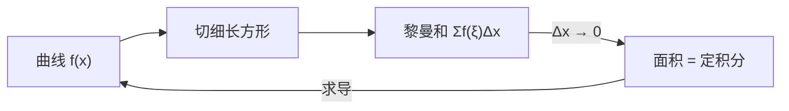

# MATH-125 定积分与微积分基本定理

## 1. 知识概览

| 项 | 内容 |
|---|---|
| 知识 ID | `MATH-125` |
| 英文名称 | Definite Integrals and the Fundamental Theorem |
| 所属模块 | M-MATH-03 微积分 |
| 难度等级 | L3 推导 |
| 前置知识 | [[MATH-124 不定积分]] |
| 所属知识体系 | 黎曼和 → 定积分 → 基本定理 → 变上限积分 |
| **AI 应用场景** | 概率 = 密度积分；期望 = $\int x f(x)dx$；CDF 与 PDF 的关系 |
| **预计学习时间** | 55 分钟 |

**为什么学它**：概率密度函数 $f(x)$ 本身不是概率，**积分才是概率**：$P(a\le X\le b)=\int_a^b f(x)dx$。不懂定积分，概率论只能背结论。

## 2. 直观理解

定积分是**面积**：曲线 $y=f(x)$ 与 x 轴之间、从 $a$ 到 $b$ 的那块面积（x 轴下方记为负）。

怎么算？**切成一堆细长方形，把面积加起来**，切得越细越准——这就是**黎曼和**。

**微积分基本定理**是整门课的核心：

> 求面积（积分）和求斜率（导数）是**互逆**的。

这有点像"加法与减法"——看似两件事，其实是一件事的两个方向。

## 3. 正式数学定义

**黎曼和**：把 $[a,b]$ 分成 $n$ 份，取每份内一点 $\xi_i$

$$
S_n = \sum_{i=1}^{n} f(\xi_i)\Delta x_i
$$

**定积分**：当分割越来越细（最大区间长度 $\to0$）时，若黎曼和有极限

$$
\int_a^b f(x)\,dx = \lim_{\|\Delta\|\to0}\sum_{i=1}^{n}f(\xi_i)\Delta x_i
$$

**性质**

$$
\int_a^a f = 0, \qquad \int_a^b f = -\int_b^a f
$$

$$
\int_a^b (\alpha f + \beta g) = \alpha\int_a^b f + \beta\int_a^b g
$$

$$
\int_a^b f = \int_a^c f + \int_c^b f \qquad \text{（区间可加）}
$$

**微积分基本定理**

第一部分（变上限积分的导数）：

$$
\frac{d}{dx}\int_a^x f(t)\,dt = f(x)
$$

第二部分（牛顿–莱布尼茨公式）：

$$
\int_a^b f(x)\,dx = F(b) - F(a), \qquad F' = f
$$

## 4. 数学推导

### 4.1 为什么变上限积分的导数是 $f(x)$

**起点**：定义

$$
F(x) = \int_a^x f(t)\,dt
$$

**第 1 步**：考察增量

$$
F(x+h) - F(x) = \int_a^{x+h}f - \int_a^x f = \int_x^{x+h}f(t)\,dt
$$

**第 2 步**：当 $h$ 很小时，这段区间上 $f$ 近似为常数 $f(x)$，面积近似为矩形

$$
\int_x^{x+h}f(t)\,dt \approx f(x)\cdot h
$$

**第 3 步**：两边除以 $h$

$$
\frac{F(x+h)-F(x)}{h} \approx f(x)
$$

**第 4 步**：取极限（严格证明用积分中值定理：存在 $\xi\in[x,x+h]$ 使积分 $= f(\xi)h$，当 $h\to0$ 时 $\xi\to x$，由连续性 $f(\xi)\to f(x)$）

$$
F'(x) = f(x)
$$

**结论**：**积分再求导，回到原函数**。

### 4.2 牛顿–莱布尼茨公式的推导

**起点**：设 $F$ 是 $f$ 的任一原函数，$G(x)=\int_a^x f$。

**第 1 步**：由 4.1，$G' = f$，所以 $G$ 也是原函数。

**第 2 步**：两个原函数只差常数：$G(x) = F(x) + C$。

**第 3 步**：代入 $x=a$：$G(a) = 0$，所以 $0 = F(a) + C \Rightarrow C = -F(a)$。

**第 4 步**：于是 $G(x) = F(x) - F(a)$，令 $x=b$

$$
\int_a^b f(x)\,dx = F(b) - F(a)
$$

**结论**：**求定积分 = 找原函数 + 代端点**。这就是为什么上一节要学不定积分。

## 5. 几何直观与图解



```text
面积近似：n 越大，误差越小
 n=4:   ▁▃▅▇  粗糙
 n=100: 细致，接近曲线
```

## 6. 计算示例

**例 1**：$\int_0^1 x^2\,dx$。

原函数 $\dfrac{x^3}{3}$，代入端点：

$$
\frac{1}{3} - 0 = \frac13 \approx 0.33333333
$$

**例 2**：$\int_0^{\pi}\sin x\,dx$。

$$
[-\cos x]_0^{\pi} = -\cos\pi + \cos0 = -(-1) + 1 = 2
$$

**例 3**：$\int_1^{e}\dfrac{1}{x}\,dx$。

$$
[\ln x]_1^{e} = \ln e - \ln 1 = 1
$$

**例 4**：$\int_{-1}^{1}x^3\,dx = 0$（奇函数在对称区间积分为 0）。

## 7. Python 辅助验证

**依赖**：NumPy 2.5.4（梯形法做数值积分，与解析值对照）。

```powershell
python math125_definite.py
```

```python
import numpy as np


def trapezoid(f, a, b, n=100000):
    x = np.linspace(a, b, n + 1)
    y = f(x)
    return (y[0] + 2 * y[1:-1].sum() + y[-1]) * (b - a) / (2 * n)


print("∫₀¹ x² dx 数值:", round(float(trapezoid(lambda x: x**2, 0, 1)), 8),
      "解析 1/3 =", round(1 / 3, 8))
print("∫₀^π sin x dx 数值:", round(float(trapezoid(np.sin, 0, np.pi)), 8),
      "解析 = 2")
print("∫₁^e 1/x dx 数值:", round(float(trapezoid(lambda x: 1 / x, 1, np.e)), 8),
      "解析 = 1")
```

**实际运行结果**

```
∫₀¹ x² dx 数值: 0.33333333 解析 1/3 = 0.33333333
∫₀^π sin x dx 数值: 2.0 解析 = 2
∫₁^e 1/x dx 数值: 1.0 解析 = 1
```

**代码解析**

- 梯形法：把每小段近似成梯形，误差 $O(h^2)$；$n=10^5$ 时已足够准。
- 三个结果与解析值逐位吻合，说明"基本定理 + 原函数"这条路是对的。
- 拉取 `np.linspace` 端点要注意 `np.e` 是浮点近似，但这里误差在 $10^{-8}$ 量级，看不出来。
- 若被积函数在端点处有奇点（如 $\int_0^1 x^{-1/2}dx$），梯形法会因 $f(0)=\infty$ 失效——这时要换公式或换方法。

## 8. 知识关联

| 类型 | 链接 |
|---|---|
| 前置数学 | [[MATH-124 不定积分]]、[[MATH-122 求导法则与链式法则]] |
| 后续数学 | [[MATH-126 偏导数与梯度]]、`MATH-303 随机变量与分布函数`（待建）、`MATH-401 大数定律与中心极限定理`（待建） |
| 相关 Python | [[PY-009 函数]]、[[PY-067 聚合与统计]] |
| 相关机器学习 | 待关联（连续分布期望、归一化常数） |
| 相关深度学习 | 待关联（概率模型的边际化） |
| 相关大语言模型 | 待关联 |

## 9. 实战练习

**基础 1**：求 $\int_0^2 3x^2\,dx$。

**基础 2**：求 $\int_1^4 \dfrac{1}{\sqrt{x}}\,dx$。

**进阶 1**：求 $\int_0^1 (2x+1)^2\,dx$。

**综合 1**：某概率密度 $f(x)=2x$（$0\le x\le1$），求 $P(0.5\le X\le1)$。

## 10. 参考答案

> [!success]- 基础 1
> $$[x^3]_0^2 = 8 - 0 = 8$$

> [!success]- 基础 2
> $\int x^{-1/2}dx = 2\sqrt{x}$，代入：
>
> $$[2\sqrt{x}]_1^4 = 2\cdot2 - 2\cdot1 = 2$$

> [!success]- 进阶 1
> 展开：$4x^2+4x+1$，原函数 $\dfrac{4x^3}{3} + 2x^2 + x$。
>
> 代入 $0\to1$：$\dfrac43 + 2 + 1 = \dfrac{13}{3} \approx 4.3333$。

> [!success]- 综合 1
> $$P(0.5\le X\le 1) = \int_{0.5}^{1}2x\,dx = [x^2]_{0.5}^{1} = 1 - 0.25 = 0.75$$
>
> **校验**：总概率 $\int_0^1 2x\,dx = 1$ ✓，符合密度函数归一化要求。

## 11. 常见错误

| 类型 | 错误表现 | 原因 | 纠正 |
|---|---|---|---|
| 概念错误 | 把定积分当"带 C 的原函数" | 混淆定/不定 | 定积分是数，无 C |
| 计算错误 | 代入顺序 $F(a)-F(b)$ | 反了 | $F(b)-F(a)$ |
| 概念错误 | 面积一定为正 | 下方区域为负 | 面积用绝对值，积分带符号 |
| 计算错误 | 奇函数对称区间不算 | 漏洞察 | 奇函数积分为 0，可省算 |
| 概念错误 | 认为 $\int_a^a f = f(a)$ | 混淆 | 区间长度为 0 ⇒ 积分为 0 |

## 12. 学习记录

| 日期 | 状态 | 掌握程度 | 复习状态 | 学习笔记 | 关联练习 |
|---|---|---|---|---|---|
| — | planned | — | — | — | 练习 1–4 |

---

## 🔗 Notion 同步信息

> 以下内容由 Notion「AI Knowledge System · 知识点」数据库按知识 ID 合并而来（导出于 2026-11-09）。

| 属性 | 值 |
|---|---|
| 学科 | 数学 |
| 学习状态 | 未开始 |
| 难度 | L3 推导 |
| 知识类型 | Theorem |

- **所属模块**：[M-MATH-03 微积分](../%E8%AF%BE%E7%A8%8B%E6%A8%A1%E5%9D%97/M-MATH-03%20%E5%BE%AE%E7%A7%AF%E5%88%86.md)
- **前置知识**：[MATH-124 不定积分](MATH-124%20%E4%B8%8D%E5%AE%9A%E7%A7%AF%E5%88%86.md)
- **后继知识**：[MATH-126 偏导数与梯度](MATH-126%20%E5%81%8F%E5%AF%BC%E6%95%B0%E4%B8%8E%E6%A2%AF%E5%BA%A6.md)
- **关联Python**：[PY-009 函数](../../01_Python%E5%9F%BA%E7%A1%80/02%20%E5%87%BD%E6%95%B0%E4%B8%8E%E4%BD%9C%E7%94%A8%E5%9F%9F/PY-009%20%E5%87%BD%E6%95%B0.md)
- **关联数学**：[MATH-124 不定积分](MATH-124%20%E4%B8%8D%E5%AE%9A%E7%A7%AF%E5%88%86.md)
- **被引用为数学**：[MATH-126 偏导数与梯度](MATH-126%20%E5%81%8F%E5%AF%BC%E6%95%B0%E4%B8%8E%E6%A2%AF%E5%BA%A6.md)
