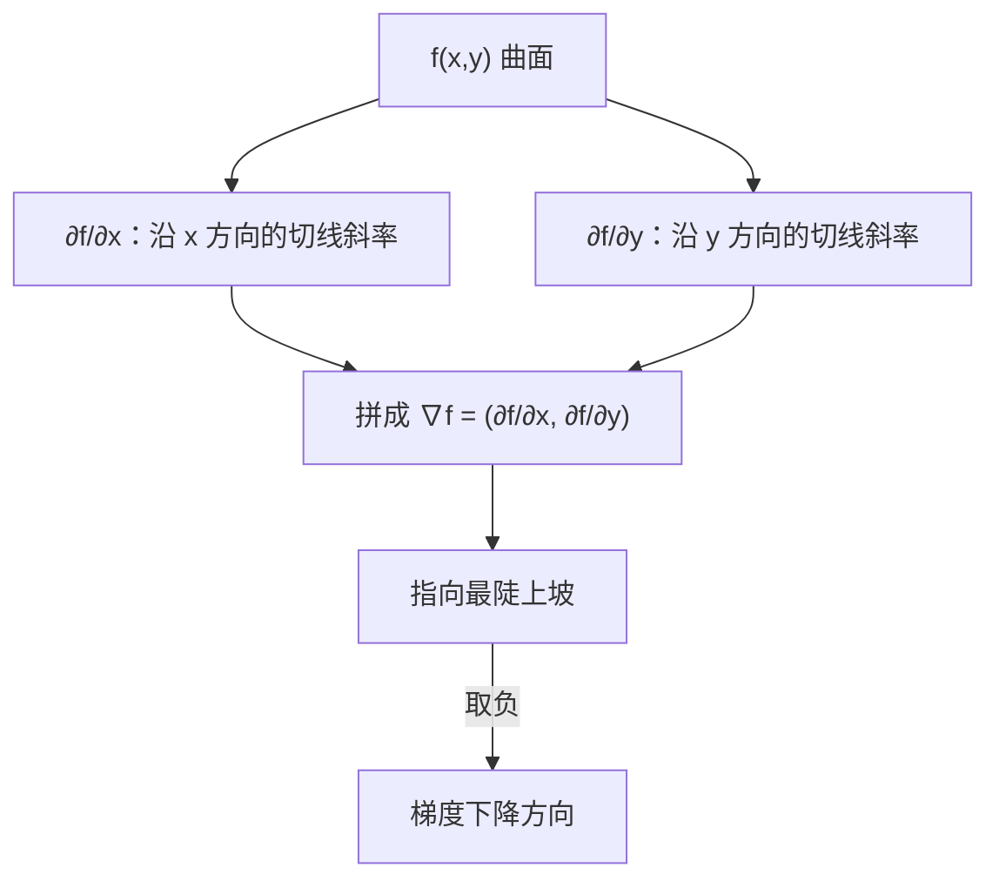

# MATH-126 偏导数与梯度

## 1. 知识概览

| 项 | 内容 |
|---|---|
| 知识 ID | `MATH-126` |
| 英文名称 | Partial Derivatives and the Gradient |
| 所属模块 | M-MATH-03 微积分 |
| 难度等级 | L3 推导 |
| 前置知识 | [[MATH-125 定积分与微积分基本定理]] |
| 所属知识体系 | 多元函数 → 偏导 → 梯度 → 方向导数 |
| **AI 应用场景** | 损失的梯度 $\nabla_\theta L$；梯度下降的更新方向；batch 里每个参数的偏导 |
| **预计学习时间** | 60 分钟 |

**为什么学它**：模型参数不是 1 个，是百万个。损失 $L(\theta_1,\dots,\theta_n)$ 是**多元函数**，要更新每个参数，就得算它对这个参数的**偏导数**——所有偏导排成向量就是**梯度**。梯度指向"损失上升最快的方向"，所以下降就取负梯度。

## 2. 直观理解

**偏导数**是"只看一个变量，其余当常数"的变化率。

站在山坡上：

- 只往东走一小步，高度变化多少 → 对东的偏导。
- 只往北走一小步，高度变化多少 → 对北的偏导。

**梯度**把这两个数打包成向量 $(\partial f/\partial x,\ \partial f/\partial y)$。

**梯度的含义**：它指向"上坡最陡"的方向。所以：

$$
\theta \leftarrow \theta - \eta\nabla_\theta L
$$

就是"沿下坡最陡方向走一小步"。这就是梯度下降。

## 3. 正式数学定义

**偏导数**：对 $f(x,y)$，

$$
\frac{\partial f}{\partial x} = \lim_{h\to0}\frac{f(x+h,y)-f(x,y)}{h}
$$

求 $\partial f/\partial x$ 时，**把 $y$ 当常数**。

**梯度**

$$
\nabla f = \left(\frac{\partial f}{\partial x_1}, \frac{\partial f}{\partial x_2}, \dots, \frac{\partial f}{\partial x_n}\right)
$$

**方向导数**：沿单位向量 $\mathbf{u}$ 的变化率

$$
D_{\mathbf{u}}f = \nabla f\cdot\mathbf{u}
$$

**关键性质**：当 $\mathbf{u}$ 与 $\nabla f$ 同向时，$D_{\mathbf{u}}f = \|\nabla f\|$ 取最大值——**梯度指向最速上升方向**。

**多元链式法则**：若 $z = f(x,y)$，$x=x(t)$，$y=y(t)$

$$
\frac{dz}{dt} = \frac{\partial f}{\partial x}\frac{dx}{dt} + \frac{\partial f}{\partial y}\frac{dy}{dt}
$$

## 4. 数学推导

### 4.1 为什么梯度方向是上升最快的方向

**起点**：$f$ 可微，单位方向 $\mathbf{u}$（$\|\mathbf{u}\|=1$）。

**第 1 步**：方向导数

$$
D_{\mathbf{u}}f = \nabla f\cdot\mathbf{u} = \|\nabla f\|\,\|\mathbf{u}\|\cos\theta = \|\nabla f\|\cos\theta
$$

**第 2 步**：$\cos\theta\le1$，等号当 $\theta=0$，即 $\mathbf{u}$ 与 $\nabla f$ 同向。

**第 3 步**：所以上升最快的方向就是 $\nabla f$ 方向，最大变化率为 $\|\nabla f\|$。

**第 4 步**：反过来，下降最快是 $\mathbf{u} = -\nabla f/\|\nabla f\|$，变化率 $-\|\nabla f\|$。

**结论**：梯度下降取负梯度，是**局部最优的下降方向**。

### 4.2 多元链式法则（计算图视角）

**起点**：$L$ 依赖中间变量 $a,b$，而 $a,b$ 又依赖参数 $w$。

**第 1 步**：一元链式法则

$$
\frac{dL}{dw} = \frac{\partial L}{\partial a}\frac{da}{dw} + \frac{\partial L}{\partial b}\frac{db}{dw}
$$

**第 2 步**：每一"条路径"贡献一项，全部相加。

**第 3 步**：这正是反向传播的做法——从损失出发，沿计算图反向累加每条路径的乘积。

**例**：$L = (a+b)^2$，$a=2w$，$b=w^2$。

$$
\frac{dL}{dw} = 2(a+b)\cdot2 + 2(a+b)\cdot2w = 2(a+b)(2+2w)
$$

代入 $w=1$：$a=2,b=1$，得 $2\cdot3\cdot4 = 24$。

## 5. 几何直观与图解



```text
等高线图（俯视）：
  梯度 ⊥ 等高线，指向更高的一条
  ------  🡒  ∇f
```

## 6. 计算示例

**例**：$f(x,y) = x^2 + 3xy + y^2$，求 $x=1,y=2$ 处的偏导与梯度。

**第 1 步**：对 $x$ 求偏导（$y$ 当常数）

$$
\frac{\partial f}{\partial x} = 2x + 3y = 2 + 6 = 8
$$

**第 2 步**：对 $y$ 求偏导（$x$ 当常数）

$$
\frac{\partial f}{\partial y} = 3x + 2y = 3 + 4 = 7
$$

**第 3 步**：梯度

$$
\nabla f(1,2) = (8, 7), \qquad \|\nabla f\| = \sqrt{64+49} = \sqrt{113} \approx 10.63
$$

**第 4 步**：验证"沿梯度方向函数上升"

沿单位梯度方向走 $10^{-3}$：$f$ 从 $11$ 增到约 $11.0106$ ✓

## 7. Python 辅助验证

**依赖**：NumPy 2.5.4。

```powershell
python math126_gradient.py
```

```python
import numpy as np


def f(x, y):
    return x**2 + 3 * x * y + y**2


def partial(fn, point, axis, h=1e-6):
    p = list(point)
    p[axis] += h
    hi = fn(*p)
    p[axis] -= 2 * h
    lo = fn(*p)
    return (hi - lo) / (2 * h)


x0, y0 = 1.0, 2.0
gx = partial(f, (x0, y0), 0)
gy = partial(f, (x0, y0), 1)
print("∂f/∂x 数值:", round(gx, 6), " 解析 2x+3y =", 2 * x0 + 3 * y0)
print("∂f/∂y 数值:", round(gy, 6), " 解析 3x+2y =", 3 * x0 + 2 * y0)
print("梯度:", [round(gx, 4), round(gy, 4)])

d = np.array([gx, gy])
d = d / np.linalg.norm(d)
base = f(x0, y0)
step = 1e-3
up = f(x0 + step * d[0], y0 + step * d[1])
print("沿梯度走一小步函数变大:", bool(up > base), round(up, 6), ">", round(base, 6))
```

**实际运行结果**

```
∂f/∂x 数值: 8.0  解析 2x+3y = 8
∂f/∂y 数值: 7.0  解析 3x+2y = 7
梯度: [8.0, 7.0]
沿梯度走一小步函数变大: True 11.010633 > 11.0
```

**代码解析**

- `partial` 用中心差分对**单个轴**求偏导，其余坐标不动。
- 数值与解析完全一致，说明偏导算对了。
- 沿单位梯度走 $10^{-3}$，函数从 11 增到 11.0106——这就是"梯度指向上升方向"的数值证据。
- 梯度下降只需把方向取反：$\theta \leftarrow \theta - \eta\nabla f$。

## 8. 知识关联

| 类型 | 链接 |
|---|---|
| 前置数学 | [[MATH-125 定积分与微积分基本定理]]、[[MATH-122 求导法则与链式法则]] |
| 后续数学 | `MATH-127 Hessian 与多元展开`（待建）、`MATH-701 优化问题与凸性`（待建）、[[MATH-721 梯度下降]] |
| 相关 Python | [[PY-066 矩阵运算]]、[[PY-009 函数]] |
| 相关机器学习 | 待关联（损失函数梯度、正规方程） |
| 相关深度学习 | 待关联（反向传播逐层梯度） |
| 相关大语言模型 | 待关联（Adam 更新方向） |

## 9. 实战练习

**基础 1**：$f(x,y)=x^3y^2$，求 $\partial f/\partial x$ 与 $\partial f/\partial y$。

**基础 2**：$f(x,y)=e^{x+y}$，求梯度。

**进阶 1**：$f(x,y)=x^2y + y^3$，求在 $(1,1)$ 处的梯度与它的模。

**综合 1**：损失 $L(w_1,w_2)=(w_1-1)^2+(w_2-2)^2$，求梯度为 0 的点，并说明梯度下降会收敛到哪里。

## 10. 参考答案

> [!success]- 基础 1
> $$\frac{\partial f}{\partial x} = 3x^2y^2, \qquad \frac{\partial f}{\partial y} = 2x^3y$$

> [!success]- 基础 2
> $$\nabla f = (e^{x+y},\ e^{x+y})$$
>
> 两个偏导相同，说明沿 $45°$ 方向上升最快。

> [!success]- 进阶 1
> $$\frac{\partial f}{\partial x} = 2xy = 2,\qquad \frac{\partial f}{\partial y} = x^2 + 3y^2 = 4$$
>
> $$\nabla f(1,1) = (2,4),\qquad \|\nabla f\| = \sqrt{4+16} = \sqrt{20} \approx 4.472$$

> [!success]- 综合 1
> $$\nabla L = (2(w_1-1),\ 2(w_2-2)) = \mathbf{0} \Rightarrow w_1=1,\ w_2=2$$
>
> 损失在 $(1,2)$ 取最小值 0（开口向上的碗形，凸函数），梯度下降会收敛到该点。
>
> **注意**：这题恰好是凸函数；一般网络非凸，只能收敛到局部极小或鞍点附近。

## 11. 常见错误

| 类型 | 错误表现 | 原因 | 纠正 |
|---|---|---|---|
| 概念错误 | 求 $\partial f/\partial x$ 时把 $y$ 也当变量 | 违反偏导定义 | 其余变量视作常数 |
| 概念错误 | 把梯度当标量 | 梯度是向量 | 各偏导排成向量 |
| 计算错误 | 方向导数忘记归一化 $\mathbf{u}$ | 用未单位化向量 | $D_u f = \nabla f\cdot\hat{u}$ |
| 概念错误 | 认为梯度是"下降方向" | 方向反了 | 梯度是**上升**方向 |
| 概念错误 | 认为梯度为 0 一定是极小 | 也可能极大/鞍点 | 需 Hessian 判断 |

## 12. 学习记录

| 日期 | 状态 | 掌握程度 | 复习状态 | 学习笔记 | 关联练习 |
|---|---|---|---|---|---|
| — | planned | — | — | — | 练习 1–4 |

---

## 🔗 Notion 同步信息

> 以下内容由 Notion「AI Knowledge System · 知识点」数据库按知识 ID 合并而来（导出于 2026-11-09）。

| 属性 | 值 |
|---|---|
| 学科 | 数学 |
| 学习状态 | 未开始 |
| 难度 | L3 推导 |
| 知识类型 | Concept |

- **所属模块**：[M-MATH-03 微积分](../%E8%AF%BE%E7%A8%8B%E6%A8%A1%E5%9D%97/M-MATH-03%20%E5%BE%AE%E7%A7%AF%E5%88%86.md)
- **前置知识**：[MATH-125 定积分与微积分基本定理](MATH-125%20%E5%AE%9A%E7%A7%AF%E5%88%86%E4%B8%8E%E5%BE%AE%E7%A7%AF%E5%88%86%E5%9F%BA%E6%9C%AC%E5%AE%9A%E7%90%86.md)
- **后继知识**：[MATH-127 Hessian 与多元展开](MATH-127%20Hessian%20%E4%B8%8E%E5%A4%9A%E5%85%83%E5%B1%95%E5%BC%80.md)
- **关联Python**：[PY-066 矩阵运算](../../01_Python%E5%9F%BA%E7%A1%80/08%20NumPy/PY-066%20%E7%9F%A9%E9%98%B5%E8%BF%90%E7%AE%97.md)
- **关联数学**：[MATH-125 定积分与微积分基本定理](MATH-125%20%E5%AE%9A%E7%A7%AF%E5%88%86%E4%B8%8E%E5%BE%AE%E7%A7%AF%E5%88%86%E5%9F%BA%E6%9C%AC%E5%AE%9A%E7%90%86.md)
- **被引用为数学**：[MATH-127 Hessian 与多元展开](MATH-127%20Hessian%20%E4%B8%8E%E5%A4%9A%E5%85%83%E5%B1%95%E5%BC%80.md) · [DL-019 梯度的含义与链式法则](../../04_%E6%B7%B1%E5%BA%A6%E5%AD%A6%E4%B9%A0/01%20%E7%A5%9E%E7%BB%8F%E7%BD%91%E7%BB%9C%E5%9F%BA%E7%A1%80/DL-019%20%E6%A2%AF%E5%BA%A6%E7%9A%84%E5%90%AB%E4%B9%89%E4%B8%8E%E9%93%BE%E5%BC%8F%E6%B3%95%E5%88%99.md)
