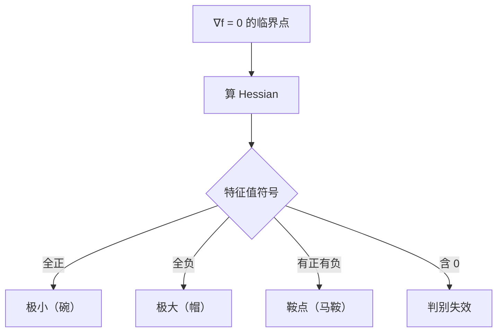

# MATH-127 Hessian 与多元展开

## 1. 知识概览

| 项 | 内容 |
|---|---|
| 知识 ID | `MATH-127` |
| 英文名称 | Hessian Matrix and Multivariate Expansion |
| 所属模块 | M-MATH-03 微积分 |
| 难度等级 | L3 推导 |
| 前置知识 | [[MATH-126 偏导数与梯度]] |
| 所属知识体系 | 二阶偏导 → Hessian → 二阶判别 → 鞍点 |
| **AI 应用场景** | 判断临界点类型（极小/极大/鞍点）、Newton 法、曲率、二阶优化 |
| **预计学习时间** | 55 分钟 |

**为什么学它**：梯度为 0 只说明"这里是平的"，分不清是谷底、山顶还是**鞍点**。深度学习的损失面上鞍点远多于局部极小——判断依据就是 **Hessian 的特征值符号**。

## 2. 直观理解

一元函数用 $f''$ 判断弯曲方向；多元函数有多个方向，一个数不够用，需要一张表——**Hessian 矩阵**：

$$
H = \begin{bmatrix} f_{xx} & f_{xy}\\ f_{yx} & f_{yy}\end{bmatrix}
$$

它记录"每个方向的二阶变化"。

**判断规则**（在梯度为 0 的点）：

| Hessian | 结论 |
|---|---|
| 正定（所有特征值 > 0） | 极小值（碗底） |
| 负定（所有特征值 < 0） | 极大值（山顶） |
| 有正有负（不定） | **鞍点** |
| 有零特征值 | 判别失效 |

## 3. 正式数学定义

**二阶偏导数**：$f_{xx}=\dfrac{\partial^2 f}{\partial x^2}$，$f_{xy}=\dfrac{\partial^2 f}{\partial x\partial y}$。

**Hessian 矩阵**

$$
H_f = \begin{bmatrix}
\dfrac{\partial^2 f}{\partial x_1^2} & \cdots & \dfrac{\partial^2 f}{\partial x_1\partial x_n}\\
\vdots & \ddots & \vdots\\
\dfrac{\partial^2 f}{\partial x_n\partial x_1} & \cdots & \dfrac{\partial^2 f}{\partial x_n^2}
\end{bmatrix}
$$

**对称性**：若二阶偏导连续（Clairaut 定理），$f_{xy}=f_{yx}$，故 $H$ 对称。

**二阶 Taylor 展开**（在 $\mathbf{x}_0$ 附近）

$$
f(\mathbf{x}_0+\Delta) \approx f(\mathbf{x}_0) + \nabla f(\mathbf{x}_0)^T\Delta + \tfrac12\Delta^T H(\mathbf{x}_0)\Delta
$$

**正定判定**（二阶）

$$
\text{正定} \iff f_{xx}>0 \text{ 且 } f_{xx}f_{yy}-f_{xy}^2>0
$$

$$
\text{不定} \iff f_{xx}f_{yy}-f_{xy}^2<0
$$

## 4. 数学推导

### 4.1 为什么 $H$ 正定 ⇒ 极小值

**起点**：$\nabla f(\mathbf{x}_0)=\mathbf{0}$，$H(\mathbf{x}_0)$ 正定。

**第 1 步**：Taylor 展开中梯度项为零

$$
f(\mathbf{x}_0+\Delta) - f(\mathbf{x}_0) \approx \tfrac12\Delta^T H\Delta
$$

**第 2 步**：正定意味着对一切 $\Delta\neq\mathbf{0}$，都有 $\Delta^T H\Delta > 0$。

**第 3 步**：所以 $\mathbf{x}_0$ 附近（$\|\Delta\|$ 足够小）函数值都更大

$$
f(\mathbf{x}_0+\Delta) > f(\mathbf{x}_0)
$$

**第 4 步**：即 $\mathbf{x}_0$ 是**严格局部极小值**。

**反向**：若 $H$ 不定，存在 $\Delta_1$ 使 $\Delta_1^TH\Delta_1>0$（上升方向）与 $\Delta_2$ 使其 $<0$（下降方向），于是在任意小的邻域里既有更高点也有更低点——**鞍点**。

### 4.2 二阶判别为什么用行列式

**起点**：二维时 $H = \begin{bmatrix}a&b\\b&c\end{bmatrix}$，其中 $a=f_{xx}$、$b=f_{xy}$、$c=f_{yy}$。

**第 1 步**：特征方程

$$
\det(H-\lambda I) = (a-\lambda)(c-\lambda) - b^2 = \lambda^2 - (a+c)\lambda + (ac-b^2)
$$

**第 2 步**：由韦达定理，两个特征值之积 $= ac-b^2 = \det H$。

**第 3 步**：若 $\det H<0$，两特征值异号 ⇒ 不定 ⇒ 鞍点。

**第 4 步**：若 $\det H>0$ 且 $a>0$，两特征值同号且和 $a+c>0$ ⇒ 都正 ⇒ 正定 ⇒ 极小。

**结论**：行列式符号 + $f_{xx}$ 符号，就够了。

## 5. 几何直观与图解



```text
碗形（极小）    帽子（极大）     马鞍（鞍点）
 ╲   ╱           ╱‾‾╲            ╱╲
  ╲_╱           ╱    ╲          ╱  ╲
                                ╲  ╱
                                 ╲╱
```

## 6. 计算示例

**例**：$f(x,y)=x^2+3xy+y^2$，求 $(1,2)$ 处 Hessian 并判断类型。

**第 1 步**：一阶偏导

$$
f_x = 2x+3y,\qquad f_y = 3x+2y
$$

**第 2 步**：二阶偏导

$$
f_{xx}=2,\qquad f_{yy}=2,\qquad f_{xy}=3
$$

**第 3 步**：Hessian

$$
H = \begin{bmatrix}2&3\\3&2\end{bmatrix}
$$

**第 4 步**：特征值

$$
\det(H-\lambda I) = (2-\lambda)^2 - 9 = 0 \Rightarrow \lambda = 2\pm3 = 5,\ -1
$$

一正一负 ⇒ **不定** ⇒ 该点是**鞍点**。

**第 5 步**：用行列式核对

$$
\det H = 4 - 9 = -5 < 0 \Rightarrow \text{鞍点} \;✓
$$

## 7. Python 辅助验证

**依赖**：NumPy 2.5.4。

```powershell
python math127_hessian.py
```

```python
import numpy as np


def f(x, y):
    return x**2 + 3 * x * y + y**2


def hessian(fn, point, h=1e-4):
    x, y = point
    fxx = (fn(x + h, y) - 2 * fn(x, y) + fn(x - h, y)) / h**2
    fyy = (fn(x, y + h) - 2 * fn(x, y) + fn(x, y - h)) / h**2
    fxy = (fn(x + h, y + h) - fn(x + h, y - h)
           - fn(x - h, y + h) + fn(x - h, y - h)) / (4 * h**2)
    return np.array([[fxx, fxy], [fxy, fyy]])


H = hessian(f, (1.0, 2.0))
print("Hessian:", H.round(4).tolist())
ev = np.linalg.eigvalsh(H)
print("特征值:", ev.round(4).tolist())
print("正定:", bool(np.all(ev > 0)), " 负定:", bool(np.all(ev < 0)))
print("行列式:", round(float(np.linalg.det(H)), 4))
```

**实际运行结果**

```
Hessian: [[2.0, 3.0], [3.0, 2.0]]
特征值: [-1.0, 5.0]
正定: False  负定: False
行列式: -5.0
```

**代码解析**

- 对角元用**二阶中心差分**，混合偏导用四角差分公式。
- 数值 Hessian 与解析结果 `[[2,3],[3,2]]` 完全一致（该函数二阶导是常数）。
- 特征值 `[-1, 5]` 一正一负 ⇒ 鞍点，与手算、行列式判断三者一致。
- `eigvalsh` 专门用于对称矩阵，返回实数且升序。

## 8. 知识关联

| 类型 | 链接 |
|---|---|
| 前置数学 | [[MATH-126 偏导数与梯度]]、[[MATH-223 特征值与特征向量]] |
| 后续数学 | `MATH-701 优化问题与凸性`（待建）、`MATH-707 牛顿法`（待建） |
| 相关 Python | [[PY-066 矩阵运算]] |
| 相关机器学习 | 待关联（临界点分类、二阶优化） |
| 相关深度学习 | 待关联（鞍点问题、曲率与学习率） |
| 相关大语言模型 | 待关联（二阶近似与量化误差） |

## 9. 实战练习

**基础 1**：求 $f(x,y)=x^2+y^2$ 的 Hessian，并判断 $(0,0)$ 的类型。

**基础 2**：$f(x,y)=x^2-y^2$ 在原点是什么类型的临界点？

**进阶 1**：$f(x,y)=x^3-3x+y^2$，求所有临界点并分类。

**综合 1**：为什么深度学习中"鞍点比局部极小更常见"？用 Hessian 特征值的角度解释。

## 10. 参考答案

> [!success]- 基础 1
> $$H = \begin{bmatrix}2&0\\0&2\end{bmatrix}, \quad \text{特征值 } 2,2 > 0$$
>
> 正定 ⇒ $(0,0)$ 是**极小值**点，$f(0,0)=0$ 为全局最小。

> [!success]- 基础 2
> $$H = \begin{bmatrix}2&0\\0&-2\end{bmatrix}, \quad \text{特征值 } 2,-2$$
>
> 不定 ⇒ **鞍点**（沿 $x$ 方向上升、沿 $y$ 方向下降）。

> [!success]- 进阶 1
> $f_x = 3x^2-3=0 \Rightarrow x=\pm1$；$f_y=2y=0 \Rightarrow y=0$。
>
> 两个临界点：$(1,0)$、$(-1,0)$。
>
> $$H=\begin{bmatrix}6x&0\\0&2\end{bmatrix}$$
>
> - $(1,0)$：$H=\operatorname{diag}(6,2)$ 正定 ⇒ 极小。
> - $(-1,0)$：$H=\operatorname{diag}(-6,2)$ 不定 ⇒ 鞍点。

> [!success]- 综合 1
> 高维空间里，$n$ 个特征值要"全部同号"才不是鞍点。若符号近似随机，概率约 $2/2^n$，随 $n$ 增大指数级变小。
>
> 所以**大多数临界点是鞍点**。这也是为什么"训练卡住"经常不是陷入局部最优，而是停在鞍点附近的平坦区域。

## 11. 常见错误

| 类型 | 错误表现 | 原因 | 纠正 |
|---|---|---|---|
| 概念错误 | 梯度为 0 就判极小 | 忽略二阶信息 | 必须看 Hessian |
| 计算错误 | 只算 $f_{xx}$ 与 $f_{yy}$ | 漏混合偏导 | 检查行列式 |
| 概念错误 | 认为 $\det H>0$ 一定是极小 | 还需 $f_{xx}>0$ | 两者都要 |
| 概念错误 | 把鞍点叫"局部极大" | 类型混淆 | 有升有降才是鞍点 |
| 计算错误 | 用 `eig` 算对称矩阵 | 可能返回复数 | 用 `eigvalsh` |

## 12. 学习记录

| 日期 | 状态 | 掌握程度 | 复习状态 | 学习笔记 | 关联练习 |
|---|---|---|---|---|---|
| — | planned | — | — | — | 练习 1–4 |

---

## 🔗 Notion 同步信息

> 以下内容由 Notion「AI Knowledge System · 知识点」数据库按知识 ID 合并而来（导出于 2026-11-09）。

| 属性 | 值 |
|---|---|
| 学科 | 数学 |
| 学习状态 | 未开始 |
| 难度 | L3 推导 |
| 知识类型 | Concept |

- **所属模块**：[M-MATH-03 微积分](../%E8%AF%BE%E7%A8%8B%E6%A8%A1%E5%9D%97/M-MATH-03%20%E5%BE%AE%E7%A7%AF%E5%88%86.md)
- **前置知识**：[MATH-126 偏导数与梯度](MATH-126%20%E5%81%8F%E5%AF%BC%E6%95%B0%E4%B8%8E%E6%A2%AF%E5%BA%A6.md)
- **后继知识**：[MATH-128 多重积分](MATH-128%20%E5%A4%9A%E9%87%8D%E7%A7%AF%E5%88%86.md) · [MATH-701 优化问题与凸性](../07%20%E6%9C%80%E4%BC%98%E5%8C%96%E6%96%B9%E6%B3%95/MATH-701%20%E4%BC%98%E5%8C%96%E9%97%AE%E9%A2%98%E4%B8%8E%E5%87%B8%E6%80%A7.md)
- **关联Python**：[PY-066 矩阵运算](../../01_Python%E5%9F%BA%E7%A1%80/08%20NumPy/PY-066%20%E7%9F%A9%E9%98%B5%E8%BF%90%E7%AE%97.md)
- **关联数学**：[MATH-126 偏导数与梯度](MATH-126%20%E5%81%8F%E5%AF%BC%E6%95%B0%E4%B8%8E%E6%A2%AF%E5%BA%A6.md)
- **被引用为数学**：[MATH-128 多重积分](MATH-128%20%E5%A4%9A%E9%87%8D%E7%A7%AF%E5%88%86.md) · [MATH-701 优化问题与凸性](../07%20%E6%9C%80%E4%BC%98%E5%8C%96%E6%96%B9%E6%B3%95/MATH-701%20%E4%BC%98%E5%8C%96%E9%97%AE%E9%A2%98%E4%B8%8E%E5%87%B8%E6%80%A7.md)
