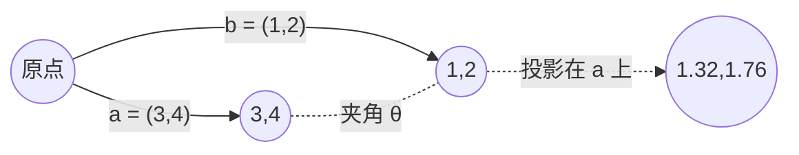

# MATH-201 向量与空间基础

## 1. 通俗概念解释

向量就是**一串有顺序的数**，但它同时可以理解成"空间里的一个箭头"。

- 一串数视角：`(3, 4)` 表示"往右 3、往上 4"。
- 箭头视角：从原点指向那个点的箭头。长度、方向就是它的全部信息。

这两个视角必须同时握在手里：**算的时候用数，想的时候用箭头**。

## 2. 数学定义

$n$ 维实向量是 $n$ 个实数的有序组：

$$
\mathbf{a} = (a_1, a_2, \dots, a_n) \in \mathbb{R}^n
$$

基本运算（逐分量）：

$$
\mathbf{a} + \mathbf{b} = (a_1+b_1,\dots,a_n+b_n), \qquad
c\,\mathbf{a} = (c a_1,\dots,c a_n)
$$

内积（点积）与范数（长度）：

$$
\langle \mathbf{a}, \mathbf{b}\rangle = \sum_{i=1}^{n} a_i b_i,
\qquad
\|\mathbf{a}\| = \sqrt{\langle \mathbf{a}, \mathbf{a}\rangle}
$$

两个向量**正交**当且仅当 $\langle \mathbf{a}, \mathbf{b}\rangle = 0$。

## 3. 公式推导

**为什么内积能表示夹角？** 由余弦定理：

$$
\|\mathbf{a} - \mathbf{b}\|^2 = \|\mathbf{a}\|^2 + \|\mathbf{b}\|^2 - 2\|\mathbf{a}\|\|\mathbf{b}\|\cos\theta
$$

左边展开：

$$
\|\mathbf{a}-\mathbf{b}\|^2 = \sum (a_i-b_i)^2 = \|\mathbf{a}\|^2 + \|\mathbf{b}\|^2 - 2\sum a_i b_i
$$

两式对比即得：

$$
\langle \mathbf{a}, \mathbf{b}\rangle = \|\mathbf{a}\|\|\mathbf{b}\|\cos\theta
$$

这就是"点积 = 长度 × 长度 × 夹角余弦"。

**投影公式**：把 $\mathbf{b}$ 投影到 $\mathbf{a}$ 方向上，投影向量为

$$
\mathrm{proj}_{\mathbf{a}}\mathbf{b} = \frac{\langle \mathbf{a},\mathbf{b}\rangle}{\|\mathbf{a}\|^2}\,\mathbf{a}
$$

推导思路：投影必须与 $\mathbf{a}$ 同向（写成 $t\mathbf{a}$），且残差 $\mathbf{b}-t\mathbf{a}$ 要与 $\mathbf{a}$ 正交：

$$
\langle \mathbf{a}, \mathbf{b} - t\mathbf{a}\rangle = 0
\;\Rightarrow\;
t = \frac{\langle \mathbf{a},\mathbf{b}\rangle}{\|\mathbf{a}\|^2}
$$

## 4. 几何直观



- 两个向量夹角小于 90° → 点积为正；等于 90° → 点积为 0；大于 90° → 点积为负。
- 点积的**符号**告诉我们"方向是否一致"，这是后面"相似度"的几何来源。

## 5. 具体数值示例

取 $\mathbf{a}=(3,4)$，$\mathbf{b}=(1,2)$：

| 量 | 计算 | 结果 |
|---|---|---|
| 内积 | $3\times1 + 4\times2$ | $11$ |
| $\|\mathbf{a}\|$ | $\sqrt{9+16}$ | $5$ |
| $\|\mathbf{b}\|$ | $\sqrt{1+4}$ | $\approx 2.2361$ |
| $\cos\theta$ | $11 / (5 \times 2.2361)$ | $\approx 0.9839$ |
| 夹角 | $\arccos(0.9839)$ | $\approx 10.3^\circ$ |
| 投影系数 $t$ | $11 / 25$ | $0.44$ |
| 投影向量 | $0.44 \times (3,4)$ | $(1.32,\ 1.76)$ |

## 6. 计算步骤

1. 逐分量相乘再求和 → 内积。
2. 各分量平方求和再开方 → 范数。
3. 内积除以两范数之积 → 余弦；用 `acos` 得角度。
4. 投影：内积 ÷ 范数平方 得系数，再乘原向量。

## 7. Python 应用示例

```python
import math

def dot(a, b):
    return sum(x * y for x, y in zip(a, b))

def norm(a):
    return math.sqrt(dot(a, a))

def cosine(a, b):
    return dot(a, b) / (norm(a) * norm(b))

def projection(a, b):
    t = dot(a, b) / dot(a, a)
    return tuple(t * x for x in a)

a = (3, 4)
b = (1, 2)

print("内积:", dot(a, b))
print("范数:", norm(a), round(norm(b), 4))
print("余弦:", round(cosine(a, b), 4))
print("夹角:", round(math.degrees(math.acos(cosine(a, b))), 1))
print("投影:", tuple(round(x, 2) for x in projection(a, b)))
```

## 8. 基础练习

1. 求 $(1,2,3)$ 与 $(4,5,6)$ 的内积与各自范数。
2. 判断 $(1,0)$ 与 $(0,1)$ 是否正交，并说明几何含义。
3. 求 $(2,0)$ 与 $(1,1)$ 的夹角余弦。

## 9. 进阶练习

1. 证明：若 $\langle\mathbf{a},\mathbf{b}\rangle=0$，则 $\|\mathbf{a}+\mathbf{b}\|^2=\|\mathbf{a}\|^2+\|\mathbf{b}\|^2$（勾股定理的向量形式）。
2. 把 $\mathbf{b}=(2,3)$ 投影到 $\mathbf{a}=(1,1)$ 上，写出投影向量与残差，并验证残差与 $\mathbf{a}$ 正交。

## 10. 参考答案

**基础**

1. 内积 $= 4+10+18 = 32$；$\|\mathbf{a}\|=\sqrt{14}\approx3.742$，$\|\mathbf{b}\|=\sqrt{77}\approx8.775$。
2. 内积 $=0$，正交；几何上是两条互相垂直的坐标轴方向。
3. 内积 $=2$，$\|\mathbf{a}\|=2$，$\|\mathbf{b}\|=\sqrt2$，余弦 $=2/(2\sqrt2)=\frac{\sqrt2}{2}\approx0.7071$，夹角 $45^\circ$。

**进阶**

1. $\|\mathbf{a}+\mathbf{b}\|^2=\langle\mathbf{a}+\mathbf{b},\mathbf{a}+\mathbf{b}\rangle=\|\mathbf{a}\|^2+2\langle\mathbf{a},\mathbf{b}\rangle+\|\mathbf{b}\|^2$；由 $\langle\mathbf{a},\mathbf{b}\rangle=0$ 得证。
2. $t=\frac{5}{2}=2.5$，投影 $=(2.5,2.5)$，残差 $=(2,3)-(2.5,2.5)=(-0.5,0.5)$；$\langle(-0.5,0.5),(1,1)\rangle=-0.5+0.5=0$，正交成立。

## 11. 常见错误

| 错误 | 说明 | 正确做法 |
|---|---|---|
| 把点积当成逐分量相乘的结果向量 | 点积的结果是**标量** | 需要向量用逐分量乘（Hadamard 积） |
| 用内积大小直接比较相似度 | 长度大的向量内积天然更大 | 先除以范数，用余弦 |
| 混淆"正交"与"线性无关" | 正交一定无关，无关不一定正交 | 正交是更强的条件 |
| 投影公式漏掉范数平方 | 写成除以 $\|\mathbf{a}\|$ | 分母是 $\langle\mathbf{a},\mathbf{a}\rangle$ |

## 12. 与机器学习、深度学习的联系

| 用到的地方 | 具体形式 |
|---|---|
| 特征表示 | 一个样本 = 一个特征向量，数据集 = 矩阵 |
| 相似度 / 检索 | 余弦相似度就是本节公式；RAG 的向量检索底层是它 |
| 线性模型 | 预测值 $= \langle\mathbf{w}, \mathbf{x}\rangle + b$，即加权求和 |
| 嵌入（embedding） | 词/句被映射为向量，语义接近 ⇔ 方向接近 |
| 正则化 | $L_2$ 正则就是惩罚 $\|\mathbf{w}\|^2$ |

> **一句话**：不会向量，后面所有"表示学习"都只能背名词。

---

## 关联与记录

- **前置**：无（数学库起点）
- **后继**：[[MATH-216 矩阵乘法]]、[[MATH-451 最小二乘与回归统计]]
- **被谁用**：见 Backlinks（线性回归的样本表示、嵌入向量的相似度）
- **所属模块**：`M-MATH-01 数学基础`

| 日期 | 动作 | 用时 | 结果 | 复盘 |
|---|---|---|---|---|
| 2026-11-01 | 建立笔记 | — | 待学 | — |

---

## 🔗 Notion 同步信息

> 以下内容由 Notion「AI Knowledge System · 知识点」数据库按知识 ID 合并而来（导出于 2026-11-09）。

| 属性 | 值 |
|---|---|
| 学科 | 数学 |
| 学习状态 | 未开始 |
| 难度 | L1 概念 |
| 知识类型 | Concept |
| 学习目标 | 掌握向量运算、内积、范数与投影，能算夹角与相似度。 |

- **所属模块**：[M-MATH-02 线性代数](../%E8%AF%BE%E7%A8%8B%E6%A8%A1%E5%9D%97/M-MATH-02%20%E7%BA%BF%E6%80%A7%E4%BB%A3%E6%95%B0.md)
- **后继知识**：[MATH-216 矩阵乘法](MATH-216%20%E7%9F%A9%E9%98%B5%E4%B9%98%E6%B3%95.md)
- **被引用为数学**：[MATH-216 矩阵乘法](MATH-216%20%E7%9F%A9%E9%98%B5%E4%B9%98%E6%B3%95.md) · [ML-026 K 近邻](../../03_%E6%9C%BA%E5%99%A8%E5%AD%A6%E4%B9%A0/02%20%E7%9B%91%E7%9D%A3%E5%AD%A6%E4%B9%A0/ML-026%20K%20%E8%BF%91%E9%82%BB.md) · [ML-033 无监督学习基本概念](../../03_%E6%9C%BA%E5%99%A8%E5%AD%A6%E4%B9%A0/03%20%E6%97%A0%E7%9B%91%E7%9D%A3%E5%AD%A6%E4%B9%A0/ML-033%20%E6%97%A0%E7%9B%91%E7%9D%A3%E5%AD%A6%E4%B9%A0%E5%9F%BA%E6%9C%AC%E6%A6%82%E5%BF%B5.md) · [ML-034 K-Means 聚类](../../03_%E6%9C%BA%E5%99%A8%E5%AD%A6%E4%B9%A0/03%20%E6%97%A0%E7%9B%91%E7%9D%A3%E5%AD%A6%E4%B9%A0/ML-034%20K-Means%20%E8%81%9A%E7%B1%BB.md) · [ML-035 层次聚类](../../03_%E6%9C%BA%E5%99%A8%E5%AD%A6%E4%B9%A0/03%20%E6%97%A0%E7%9B%91%E7%9D%A3%E5%AD%A6%E4%B9%A0/ML-035%20%E5%B1%82%E6%AC%A1%E8%81%9A%E7%B1%BB.md) · [ML-036 DBSCAN](../../03_%E6%9C%BA%E5%99%A8%E5%AD%A6%E4%B9%A0/03%20%E6%97%A0%E7%9B%91%E7%9D%A3%E5%AD%A6%E4%B9%A0/ML-036%20DBSCAN.md) · [ML-037 距离度量与聚类评价](../../03_%E6%9C%BA%E5%99%A8%E5%AD%A6%E4%B9%A0/03%20%E6%97%A0%E7%9B%91%E7%9D%A3%E5%AD%A6%E4%B9%A0/ML-037%20%E8%B7%9D%E7%A6%BB%E5%BA%A6%E9%87%8F%E4%B8%8E%E8%81%9A%E7%B1%BB%E8%AF%84%E4%BB%B7.md) · [PY-060 ndarray 与 dtype](../../01_Python%E5%9F%BA%E7%A1%80/08%20NumPy/PY-060%20ndarray%20%E4%B8%8E%20dtype.md)
