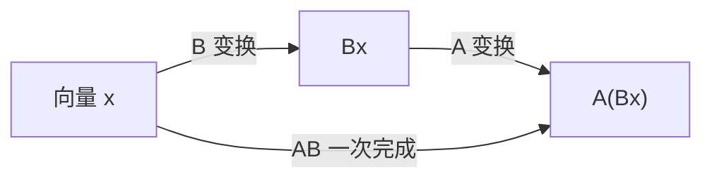

# MATH-216 矩阵乘法

## 1. 通俗概念解释

矩阵乘法不是"对应位置相乘"，而是**行与列做内积**。

- 左边取**一行**，右边取**一列**，逐项相乘再相加，得到一个数。
- 这个数放在结果矩阵的"第几行、第几列"位置上。

它的真正含义是**变换的复合**：先做 $B$ 的变换，再做 $A$ 的变换，等价于做 $AB$ 的变换。

## 2. 数学定义

设 $A \in \mathbb{R}^{m\times k}$，$B \in \mathbb{R}^{k\times n}$，则 $C = AB \in \mathbb{R}^{m\times n}$，其中

$$
c_{ij} = \sum_{p=1}^{k} a_{ip}\,b_{pj}
$$

**形状规则（必须记住）**：$(m\times k)\cdot(k\times n) \to (m\times n)$。中间那个 $k$ 必须相同，否则不能乘。

## 3. 公式推导

**为什么是"行乘列"？** 从线性组合的角度看，$B$ 的每一列是 $A$ 的列向量的系数：

$$
AB = A\,[\,\mathbf{b}_1\ \mathbf{b}_2\ \cdots\ \mathbf{b}_n\,]
= [\,A\mathbf{b}_1\ A\mathbf{b}_2\ \cdots\ A\mathbf{b}_n\,]
$$

而 $A\mathbf{b}$ 的第 $i$ 个分量正是"$A$ 的第 $i$ 行与 $\mathbf{b}$ 的内积"：

$$
(A\mathbf{b})_i = \sum_{p} a_{ip} b_p = \langle \mathbf{a}_{i\cdot}, \mathbf{b}\rangle
$$

两件事合起来就是 $c_{ij} = \langle A$ 的第 $i$ 行, $B$ 的第 $j$ 列$\rangle$。

**复合的证明**：设 $C = AB$，则

$$
(AB)\mathbf{x} = A(B\mathbf{x})
$$

即"先 $B$ 后 $A$"，说明矩阵乘法对应变换复合，因此**一般不满足交换律**。

## 4. 几何直观



- 例：$B$ 把平面旋转 30°，$A$ 再缩放 2 倍；$AB$ 就是"旋转 30° 并放大 2 倍"的合成矩阵。
- $AB \neq BA$：先旋转再缩放，与先缩放再旋转，结果不同（旋转会改变缩放方向）。

## 5. 具体数值示例

$$
A=\begin{bmatrix}1&2\\3&4\end{bmatrix},\quad
B=\begin{bmatrix}5&6\\7&8\end{bmatrix}
$$

逐项计算：

- $c_{11} = 1\times5 + 2\times7 = 19$
- $c_{12} = 1\times6 + 2\times8 = 22$
- $c_{21} = 3\times5 + 4\times7 = 43$
- $c_{22} = 3\times6 + 4\times8 = 50$

$$
AB=\begin{bmatrix}19&22\\43&50\end{bmatrix}
$$

再算 $BA$ 对照：

$$
BA=\begin{bmatrix}5\cdot1+6\cdot3&5\cdot2+6\cdot4\\7\cdot1+8\cdot3&7\cdot2+8\cdot4\end{bmatrix}
=\begin{bmatrix}23&34\\31&46\end{bmatrix}
$$

显然 $AB \neq BA$。

## 6. 计算步骤

1. 检查形状：左列数 = 右行数。
2. 结果先占位成 $m\times n$ 的矩阵。
3. 对每个 $(i,j)$：取左第 $i$ 行、右第 $j$ 列做内积。
4. 填回相应位置。
5. 复杂度：$O(mnk)$。

## 7. Python 应用示例

```python
def matmul(A, B):
    m, k = len(A), len(A[0])
    k2, n = len(B), len(B[0])
    if k != k2:
        raise ValueError("形状不匹配")
    C = [[0] * n for _ in range(m)]
    for i in range(m):
        for j in range(n):
            C[i][j] = sum(A[i][p] * B[p][j] for p in range(k))
    return C

A = [[1, 2], [3, 4]]
B = [[5, 6], [7, 8]]

print("AB =", matmul(A, B))
print("BA =", matmul(B, A))
print("形状:", len(A), "x", len(A[0]), "*", len(B), "x", len(B[0]))
```

## 8. 基础练习

1. 计算 $\begin{bmatrix}2&1\end{bmatrix}\begin{bmatrix}3\\4\end{bmatrix}$，并说明结果是标量还是矩阵。
2. 判断 $\begin{bmatrix}1&2&3\end{bmatrix}$ 能否与 $\begin{bmatrix}1&2\\3&4\end{bmatrix}$ 相乘。
3. 计算单位矩阵 $I_2$ 乘任意 $2\times2$ 矩阵，观察结果。

## 9. 进阶练习

1. 证明 $(AB)^\top = B^\top A^\top$（提示：逐元素写出两边）。
2. 设 $A=\begin{bmatrix}1&1\\0&1\end{bmatrix}$，计算 $A^2$、$A^3$，并猜 $A^n$ 的形式。

## 10. 参考答案

**基础**

1. $2\times3 + 1\times4 = 10$，是**标量**（$1\times1$ 矩阵的特例）。
2. 不能：左是 $1\times3$，右是 $2\times2$，$3 \neq 2$。
3. 结果等于原矩阵（单位矩阵是乘法的"1"）。

**进阶**

1. 左边 $(AB)^\top_{ij} = (AB)_{ji} = \sum_p a_{jp}b_{pi}$；右边 $(B^\top A^\top)_{ij} = \sum_p (B^\top)_{ip}(A^\top)_{pj} = \sum_p b_{pi}a_{jp}$，两者相等。
2. $A^2=\begin{bmatrix}1&2\\0&1\end{bmatrix}$，$A^3=\begin{bmatrix}1&3\\0&1\end{bmatrix}$，故 $A^n=\begin{bmatrix}1&n\\0&1\end{bmatrix}$。

## 11. 常见错误

| 错误 | 说明 | 正确做法 |
|---|---|---|
| 逐元素相乘 | 那是 Hadamard 积，不是矩阵乘法 | 行乘列 |
| 以为 $AB=BA$ | 矩阵乘法一般不交换 | 分别计算验证 |
| 形状不检查直接算 | 会算错或崩溃 | 先对 $k$ |
| 把 $A^\top B$ 与 $AB^\top$ 混用 | 两者形状与含义都不同 | 写清每个矩阵的形状 |

## 12. 与机器学习、深度学习的联系

| 用到的地方 | 具体形式 |
|---|---|
| 全连接层 | $\mathbf{y} = W\mathbf{x} + \mathbf{b}$，$W$ 是权重矩阵 |
| 批量计算 | $Y = XW$，一次算完整个 batch |
| 线性回归 | 预测 $\hat{\mathbf{y}} = X\mathbf{w}$ |
| Attention | $QK^\top$ 计算所有 token 两两相关度 |
| 反向传播 | 梯度计算全是矩阵乘法（链式法则的矩阵形式） |

> 深度学习里 90% 的浮点运算都是矩阵乘法，这也是 GPU 存在的理由。

---

## 关联与记录

- **前置**：[[MATH-201 向量与空间基础]]
- **后继**：[[MATH-451 最小二乘与回归统计]]
- **被谁用**：见 Backlinks（线性回归、全连接层、Attention）
- **所属模块**：`M-MATH-01 数学基础`

| 日期 | 动作 | 用时 | 结果 | 复盘 |
|---|---|---|---|---|
| 2026-11-01 | 建立笔记 | — | 待学 | — |

---

## 🔗 Notion 同步信息

> 以下内容由 Notion「AI Knowledge System · 知识点」数据库按知识 ID 合并而来（导出于 2026-11-09）。

| 属性 | 值 |
|---|---|
| 学科 | 数学 |
| 学习状态 | 未开始 |
| 难度 | L1 概念 |
| 知识类型 | Algorithm |
| 学习目标 | 掌握矩阵乘法规则与几何含义，能手算并写代码实现。 |

- **所属模块**：[M-MATH-02 线性代数](../%E8%AF%BE%E7%A8%8B%E6%A8%A1%E5%9D%97/M-MATH-02%20%E7%BA%BF%E6%80%A7%E4%BB%A3%E6%95%B0.md)
- **前置知识**：[MATH-201 向量与空间基础](MATH-201%20%E5%90%91%E9%87%8F%E4%B8%8E%E7%A9%BA%E9%97%B4%E5%9F%BA%E7%A1%80.md)
- **后继知识**：[MATH-451 最小二乘与回归统计](../04%20%E6%95%B0%E7%90%86%E7%BB%9F%E8%AE%A1/MATH-451%20%E6%9C%80%E5%B0%8F%E4%BA%8C%E4%B9%98%E4%B8%8E%E5%9B%9E%E5%BD%92%E7%BB%9F%E8%AE%A1.md) · [MATH-217 矩阵运算与维度](MATH-217%20%E7%9F%A9%E9%98%B5%E8%BF%90%E7%AE%97%E4%B8%8E%E7%BB%B4%E5%BA%A6.md)
- **关联数学**：[MATH-201 向量与空间基础](MATH-201%20%E5%90%91%E9%87%8F%E4%B8%8E%E7%A9%BA%E9%97%B4%E5%9F%BA%E7%A1%80.md)
- **被引用为数学**：[MATH-451 最小二乘与回归统计](../04%20%E6%95%B0%E7%90%86%E7%BB%9F%E8%AE%A1/MATH-451%20%E6%9C%80%E5%B0%8F%E4%BA%8C%E4%B9%98%E4%B8%8E%E5%9B%9E%E5%BD%92%E7%BB%9F%E8%AE%A1.md) · [PY-066 矩阵运算](../../01_Python%E5%9F%BA%E7%A1%80/08%20NumPy/PY-066%20%E7%9F%A9%E9%98%B5%E8%BF%90%E7%AE%97.md) · [MATH-217 矩阵运算与维度](MATH-217%20%E7%9F%A9%E9%98%B5%E8%BF%90%E7%AE%97%E4%B8%8E%E7%BB%B4%E5%BA%A6.md) · [ML-019 多元线性回归与正规方程](../../03_%E6%9C%BA%E5%99%A8%E5%AD%A6%E4%B9%A0/02%20%E7%9B%91%E7%9D%A3%E5%AD%A6%E4%B9%A0/ML-019%20%E5%A4%9A%E5%85%83%E7%BA%BF%E6%80%A7%E5%9B%9E%E5%BD%92%E4%B8%8E%E6%AD%A3%E8%A7%84%E6%96%B9%E7%A8%8B.md) · [LLM-004 Attention 的历史背景与 Transformer 的提出](../../05_%E5%A4%A7%E8%AF%AD%E8%A8%80%E6%A8%A1%E5%9E%8B/01%20NLP%E5%9F%BA%E7%A1%80/LLM-004%20Attention%20%E7%9A%84%E5%8E%86%E5%8F%B2%E8%83%8C%E6%99%AF%E4%B8%8E%20Transformer%20%E7%9A%84%E6%8F%90%E5%87%BA.md) · [LLM-011 Attention 的基本思想](../../05_%E5%A4%A7%E8%AF%AD%E8%A8%80%E6%A8%A1%E5%9E%8B/03%20Attention%E6%9C%BA%E5%88%B6/LLM-011%20Attention%20%E7%9A%84%E5%9F%BA%E6%9C%AC%E6%80%9D%E6%83%B3.md) · [LLM-012 Query、Key、Value 与 QKV 的来源](../../05_%E5%A4%A7%E8%AF%AD%E8%A8%80%E6%A8%A1%E5%9E%8B/03%20Attention%E6%9C%BA%E5%88%B6/LLM-012%20Query%E3%80%81Key%E3%80%81Value%20%E4%B8%8E%20QKV%20%E7%9A%84%E6%9D%A5%E6%BA%90.md) · [LLM-013 点积注意力与 Scaled Dot-Product Attention](../../05_%E5%A4%A7%E8%AF%AD%E8%A8%80%E6%A8%A1%E5%9E%8B/03%20Attention%E6%9C%BA%E5%88%B6/LLM-013%20%E7%82%B9%E7%A7%AF%E6%B3%A8%E6%84%8F%E5%8A%9B%E4%B8%8E%20Scaled%20Dot-Product%20Attention.md) · [LLM-015 Self-Attention](../../05_%E5%A4%A7%E8%AF%AD%E8%A8%80%E6%A8%A1%E5%9E%8B/03%20Attention%E6%9C%BA%E5%88%B6/LLM-015%20Self-Attention.md) · [LLM-016 Cross-Attention](../../05_%E5%A4%A7%E8%AF%AD%E8%A8%80%E6%A8%A1%E5%9E%8B/03%20Attention%E6%9C%BA%E5%88%B6/LLM-016%20Cross-Attention.md) · [LLM-017 Multi-Head Attention](../../05_%E5%A4%A7%E8%AF%AD%E8%A8%80%E6%A8%A1%E5%9E%8B/03%20Attention%E6%9C%BA%E5%88%B6/LLM-017%20Multi-Head%20Attention.md) · [LLM-028 RoPE 与长上下文外推](../../05_%E5%A4%A7%E8%AF%AD%E8%A8%80%E6%A8%A1%E5%9E%8B/04%20Transformer%E6%9E%B6%E6%9E%84/LLM-028%20RoPE%20%E4%B8%8E%E9%95%BF%E4%B8%8A%E4%B8%8B%E6%96%87%E5%A4%96%E6%8E%A8.md) · [LLM-036 Embedding 与向量表示](../../05_%E5%A4%A7%E8%AF%AD%E8%A8%80%E6%A8%A1%E5%9E%8B/02%20Token%E4%B8%8EEmbedding/LLM-036%20Embedding%20%E4%B8%8E%E5%90%91%E9%87%8F%E8%A1%A8%E7%A4%BA.md) · [LLM-038 从静态词向量到上下文向量](../../05_%E5%A4%A7%E8%AF%AD%E8%A8%80%E6%A8%A1%E5%9E%8B/02%20Token%E4%B8%8EEmbedding/LLM-038%20%E4%BB%8E%E9%9D%99%E6%80%81%E8%AF%8D%E5%90%91%E9%87%8F%E5%88%B0%E4%B8%8A%E4%B8%8B%E6%96%87%E5%90%91%E9%87%8F.md) · [PY-063 数组运算](../../01_Python%E5%9F%BA%E7%A1%80/08%20NumPy/PY-063%20%E6%95%B0%E7%BB%84%E8%BF%90%E7%AE%97.md) · [PY-064 广播机制](../../01_Python%E5%9F%BA%E7%A1%80/08%20NumPy/PY-064%20%E5%B9%BF%E6%92%AD%E6%9C%BA%E5%88%B6.md)
