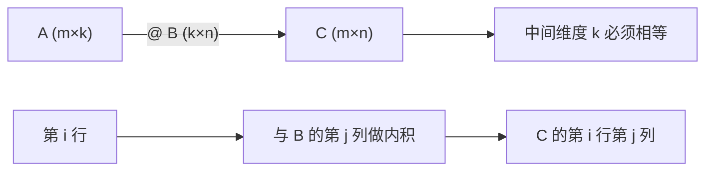

# MATH-217 矩阵运算与维度

## 1. 知识概览

| 项 | 内容 |
|---|---|
| 知识 ID | `MATH-217` |
| 英文名称 | Matrix Operations and Dimensions |
| 所属模块 | M-MATH-02 线性代数 |
| 难度等级 | L2 应用 |
| 前置知识 | [[MATH-216 矩阵乘法]] |
| 所属知识体系 | 矩阵形状 → 加减数乘 → 乘法 → 转置与单位阵 |
| **AI 应用场景** | 每一层 `Y = XW + b`；形状不匹配是最高频的报错；Attention 的 $QK^T$ |
| **预计学习时间** | 50 分钟 |

**为什么学它**：90% 的深度学习报错都是**形状不匹配**。搞清 $(m,k)\times(k,n)\to(m,n)$ 这条规则，比记公式有用得多。

## 2. 直观理解

矩阵就是一个**二维表格**：

$$
A = \begin{bmatrix} 1 & 2 & 3 \\ 4 & 5 & 6 \end{bmatrix}
$$

- **行**是横着的一条（这里有 2 行）。
- **列**是竖着的一条（这里有 3 列）。
- 记作 $2\times3$，读作"两行三列"。

**加法**：同位置相加，形状必须完全一样。
**数乘**：每个位置都乘同一个数。
**矩阵乘法**：左边取**一行**、右边取**一列**，对着乘完加起来——这就是 [[MATH-216 矩阵乘法]] 讲的内积。

## 3. 正式数学定义

**矩阵**：$m$ 行 $n$ 列的数表 $A = (a_{ij})$，$a_{ij}$ 是第 $i$ 行第 $j$ 列的元素。

**加法**（形状相同才可加）

$$
(A+B)_{ij} = a_{ij} + b_{ij}
$$

**数乘**

$$
(cA)_{ij} = c\,a_{ij}
$$

**乘法**（$A$ 为 $m\times k$，$B$ 为 $k\times n$）

$$
(AB)_{ij} = \sum_{t=1}^{k} a_{it}\,b_{tj}, \qquad AB \in \mathbb{R}^{m\times n}
$$

**转置**：$(A^T)_{ij} = a_{ji}$，形状 $m\times n \to n\times m$。

**单位矩阵** $I_n$：对角线为 1、其余为 0，满足 $AI = IA = A$。

**转置的性质**

$$
(A^T)^T = A, \qquad (A+B)^T = A^T + B^T, \qquad (AB)^T = B^T A^T
$$

> 注意最后一条：**顺序颠倒**。这条在推导梯度时反复用到。

## 4. 数学推导

### 4.1 为什么形状必须 "左列数 = 右行数"

**起点**：$A$ 是 $m \times k$，$B$ 是 $k' \times n$，要算 $AB$。

**第 1 步**：按定义，$(AB)_{ij} = \sum_{t} a_{it} b_{tj}$。

**第 2 步**：$a_{it}$ 要求 $t$ 取到 $A$ 的列数 $k$（$t = 1..k$）；$b_{tj}$ 要求 $t$ 取到 $B$ 的行数 $k'$。

**第 3 步**：同一个求和指标 $t$ 必须同时合法，因此 $k = k'$。

**第 4 步**：结果下标 $(i,j)$ 中 $i = 1..m$、$j = 1..n$，所以 $AB$ 是 $m\times n$。

**结论**：$(m\times k)(k\times n) = m\times n$，中间那个 $k$ 被"消掉"。

### 4.2 矩阵乘法为什么能表示神经网络的一层

**起点**：一个神经元对输入 $\mathbf{x}\in\mathbb{R}^{k}$ 计算

$$
z = w_1 x_1 + w_2 x_2 + \cdots + w_k x_k + b = \mathbf{w}^T\mathbf{x} + b
$$

**第 1 步**：一层有 $m$ 个神经元，每个有自己的 $\mathbf{w}_i$。把它们堆成矩阵 $W \in \mathbb{R}^{m\times k}$（第 $i$ 行是 $\mathbf{w}_i^T$）。

**第 2 步**：整层输出

$$
\mathbf{z} = W\mathbf{x} + \mathbf{b}, \qquad \mathbf{z}\in\mathbb{R}^{m}
$$

**第 3 步**：若有 $n$ 个样本，把样本堆成 $X\in\mathbb{R}^{n\times k}$（每行一个样本），则

$$
Z = XW^T + \mathbf{b}, \qquad Z\in\mathbb{R}^{n\times m}
$$

**第 4 步**：验形状：$(n\times k)(k\times m) = n\times m$，再被 $\mathbf{b}$（长度 $m$）按行广播。✓

**结论**：**矩阵乘法就是"批量做内积"**。这就是为什么 GPU 擅长训练——它擅长矩阵乘。

## 5. 几何直观与图解



形状速查表：

| 左 | 右 | 结果 | 是否合法 |
|---|---|---|---|
| $(2,3)$ | $(3,2)$ | $(2,2)$ | ✅ |
| $(2,3)$ | $(2,3)$ | — | ❌ 3≠2 |
| $(1,4)$ | $(4,1)$ | $(1,1)$ | ✅（内积） |
| $(4,1)$ | $(1,4)$ | $(4,4)$ | ✅（外积） |

## 6. 计算示例

**例**：计算 $A B$，其中

$$
A = \begin{bmatrix} 1 & 2 & 3 \\ 4 & 5 & 6\end{bmatrix}_{2\times3},
\quad
B = \begin{bmatrix} 1 & 0 \\ 0 & 1 \\ 2 & 2\end{bmatrix}_{3\times2}
$$

**第 1 步**：形状 $(2,3)(3,2) \to (2,2)$ ✓

**第 2 步**：逐元素

$$
(AB)_{11} = 1\cdot1 + 2\cdot0 + 3\cdot2 = 7
$$

$$
(AB)_{12} = 1\cdot0 + 2\cdot1 + 3\cdot2 = 8
$$

$$
(AB)_{21} = 4\cdot1 + 5\cdot0 + 6\cdot2 = 16
$$

$$
(AB)_{22} = 4\cdot0 + 5\cdot1 + 6\cdot2 = 17
$$

**结果**

$$
AB = \begin{bmatrix} 7 & 8 \\ 16 & 17\end{bmatrix}
$$

**自检**：用 NumPy 复核，输出 `[[7, 8], [16, 17]]` ✓

## 7. Python 辅助验证

**依赖**：NumPy 2.5.4。

```powershell
python math217_matrix_ops.py
```

```python
import numpy as np

A = np.array([[1, 2, 3], [4, 5, 6]])        # (2,3)
B = np.array([[1, 0], [0, 1], [2, 2]])      # (3,2)

print("A.shape:", A.shape, "B.shape:", B.shape, "A.T.shape:", A.T.shape)

C = A @ B
print("A@B 形状:", C.shape)
print("A@B =", C.tolist())
print("数乘 2A =", (2 * A).tolist())
print("转置两次还原:", np.array_equal(A.T.T, A))
print("单位矩阵 I3 =", np.eye(3, dtype=int).tolist())
```

**实际运行结果**

```
A.shape: (2, 3) B.shape: (3, 2) A.T.shape: (3, 2)
A@B 形状: (2, 2)
A@B = [[7, 8], [16, 17]]
数乘 2A = [[2, 4, 6], [8, 10, 12]]
转置两次还原: True
单位矩阵 I3 = [[1, 0, 0], [0, 1, 0], [0, 0, 1]]
```

**代码解析**

- `.shape` 返回元组，`(2, 3)` 就是两行三列。
- `@` 是矩阵乘法，`*` 是逐元素乘（见 [[PY-066 矩阵运算]]）。
- `A.T.T` 还原成 $A$，验证转置是对合运算。
- `np.eye(3)` 生成单位矩阵，`dtype=int` 避免出现 `1.0`。

## 8. 知识关联

| 类型 | 链接 |
|---|---|
| 前置数学 | [[MATH-216 矩阵乘法]]、[[MATH-201 向量与空间基础]] |
| 后续数学 | [[MATH-218 行列式与逆矩阵]]、[[MATH-219 矩阵的秩与线性方程组]]、`MATH-221 线性变换与几何意义`（待建） |
| 相关 Python | [[PY-066 矩阵运算]]、[[PY-064 广播机制]] |
| 相关机器学习 | 待关联（线性回归 $Xw$、特征矩阵） |
| 相关深度学习 | 待关联（全连接层 $XW^T+b$） |
| 相关大语言模型 | 待关联（Attention 的 $QK^T$、投影矩阵） |

## 9. 实战练习

**基础 1**：$A$ 是 $3\times4$，$B$ 是 $4\times2$，$AB$ 是什么形状？$BA$ 能算吗？

**基础 2**：计算 $\begin{bmatrix}1&2\\3&4\end{bmatrix}\begin{bmatrix}1\\1\end{bmatrix}$。

**进阶 1**：验证 $(AB)^T = B^T A^T$（用题中的 $2\times2$ 矩阵自己造数据）。

**综合 1**：某层输入 $X$ 形状 $(32, 128)$，权重 $W$ 形状 $(256, 128)$，偏置 $b$ 长度 256。写出 `Y = X @ W.T + b` 的形状推导与结果形状。

## 10. 参考答案

> [!success]- 基础 1
> $AB$：$(3,4)(4,2) \to (3,2)$ ✅
>
> $BA$：$(4,2)(3,4)$ 要求 $2 = 3$，不成立 ❌ 不能相乘。
>
> **要点**：矩阵乘法不满足交换律，甚至可能一边能乘、另一边不能乘。

> [!success]- 基础 2
> $$\begin{bmatrix}1&2\\3&4\end{bmatrix}\begin{bmatrix}1\\1\end{bmatrix} = \begin{bmatrix}1\cdot1+2\cdot1\\3\cdot1+4\cdot1\end{bmatrix} = \begin{bmatrix}3\\7\end{bmatrix}$$

> [!success]- 进阶 1
> 取 $A=\begin{bmatrix}1&2\\3&4\end{bmatrix}$，$B=\begin{bmatrix}0&1\\1&0\end{bmatrix}$：
>
> $$AB = \begin{bmatrix}2&1\\4&3\end{bmatrix} \Rightarrow (AB)^T = \begin{bmatrix}2&4\\1&3\end{bmatrix}$$
>
> $$B^T A^T = \begin{bmatrix}0&1\\1&0\end{bmatrix}\begin{bmatrix}1&3\\2&4\end{bmatrix} = \begin{bmatrix}2&4\\1&3\end{bmatrix} \;✓$$
>
> **易错**：写成 $(AB)^T = A^T B^T$——顺序必须颠倒。

> [!success]- 综合 1
> $X(32,128) \cdot W^T(128,256) \to (32,256)$，再加 $b$（长度 256 按最后一维广播）→ **输出 $(32, 256)$**。
>
> 含义：32 个样本、每个样本 256 维输出。

## 11. 常见错误

| 类型 | 错误表现 | 原因 | 纠正 |
|---|---|---|---|
| 概念错误 | 认为 $AB = BA$ | 混淆数的乘法 | 矩阵乘法一般不可交换 |
| 形状错误 | $(2,3)@(2,3)$ | 中间维度不等 | 检查 $k$ 是否相等 |
| 公式错误 | $(AB)^T = A^T B^T$ | 漏颠倒 | $B^T A^T$ |
| 代码错误 | 用 `*` 做矩阵乘 | 运算符语义 | 用 `@` 或 `np.dot` |
| 概念错误 | 认为加法可跨形状广播 | 加法要求同形状 | 只有乘/加标量可广播 |
| 精度错误 | 用 `==` 比较矩阵 | 浮点误差 | `np.allclose` |

## 12. 学习记录

| 日期 | 状态 | 掌握程度 | 复习状态 | 学习笔记 | 关联练习 |
|---|---|---|---|---|---|
| — | planned | — | — | — | 练习 1–4 |

---

## 🔗 Notion 同步信息

> 以下内容由 Notion「AI Knowledge System · 知识点」数据库按知识 ID 合并而来（导出于 2026-11-09）。

| 属性 | 值 |
|---|---|
| 学科 | 数学 |
| 学习状态 | 未开始 |
| 难度 | L2 应用 |
| 知识类型 | Technique |

- **所属模块**：[M-MATH-02 线性代数](../%E8%AF%BE%E7%A8%8B%E6%A8%A1%E5%9D%97/M-MATH-02%20%E7%BA%BF%E6%80%A7%E4%BB%A3%E6%95%B0.md)
- **前置知识**：[MATH-216 矩阵乘法](MATH-216%20%E7%9F%A9%E9%98%B5%E4%B9%98%E6%B3%95.md)
- **后继知识**：[MATH-218 行列式与逆矩阵](MATH-218%20%E8%A1%8C%E5%88%97%E5%BC%8F%E4%B8%8E%E9%80%86%E7%9F%A9%E9%98%B5.md)
- **关联Python**：[PY-066 矩阵运算](../../01_Python%E5%9F%BA%E7%A1%80/08%20NumPy/PY-066%20%E7%9F%A9%E9%98%B5%E8%BF%90%E7%AE%97.md)
- **关联数学**：[MATH-216 矩阵乘法](MATH-216%20%E7%9F%A9%E9%98%B5%E4%B9%98%E6%B3%95.md)
- **被引用为数学**：[MATH-218 行列式与逆矩阵](MATH-218%20%E8%A1%8C%E5%88%97%E5%BC%8F%E4%B8%8E%E9%80%86%E7%9F%A9%E9%98%B5.md) · [DL-002 什么是深度学习](../../04_%E6%B7%B1%E5%BA%A6%E5%AD%A6%E4%B9%A0/01%20%E7%A5%9E%E7%BB%8F%E7%BD%91%E7%BB%9C%E5%9F%BA%E7%A1%80/DL-002%20%E4%BB%80%E4%B9%88%E6%98%AF%E6%B7%B1%E5%BA%A6%E5%AD%A6%E4%B9%A0.md) · [DL-005 人工神经元：权重、偏置与线性组合](../../04_%E6%B7%B1%E5%BA%A6%E5%AD%A6%E4%B9%A0/01%20%E7%A5%9E%E7%BB%8F%E7%BD%91%E7%BB%9C%E5%9F%BA%E7%A1%80/DL-005%20%E4%BA%BA%E5%B7%A5%E7%A5%9E%E7%BB%8F%E5%85%83%E2%80%94%E2%80%94%E6%9D%83%E9%87%8D%E3%80%81%E5%81%8F%E7%BD%AE%E4%B8%8E%E7%BA%BF%E6%80%A7%E7%BB%84%E5%90%88.md) · [DL-006 输入层、隐藏层与输出层](../../04_%E6%B7%B1%E5%BA%A6%E5%AD%A6%E4%B9%A0/01%20%E7%A5%9E%E7%BB%8F%E7%BD%91%E7%BB%9C%E5%9F%BA%E7%A1%80/DL-006%20%E8%BE%93%E5%85%A5%E5%B1%82%E3%80%81%E9%9A%90%E8%97%8F%E5%B1%82%E4%B8%8E%E8%BE%93%E5%87%BA%E5%B1%82.md) · [DL-011 神经网络前向传播](../../04_%E6%B7%B1%E5%BA%A6%E5%AD%A6%E4%B9%A0/01%20%E7%A5%9E%E7%BB%8F%E7%BD%91%E7%BB%9C%E5%9F%BA%E7%A1%80/DL-011%20%E7%A5%9E%E7%BB%8F%E7%BD%91%E7%BB%9C%E5%89%8D%E5%90%91%E4%BC%A0%E6%92%AD.md) · [DL-012 线性变换的矩阵形式](../../04_%E6%B7%B1%E5%BA%A6%E5%AD%A6%E4%B9%A0/01%20%E7%A5%9E%E7%BB%8F%E7%BD%91%E7%BB%9C%E5%9F%BA%E7%A1%80/DL-012%20%E7%BA%BF%E6%80%A7%E5%8F%98%E6%8D%A2%E7%9A%84%E7%9F%A9%E9%98%B5%E5%BD%A2%E5%BC%8F.md) · [DL-041 图像张量、通道与批次维度](../../04_%E6%B7%B1%E5%BA%A6%E5%AD%A6%E4%B9%A0/02%20CNN/DL-041%20%E5%9B%BE%E5%83%8F%E5%BC%A0%E9%87%8F%E3%80%81%E9%80%9A%E9%81%93%E4%B8%8E%E6%89%B9%E6%AC%A1%E7%BB%B4%E5%BA%A6.md) · [DL-042 卷积运算](../../04_%E6%B7%B1%E5%BA%A6%E5%AD%A6%E4%B9%A0/02%20CNN/DL-042%20%E5%8D%B7%E7%A7%AF%E8%BF%90%E7%AE%97.md) · [DL-043 Padding、Stride 与输出尺寸](../../04_%E6%B7%B1%E5%BA%A6%E5%AD%A6%E4%B9%A0/02%20CNN/DL-043%20Padding%E3%80%81Stride%20%E4%B8%8E%E8%BE%93%E5%87%BA%E5%B0%BA%E5%AF%B8.md) · [DL-044 多通道卷积与 Feature Map](../../04_%E6%B7%B1%E5%BA%A6%E5%AD%A6%E4%B9%A0/02%20CNN/DL-044%20%E5%A4%9A%E9%80%9A%E9%81%93%E5%8D%B7%E7%A7%AF%E4%B8%8E%20Feature%20Map.md) · [DL-045 池化：Max 与 Average](../../04_%E6%B7%B1%E5%BA%A6%E5%AD%A6%E4%B9%A0/02%20CNN/DL-045%20%E6%B1%A0%E5%8C%96%E2%80%94%E2%80%94Max%20%E4%B8%8E%20Average.md) · [DL-046 感受野与参数共享](../../04_%E6%B7%B1%E5%BA%A6%E5%AD%A6%E4%B9%A0/02%20CNN/DL-046%20%E6%84%9F%E5%8F%97%E9%87%8E%E4%B8%8E%E5%8F%82%E6%95%B0%E5%85%B1%E4%BA%AB.md) · [DL-056 PyTorch 与 Tensor 基础](../../04_%E6%B7%B1%E5%BA%A6%E5%AD%A6%E4%B9%A0/06%20PyTorch/DL-056%20PyTorch%20%E4%B8%8E%20Tensor%20%E5%9F%BA%E7%A1%80.md) · [DL-057 Tensor 形状、广播与常用运算](../../04_%E6%B7%B1%E5%BA%A6%E5%AD%A6%E4%B9%A0/06%20PyTorch/DL-057%20Tensor%20%E5%BD%A2%E7%8A%B6%E3%80%81%E5%B9%BF%E6%92%AD%E4%B8%8E%E5%B8%B8%E7%94%A8%E8%BF%90%E7%AE%97.md) · [LLM-019 Attention 的张量维度与实现细节](../../05_%E5%A4%A7%E8%AF%AD%E8%A8%80%E6%A8%A1%E5%9E%8B/03%20Attention%E6%9C%BA%E5%88%B6/LLM-019%20Attention%20%E7%9A%84%E5%BC%A0%E9%87%8F%E7%BB%B4%E5%BA%A6%E4%B8%8E%E5%AE%9E%E7%8E%B0%E7%BB%86%E8%8A%82.md) · [LLM-020 Attention 的计算复杂度与局限](../../05_%E5%A4%A7%E8%AF%AD%E8%A8%80%E6%A8%A1%E5%9E%8B/03%20Attention%E6%9C%BA%E5%88%B6/LLM-020%20Attention%20%E7%9A%84%E8%AE%A1%E7%AE%97%E5%A4%8D%E6%9D%82%E5%BA%A6%E4%B8%8E%E5%B1%80%E9%99%90.md) · [LLM-021 Transformer 总体架构](../../05_%E5%A4%A7%E8%AF%AD%E8%A8%80%E6%A8%A1%E5%9E%8B/04%20Transformer%E6%9E%B6%E6%9E%84/LLM-021%20Transformer%20%E6%80%BB%E4%BD%93%E6%9E%B6%E6%9E%84.md) · [LLM-090 KV Cache 的原理与显存](../../05_%E5%A4%A7%E8%AF%AD%E8%A8%80%E6%A8%A1%E5%9E%8B/06%20%E6%8E%A8%E7%90%86%E4%B8%8E%E9%83%A8%E7%BD%B2/LLM-090%20KV%20Cache%20%E7%9A%84%E5%8E%9F%E7%90%86%E4%B8%8E%E6%98%BE%E5%AD%98.md)
