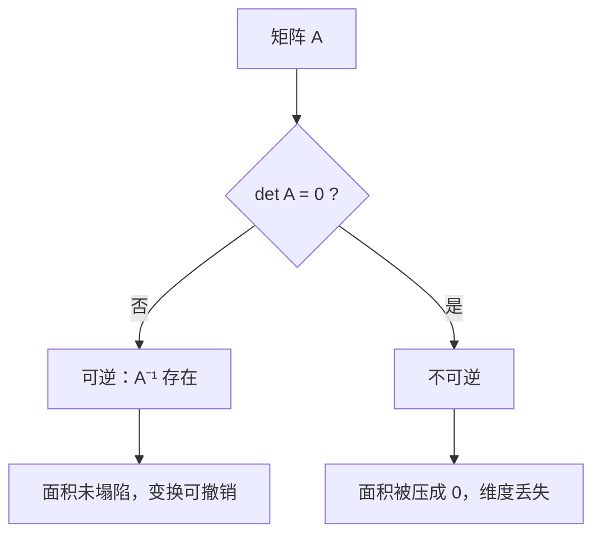

# MATH-218 行列式与逆矩阵

## 1. 知识概览

| 项 | 内容 |
|---|---|
| 知识 ID | `MATH-218` |
| 英文名称 | Determinants and Matrix Inverse |
| 所属模块 | M-MATH-02 线性代数 |
| 难度等级 | L2 应用 |
| 前置知识 | [[MATH-217 矩阵运算与维度]] |
| 所属知识体系 | 行列式（体积/可逆性）→ 逆矩阵 → 解方程 |
| **AI 应用场景** | 判断线性方程组是否唯一可解、特征多项式、协方差行列式（高斯分布归一化项） |
| **预计学习时间** | 55 分钟 |

**为什么学它**：行列式回答一个问题——**这个变换是否"压扁"了空间**。若被压扁（$\det = 0$），信息丢了，就不可逆。机器学习里"特征完全共线导致回归无唯一解"，本质就是 $\det = 0$。

## 2. 直观理解

**行列式**是"面积/体积的缩放倍数"：

- 二维：$\det$ 是变换后单位正方形的**面积**。
- 三维：是单位立方体的**体积**。
- $\det = 0$：面积被压成 0（一条线或一个点）——维度塌了，无法还原。

**逆矩阵**是"撤销按钮"：$A^{-1}$ 把 $A$ 做的变换反向做回去。

**类比**：你把照片缩小一半（$A$），逆矩阵就是放大两倍（$A^{-1}$）。但如果把照片压成一条线（$\det=0$），放大也救不回来。

## 3. 正式数学定义

**二阶行列式**

$$
\det\begin{bmatrix} a & b \\ c & d\end{bmatrix} = ad - bc
$$

**三阶行列式**（按第一行展开）

$$
\det\begin{bmatrix} a & b & c \\ d & e & f \\ g & h & i\end{bmatrix}
= a(ei - fh) - b(di - fg) + c(dh - eg)
$$

**逆矩阵**：若存在 $B$ 使 $AB = BA = I$，称 $A$ 可逆，记 $B = A^{-1}$。

**二阶逆矩阵公式**

$$
A^{-1} = \frac{1}{\det A}\begin{bmatrix} d & -b \\ -c & a\end{bmatrix}, \qquad \det A \neq 0
$$

**可逆的等价条件**

$$
A \text{ 可逆} \iff \det A \neq 0 \iff \text{rank}(A) = n \iff A \text{ 的列线性无关}
$$

**性质**

$$
\det(AB) = \det A \cdot \det B, \qquad \det(A^{-1}) = \frac{1}{\det A}, \qquad (AB)^{-1} = B^{-1}A^{-1}
$$

## 4. 数学推导

### 4.1 二阶行列式的几何来源

**起点**：$A = \begin{bmatrix} a & b \\ c & d\end{bmatrix}$ 把单位正方形（顶点 $(0,0),(1,0),(0,1),(1,1)$）映射成平行四边形。

**第 1 步**：两条边向量变成 $\mathbf{u} = (a, c)$ 与 $\mathbf{v} = (b, d)$。

**第 2 步**：平行四边形面积 = 底 × 高。用向量叉积的二维形式

$$
S = |\mathbf{u} \times \mathbf{v}| = |a d - b c|
$$

**第 3 步**：去掉绝对值就是**有向面积**（保号），定义为行列式

$$
\det A = ad - bc
$$

**结论**：$|\det A|$ 是面积缩放倍数；符号表示"是否翻转了方向"（镜像）。

### 4.2 二阶逆矩阵公式的推导

**起点**：设 $A = \begin{bmatrix} a & b \\ c & d\end{bmatrix}$，求 $A^{-1}$。

**第 1 步**：先猜一个"交换对角、取反副对角"的矩阵

$$
C = \begin{bmatrix} d & -b \\ -c & a\end{bmatrix}
$$

**第 2 步**：算 $AC$

$$
AC = \begin{bmatrix} a & b \\ c & d\end{bmatrix}\begin{bmatrix} d & -b \\ -c & a\end{bmatrix}
= \begin{bmatrix} ad - bc & -ab + ab \\ cd - dc & -cb + da\end{bmatrix}
= \begin{bmatrix} ad-bc & 0 \\ 0 & ad-bc\end{bmatrix}
$$

**第 3 步**：即 $AC = (\det A)\, I$。

**第 4 步**：若 $\det A \neq 0$，两边除以 $\det A$

$$
A \cdot \frac{C}{\det A} = I \;\Longrightarrow\; A^{-1} = \frac{1}{\det A}\begin{bmatrix} d & -b \\ -c & a\end{bmatrix}
$$

**适用条件**：$\det A \neq 0$。若 $\det A = 0$，$C$ 存在但除不了，逆不存在。

## 5. 几何直观与图解



```text
单位正方形 (面积 1)  --A-->  平行四边形 (面积 |det A|)
        ┌──┐                     ╱╱
        │  │        A          ╱ ╱
        └──┘                  ╱╱
```

## 6. 计算示例

**例 1**：$A = \begin{bmatrix}1&2\\3&4\end{bmatrix}$。

$$
\det A = 1\cdot4 - 2\cdot3 = -2
$$

逆矩阵：

$$
A^{-1} = \frac{1}{-2}\begin{bmatrix}4 & -2 \\ -3 & 1\end{bmatrix}
= \begin{bmatrix}-2 & 1 \\ 1.5 & -0.5\end{bmatrix}
$$

**自检**：

$$
A A^{-1} = \begin{bmatrix}1&2\\3&4\end{bmatrix}\begin{bmatrix}-2&1\\1.5&-0.5\end{bmatrix}
= \begin{bmatrix}-2+3 & 1-1 \\ -6+6 & 3-2\end{bmatrix} = \begin{bmatrix}1&0\\0&1\end{bmatrix} ✓
$$

**例 2**：$S = \begin{bmatrix}1&2\\2&4\end{bmatrix}$，$\det S = 4 - 4 = 0$，**不可逆**（第二行是第一行的 2 倍，线性相关）。

**例 3**：$B = \begin{bmatrix}2&0&1\\0&3&0\\1&0&2\end{bmatrix}$，按第一行展开：

$$
\det B = 2(3\cdot2 - 0\cdot0) - 0(\cdots) + 1(0\cdot0 - 3\cdot1) = 12 - 3 = 9
$$

## 7. Python 辅助验证

**依赖**：NumPy 2.5.4。

```powershell
python math218_det_inv.py
```

```python
import numpy as np

A = np.array([[1.0, 2.0], [3.0, 4.0]])
print("det:", round(float(np.linalg.det(A)), 6))
print("inv:", np.linalg.inv(A).round(4).tolist())
print("A @ inv ≈ I:", bool(np.allclose(A @ np.linalg.inv(A), np.eye(2))))

S = np.array([[1.0, 2.0], [2.0, 4.0]])
print("奇异矩阵 det:", round(float(np.linalg.det(S)), 10))
try:
    np.linalg.inv(S)
except np.linalg.LinAlgError:
    print("奇异矩阵不可逆")

B = np.array([[2.0, 0.0, 1.0], [0.0, 3.0, 0.0], [1.0, 0.0, 2.0]])
print("3x3 det:", round(float(np.linalg.det(B)), 6))
```

**实际运行结果**

```
det: -2.0
inv: [[-2.0, 1.0], [1.5, -0.5]]
A @ inv ≈ I: True
奇异矩阵 det: 0.0
奇异矩阵不可逆
3x3 det: 9.0
```

**代码解析**

- `np.linalg.det` 对 2×2 直接返回 $ad-bc$，本例 $-2$。
- `np.linalg.inv` 内部用 LU 分解，不是套公式；对奇异矩阵抛 `LinAlgError`。
- 用 `np.allclose` 而非 `==` 判断"乘积是单位阵"——浮点会有 $10^{-17}$ 级误差。
- 3×3 的 $9$ 与手算一致。

## 8. 知识关联

| 类型 | 链接 |
|---|---|
| 前置数学 | [[MATH-217 矩阵运算与维度]]、[[MATH-216 矩阵乘法]] |
| 后续数学 | [[MATH-219 矩阵的秩与线性方程组]]、`MATH-223 特征值与特征向量`（待建）、`MATH-224 SVD 与低秩近似`（待建） |
| 相关 Python | [[PY-066 矩阵运算]] |
| 相关机器学习 | 待关联（协方差矩阵行列式、高斯分布归一化） |
| 相关深度学习 | 待关联（Jacobian 行列式、正则化项的几何意义） |
| 相关大语言模型 | 待关联 |

## 9. 实战练习

**基础 1**：求 $\det\begin{bmatrix}3&1\\2&5\end{bmatrix}$。

**基础 2**：判断 $\begin{bmatrix}2&3\\4&6\end{bmatrix}$ 是否可逆，并说明理由。

**进阶 1**：求 $\begin{bmatrix}2&1\\1&3\end{bmatrix}$ 的逆矩阵，并验证乘积为单位阵。

**综合 1**：已知 $\det A = 3$，$\det B = 5$，求 $\det(AB)$、$\det(A^{-1})$、$\det(2A)$（$A$ 为 $2\times2$）。

## 10. 参考答案

> [!success]- 基础 1
> $$\det = 3\times5 - 1\times2 = 15 - 2 = 13$$

> [!success]- 基础 2
> $$\det = 2\times6 - 3\times4 = 12 - 12 = 0$$
>
> 不可逆。第二行是第一行的 2 倍，两行线性相关。

> [!success]- 进阶 1
> $\det = 2\times3 - 1\times1 = 5$，所以
>
> $$A^{-1} = \frac{1}{5}\begin{bmatrix}3&-1\\-1&2\end{bmatrix} = \begin{bmatrix}0.6&-0.2\\-0.2&0.4\end{bmatrix}$$
>
> 验证：$\begin{bmatrix}2&1\\1&3\end{bmatrix}\begin{bmatrix}0.6&-0.2\\-0.2&0.4\end{bmatrix} = \begin{bmatrix}1&0\\0&1\end{bmatrix}$ ✓

> [!success]- 综合 1
> $\det(AB) = \det A\det B = 15$。
>
> $\det(A^{-1}) = \dfrac{1}{\det A} = \dfrac13$。
>
> $\det(2A) = 2^2\det A = 4\times3 = 12$（$n$ 阶时是 $2^n\det A$）。
>
> **易错**：把 $\det(2A)$ 写成 $2\det A$——数乘整行会按维度累乘。

## 11. 常见错误

| 类型 | 错误表现 | 原因 | 纠正 |
|---|---|---|---|
| 公式错误 | 二阶行列式写成 $ab-cd$ | 位置记混 | 主对角积 − 副对角积 |
| 公式错误 | 逆矩阵忘记除以 $\det$ | 漏缩放 | $A^{-1} = \frac{1}{\det A}C$ |
| 概念错误 | 认为 $\det=0$ 仍可求逆 | 缺可逆条件 | 只能判定不可逆 |
| 公式错误 | $(AB)^{-1} = A^{-1}B^{-1}$ | 顺序错 | $B^{-1}A^{-1}$ |
| 计算错误 | $\det(2A) = 2\det A$ | 忽略维度 | $2^n\det A$ |
| 代码错误 | 用 `==` 判断是否单位阵 | 浮点误差 | `np.allclose` |

## 12. 学习记录

| 日期 | 状态 | 掌握程度 | 复习状态 | 学习笔记 | 关联练习 |
|---|---|---|---|---|---|
| — | planned | — | — | — | 练习 1–4 |

---

## 🔗 Notion 同步信息

> 以下内容由 Notion「AI Knowledge System · 知识点」数据库按知识 ID 合并而来（导出于 2026-11-09）。

| 属性 | 值 |
|---|---|
| 学科 | 数学 |
| 学习状态 | 未开始 |
| 难度 | L2 应用 |
| 知识类型 | Technique |

- **所属模块**：[M-MATH-02 线性代数](../%E8%AF%BE%E7%A8%8B%E6%A8%A1%E5%9D%97/M-MATH-02%20%E7%BA%BF%E6%80%A7%E4%BB%A3%E6%95%B0.md)
- **前置知识**：[MATH-217 矩阵运算与维度](MATH-217%20%E7%9F%A9%E9%98%B5%E8%BF%90%E7%AE%97%E4%B8%8E%E7%BB%B4%E5%BA%A6.md)
- **后继知识**：[MATH-219 矩阵的秩与线性方程组](MATH-219%20%E7%9F%A9%E9%98%B5%E7%9A%84%E7%A7%A9%E4%B8%8E%E7%BA%BF%E6%80%A7%E6%96%B9%E7%A8%8B%E7%BB%84.md)
- **关联Python**：[PY-066 矩阵运算](../../01_Python%E5%9F%BA%E7%A1%80/08%20NumPy/PY-066%20%E7%9F%A9%E9%98%B5%E8%BF%90%E7%AE%97.md)
- **关联数学**：[MATH-217 矩阵运算与维度](MATH-217%20%E7%9F%A9%E9%98%B5%E8%BF%90%E7%AE%97%E4%B8%8E%E7%BB%B4%E5%BA%A6.md)
- **被引用为数学**：[MATH-219 矩阵的秩与线性方程组](MATH-219%20%E7%9F%A9%E9%98%B5%E7%9A%84%E7%A7%A9%E4%B8%8E%E7%BA%BF%E6%80%A7%E6%96%B9%E7%A8%8B%E7%BB%84.md)
