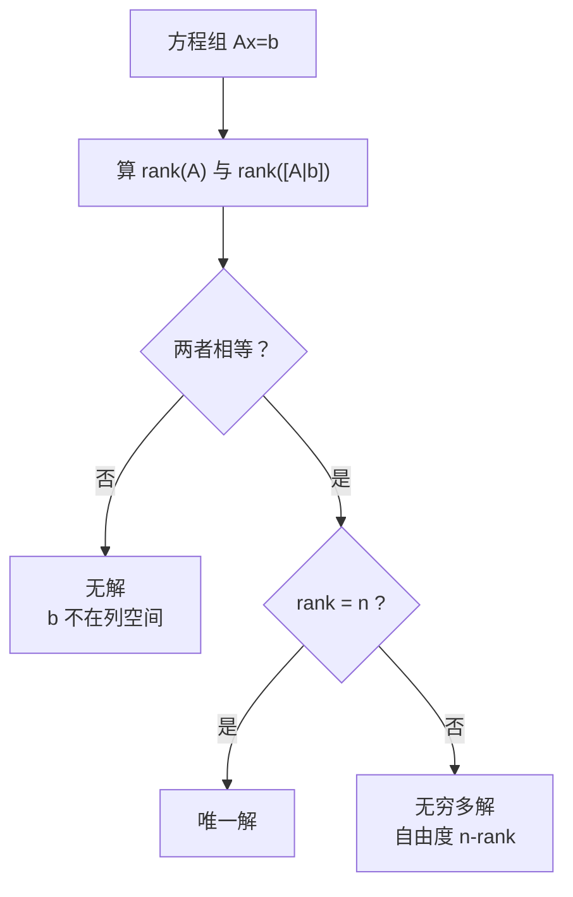

# MATH-219 矩阵的秩与线性方程组

## 1. 知识概览

| 项 | 内容 |
|---|---|
| 知识 ID | `MATH-219` |
| 英文名称 | Rank and Systems of Linear Equations |
| 所属模块 | M-MATH-02 线性代数 |
| 难度等级 | L3 推导 |
| 前置知识 | [[MATH-218 行列式与逆矩阵]] |
| 所属知识体系 | 秩 → 增广矩阵 → 解的三种情形 |
| **AI 应用场景** | 最小二乘是否有唯一解、特征共线导致回归不稳定、模型欠定 |
| **预计学习时间** | 55 分钟 |

**为什么学它**：训练线性回归时经常遇到"解不唯一"或"根本无解"。这不是代码 bug，而是**方程组的秩**决定的。理解秩，才能判断"这组数据能定出几个参数"。

## 2. 直观理解

**秩**是"这堆方程里到底有几个是**真正独立**的"。

- 方程组里两个方程一模一样（或一个是另一个的倍数），那是**重复信息**，不算数。
- 独立方程的个数，就是秩。

**三种结局**：

| 情形 | 直观 |
|---|---|
| 唯一解 | 独立方程数 = 未知数个数，恰好够用 |
| 无穷多解 | 独立方程不够，未知数自由 |
| 无解 | 条件互相矛盾（如 $x=1$ 且 $x=2$） |

## 3. 正式数学定义

**秩**：矩阵 $A$ 中**线性无关的行（或列）的最大数目**，记 $\text{rank}(A)$。

性质：$\text{rank}(A) \le \min(m, n)$；$\text{rank}(A) = \text{rank}(A^T)$。

**线性方程组**：$A\mathbf{x} = \mathbf{b}$，其中 $A$ 是 $m\times n$，$\mathbf{x}\in\mathbb{R}^n$。

**增广矩阵**：$[A \mid \mathbf{b}]$。

**Rouché–Capelli 定理**

$$
\text{rank}(A) = \text{rank}([A\mid\mathbf{b}]) \Rightarrow \text{有解}
$$

| 条件 | 结论 |
|---|---|
| $\text{rank}(A) \neq \text{rank}([A\mid\mathbf{b}])$ | **无解** |
| $\text{rank}(A) = \text{rank}([A\mid\mathbf{b}]) = n$ | **唯一解** |
| $\text{rank}(A) = \text{rank}([A\mid\mathbf{b}]) < n$ | **无穷多解**，自由度为 $n - \text{rank}(A)$ |

**齐次方程组** $A\mathbf{x} = \mathbf{0}$：必有零解；有非零解 $\iff \text{rank}(A) < n$。

## 4. 数学推导

### 4.1 为什么"秩 = 未知数个数"才有唯一解

**起点**：$A\mathbf{x} = \mathbf{b}$，$A$ 为 $n\times n$。

**第 1 步**：若 $\text{rank}(A) = n$，则 $A$ 的行（方程）线性无关，$A$ 可逆（由 [[MATH-218 行列式与逆矩阵]]，$\det A \neq 0$）。

**第 2 步**：两边左乘 $A^{-1}$

$$
\mathbf{x} = A^{-1}\mathbf{b}
$$

**第 3 步**：$A^{-1}$ 唯一，所以 $\mathbf{x}$ 唯一。

**反向**：若 $\text{rank}(A) < n$，则存在非零向量 $\mathbf{v}$ 使 $A\mathbf{v} = \mathbf{0}$（零空间非平凡）。

**第 4 步**：若 $\mathbf{x}_0$ 是一个解，则 $\mathbf{x}_0 + t\mathbf{v}$ 也是解（$t$ 任意）

$$
A(\mathbf{x}_0 + t\mathbf{v}) = A\mathbf{x}_0 + tA\mathbf{v} = \mathbf{b} + \mathbf{0} = \mathbf{b}
$$

**结论**：解不唯一，且有无穷多个。这就是"秩不足 ⇒ 无穷多解"的来源。

### 4.2 为什么秩不相等就无解

**起点**：把 $A$ 按行写成方程组，每行是一个方程。

**第 1 步**：若把 $\mathbf{b}$ 拼进去后秩变大，说明 $\mathbf{b}$ 带来了**新的、独立的方向**。

**第 2 步**：这个新方向无法由 $A$ 的列线性组合得到，即 $\mathbf{b} \notin \text{Col}(A)$。

**第 3 步**：$A\mathbf{x}$ 的一切取值都在 $\text{Col}(A)$ 里，所以不存在 $\mathbf{x}$ 使 $A\mathbf{x} = \mathbf{b}$。

**结论**：$\text{rank}(A) < \text{rank}([A\mid\mathbf{b}]) \Rightarrow$ 无解。

## 5. 几何直观与图解



平面上的直观（两个未知数）：

| 情形 | 两条直线的关系 |
|---|---|
| 唯一解 | 相交于一点 |
| 无解 | 平行不重合 |
| 无穷多解 | 完全重合 |

## 6. 计算示例

**例 1**：$\begin{cases} x + y = 3 \\ 2x + 2y = 6\end{cases}$

$$
A = \begin{bmatrix}1&1\\2&2\end{bmatrix},\quad [A|\mathbf{b}] = \begin{bmatrix}1&1&3\\2&2&6\end{bmatrix}
$$

$\text{rank}(A) = 1$（两行成比例），$\text{rank}([A|\mathbf{b}]) = 1$（第三列也是同样比例），且 $1 < 2 = n$。

**结论**：无穷多解，自由度 $2 - 1 = 1$。通解 $x = 3 - t,\ y = t$。

**例 2**：$\begin{cases} x + y = 1 \\ x + y = 2\end{cases}$

$\text{rank}(A) = 1$，$\text{rank}([A|\mathbf{b}]) = 2$，**不相等 ⇒ 无解**。

**例 3**：$\begin{cases} 2x + y = 5 \\ x + 3y = 10\end{cases}$

$\det = 6 - 1 = 5 \neq 0$，$\text{rank} = 2 = n$，**唯一解**。

解：$x = 1,\ y = 3$。

**自检**：$2(1)+3 = 5$ ✓，$1 + 3(3) = 10$ ✓

## 7. Python 辅助验证

**依赖**：NumPy 2.5.4。

```powershell
python math219_rank.py
```

```python
import numpy as np

A1 = np.array([[1.0, 1.0], [2.0, 2.0]])
b1 = np.array([3.0, 6.0])
aug1 = np.column_stack([A1, b1])
print("例1 rank(A):", np.linalg.matrix_rank(A1),
      "rank([A|b]):", np.linalg.matrix_rank(aug1))
print("例1 无穷多解:",
      bool(np.linalg.matrix_rank(A1) == np.linalg.matrix_rank(aug1)
           and np.linalg.matrix_rank(A1) < 2))

A2 = np.array([[1.0, 1.0], [1.0, 1.0]])
b2 = np.array([1.0, 2.0])
print("例2 无解:",
      bool(np.linalg.matrix_rank(A2) != np.linalg.matrix_rank(np.column_stack([A2, b2]))))

A3 = np.array([[2.0, 1.0], [1.0, 3.0]])
b3 = np.array([5.0, 10.0])
print("例3 唯一解:", np.linalg.solve(A3, b3).round(6).tolist(),
      "rank:", np.linalg.matrix_rank(A3))
```

**实际运行结果**

```
例1 rank(A): 1 rank([A|b]): 1
例1 无穷多解: True
例2 无解: True
例3 唯一解: [1.0, 3.0] rank: 2
```

**代码解析**

- `matrix_rank` 用 SVD（奇异值）判定，对浮点数据比手算行列式稳。
- 判断"无穷多解"必须**同时**满足两个条件：秩相等 **且** 秩小于未知数个数。
- `np.linalg.solve` 只适用于唯一解；对奇异矩阵会抛 `LinAlgError`。
- 用 `bool(...)` 包住 numpy 布尔值，输出更干净。

## 8. 知识关联

| 类型 | 链接 |
|---|---|
| 前置数学 | [[MATH-218 行列式与逆矩阵]]、[[MATH-217 矩阵运算与维度]] |
| 后续数学 | [[MATH-220 高斯消元]]、`MATH-222 基、维度与子空间`（待建）、[[MATH-451 最小二乘与回归统计]] |
| 相关 Python | [[PY-066 矩阵运算]] |
| 相关机器学习 | 待关联（最小二乘唯一解条件、多重共线性） |
| 相关深度学习 | 待关联（参数可辨识性） |
| 相关大语言模型 | 待关联（低秩结构） |

## 9. 实战练习

**基础 1**：判断 $\begin{cases} x + 2y = 4 \\ 2x + 4y = 8\end{cases}$ 的解的情况。

**基础 2**：判断 $\begin{cases} x - y = 1 \\ x - y = 3\end{cases}$ 的解的情况。

**进阶 1**：解 $\begin{cases} x + 2y + z = 4 \\ 2x + y - z = 1\end{cases}$，说明自由度为多少。

**综合 1**：某线性回归有 3 个特征但只有 2 条样本，试说明为什么参数无法唯一确定（用秩的语言）。

## 10. 参考答案

> [!success]- 基础 1
> 第二行是第一行的 2 倍，$\text{rank}(A) = 1$，增广后仍为 1，且 $1 < 2$。
>
> **无穷多解**，自由度 1：$x = 4 - 2t,\ y = t$。

> [!success]- 基础 2
> $A$ 的两行相同，$\text{rank}(A) = 1$；但右端 $1 \neq 3$，增广矩阵秩为 2。
>
> 秩不相等 ⇒ **无解**（两条平行线）。

> [!success]- 进阶 1
> 2 个方程 3 个未知数，$\text{rank}(A) \le 2 < 3$，故**必有无穷多解**，自由度至少 1。
>
> 消元：第一式 $-2\times$ 第二式 可解出关系，设 $z = t$，得
>
> $$x = \frac{2 + 3t}{?},\quad y = \cdots$$
>
> 实际做法：把 $z$ 当自由参数回代，得到含 $t$ 的通解。
>
> **易错**：直接套 `np.linalg.solve`——它要求方阵且满秩，这里会报错。

> [!success]- 综合 1
> 设计矩阵 $X$ 是 $2\times3$，$\text{rank}(X) \le \min(2,3) = 2 < 3$。
>
> 由本节结论，$\text{rank}(A) < n$ ⇒ **无穷多解**，即存在无穷多组权重都能把 2 个样本拟合到零误差。
>
> **实践含义**：样本数少于特征数时，必须加正则化（L2）才能得到唯一解。

## 11. 常见错误

| 类型 | 错误表现 | 原因 | 纠正 |
|---|---|---|---|
| 概念错误 | 以为"方程个数 ≥ 未知数个数"就有唯一解 | 忽略独立性 | 看秩，不看个数 |
| 概念错误 | 把秩相等就当成唯一解 | 漏看是否 $=n$ | 还需 $\text{rank} = n$ |
| 计算错误 | 用 `det` 判断非方阵 | 行列式只对方阵 | 用 `matrix_rank` |
| 代码错误 | 对奇异矩阵调 `solve` | 未判可解性 | 先判秩或用 `lstsq` |
| 概念错误 | 认为无解时程序会给出"最近解" | `solve` 直接报错 | 需要近似解用 `lstsq` |

## 12. 学习记录

| 日期 | 状态 | 掌握程度 | 复习状态 | 学习笔记 | 关联练习 |
|---|---|---|---|---|---|
| — | planned | — | — | — | 练习 1–4 |

---

## 🔗 Notion 同步信息

> 以下内容由 Notion「AI Knowledge System · 知识点」数据库按知识 ID 合并而来（导出于 2026-11-09）。

| 属性 | 值 |
|---|---|
| 学科 | 数学 |
| 学习状态 | 未开始 |
| 难度 | L3 推导 |
| 知识类型 | Theorem |

- **所属模块**：[M-MATH-02 线性代数](../%E8%AF%BE%E7%A8%8B%E6%A8%A1%E5%9D%97/M-MATH-02%20%E7%BA%BF%E6%80%A7%E4%BB%A3%E6%95%B0.md)
- **前置知识**：[MATH-218 行列式与逆矩阵](MATH-218%20%E8%A1%8C%E5%88%97%E5%BC%8F%E4%B8%8E%E9%80%86%E7%9F%A9%E9%98%B5.md)
- **后继知识**：[MATH-220 高斯消元](MATH-220%20%E9%AB%98%E6%96%AF%E6%B6%88%E5%85%83.md)
- **关联Python**：[PY-066 矩阵运算](../../01_Python%E5%9F%BA%E7%A1%80/08%20NumPy/PY-066%20%E7%9F%A9%E9%98%B5%E8%BF%90%E7%AE%97.md)
- **关联数学**：[MATH-218 行列式与逆矩阵](MATH-218%20%E8%A1%8C%E5%88%97%E5%BC%8F%E4%B8%8E%E9%80%86%E7%9F%A9%E9%98%B5.md)
- **被引用为数学**：[MATH-220 高斯消元](MATH-220%20%E9%AB%98%E6%96%AF%E6%B6%88%E5%85%83.md)
