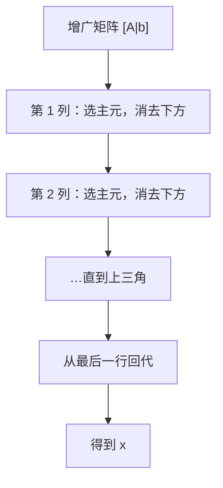

# MATH-220 高斯消元

## 1. 知识概览

| 项 | 内容 |
|---|---|
| 知识 ID | `MATH-220` |
| 英文名称 | Gaussian Elimination |
| 所属模块 | M-MATH-02 线性代数 |
| 难度等级 | L2 应用 |
| 前置知识 | [[MATH-219 矩阵的秩与线性方程组]] |
| 所属知识体系 | 行变换 → 上三角 → 回代 |
| **AI 应用场景** | 线性方程组求解、LU 分解、`np.linalg.solve` 的内部算法 |
| **预计学习时间** | 50 分钟 |

**为什么学它**：这是**人类最早的系统算法之一**，也是 `np.linalg.solve` 的底层思路。自己实现一遍，就能明白"为什么复杂度是 $O(n^3)$"以及"为什么需要选主元"。

## 2. 直观理解

解方程组最朴素的办法是**消去未知数**：

$$
\begin{cases} x + y = 3 \\ 2x - y = 0\end{cases}
$$

第二式减去第一式的 2 倍，就消掉了 $x$，解出 $y$，再回代求 $x$。

**高斯消元**把这个操作**系统化**：

1. 用第一行消掉下面所有行的第一个未知数；
2. 用第二行消掉下面所有行的第二个未知数；
3. ……
4. 得到**上三角**形状后，从最后一行往回代。

## 3. 正式数学定义

**初等行变换**（不改变方程组的解集）

1. 交换两行；
2. 某行乘以非零常数；
3. 某行加上另一行的倍数。

**高斯消元**：用初等行变换把增广矩阵 $[A\mid\mathbf{b}]$ 化为**行阶梯形**：

$$
\begin{bmatrix}
a_{11} & a_{12} & \cdots & a_{1n} & b_1\\
0 & a'_{22} & \cdots & a'_{2n} & b'_2\\
\vdots & & \ddots & & \vdots\\
0 & \cdots & 0 & a^{(n)}_{nn} & b^{(n)}_n
\end{bmatrix}
$$

**回代**：由最后一行解出 $x_n$，逐个往上代入。

**复杂度**：消元约 $\dfrac{n^3}{3}$ 次乘加，回代 $O(n^2)$，总体 $O(n^3)$。

**选主元（pivoting）**：第 $k$ 步在第 $k$ 列中选**绝对值最大**的元素换到对角位置，减小舍入误差。

## 4. 数学推导

### 4.1 为什么行变换不改变解集

**起点**：方程组对应增广矩阵，每一行是一个方程。

**第 1 步（交换）**：方程的顺序不影响"同时满足"这一条件，解集不变。

**第 2 步（乘非零常数）**：$c\cdot(\text{方程}) = c\cdot 0$ 与方程本身等价（$c\neq0$）。

**第 3 步（行加倍数）**：设原方程 $E_1, E_2$。新方程 $E_2' = E_2 + kE_1$。

- 若 $\mathbf{x}$ 满足 $E_1, E_2$，则满足 $E_2'$ —— 新解集包含旧解集。
- 反过来，$E_2 = E_2' - kE_1$，若满足 $E_1, E_2'$，则满足 $E_2$ —— 旧解集包含新解集。

**结论**：两个方向都成立，解集完全不变。

### 4.2 回代公式

**起点**：已化为上三角，第 $i$ 行形如

$$
a_{ii}x_i + a_{i,i+1}x_{i+1} + \cdots + a_{in}x_n = b_i
$$

**第 1 步**：从 $i = n$ 开始，$x_n = b_n / a_{nn}$。

**第 2 步**：对 $i = n-1, \dots, 1$，把已知的 $x_{i+1..n}$ 移到右边

$$
x_i = \frac{b_i - \sum_{j=i+1}^{n} a_{ij}x_j}{a_{ii}}
$$

**适用条件**：所有主元 $a_{ii} \neq 0$；若某步主元为 0，需交换行（选主元）。

## 5. 几何直观与图解



消元过程的形状变化：

```text
■ ■ ■ | ■        ■ ■ ■ | ■        ■ ■ ■ | ■
■ ■ ■ | ■   -->  0 ■ ■ | ■   -->  0 ■ ■ | ■
■ ■ ■ | ■        0 ■ ■ | ■        0 0 ■ | ■
  原始              消第一列          上三角
```

## 6. 计算示例

**例**：解方程组

$$
\begin{cases}
2x + y - z = 8\\
-3x - y + 2z = -11\\
-2x + y + 2z = -3
\end{cases}
$$

**第 1 步**：写出增广矩阵

$$
\begin{bmatrix}
2 & 1 & -1 & 8\\
-3 & -1 & 2 & -11\\
-2 & 1 & 2 & -3
\end{bmatrix}
$$

**第 2 步**：消第一列（主元 2）

- $R_2 \leftarrow R_2 - \left(\frac{-3}{2}\right)R_1 = R_2 + 1.5R_1$
- $R_3 \leftarrow R_3 + R_1$

$$
\begin{bmatrix}
2 & 1 & -1 & 8\\
0 & 0.5 & 0.5 & 1\\
0 & 2 & 1 & 5
\end{bmatrix}
$$

**第 3 步**：消第二列（主元 0.5），$R_3 \leftarrow R_3 - 4R_2$

$$
\begin{bmatrix}
2 & 1 & -1 & 8\\
0 & 0.5 & 0.5 & 1\\
0 & 0 & -1 & 1
\end{bmatrix}
$$

**第 4 步**：回代

$$
z = \frac{1}{-1} = -1
$$

$$
0.5y + 0.5(-1) = 1 \;\Rightarrow\; y = 3
$$

$$
2x + 3 - (-1) = 8 \;\Rightarrow\; 2x = 4 \;\Rightarrow\; x = 2
$$

**结果**：$x=2,\ y=3,\ z=-1$。

**自检**：第二式 $-3(2) - 3 + 2(-1) = -6 - 3 - 2 = -11$ ✓

## 7. Python 辅助验证

**依赖**：NumPy 2.5.4。

```powershell
python math220_gauss.py
```

```python
import numpy as np


def gauss_eliminate(A, b):
    A = np.array(A, dtype=float)
    b = np.array(b, dtype=float)
    n = len(b)
    M = np.column_stack([A, b])

    for col in range(n):
        pivot = np.argmax(np.abs(M[col:, col])) + col
        if abs(M[pivot, col]) < 1e-12:
            raise ValueError("矩阵奇异，无唯一解")
        M[[col, pivot]] = M[[pivot, col]]
        for r in range(col + 1, n):
            M[r] -= (M[r, col] / M[col, col]) * M[col]

    x = np.zeros(n)
    for i in range(n - 1, -1, -1):
        x[i] = (M[i, -1] - M[i, i + 1:n] @ x[i + 1:]) / M[i, i]
    return x


A = [[2, 1, -1], [-3, -1, 2], [-2, 1, 2]]
b = [8, -11, -3]

x = gauss_eliminate(A, b)
print("消元解:", x.round(6).tolist())
print("numpy 解:", np.linalg.solve(np.array(A, float), np.array(b, float)).round(6).tolist())
print("残差为零:", bool(np.allclose(np.array(A, float) @ x, b)))
```

**实际运行结果**

```
消元解: [2.0, 3.0, -1.0]
numpy 解: [2.0, 3.0, -1.0]
残差为零: True
```

**代码解析**

- `np.column_stack([A, b])` 拼出增广矩阵。
- `np.argmax(np.abs(M[col:, col]))` 实现**部分选主元**：找当前列绝对值最大的行。
- `M[[col, pivot]] = M[[pivot, col]]` 是 NumPy 的花式索引，一次交换两行。
- `M[r] -= factor * M[col]` 整行一次性更新，避免内层循环。
- 回代用向量点积 `M[i, i+1:n] @ x[i+1:]`，比手写循环简洁。
- 与 `np.linalg.solve` 结果一致，残差为零，说明实现正确。

## 8. 知识关联

| 类型 | 链接 |
|---|---|
| 前置数学 | [[MATH-219 矩阵的秩与线性方程组]]、[[MATH-218 行列式与逆矩阵]] |
| 后续数学 | `MATH-221 线性变换与几何意义`（待建）、`MATH-601 误差与稳定性`（待建） |
| 相关 Python | [[PY-066 矩阵运算]]、[[PY-062 索引与切片]]（花式索引） |
| 相关机器学习 | 待关联（`solve` 解正规方程） |
| 相关深度学习 | 待关联（LU 分解、批量求解） |
| 相关大语言模型 | 待关联 |

## 9. 实战练习

**基础 1**：用消元法解 $\begin{cases} x + y = 5 \\ x - y = 1\end{cases}$。

**基础 2**：说明为什么消元时主元不能为 0。

**进阶 1**：对 $\begin{cases} x + 2y = 4 \\ 3x + 6y = 12\end{cases}$ 做消元，观察第二行变成什么，据此判断解的情况。

**综合 1**：把上面的 Python 实现改成返回"是否奇异"，并给出一个 3×3 的奇异矩阵测试它。

## 10. 参考答案

> [!success]- 基础 1
> 第二行减第一行：$-2y = -4 \Rightarrow y = 2$。
>
> 回代 $x + 2 = 5 \Rightarrow x = 3$。
>
> 解为 $(3, 2)$。

> [!success]- 基础 2
> 消元要用主元作除数（$R_r \leftarrow R_r - \frac{a_{rc}}{a_{cc}}R_c$）。若主元为 0，除零无意义。
>
> 处理方式：**交换行**，把该列非零元素所在行换上来（选主元）。

> [!success]- 进阶 1
> $R_2 \leftarrow R_2 - 3R_1$：
>
> $$\begin{bmatrix}1&2&4\\3&6&12\end{bmatrix} \to \begin{bmatrix}1&2&4\\0&0&0\end{bmatrix}$$
>
> 第二行全为 0，说明两个方程本质是同一个。$\text{rank}(A)=\text{rank}([A|b])=1<2$，**无穷多解**：$x = 4-2t,\ y=t$。

> [!success]- 综合 1
> ```text
> import numpy as np
>
> def gauss_solve(A, b):
>     ...
>     if abs(M[pivot, col]) < 1e-12:
>         return None, False      # 奇异
>     ...
>     return x, True
>
> S = [[1, 2, 3], [2, 4, 6], [1, 1, 1]]
> print(gauss_solve(S, [1, 2, 1]))
> ```
> 输出 `(None, False)`，因为第一列主元可消，但第二行与第一行成比例，第二步主元为 0。
>
> **要点**：奇异不是"算错"，而是"方程本身不独立"。

## 11. 常见错误

| 类型 | 错误表现 | 原因 | 纠正 |
|---|---|---|---|
| 计算错误 | 主元为 0 时直接除 | 未选主元 | 先交换行 |
| 计算错误 | 消元时只改当前列 | 行变换要整行 | 整行一起更新 |
| 概念错误 | 认为消元改变了方程组的解 | 混淆等价 | 行变换保持解集 |
| 代码错误 | 内层用 Python 循环逐元素算 | 慢 | 用整行向量运算 |
| 数值错误 | 主元取绝对值最小的 | 舍入误差放大 | 取绝对值最大的 |
| 概念错误 | 回代顺序从第一行开始 | 顺序反了 | 从最后一行往上 |

## 12. 学习记录

| 日期 | 状态 | 掌握程度 | 复习状态 | 学习笔记 | 关联练习 |
|---|---|---|---|---|---|
| — | planned | — | — | — | 练习 1–4 |

---

## 🔗 Notion 同步信息

> 以下内容由 Notion「AI Knowledge System · 知识点」数据库按知识 ID 合并而来（导出于 2026-11-09）。

| 属性 | 值 |
|---|---|
| 学科 | 数学 |
| 学习状态 | 未开始 |
| 难度 | L2 应用 |
| 知识类型 | Algorithm |

- **所属模块**：[M-MATH-02 线性代数](../%E8%AF%BE%E7%A8%8B%E6%A8%A1%E5%9D%97/M-MATH-02%20%E7%BA%BF%E6%80%A7%E4%BB%A3%E6%95%B0.md)
- **前置知识**：[MATH-219 矩阵的秩与线性方程组](MATH-219%20%E7%9F%A9%E9%98%B5%E7%9A%84%E7%A7%A9%E4%B8%8E%E7%BA%BF%E6%80%A7%E6%96%B9%E7%A8%8B%E7%BB%84.md)
- **后继知识**：[MATH-221 线性变换与几何意义](MATH-221%20%E7%BA%BF%E6%80%A7%E5%8F%98%E6%8D%A2%E4%B8%8E%E5%87%A0%E4%BD%95%E6%84%8F%E4%B9%89.md)
- **关联Python**：[PY-066 矩阵运算](../../01_Python%E5%9F%BA%E7%A1%80/08%20NumPy/PY-066%20%E7%9F%A9%E9%98%B5%E8%BF%90%E7%AE%97.md)
- **关联数学**：[MATH-219 矩阵的秩与线性方程组](MATH-219%20%E7%9F%A9%E9%98%B5%E7%9A%84%E7%A7%A9%E4%B8%8E%E7%BA%BF%E6%80%A7%E6%96%B9%E7%A8%8B%E7%BB%84.md)
- **被引用为数学**：[MATH-221 线性变换与几何意义](MATH-221%20%E7%BA%BF%E6%80%A7%E5%8F%98%E6%8D%A2%E4%B8%8E%E5%87%A0%E4%BD%95%E6%84%8F%E4%B9%89.md)
