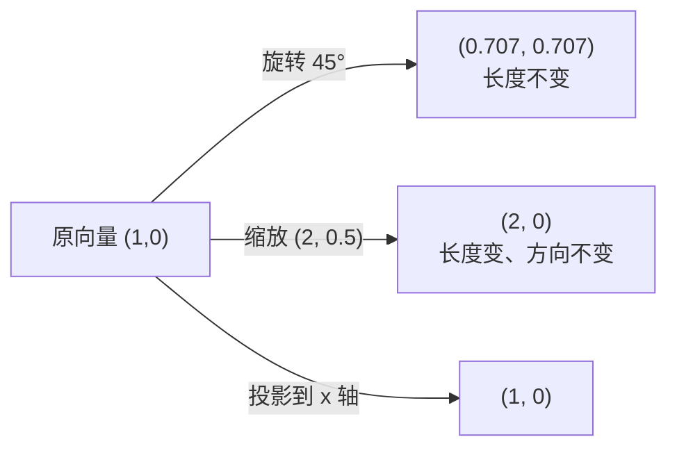

# MATH-221 线性变换与几何意义

## 1. 知识概览

| 项 | 内容 |
|---|---|
| 知识 ID | `MATH-221` |
| 英文名称 | Linear Transformations and Their Geometry |
| 所属模块 | M-MATH-02 线性代数 |
| 难度等级 | L3 推导 |
| 前置知识 | [[MATH-220 高斯消元]] |
| 所属知识体系 | 变换定义 → 矩阵表示 → 旋转/缩放/投影 → 核与像 |
| **AI 应用场景** | 全连接层就是线性变换；Embedding 是"把词映射到向量空间"；数据增广的旋转 |
| **预计学习时间** | 55 分钟 |

**为什么学它**：矩阵不只是"数表"，它是**空间的动作**。$A\mathbf{x}$ 的意思是"把向量 $\mathbf{x}$ 搬到一个新位置"。理解这一点，才能看懂"神经网络为什么能提取特征"。

## 2. 直观理解

线性变换是"**保持网格线平行且等距**"的空间操作：

- **旋转**：整体转一个角度，形状不变。
- **缩放**：沿坐标轴拉伸或压缩。
- **投影**：把一个三维物体压到二维平面上（丢掉一个方向）。
- **剪切**：把正方形推成平行四边形（像推一叠牌）。

**不是线性的例子**：把图像弯成弧形（弯曲网格线）、把原点挪走（平移）。

**关键**：线性变换必须**把原点固定**、**把直线映成直线**、**保持比例**。

## 3. 正式数学定义

**线性变换**：映射 $T:\mathbb{R}^n\to\mathbb{R}^m$ 满足

$$
T(\alpha\mathbf{x} + \beta\mathbf{y}) = \alpha T(\mathbf{x}) + \beta T(\mathbf{y})
$$

对任意标量 $\alpha,\beta$ 与向量 $\mathbf{x},\mathbf{y}$ 成立。

**矩阵表示**：任何线性变换都可用矩阵 $A$ 表示

$$
T(\mathbf{x}) = A\mathbf{x}
$$

且 $A$ 的第 $j$ 列 $= T(\mathbf{e}_j)$（标准基像）。

**常见变换矩阵**（二维）

| 变换 | 矩阵 |
|---|---|
| 旋转 $\theta$ | $\begin{bmatrix}\cos\theta & -\sin\theta\\ \sin\theta & \cos\theta\end{bmatrix}$ |
| 沿 $x$ 缩放 $s_x$、沿 $y$ 缩放 $s_y$ | $\begin{bmatrix}s_x & 0\\ 0 & s_y\end{bmatrix}$ |
| 投影到 $x$ 轴 | $\begin{bmatrix}1 & 0\\ 0 & 0\end{bmatrix}$ |
| 剪切 | $\begin{bmatrix}1 & k\\ 0 & 1\end{bmatrix}$ |

**核（kernel）与像（image）**

$$
\ker T = \{\mathbf{x} : T(\mathbf{x}) = \mathbf{0}\}, \qquad \operatorname{Im} T = \{T(\mathbf{x})\}
$$

**维数定理**

$$
\dim\ker T + \dim\operatorname{Im} T = n
$$

## 4. 数学推导

### 4.1 为什么"矩阵的列 = 标准基的像"

**起点**：$\mathbf{x}\in\mathbb{R}^n$ 可写成标准基的线性组合

$$
\mathbf{x} = x_1\mathbf{e}_1 + x_2\mathbf{e}_2 + \cdots + x_n\mathbf{e}_n
$$

**第 1 步**：用线性性展开 $T(\mathbf{x})$

$$
T(\mathbf{x}) = x_1T(\mathbf{e}_1) + \cdots + x_nT(\mathbf{e}_n)
$$

**第 2 步**：把每个 $T(\mathbf{e}_j)$ 当作列向量，拼成矩阵 $A$

$$
A = \big[\,T(\mathbf{e}_1) \mid T(\mathbf{e}_2) \mid \cdots \mid T(\mathbf{e}_n)\,\big]
$$

**第 3 步**：上式正是矩阵-向量乘法

$$
T(\mathbf{x}) = A\mathbf{x}
$$

**结论**：**知道基向量被搬到哪里，就知道整个变换**。这也是"矩阵是变换的坐标记录"的含义。

### 4.2 为什么旋转矩阵的行列式为 1

**起点**：$R_\theta = \begin{bmatrix}\cos\theta & -\sin\theta\\ \sin\theta & \cos\theta\end{bmatrix}$。

**第 1 步**：算行列式

$$
\det R_\theta = \cos\theta\cdot\cos\theta - (-\sin\theta)(\sin\theta) = \cos^2\theta + \sin^2\theta
$$

**第 2 步**：用三角恒等式 $\cos^2\theta + \sin^2\theta = 1$

$$
\det R_\theta = 1
$$

**结论**：旋转不改变面积（$|\det|=1$），也不翻转方向（$\det>0$）。

**对比**：缩放矩阵 $\det = s_x s_y$，正是面积缩放倍数；若 $s_x$ 或 $s_y$ 为负，则方向翻转。

## 5. 几何直观与图解



```text
y                 y
│    ╱            │   ╱
│   ╱  旋转        │  ╱   缩放 2×0.5
│  ╱              │ ╱
└──────── x       └──────── x
```

## 6. 计算示例

**例 1**：把向量 $(1,0)$ 旋转 $45°$。

$$
R_{45°} = \begin{bmatrix}\tfrac{\sqrt2}{2} & -\tfrac{\sqrt2}{2}\\[2pt] \tfrac{\sqrt2}{2} & \tfrac{\sqrt2}{2}\end{bmatrix}
$$

$$
R\begin{bmatrix}1\\0\end{bmatrix} = \begin{bmatrix}\tfrac{\sqrt2}{2}\\ \tfrac{\sqrt2}{2}\end{bmatrix} \approx \begin{bmatrix}0.7071\\ 0.7071\end{bmatrix}
$$

长度 $\sqrt{0.5+0.5} = 1$，未变 ✓

**例 2**：缩放 $S = \begin{bmatrix}2&0\\0&0.5\end{bmatrix}$ 作用于 $(1,0)$。

$$
S\begin{bmatrix}1\\0\end{bmatrix} = \begin{bmatrix}2\\0\end{bmatrix}
$$

面积倍数 $= \det S = 1$（一维拉长、一维压缩，面积恰好不变）。

**例 3**：投影 $P = \begin{bmatrix}1&0\\0&0\end{bmatrix}$ 作用于 $(3,4)$。

$$
P\begin{bmatrix}3\\4\end{bmatrix} = \begin{bmatrix}3\\0\end{bmatrix}
$$

$\ker P$ 是 $y$ 轴（被压成 0 的方向），$\dim\ker P = 1$；$\operatorname{Im}P$ 是 $x$ 轴，$\dim = 1$；$1+1=2$ ✓ 符合维数定理。

## 7. Python 辅助验证

**依赖**：NumPy 2.5.4。

```powershell
python math221_transform.py
```

```python
import math

import numpy as np

theta = math.pi / 4
R = np.array([[math.cos(theta), -math.sin(theta)],
              [math.sin(theta), math.cos(theta)]])
S = np.array([[2.0, 0.0], [0.0, 0.5]])

v = np.array([1.0, 0.0])
print("原向量:", v.tolist())
print("旋转 45°:", (R @ v).round(4).tolist())
print("旋转前后长度:", round(float(np.linalg.norm(R @ v)), 6),
      round(float(np.linalg.norm(v)), 6))
print("缩放 2×0.5:", (S @ v).round(4).tolist())
print("缩放 det（面积倍数）:", round(float(np.linalg.det(S)), 4))
print("旋转 det:", round(float(np.linalg.det(R)), 4))
print("旋转保持面积:", bool(abs(np.linalg.det(R) - 1) < 1e-12))
```

**实际运行结果**

```
原向量: [1.0, 0.0]
旋转 45°: [0.7071, 0.7071]
旋转前后长度: 1.0 1.0
缩放 2×0.5: [2.0, 0.0]
缩放 det（面积倍数）: 1.0
旋转 det: 1.0
旋转保持面积: True
```

**代码解析**

- `R @ v` 才是"变换"，`R * v` 是逐元素乘，语义完全不同。
- 旋转后长度仍为 1，印证"旋转是正交变换"。
- 两个矩阵的 $\det$ 都是 1，但含义不同：旋转"不动形状"，缩放"拉一维压一维"。
- 浮点比较用 `abs(...) < 1e-12`，不用 `==`。

## 8. 知识关联

| 类型 | 链接 |
|---|---|
| 前置数学 | [[MATH-220 高斯消元]]、[[MATH-217 矩阵运算与维度]]、[[MATH-218 行列式与逆矩阵]] |
| 后续数学 | [[MATH-222 基、维度与子空间]]、[[MATH-223 特征值与特征向量]]、`MATH-224 SVD 与低秩近似` |
| 相关 Python | [[PY-066 矩阵运算]] |
| 相关机器学习 | 待关联（特征变换、数据增广、PCA 的投影） |
| 相关深度学习 | 待关联（全连接层＝线性变换 + 非线性激活） |
| 相关大语言模型 | 待关联（Embedding 把 token 映射到向量空间） |

## 9. 实战练习

**基础 1**：把 $(1,1)$ 旋转 $90°$，写出结果并说明长度是否变化。

**基础 2**：求投影矩阵 $\begin{bmatrix}1&0\\0&0\end{bmatrix}$ 的核。

**进阶 1**：说明剪切矩阵 $\begin{bmatrix}1&1\\0&1\end{bmatrix}$ 的几何效果与行列式。

**综合 1**：给定 $A=\begin{bmatrix}2&0\\0&3\end{bmatrix}$，求它把单位正方形映射成什么形状、面积是多少。

## 10. 参考答案

> [!success]- 基础 1
> $$R_{90°} = \begin{bmatrix}0&-1\\1&0\end{bmatrix},\quad \begin{bmatrix}0&-1\\1&0\end{bmatrix}\begin{bmatrix}1\\1\end{bmatrix} = \begin{bmatrix}-1\\1\end{bmatrix}$$
>
> 长度为 $\sqrt2$，与原向量长度相同 ⇒ 旋转保长。

> [!success]- 基础 2
> 解 $P\mathbf{x}=\mathbf{0}$：$\begin{bmatrix}1&0\\0&0\end{bmatrix}\begin{bmatrix}x\\y\end{bmatrix} = \begin{bmatrix}x\\0\end{bmatrix} = \mathbf{0} \Rightarrow x=0$。
>
> 核 $= \{(0,y)\} = y$ 轴，$\dim\ker = 1$。

> [!success]- 进阶 1
> 作用：$(x,y)\mapsto(x+y,\ y)$。正方形被推成平行四边形（上边相对下边向右错开），面积不变（$\det = 1$）。
>
> **要点**：剪切不改变面积与"平行性"，但改变角度。

> [!success]- 综合 1
> 单位正方形（边长 1）映射成边长 2 与 3 的矩形，面积 $= 6 = \det A$。
>
> **一般结论**：$|\det A|$ 就是面积（体积）缩放倍数。

## 11. 常见错误

| 类型 | 错误表现 | 原因 | 纠正 |
|---|---|---|---|
| 概念错误 | 认为平移是线性变换 | 平移不固定原点 | 仿射变换才含平移 |
| 计算错误 | 用 `*` 做变换 | 逐元素乘语义不同 | 用 `@` |
| 概念错误 | 认为 $\ker$ 一定是 $\{\mathbf{0}\}$ | 只有满秩时才如此 | 奇异矩阵核非平凡 |
| 概念错误 | 认为 $\det=0$ 变换"什么都没做" | 是把空间压扁 | 信息丢失、不可逆 |
| 计算错误 | 旋转角度用度数 | 三角函数要弧度 | 用 `math.radians` 或 $\pi$ 换算 |

## 12. 学习记录

| 日期 | 状态 | 掌握程度 | 复习状态 | 学习笔记 | 关联练习 |
|---|---|---|---|---|---|
| — | planned | — | — | — | 练习 1–4 |

---

## 🔗 Notion 同步信息

> 以下内容由 Notion「AI Knowledge System · 知识点」数据库按知识 ID 合并而来（导出于 2026-11-09）。

| 属性 | 值 |
|---|---|
| 学科 | 数学 |
| 学习状态 | 未开始 |
| 难度 | L3 推导 |
| 知识类型 | Concept |

- **所属模块**：[M-MATH-02 线性代数](../%E8%AF%BE%E7%A8%8B%E6%A8%A1%E5%9D%97/M-MATH-02%20%E7%BA%BF%E6%80%A7%E4%BB%A3%E6%95%B0.md)
- **前置知识**：[MATH-220 高斯消元](MATH-220%20%E9%AB%98%E6%96%AF%E6%B6%88%E5%85%83.md)
- **后继知识**：[MATH-222 基、维度与子空间](MATH-222%20%E5%9F%BA%E3%80%81%E7%BB%B4%E5%BA%A6%E4%B8%8E%E5%AD%90%E7%A9%BA%E9%97%B4.md)
- **关联Python**：[PY-066 矩阵运算](../../01_Python%E5%9F%BA%E7%A1%80/08%20NumPy/PY-066%20%E7%9F%A9%E9%98%B5%E8%BF%90%E7%AE%97.md)
- **关联数学**：[MATH-220 高斯消元](MATH-220%20%E9%AB%98%E6%96%AF%E6%B6%88%E5%85%83.md)
- **被引用为数学**：[MATH-222 基、维度与子空间](MATH-222%20%E5%9F%BA%E3%80%81%E7%BB%B4%E5%BA%A6%E4%B8%8E%E5%AD%90%E7%A9%BA%E9%97%B4.md) · [LLM-012 Query、Key、Value 与 QKV 的来源](../../05_%E5%A4%A7%E8%AF%AD%E8%A8%80%E6%A8%A1%E5%9E%8B/03%20Attention%E6%9C%BA%E5%88%B6/LLM-012%20Query%E3%80%81Key%E3%80%81Value%20%E4%B8%8E%20QKV%20%E7%9A%84%E6%9D%A5%E6%BA%90.md)
