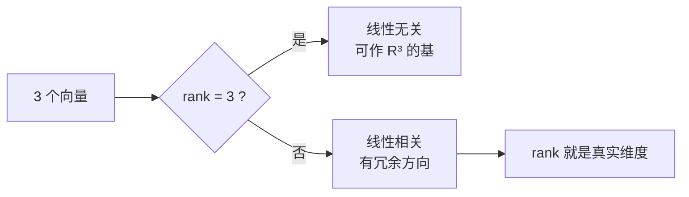

# MATH-222 基、维度与子空间

## 1. 知识概览

| 项 | 内容 |
|---|---|
| 知识 ID | `MATH-222` |
| 英文名称 | Basis, Dimension and Subspaces |
| 所属模块 | M-MATH-02 线性代数 |
| 难度等级 | L3 推导 |
| 前置知识 | [[MATH-221 线性变换与几何意义]] |
| 所属知识体系 | 线性组合 → 张成 → 线性无关 → 基 → 维度 |
| **AI 应用场景** | 特征空间的维度、Embedding 维度、PCA 保留几个主成分、模型容量 |
| **预计学习时间** | 55 分钟 |

**为什么学它**：**维度**不是"有几个数"，而是"有几个独立方向"。PCA 说"降到 2 维"，意思是"用 2 个独立方向近似原数据"。不懂基与维度，这句话就只是术语。

## 2. 直观理解

**子空间**是"过原点的平坦区域"：

- 一维：过原点的一条直线。
- 二维：过原点的一个平面。
- 整个空间本身也算子空间。

**线性组合**是"把几个向量按比例加起来"：$a\mathbf{v}_1 + b\mathbf{v}_2$。

**张成（span）**是"用这些向量能组合出的全部点"。

**基**是"最省的一组方向"：既能张成整个空间，又没有多余方向。

**维度**是"基里向量的个数"。

生活类比：描述平面上一个点需要 2 个独立方向（东、北）；如果再加一个"东北"方向，那是多余的——它已经能用前两个表示。

## 3. 正式数学定义

**线性组合**：$\sum_i c_i\mathbf{v}_i$。

**张成**：$\operatorname{span}\{\mathbf{v}_1,\dots,\mathbf{v}_k\} = \{\sum c_i\mathbf{v}_i\}$。

**线性无关**：若 $\sum c_i\mathbf{v}_i = \mathbf{0}$ 只有 $c_i = 0$ 这一组解，则无关；否则相关。

**基**：向量组 $\{\mathbf{v}_i\}$ 既是张成集又线性无关，称为该空间的一组基。

**维度**：$\dim V$ = 任一组基中向量的个数（与基的选择无关）。

**子空间**：$V\subseteq\mathbb{R}^n$ 满足：含零向量、对加法封闭、对数乘封闭。

**坐标**：给定基 $B = \{\mathbf{v}_1,\dots,\mathbf{v}_n\}$，任何 $\mathbf{x}$ 唯一表示为

$$
\mathbf{x} = c_1\mathbf{v}_1 + \cdots + c_n\mathbf{v}_n
$$

$(c_1,\dots,c_n)$ 就是 $\mathbf{x}$ 在基 $B$ 下的坐标。

## 4. 数学推导

### 4.1 为什么"坐标"唯一（当基确定时）

**起点**：设 $\mathbf{x}$ 有两组表示

$$
\mathbf{x} = \sum c_i\mathbf{v}_i = \sum d_i\mathbf{v}_i
$$

**第 1 步**：两式相减

$$
\sum (c_i - d_i)\mathbf{v}_i = \mathbf{0}
$$

**第 2 步**：因为 $\{\mathbf{v}_i\}$ 线性无关，上式只有平凡解

$$
c_i - d_i = 0 \;\Rightarrow\; c_i = d_i
$$

**第 3 步**：所以表示唯一。

**结论**：**基的作用是给每个向量一个唯一"地址"**。换基就是换坐标系统，同一个点坐标变了，但点没变。

### 4.2 维数定理（秩-零化度）

**起点**：线性变换 $T:\mathbb{R}^n\to\mathbb{R}^m$，矩阵 $A$。

**第 1 步**：取 $\ker T$ 的一组基 $\{\mathbf{u}_1,\dots,\mathbf{u}_k\}$，$\dim\ker T = k$。

**第 2 步**：把它扩充成整个 $\mathbb{R}^n$ 的基 $\{\mathbf{u}_1,\dots,\mathbf{u}_k,\mathbf{w}_1,\dots,\mathbf{w}_{n-k}\}$。

**第 3 步**：$T(\mathbf{w}_j)$ 张成 $\operatorname{Im}T$ 且线性无关（否则某个 $\mathbf{w}$ 的组合落在核里，与基的独立性矛盾）。

**第 4 步**：所以 $\dim\operatorname{Im}T = n - k$，即

$$
\dim\ker T + \dim\operatorname{Im}T = n
$$

**结论**：**"被压掉的维度 + 留下的维度 = 输入维度"**。这句话在 PCA 里就是"丢弃的方向数 + 保留的主成分数 = 原始维度"。

## 5. 几何直观与图解



```text
三维空间中的三个向量：
  v3 = v1 + v2  → 落在一个平面里 → 维数 2，不是 3
```

## 6. 计算示例

**例 1**：$\mathbf{v}_1=(1,0)$、$\mathbf{v}_2=(0,1)$、$\mathbf{v}_3=(1,1)$，判断是否线性无关。

$$
\mathbf{v}_3 = \mathbf{v}_1 + \mathbf{v}_2
$$

存在非零系数组合为零 ⇒ **线性相关**。秩为 2（不是 3）。

**例 2**：在标准基下，$\mathbf{x}=(3,4)$ 的坐标就是 $(3,4)$。

**例 3**：换基为 $U = \{\mathbf{u}_1=(1,1),\ \mathbf{u}_2=(1,-1)\}$，求 $(3,4)$ 的坐标。

解 $a\mathbf{u}_1 + b\mathbf{u}_2 = (3,4)$：

$$
\begin{cases} a + b = 3 \\ a - b = 4\end{cases} \Rightarrow a = 3.5,\ b = -0.5
$$

检查：$3.5(1,1) + (-0.5)(1,-1) = (3, 4)$ ✓

## 7. Python 辅助验证

**依赖**：NumPy 2.5.4。

```powershell
python math222_basis.py
```

```python
import numpy as np

v1 = np.array([1.0, 0.0])
v2 = np.array([0.0, 1.0])
v3 = np.array([1.0, 1.0])

print("rank([v1,v2]):", np.linalg.matrix_rank(np.column_stack([v1, v2])))
print("rank([v1,v2,v3]):", np.linalg.matrix_rank(np.column_stack([v1, v2, v3])))
print("v3 = v1 + v2:", bool(np.allclose(v3, v1 + v2)))

B = np.column_stack([v1, v2])
x = np.array([3.0, 4.0])
print("x 在标准基下的坐标:", np.linalg.solve(B, x).round(6).tolist())

U = np.column_stack([np.array([1.0, 1.0]), np.array([1.0, -1.0])])
print("新基行列式:", round(float(np.linalg.det(U)), 4))
print("x 在新基下的坐标:", np.linalg.solve(U, x).round(6).tolist())
```

**实际运行结果**

```
rank([v1,v2]): 2
rank([v1,v2,v3]): 2
v3 = v1 + v2: True
x 在标准基下的坐标: [3.0, 4.0]
新基行列式: -2.0
x 在新基下的坐标: [3.5, -0.5]
```

**代码解析**

- 三个向量放进矩阵后**秩仍是 2**，直接用数值印证"第三个是多余的"。
- `matrix_rank` 是判断线性相关最省事的办法。
- 求坐标本质是**解线性方程组** $B\mathbf{c} = \mathbf{x}$。
- 新基行列式 $-2$（非零）说明 $\mathbf{u}_1,\mathbf{u}_2$ 线性无关，确实构成基；负号表示这组基"翻转了定向"。

## 8. 知识关联

| 类型 | 链接 |
|---|---|
| 前置数学 | [[MATH-221 线性变换与几何意义]]、[[MATH-219 矩阵的秩与线性方程组]] |
| 后续数学 | [[MATH-223 特征值与特征向量]]、`MATH-224 SVD 与低秩近似` |
| 相关 Python | [[PY-066 矩阵运算]] |
| 相关机器学习 | 待关联（特征空间维度、PCA 主成分个数） |
| 相关深度学习 | 待关联（隐层维度、Embedding 维度） |
| 相关大语言模型 | 待关联（词向量空间的维度） |

## 9. 实战练习

**基础 1**：判断 $(1,2)$、$(2,4)$ 是否线性无关。

**基础 2**：$\mathbb{R}^2$ 中，$\{(1,0)\}$ 张成的是什么？维度是多少？

**进阶 1**：在基 $\{(1,1),(1,-1)\}$ 下求 $(0,2)$ 的坐标。

**综合 1**：三个向量 $(1,0,0),(0,1,0),(1,1,0)$ 在 $\mathbb{R}^3$ 中的秩是多少？它们张成的子空间维度是多少、几何上是什么？

## 10. 参考答案

> [!success]- 基础 1
> $(2,4) = 2(1,2)$，线性相关（不是无关）。
>
> **易错**：看到"两个不同向量"就以为无关——要看是否成比例。

> [!success]- 基础 2
> 张成 $x$ 轴（所有 $(t,0)$），维度 **1**。
>
> 一个向量只能张成一维线（除非它是零向量，那就只张成 $\{0\}$，维度 0）。

> [!success]- 进阶 1
> 解 $a(1,1) + b(1,-1) = (0,2)$：
>
> $$a + b = 0,\quad a - b = 2 \Rightarrow a = 1,\ b = -1$$
>
> 坐标为 $(1, -1)$。检查：$1(1,1) + (-1)(1,-1) = (0,2)$ ✓

> [!success]- 综合 1
> $(1,1,0) = (1,0,0) + (0,1,0)$，线性相关，秩 $= 2$。
>
> 张成的子空间维度 $= 2$，几何上是 **$z=0$ 平面**（$xy$ 平面）。
>
> **要点**：三个向量不代表三维，能独立出几个方向才是维数。

## 11. 常见错误

| 类型 | 错误表现 | 原因 | 纠正 |
|---|---|---|---|
| 概念错误 | 用"向量个数"当维度 | 忽略相关性 | 维度 = 秩，不是个数 |
| 判断错误 | 认为 $\mathbf{v}$ 与 $2\mathbf{v}$ 无关 | 只看形式不同 | 成比例即相关 |
| 概念错误 | 认为子空间可以不过原点 | 定义要求含零 | 平移后的直线不是子空间 |
| 计算错误 | 换基后忘了验算 | 未回代 | 一定乘回去检查 |
| 概念错误 | 认为基唯一 | 基可以有很多组 | 维度唯一，基不唯一 |

## 12. 学习记录

| 日期 | 状态 | 掌握程度 | 复习状态 | 学习笔记 | 关联练习 |
|---|---|---|---|---|---|
| — | planned | — | — | — | 练习 1–4 |

---

## 🔗 Notion 同步信息

> 以下内容由 Notion「AI Knowledge System · 知识点」数据库按知识 ID 合并而来（导出于 2026-11-09）。

| 属性 | 值 |
|---|---|
| 学科 | 数学 |
| 学习状态 | 未开始 |
| 难度 | L3 推导 |
| 知识类型 | Concept |

- **所属模块**：[M-MATH-02 线性代数](../%E8%AF%BE%E7%A8%8B%E6%A8%A1%E5%9D%97/M-MATH-02%20%E7%BA%BF%E6%80%A7%E4%BB%A3%E6%95%B0.md)
- **前置知识**：[MATH-221 线性变换与几何意义](MATH-221%20%E7%BA%BF%E6%80%A7%E5%8F%98%E6%8D%A2%E4%B8%8E%E5%87%A0%E4%BD%95%E6%84%8F%E4%B9%89.md)
- **后继知识**：[MATH-223 特征值与特征向量](MATH-223%20%E7%89%B9%E5%BE%81%E5%80%BC%E4%B8%8E%E7%89%B9%E5%BE%81%E5%90%91%E9%87%8F.md)
- **关联Python**：[PY-066 矩阵运算](../../01_Python%E5%9F%BA%E7%A1%80/08%20NumPy/PY-066%20%E7%9F%A9%E9%98%B5%E8%BF%90%E7%AE%97.md)
- **关联数学**：[MATH-221 线性变换与几何意义](MATH-221%20%E7%BA%BF%E6%80%A7%E5%8F%98%E6%8D%A2%E4%B8%8E%E5%87%A0%E4%BD%95%E6%84%8F%E4%B9%89.md)
- **被引用为数学**：[MATH-223 特征值与特征向量](MATH-223%20%E7%89%B9%E5%BE%81%E5%80%BC%E4%B8%8E%E7%89%B9%E5%BE%81%E5%90%91%E9%87%8F.md) · [ML-029 支持向量机](../../03_%E6%9C%BA%E5%99%A8%E5%AD%A6%E4%B9%A0/02%20%E7%9B%91%E7%9D%A3%E5%AD%A6%E4%B9%A0/ML-029%20%E6%94%AF%E6%8C%81%E5%90%91%E9%87%8F%E6%9C%BA.md)
