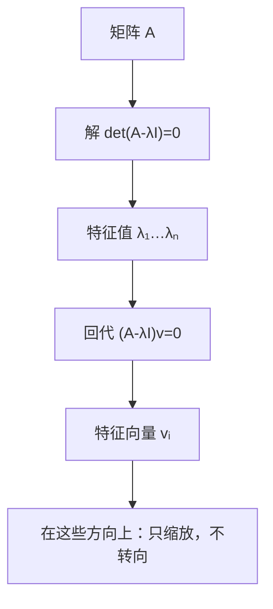

# MATH-223 特征值与特征向量

## 1. 知识概览

| 项 | 内容 |
|---|---|
| 知识 ID | `MATH-223` |
| 英文名称 | Eigenvalues and Eigenvectors |
| 所属模块 | M-MATH-02 线性代数 |
| 难度等级 | L3 推导 |
| 前置知识 | [[MATH-222 基、维度与子空间]] |
| 所属知识体系 | 定义 → 特征方程 → 性质 → 对角化 → PCA |
| **AI 应用场景** | PCA 降维、谱归一化、协方差矩阵分析、图神经网络的谱方法 |
| **预计学习时间** | 60 分钟 |

**为什么学它**：**特征向量是"变换下方向不变的方向"**。一个矩阵作用在特征向量上，只拉长/压缩，不转向。PCA 就是找"数据变化最大的方向"，那正是协方差矩阵的特征向量。

## 2. 直观理解

想象把一张纸拉伸（矩阵 $A$）：

- 大多数方向被拉长**并且**转向。
- 但总有那么一两个方向，**只被拉长，不转向**。

那些"不转向的方向"就是**特征向量**，"拉长的倍数"就是**特征值**。

数学表达：

$$
A\mathbf{v} = \lambda\mathbf{v}
$$

"矩阵作用在 $\mathbf{v}$ 上 = 简单把 $\mathbf{v}$ 放大 $\lambda$ 倍"。

**为什么重要**：复杂变换在特征向量方向上变得极其简单——只有缩放。这就是"对角化"能把矩阵运算变简单的根本原因。

## 3. 正式数学定义

**特征值 / 特征向量**：对 $n\times n$ 矩阵 $A$，若存在非零向量 $\mathbf{v}$ 与标量 $\lambda$ 使

$$
A\mathbf{v} = \lambda\mathbf{v}, \qquad \mathbf{v}\neq\mathbf{0}
$$

则称 $\lambda$ 为特征值，$\mathbf{v}$ 为对应的特征向量。

**特征方程**

$$
A\mathbf{v} = \lambda\mathbf{v} \iff (A - \lambda I)\mathbf{v} = \mathbf{0}
$$

有非零解 $\iff \det(A - \lambda I) = 0$。这个关于 $\lambda$ 的 $n$ 次多项式叫**特征多项式**。

**两条必记性质**

$$
\operatorname{tr}(A) = \sum_i \lambda_i, \qquad \det(A) = \prod_i \lambda_i
$$

**对角化**：若 $A$ 有 $n$ 个线性无关的特征向量，令 $P = [\mathbf{v}_1 \mid \cdots \mid \mathbf{v}_n]$，则

$$
A = P\Lambda P^{-1}, \qquad \Lambda = \operatorname{diag}(\lambda_1,\dots,\lambda_n)
$$

**对称矩阵**（$A = A^T$）：特征值全为实数，特征向量可正交，必可正交对角化 $A = Q\Lambda Q^T$。

## 4. 数学推导

### 4.1 特征方程的来源

**起点**：$A\mathbf{v} = \lambda\mathbf{v}$，$\mathbf{v}\neq\mathbf{0}$。

**第 1 步**：移项

$$
A\mathbf{v} - \lambda\mathbf{v} = \mathbf{0}
$$

**第 2 步**：提出 $\mathbf{v}$（注意 $\lambda\mathbf{v} = \lambda I\mathbf{v}$）

$$
(A - \lambda I)\mathbf{v} = \mathbf{0}
$$

**第 3 步**：这是一个齐次方程组，要求**非零解**。由 [[MATH-219 矩阵的秩与线性方程组]]，齐次方程有非零解 $\iff$ 矩阵奇异

$$
\det(A - \lambda I) = 0
$$

**第 4 步**：解这个多项式方程得到 $\lambda$，再回代求 $\mathbf{v}$。

**例**：$A = \begin{bmatrix}2&1\\1&2\end{bmatrix}$

$$
\det(A - \lambda I) = \begin{vmatrix}2-\lambda & 1\\ 1 & 2-\lambda\end{vmatrix} = (2-\lambda)^2 - 1 = \lambda^2 - 4\lambda + 3
$$

解得 $\lambda = 1, 3$。

### 4.2 迹与行列式为什么等于特征值之和/积

**起点**：特征多项式展开

$$
\det(A - \lambda I) = (-\lambda)^n + c_{n-1}(-\lambda)^{n-1} + \cdots + \det(A)
$$

**第 1 步**：由韦达定理，$n$ 次多项式 $(-\lambda)^n + c_{n-1}(-\lambda)^{n-1}+\cdots$ 的根之和等于 $(-1)^{n-1}c_{n-1}$。

**第 2 步**：可以证明 $c_{n-1} = -\operatorname{tr}(A)$，于是

$$
\sum_i \lambda_i = \operatorname{tr}(A)
$$

**第 3 步**：常数项等于 $\lambda=0$ 时的值

$$
\det(A - 0\cdot I) = \det A = \prod_i \lambda_i
$$

**结论**：这两个恒等式是**验算特征值最实用的工具**——算错了，加一下、乘一下立刻发现。

## 5. 几何直观与图解



```text
普通方向:  v → Av   （长度变 + 方向变）
特征方向:  v → λv   （只长度变）
```

## 6. 计算示例

**例**：$A = \begin{bmatrix}2&1\\1&2\end{bmatrix}$。

**第 1 步**：特征方程 $\lambda^2 - 4\lambda + 3 = 0$，根 $\lambda_1 = 1$，$\lambda_2 = 3$。

**第 2 步**：求 $\lambda = 3$ 的特征向量，解 $(A - 3I)\mathbf{v} = \mathbf{0}$

$$
\begin{bmatrix}-1 & 1\\ 1 & -1\end{bmatrix}\begin{bmatrix}v_1\\v_2\end{bmatrix} = \mathbf{0} \Rightarrow v_1 = v_2
$$

取 $\mathbf{v} = (1,1)$（归一化后 $(0.7071, 0.7071)$）。

**第 3 步**：求 $\lambda = 1$ 的特征向量

$$
\begin{bmatrix}1 & 1\\ 1 & 1\end{bmatrix}\begin{bmatrix}v_1\\v_2\end{bmatrix} = \mathbf{0} \Rightarrow v_1 = -v_2
$$

取 $\mathbf{v} = (-1,1)$（归一化后 $(-0.7071, 0.7071)$）。

**第 4 步**：验算

- $\operatorname{tr}(A) = 4 = 1 + 3$ ✓
- $\det(A) = 3 = 1\times3$ ✓

## 7. Python 辅助验证

**依赖**：NumPy 2.5.4。

```powershell
python math223_eigen.py
```

```python
import numpy as np

A = np.array([[2.0, 1.0], [1.0, 2.0]])
vals, vecs = np.linalg.eigh(A)      # 对称矩阵用 eigh，返回实数且已排序

print("特征值:", vals.round(6).tolist())
print("特征向量（列）:", vecs.round(4).tolist())
print("验证 Av = λv:",
      [bool(np.allclose(A @ vecs[:, i], vals[i] * vecs[:, i])) for i in range(2)])
print("迹 = 特征值和:", round(float(np.trace(A)), 6), round(float(vals.sum()), 6))
print("行列式 = 特征值积:", round(float(np.linalg.det(A)), 6),
      round(float(np.prod(vals)), 6))
print("特征多项式 λ²-4λ+3 的根:", np.roots([1, -4, 3]).round(6).tolist())
```

**实际运行结果**

```
特征值: [1.0, 3.0]
特征向量（列）: [[-0.7071, 0.7071], [0.7071, 0.7071]]
验证 Av = λv: [True, True]
迹 = 特征值和: 4.0 4.0
行列式 = 特征值积: 3.0 3.0
特征多项式 λ²-4λ+3 的根: [3.0, 1.0]
```

**代码解析**

- 对称矩阵用 `eigh`（Hermitian eigen），返回**实数**且**升序**；`eig` 对一般矩阵可能返回复数。
- 特征向量按列返回：`vecs[:, 0]` 是第一个特征向量。
- 迹与行列式两次对照全部吻合，说明结果可信。
- `np.roots` 直接解特征多项式，与 `eigh` 互为验证。

## 8. 知识关联

| 类型 | 链接 |
|---|---|
| 前置数学 | [[MATH-222 基、维度与子空间]]、[[MATH-218 行列式与逆矩阵]]、[[MATH-219 矩阵的秩与线性方程组]] |
| 后续数学 | `MATH-224 SVD 与低秩近似`、`MATH-806 PCA 数学原理`（待建） |
| 相关 Python | [[PY-066 矩阵运算]] |
| 相关机器学习 | 待关联（PCA 的主成分、协方差矩阵分析） |
| 相关深度学习 | 待关联（谱归一化、Hessian 特征值判断鞍点） |
| 相关大语言模型 | 待关联（低秩近似与模型压缩） |

## 9. 实战练习

**基础 1**：求 $\begin{bmatrix}3&0\\0&5\end{bmatrix}$ 的特征值与特征向量。

**基础 2**：已知 $A$ 的特征值为 $2,4$，求 $\operatorname{tr}(A)$ 与 $\det(A)$。

**进阶 1**：求 $\begin{bmatrix}0&1\\1&0\end{bmatrix}$ 的特征值，并说明对应变换的几何含义。

**综合 1**：某二维数据的协方差矩阵为 $\begin{bmatrix}5&0\\0&1\end{bmatrix}$，PCA 应该保留哪个方向？解释原因。

## 10. 参考答案

> [!success]- 基础 1
> 对角矩阵的特征值就是对角元：$\lambda_1=3,\lambda_2=5$。
>
> 特征向量为 $\mathbf{e}_1=(1,0)$ 与 $\mathbf{e}_2=(0,1)$。
>
> **要点**：对角矩阵已经在"自己的坐标系"里，无需计算。

> [!success]- 基础 2
> $\operatorname{tr}(A) = 2+4 = 6$，$\det(A) = 2\times4 = 8$。

> [!success]- 进阶 1
> $$\det\begin{bmatrix}-\lambda&1\\1&-\lambda\end{bmatrix} = \lambda^2 - 1 = 0 \Rightarrow \lambda = \pm1$$
>
> 几何含义：这是"关于直线 $y=x$ 的镜像"。方向 $(1,1)$ 不变（$\lambda=1$），方向 $(1,-1)$ 被反向（$\lambda=-1$）。
>
> **要点**：$\lambda=-1$ 表示"该方向被完全翻转"，不是"长度为负"。

> [!success]- 综合 1
> 协方差矩阵对角化，特征值 $5$ 与 $1$。特征值大 = 该方向方差大 = 信息多。
>
> 所以保留对应 $\lambda=5$ 的方向（此处就是第一坐标轴），丢弃 $\lambda=1$ 的方向。
>
> **量化**：保留 1 个主成分，保留的方差占比 $= \dfrac{5}{5+1} \approx 83.3\%$。

## 11. 常见错误

| 类型 | 错误表现 | 原因 | 纠正 |
|---|---|---|---|
| 概念错误 | 认为特征向量唯一 | 只差非零倍数 | 特征向量是一整条方向 |
| 计算错误 | 特征方程符号错 | 写成 $\det(\lambda I - A)$ | 两者相差 $(-1)^n$，根相同，但要一致 |
| 概念错误 | 用 `eig` 结果判断对称矩阵 | 可能返回复数 | 对称矩阵用 `eigh` |
| 错误 | 忘记验算 | 无自检 | 用迹与行列式对账 |
| 概念错误 | 认为所有矩阵都可对角化 | 亏缺时不行 | 需 $n$ 个线性无关特征向量 |
| 概念错误 | $\lambda=0$ 当作"无特征值" | 0 是合法特征值 | $\lambda=0$ 意味着矩阵奇异 |

## 12. 学习记录

| 日期 | 状态 | 掌握程度 | 复习状态 | 学习笔记 | 关联练习 |
|---|---|---|---|---|---|
| — | planned | — | — | — | 练习 1–4 |

---

## 🔗 Notion 同步信息

> 以下内容由 Notion「AI Knowledge System · 知识点」数据库按知识 ID 合并而来（导出于 2026-11-09）。

| 属性 | 值 |
|---|---|
| 学科 | 数学 |
| 学习状态 | 未开始 |
| 难度 | L3 推导 |
| 知识类型 | Algorithm |

- **所属模块**：[M-MATH-02 线性代数](../%E8%AF%BE%E7%A8%8B%E6%A8%A1%E5%9D%97/M-MATH-02%20%E7%BA%BF%E6%80%A7%E4%BB%A3%E6%95%B0.md)
- **前置知识**：[MATH-222 基、维度与子空间](MATH-222%20%E5%9F%BA%E3%80%81%E7%BB%B4%E5%BA%A6%E4%B8%8E%E5%AD%90%E7%A9%BA%E9%97%B4.md)
- **后继知识**：[MATH-224 SVD 与低秩近似](MATH-224%20SVD%20%E4%B8%8E%E4%BD%8E%E7%A7%A9%E8%BF%91%E4%BC%BC.md)
- **关联Python**：[PY-066 矩阵运算](../../01_Python%E5%9F%BA%E7%A1%80/08%20NumPy/PY-066%20%E7%9F%A9%E9%98%B5%E8%BF%90%E7%AE%97.md)
- **关联数学**：[MATH-222 基、维度与子空间](MATH-222%20%E5%9F%BA%E3%80%81%E7%BB%B4%E5%BA%A6%E4%B8%8E%E5%AD%90%E7%A9%BA%E9%97%B4.md)
- **被引用为数学**：[MATH-224 SVD 与低秩近似](MATH-224%20SVD%20%E4%B8%8E%E4%BD%8E%E7%A7%A9%E8%BF%91%E4%BC%BC.md) · [ML-015 特征选择与特征构造](../../03_%E6%9C%BA%E5%99%A8%E5%AD%A6%E4%B9%A0/05%20%E7%89%B9%E5%BE%81%E5%B7%A5%E7%A8%8B/ML-015%20%E7%89%B9%E5%BE%81%E9%80%89%E6%8B%A9%E4%B8%8E%E7%89%B9%E5%BE%81%E6%9E%84%E9%80%A0.md) · [ML-038 PCA 降维](../../03_%E6%9C%BA%E5%99%A8%E5%AD%A6%E4%B9%A0/03%20%E6%97%A0%E7%9B%91%E7%9D%A3%E5%AD%A6%E4%B9%A0/ML-038%20PCA%20%E9%99%8D%E7%BB%B4.md)
