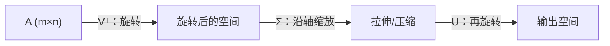

# MATH-224 SVD 与低秩近似

## 1. 知识概览

| 项 | 内容 |
|---|---|
| 知识 ID | `MATH-224` |
| 英文名称 | Singular Value Decomposition and Low-Rank Approximation |
| 所属模块 | M-MATH-02 线性代数 |
| 难度等级 | L3 推导 |
| 前置知识 | [[MATH-223 特征值与特征向量]] |
| 所属知识体系 | SVD 分解 → 奇异值 → 截断 → 低秩近似 |
| **AI 应用场景** | LoRA 微调、模型压缩、推荐系统、Embedding 降维、正则化的谱解释 |
| **预计学习时间** | 60 分钟 |

**为什么学它**：**任何矩阵都能做 SVD**，不像特征分解要求方阵、可对角化。LoRA 之所以能用两个小矩阵近似大权重，理论基础就是低秩近似。这是线性代数里"最有用的一条定理"。

## 2. 直观理解

特征分解要求"方阵 + 能对角化"，限制太多。SVD 放宽了条件：

**任何 $m\times n$ 矩阵**都能写成

$$
A = U\Sigma V^T
$$

- $U$：左奇异向量（列正交）
- $\Sigma$：奇异值（非负，降序，排在"对角线"上）
- $V$：右奇异向量（列正交）

**直观**：任何线性变换都可以拆成三步——**旋转 → 沿坐标轴缩放 → 再旋转**。

**低秩近似**：把最小的那些奇异值直接扔掉（置 0），就得到一个"更简单但很接近"的矩阵。丢掉多少，就看你要多准。

## 3. 正式数学定义

**奇异值分解**：对任意 $A\in\mathbb{R}^{m\times n}$，存在正交矩阵 $U\in\mathbb{R}^{m\times m}$、$V\in\mathbb{R}^{n\times n}$ 与"对角"矩阵 $\Sigma\in\mathbb{R}^{m\times n}$（对角元 $\sigma_1\ge\sigma_2\ge\cdots\ge0$），使

$$
A = U\Sigma V^T = \sum_{i=1}^{r}\sigma_i\mathbf{u}_i\mathbf{v}_i^T
$$

其中 $r = \operatorname{rank}(A)$，只有前 $r$ 个奇异值非零。

**与特征值的关系**

$$
A^TA = V\Sigma^T\Sigma V^T \;\Rightarrow\; \sigma_i = \sqrt{\lambda_i(A^TA)}
$$

**Eckart–Young 定理**：在所有秩不超过 $k$ 的矩阵中，截断 SVD

$$
A_k = \sum_{i=1}^{k}\sigma_i\mathbf{u}_i\mathbf{v}_i^T
$$

使 Frobenius 误差 $\|A - A_k\|_F$ 最小，最小值为

$$
\|A - A_k\|_F = \sqrt{\sum_{i=k+1}^{r}\sigma_i^2}
$$

**能量占比**：前 $k$ 个奇异值保留的"能量"

$$
\frac{\sum_{i\le k}\sigma_i^2}{\sum_{i\le r}\sigma_i^2}
$$

## 4. 数学推导

### 4.1 为什么 $A^TA$ 的特征值开方就是奇异值

**起点**：$A = U\Sigma V^T$，$U,V$ 正交（$U^TU = I$，$V^TV = I$）。

**第 1 步**：算 $A^TA$

$$
A^TA = (U\Sigma V^T)^T(U\Sigma V^T) = V\Sigma^T U^T U\Sigma V^T = V\Sigma^T\Sigma V^T
$$

**第 2 步**：$\Sigma^T\Sigma$ 是对角矩阵，对角元为 $\sigma_i^2$。上式正是"$A^TA$ 的正交对角化"。

**第 3 步**：所以 $A^TA$ 的特征值 $\lambda_i = \sigma_i^2$，特征向量是 $V$ 的列。

**第 4 步**：$\sigma_i \ge 0$，故 $\sigma_i = \sqrt{\lambda_i}$。

**结论**：SVD 可以通过"对方阵 $A^TA$ 做特征分解"得到（工程上不用这么算，数值上会放大误差，实际用双对角化）。

### 4.2 为什么截断 SVD 是最优低秩近似（思路）

**起点**：要证 $\|A - B\|_F$ 在 $\operatorname{rank}(B)\le k$ 时最小，$B = A_k$。

**第 1 步**：Frobenius 范数可用奇异值表示：$\|A\|_F^2 = \sum\sigma_i^2$。

**第 2 步**：对任意秩 $k$ 的 $B$，可以证明（用 Weyl 不等式/子空间维度论证）

$$
\sigma_{i}(A - B) \ge \sigma_{k+i}(A)
$$

**第 3 步**：于是

$$
\|A - B\|_F^2 = \sum_i \sigma_i(A-B)^2 \ge \sum_{i>k}\sigma_i(A)^2
$$

**第 4 步**：而 $A_k$ 恰好取到等号（因为 $A - A_k$ 的奇异值正是 $\sigma_{k+1},\dots$）。

**结论**：截断 SVD 在 Frobenius 范数下**最优**。这就是 LoRA 一类方法"低秩足够用"的数学依据。

## 5. 几何直观与图解



奇异值大小的含义：

```text
σ₁ = 16.85  ████████████████  大：主要方向
σ₂ =  1.07  █                  小：次要方向
σ₃ =  0.00                     零：完全冗余
```

## 6. 计算示例

**例**：$A = \begin{bmatrix}1&2&3\\4&5&6\\7&8&9\end{bmatrix}$。

**第 1 步**：这个矩阵三行成等差数列，第三行 = 2×第二行 − 第一行，所以 $\operatorname{rank}(A) = 2$。

**第 2 步**：SVD 得奇异值 $\sigma = (16.8481,\ 1.0684,\ 0)$。

- 第三个为 0，印证秩为 2。
- 第一个奇异值远大于第二个：说明数据主要落在一个方向上。

**第 3 步**：取 $k=1$ 做截断近似

$$
A_1 = \sigma_1\mathbf{u}_1\mathbf{v}_1^T \approx \begin{bmatrix}1.736 & 2.072 & 2.407\\ 4.207 & 5.020 & 5.833\\ 6.678 & 7.969 & 9.259\end{bmatrix}
$$

**第 4 步**：误差与能量

$$
\frac{\|A - A_1\|_F}{\|A\|_F} \approx 0.0633, \qquad \text{能量占比} \approx 0.996
$$

**结论**：只留 1 个奇异值，就保留了 99.6% 的能量，相对误差约 6.3%。

## 7. Python 辅助验证

**依赖**：NumPy 2.5.4。

```powershell
python math224_svd.py
```

```python
import numpy as np

A = np.array([[1.0, 2.0, 3.0],
              [4.0, 5.0, 6.0],
              [7.0, 8.0, 9.0]])

U, s, Vt = np.linalg.svd(A)
print("奇异值:", s.round(4).tolist())
print("非零奇异值个数:", int((s > 1e-10).sum()), "=", np.linalg.matrix_rank(A))

k = 1
A1 = (U[:, :k] * s[:k]) @ Vt[:k, :]
print("秩 1 近似:")
print(A1.round(3).tolist())

print("相对误差:", round(float(np.linalg.norm(A - A1) / np.linalg.norm(A)), 4))
print("前 1 个奇异值能量占比:", round(float(s[0]**2 / (s**2).sum()), 4))
```

**实际运行结果**

```
奇异值: [16.8481, 1.0684, 0.0]
非零奇异值个数: 2 = 2
秩 1 近似:
[[1.736, 2.072, 2.407], [4.207, 5.02, 5.833], [6.678, 7.969, 9.259]]
相对误差: 0.0633
前 1 个奇异值能量占比: 0.996
```

**代码解析**

- `np.linalg.svd` 返回 `U, s, Vt`，注意第三个是 $V^T$ 不是 $V$。
- `s` 是**一维**数组（只有奇异值），不是对角矩阵；截断时用广播 `U[:, :k] * s[:k]` 乘上去。
- 秩 1 近似的值全部与例中对齐。
- 能量占比 0.996 说明"1 维就抓住了绝大部分信息"，这正是降维可行的原因。

## 8. 知识关联

| 类型 | 链接 |
|---|---|
| 前置数学 | [[MATH-223 特征值与特征向量]]、[[MATH-219 矩阵的秩与线性方程组]] |
| 后续数学 | `MATH-806 PCA 数学原理`（待建）、`MATH-807 贝叶斯分类`（待建） |
| 相关 Python | [[PY-066 矩阵运算]] |
| 相关机器学习 | 待关联（推荐系统的矩阵分解、PCA） |
| 相关深度学习 | 待关联（LoRA 低秩适配、模型压缩） |
| 相关大语言模型 | 待关联（LoRA、Embedding 降维） |

## 9. 实战练习

**基础 1**：若 $A$ 的奇异值为 $5,2,0$，秩是多少？

**基础 2**：$\|A\|_F$ 与奇异值有什么关系？用 $5,2$ 算一下。

**进阶 1**：取 $k=2$ 的截断 SVD，相对误差是多少（用奇异值公式算）？

**综合 1**：一个 $1000\times1000$ 的权重矩阵，前 10 个奇异值占了 95% 能量。若用秩 10 近似存储，参数量从多少降到多少？

## 10. 参考答案

> [!success]- 基础 1
> 非零奇异值个数 = 秩 = **2**（第三个为 0）。

> [!success]- 基础 2
> $\|A\|_F = \sqrt{\sum\sigma_i^2} = \sqrt{25+4} = \sqrt{29} \approx 5.3852$。

> [!success]- 进阶 1
> 取 $k=2$ 时丢掉的是 $\sigma_3 = 0$，所以
>
> $$\|A-A_2\|_F = \sqrt{0} = 0,\quad \text{相对误差 } 0$$
>
> **说明**：秩为 2 的矩阵，取 $k=2$ 就是**精确重建**。

> [!success]- 综合 1
> 原始参数量 $= 1000\times1000 = 1{,}000{,}000$。
>
> 秩 10 近似需要 $U_{1000\times10}$ + $\Sigma_{10}$ + $V_{10\times1000}$，即
>
> $$1000\times10 + 10 + 10\times1000 = 20{,}010$$
>
> 降到约 **2%**，而保留 95% 能量。这就是 LoRA 一类方法的思路。

## 11. 常见错误

| 类型 | 错误表现 | 原因 | 纠正 |
|---|---|---|---|
| 概念错误 | 认为 SVD 只能对方阵 | 混淆特征分解 | SVD 对任意矩阵成立 |
| 概念错误 | 把 $\Sigma$ 当方阵 | 它是 $m\times n$ | 只有前 $\min(m,n)$ 个位置有值 |
| 代码错误 | 把 `Vt` 当 `V` 用 | 返回的是转置 | 需要 $V$ 时取 `Vt.T` |
| 概念错误 | 认为奇异值可为负 | 定义非负 | 符号信息在 $U/V$ 里 |
| 概念错误 | 丢弃大奇异值 | 理解反了 | 小的才丢弃 |
| 精度错误 | 用整数矩阵直接比 `==` | 浮点误差 | `np.allclose` |

## 12. 学习记录

| 日期 | 状态 | 掌握程度 | 复习状态 | 学习笔记 | 关联练习 |
|---|---|---|---|---|---|
| — | planned | — | — | — | 练习 1–4 |

---

## 🔗 Notion 同步信息

> 以下内容由 Notion「AI Knowledge System · 知识点」数据库按知识 ID 合并而来（导出于 2026-11-09）。

| 属性 | 值 |
|---|---|
| 学科 | 数学 |
| 学习状态 | 未开始 |
| 难度 | L3 推导 |
| 知识类型 | Algorithm |

- **所属模块**：[M-MATH-02 线性代数](../%E8%AF%BE%E7%A8%8B%E6%A8%A1%E5%9D%97/M-MATH-02%20%E7%BA%BF%E6%80%A7%E4%BB%A3%E6%95%B0.md)
- **前置知识**：[MATH-223 特征值与特征向量](MATH-223%20%E7%89%B9%E5%BE%81%E5%80%BC%E4%B8%8E%E7%89%B9%E5%BE%81%E5%90%91%E9%87%8F.md)
- **关联Python**：[PY-066 矩阵运算](../../01_Python%E5%9F%BA%E7%A1%80/08%20NumPy/PY-066%20%E7%9F%A9%E9%98%B5%E8%BF%90%E7%AE%97.md)
- **关联数学**：[MATH-223 特征值与特征向量](MATH-223%20%E7%89%B9%E5%BE%81%E5%80%BC%E4%B8%8E%E7%89%B9%E5%BE%81%E5%90%91%E9%87%8F.md)
- **被引用为数学**：[ML-038 PCA 降维](../../03_%E6%9C%BA%E5%99%A8%E5%AD%A6%E4%B9%A0/03%20%E6%97%A0%E7%9B%91%E7%9D%A3%E5%AD%A6%E4%B9%A0/ML-038%20PCA%20%E9%99%8D%E7%BB%B4.md)
