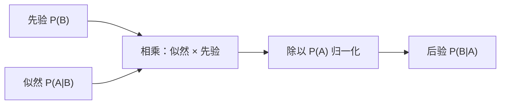

# MATH-302 全概率与贝叶斯公式

## 1. 知识概览

| 项 | 内容 |
|---|---|
| 知识 ID | `MATH-302` |
| 英文名称 | Law of Total Probability and Bayes' Theorem |
| 所属模块 | M-MATH-04 概率论与数理统计 |
| 难度等级 | L3 推导 |
| 前置知识 | [[MATH-301 概率基础与条件概率]] |
| 所属知识体系 | 划分 → 全概率 → 贝叶斯 → 先验/后验 |
| **AI 应用场景** | 朴素贝叶斯分类器、贝叶斯推断、后验概率、生成模型的先验 |
| **预计学习时间** | 60 分钟 |

**为什么学它**：这是**从"证据"反推"原因"**的公式。分类器看到特征 $x$，要判断类别 $y$——求的是 $P(y\mid x)$，而模型能直接估计的往往是 $P(x\mid y)$。贝叶斯公式就是把两者接起来的桥。

## 2. 直观理解

**全概率公式**："把所有可能情况分开算，再加起来"。

- 想知道"任意一个人得病的概率"，可以分成"男性得病 + 女性得病"。

**贝叶斯公式**："看到结果，反推原因"。

- 已知检测阳性（结果），问"真的得病了吗"（原因）。
- **关键直觉**：如果这个病本身极罕见，即使检测很准，阳性里也大部分是**误报**。

生活类比：报警器响了。可能是真火灾，也可能是烤面包冒烟。如果真火灾极罕见，那"响了"更可能是误报——这就是贝叶斯要算的。

## 3. 正式数学定义

**划分**：$B_1,\dots,B_n$ 两两互斥且并为 $\Omega$。

**全概率公式**

$$
P(A) = \sum_{i=1}^{n}P(A\mid B_i)\,P(B_i)
$$

**贝叶斯公式**

$$
P(B_k\mid A) = \frac{P(A\mid B_k)P(B_k)}{\sum_{i}P(A\mid B_i)P(B_i)}
$$

| 术语 | 含义 |
|---|---|
| 先验 $P(B_k)$ | 看到证据前对原因的判断 |
| 似然 $P(A\mid B_k)$ | 该原因下出现证据的可能性 |
| 后验 $P(B_k\mid A)$ | 看到证据后修正的判断 |
| 证据 $P(A)$ | 归一化常数（全概率） |

**贝叶斯更新口诀**

$$
\text{后验} \propto \text{似然} \times \text{先验}
$$

## 4. 数学推导

### 4.1 全概率公式

**起点**：$B_i$ 构成划分，$A$ 可拆成互斥并

$$
A = (A\cap B_1)\cup(A\cap B_2)\cup\cdots\cup(A\cap B_n)
$$

**第 1 步**：这些交集两两互斥（因为 $B_i$ 互斥），故概率可加

$$
P(A) = \sum_i P(A\cap B_i)
$$

**第 2 步**：用乘法公式 $P(A\cap B_i)=P(A\mid B_i)P(B_i)$

$$
P(A) = \sum_i P(A\mid B_i)P(B_i)
$$

**结论**：把"难算的整体概率"拆成"好算的分情况概率"。

### 4.2 贝叶斯公式

**起点**：要求 $P(B_k\mid A)$。

**第 1 步**：由条件概率定义

$$
P(B_k\mid A) = \frac{P(A\cap B_k)}{P(A)}
$$

**第 2 步**：分子用乘法公式

$$
P(A\cap B_k) = P(A\mid B_k)P(B_k)
$$

**第 3 步**：分母用全概率公式

$$
P(A) = \sum_i P(A\mid B_i)P(B_i)
$$

**第 4 步**：合并

$$
P(B_k\mid A) = \frac{P(A\mid B_k)P(B_k)}{\sum_i P(A\mid B_i)P(B_i)}
$$

**结论**：**后验 = 似然 × 先验 / 证据**。分母只是让概率加起来等于 1 的归一化项。

## 5. 几何直观与图解



```text
罕见病检测（患病率 1%，灵敏度 99%，假阳 2%）
         真实    检测
         1%  →  99% 阳性 ┐
                       ├→ 阳性总数 = 2.97%
        99%  →   2% 阳性 ┘
        阳性里真患病 = 0.99% / 2.97% ≈ 33%
```

## 6. 计算示例

**例**：某病患病率 $P(D)=0.01$；检测灵敏度 $P(+\mid D)=0.99$；假阳性率 $P(+\mid \bar D)=0.02$。求阳性时真患病的概率。

**第 1 步**：全概率算 $P(+)$

$$
P(+) = 0.99\times0.01 + 0.02\times0.99 = 0.0099 + 0.0198 = 0.0297
$$

**第 2 步**：贝叶斯

$$
P(D\mid +) = \frac{0.0099}{0.0297} = \frac13 \approx 0.3333
$$

**结论**：即使检测阳性，真正患病的概率也只有 **33%**——因为健康人基数太大，2% 的假阳性产生了大量误报。

**这解释了为什么**：罕见病筛查通常要做**二次检测**，或对高风险人群筛查。

## 7. Python 辅助验证

**依赖**：仅标准库。

```powershell
python math302_bayes.py
```

```python
prior = 0.01          # P(D)
sens = 0.99           # P(+|D)
fpr = 0.02            # P(+|not D)

p_pos = sens * prior + fpr * (1 - prior)
posterior = sens * prior / p_pos

print("P(+):", round(p_pos, 6))
print("P(D|+):", round(posterior, 6))
print("P(not D|+):", round(1 - posterior, 6))
```

**实际运行结果**

```
P(+): 0.0297
P(D|+): 0.333333
P(not D|+): 0.666667
```

**代码解析**

- 分母用全概率公式，两个分支：患病且阳性、健康且阳性。
- 后验 $1/3$，与手算一致。
- `1 - posterior` 是"阳性但健康"的概率，约 $2/3$——**误报占多数**。
- 若把患病率改成 0.3，后验会大幅上升（可自己改 `prior` 观察）。

## 8. 知识关联

| 类型 | 链接 |
|---|---|
| 前置数学 | [[MATH-301 概率基础与条件概率]]、`MATH-501 集合与集合运算`（待建） |
| 后续数学 | [[MATH-303 随机变量与分布函数]]、`MATH-807 贝叶斯分类`（待建）、`MATH-404 最大似然估计`（待建） |
| 相关 Python | [[PY-066 矩阵运算]] |
| 相关机器学习 | 待关联（朴素贝叶斯、后验概率） |
| 相关深度学习 | 待关联（贝叶斯神经网络） |
| 相关大语言模型 | 待关联（贝叶斯推断与先验） |

## 9. 实战练习

**基础 1**：$P(B_1)=0.6$、$P(B_2)=0.4$，$P(A\mid B_1)=0.1$、$P(A\mid B_2)=0.3$，求 $P(A)$。

**基础 2**：上题条件下，求 $P(B_1\mid A)$。

**进阶 1**：两台机器生产同一零件，甲产 60%、次品率 2%；乙产 40%、次品率 5%。取到一个次品，求它来自甲的概率。

**综合 1**：垃圾邮件分类：先验 $P(\text{spam})=0.3$；词"免费"在垃圾邮件中出现概率 0.6，在正常邮件中 0.05。求含"免费"的邮件是垃圾邮件的概率。

## 10. 参考答案

> [!success]- 基础 1
> $$P(A) = 0.1\times0.6 + 0.3\times0.4 = 0.06 + 0.12 = 0.18$$

> [!success]- 基础 2
> $$P(B_1\mid A) = \frac{0.1\times0.6}{0.18} = \frac{0.06}{0.18} = \frac13 \approx 0.3333$$

> [!success]- 进阶 1
> $$P(\text{次品}) = 0.02\times0.6 + 0.05\times0.4 = 0.012 + 0.02 = 0.032$$
>
> $$P(\text{甲}\mid\text{次品}) = \frac{0.012}{0.032} = 0.375$$
>
> **注意**：甲产量高但次品率低，所以次品里甲只占 37.5%。

> [!success]- 综合 1
> $$P(\text{免费}) = 0.6\times0.3 + 0.05\times0.7 = 0.18 + 0.035 = 0.215$$
>
> $$P(\text{spam}\mid\text{免费}) = \frac{0.18}{0.215} \approx 0.8372$$
>
> 与 [[MATH-301 概率基础与条件概率]] 的练习答案一致，可交叉对照。

## 11. 常见错误

| 类型 | 错误表现 | 原因 | 纠正 |
|---|---|---|---|
| 概念错误 | 把 $P(D\mid +)$ 与 $P(+\mid D)$ 混为一谈 | 因果方向颠倒 | 贝叶斯公式换方向 |
| 计算错误 | 分母只算一项 | 漏其他分支 | 全概率要覆盖所有划分 |
| 概念错误 | 忽略先验 | 只看似然 | 罕见事件必须先验修正 |
| 概念错误 | 认为"准确率 99% ⇒ 阳性 99% 患病" | 忽略基率 | 基率谬误 |
| 计算错误 | 后验加起来不等于 1 | 未归一化 | 分母必须用全概率 |

## 12. 学习记录

| 日期 | 状态 | 掌握程度 | 复习状态 | 学习笔记 | 关联练习 |
|---|---|---|---|---|---|
| — | planned | — | — | — | 练习 1–4 |

---

## 🔗 Notion 同步信息

> 以下内容由 Notion「AI Knowledge System · 知识点」数据库按知识 ID 合并而来（导出于 2026-11-09）。

| 属性 | 值 |
|---|---|
| 学科 | 数学 |
| 学习状态 | 未开始 |
| 难度 | L3 推导 |
| 知识类型 | Theorem |

- **所属模块**：[M-MATH-04 概率论与数理统计](../%E8%AF%BE%E7%A8%8B%E6%A8%A1%E5%9D%97/M-MATH-04%20%E6%A6%82%E7%8E%87%E8%AE%BA%E4%B8%8E%E6%95%B0%E7%90%86%E7%BB%9F%E8%AE%A1.md)
- **前置知识**：[MATH-301 概率基础与条件概率](MATH-301%20%E6%A6%82%E7%8E%87%E5%9F%BA%E7%A1%80%E4%B8%8E%E6%9D%A1%E4%BB%B6%E6%A6%82%E7%8E%87.md)
- **后继知识**：[MATH-303 随机变量与分布函数](MATH-303%20%E9%9A%8F%E6%9C%BA%E5%8F%98%E9%87%8F%E4%B8%8E%E5%88%86%E5%B8%83%E5%87%BD%E6%95%B0.md)
- **关联Python**：[PY-066 矩阵运算](../../01_Python%E5%9F%BA%E7%A1%80/08%20NumPy/PY-066%20%E7%9F%A9%E9%98%B5%E8%BF%90%E7%AE%97.md)
- **关联数学**：[MATH-301 概率基础与条件概率](MATH-301%20%E6%A6%82%E7%8E%87%E5%9F%BA%E7%A1%80%E4%B8%8E%E6%9D%A1%E4%BB%B6%E6%A6%82%E7%8E%87.md)
- **被引用为数学**：[MATH-303 随机变量与分布函数](MATH-303%20%E9%9A%8F%E6%9C%BA%E5%8F%98%E9%87%8F%E4%B8%8E%E5%88%86%E5%B8%83%E5%87%BD%E6%95%B0.md) · [ML-027 朴素贝叶斯](../../03_%E6%9C%BA%E5%99%A8%E5%AD%A6%E4%B9%A0/02%20%E7%9B%91%E7%9D%A3%E5%AD%A6%E4%B9%A0/ML-027%20%E6%9C%B4%E7%B4%A0%E8%B4%9D%E5%8F%B6%E6%96%AF.md)
