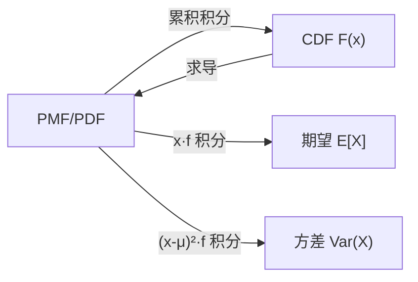

# MATH-303 随机变量与分布函数

## 1. 知识概览

| 项 | 内容 |
|---|---|
| 知识 ID | `MATH-303` |
| 英文名称 | Random Variables and Distribution Functions |
| 所属模块 | M-MATH-04 概率论与数理统计 |
| 难度等级 | L3 推导 |
| 前置知识 | [[MATH-302 全概率与贝叶斯公式]] |
| 所属知识体系 | 随机变量 → PMF/PDF → CDF → 期望与方差 |
| **AI 应用场景** | 模型输出分布、损失函数的期望、采样、正态初始化 |
| **预计学习时间** | 60 分钟 |

**为什么学它**：训练目标常写成"最小化**期望**损失" $\mathbb{E}_{(x,y)\sim D}[\ell]$。不懂随机变量与分布，就看不懂"期望"和"为什么用平均值近似"。

## 2. 直观理解

**随机变量**是把"结果"映射成"数"的函数。

- 掷骰子的结果是"几点"，映射成数字 1–6。
- 抛硬币映射成 1/0。

**分布函数** $F(x)=P(X\le x)$ 回答"不超过 $x$ 的概率有多大"。它像一张**累积成绩单**：每加一个数，概率就往上累。

- 离散型：概率集中在几个点（PMF，柱子）。
- 连续型：概率摊在区间上（PDF，曲线下的面积）。

## 3. 正式数学定义

**随机变量**：定义在样本空间上的实值函数 $X:\Omega\to\mathbb{R}$。

**分布函数（CDF）**

$$
F(x) = P(X\le x)
$$

性质：单调不减、右连续、$F(-\infty)=0$、$F(+\infty)=1$。

**离散型 · 概率质量函数（PMF）**

$$
p(x_i) = P(X=x_i), \qquad \sum_i p(x_i)=1
$$

**连续型 · 概率密度函数（PDF）**

$$
P(a\le X\le b) = \int_a^b f(x)\,dx, \qquad \int_{-\infty}^{+\infty}f(x)\,dx=1
$$

且 $F(x)=\int_{-\infty}^{x}f(t)\,dt$，$F'(x)=f(x)$。

**期望与方差**

$$
\mathbb{E}[X] = \sum_i x_i p(x_i) \quad\text{或}\quad \int x f(x)\,dx
$$

$$
\operatorname{Var}(X) = \mathbb{E}[X^2] - (\mathbb{E}[X])^2
$$

**关键区别**：$f(x)$ **不是**概率。连续型随机变量取单点的概率为 0，只有区间才有概率。

## 4. 数学推导

### 4.1 为什么 $F'(x)=f(x)$

**起点**：$F(x)=\int_{-\infty}^{x}f(t)\,dt$。

**第 1 步**：由微积分基本定理（见 [[MATH-125 定积分与微积分基本定理]]），变上限积分求导

$$
F'(x) = f(x)
$$

**第 2 步**：于是 $P(a<X\le b) = F(b)-F(a) = \int_a^b f(t)\,dt$。

**第 3 步**：特别地，$P(X=x_0)=\int_{x_0}^{x_0}f=0$——**连续型单点概率为零**。

**结论**：密度是"概率的密度"，不是概率本身；要乘区间长度才有概率。

### 4.2 方差公式的展开

**起点**：$\operatorname{Var}(X)=\mathbb{E}[(X-\mu)^2]$，$\mu=\mathbb{E}[X]$。

**第 1 步**：展开平方

$$
(X-\mu)^2 = X^2 - 2\mu X + \mu^2
$$

**第 2 步**：取期望（线性性）

$$
\mathbb{E}[(X-\mu)^2] = \mathbb{E}[X^2] - 2\mu\mathbb{E}[X] + \mu^2
$$

**第 3 步**：代入 $\mathbb{E}[X]=\mu$

$$
= \mathbb{E}[X^2] - 2\mu^2 + \mu^2 = \mathbb{E}[X^2] - \mu^2
$$

**结论**：$\operatorname{Var}(X)=\mathbb{E}[X^2]-(\mathbb{E}[X])^2$。这个形式算起来最方便。

## 5. 几何直观与图解



```text
离散（骰子）            连续（正态）
 P                       f
 │▂ ▂ ▂ ▂ ▂ ▂            │   ╱‾╲
 └─1─2─3─4─5─6           └──╱───╲──
  柱子高 = 概率           面积 = 概率
```

## 6. 计算示例

**例 1**：掷均匀骰子，求 $\mathbb{E}[X]$ 与 $\operatorname{Var}(X)$。

$$
\mathbb{E}[X] = \frac{1+2+3+4+5+6}{6} = 3.5
$$

$$
\mathbb{E}[X^2] = \frac{1+4+9+16+25+36}{6} = \frac{91}{6} \approx 15.1667
$$

$$
\operatorname{Var}(X) = \frac{91}{6} - 3.5^2 = 15.1667 - 12.25 = \frac{35}{12} \approx 2.9167
$$

**例 2**：标准正态 $Z\sim N(0,1)$，求 $P(-1<Z<1)$。

$$
= \Phi(1) - \Phi(-1) \approx 0.8413 - 0.1587 = 0.6827
$$

**例 3**：$P(Z\le1.96)$。

$$
\Phi(1.96) \approx 0.975
$$

这正是 95% 置信区间的来源。

## 7. Python 辅助验证

**依赖**：`math`（用 `math.erf` 算正态 CDF）+ NumPy。

```powershell
python math303_random_variable.py
```

```python
import math

import numpy as np


def normal_cdf(x, mu=0.0, sigma=1.0):
    return 0.5 * (1 + math.erf((x - mu) / (sigma * math.sqrt(2))))


print("Φ(0) =", round(normal_cdf(0), 6))
print("Φ(1.96) =", round(normal_cdf(1.96), 4))
print("P(-1 < Z < 1) =", round(normal_cdf(1) - normal_cdf(-1), 4))

v = np.arange(1, 7)
p = np.full(6, 1 / 6)
E = float((v * p).sum())
V = float(((v**2) * p).sum() - E**2)
print("骰子 E[X] =", round(E, 6), " Var[X] =", round(V, 6))
```

**实际运行结果**

```
Φ(0) = 0.5
Φ(1.96) = 0.975
P(-1 < Z < 1) = 0.6827
骰子 E[X] = 3.5  Var[X] = 2.916667
```

**代码解析**

- `math.erf` 是误差函数，$\Phi(x)=\frac12\left(1+\operatorname{erf}\frac{x}{\sqrt2}\right)$，免装 SciPy。
- $\Phi(1.96)=0.975$ 说明"1.96 倍标准差"对应 95% 双侧区间。
- 骰子期望与方差都是"加权求和"，与手算的 $35/12$ 一致。
- `np.full(6, 1/6)` 体现"等概率"的 PMF。

## 8. 知识关联

| 类型 | 链接 |
|---|---|
| 前置数学 | [[MATH-302 全概率与贝叶斯公式]]、[[MATH-125 定积分与微积分基本定理]]、[[MATH-128 多重积分]] |
| 后续数学 | `MATH-304 常见离散分布`（待建）、`MATH-305 常见连续分布`（待建）、`MATH-306 期望、方差与协方差`（待建） |
| 相关 Python | [[PY-066 矩阵运算]]、[[PY-068 随机数、视图与副本]] |
| 相关机器学习 | 待关联（输出分布、期望损失） |
| 相关深度学习 | 待关联（权重初始化用正态分布） |
| 相关大语言模型 | 待关联（token 概率分布、采样） |

## 9. 实战练习

**基础 1**：随机变量取 0、1、2，概率分别 0.2、0.5、0.3，求 $\mathbb{E}[X]$。

**基础 2**：上题中求 $\operatorname{Var}(X)$。

**进阶 1**：$X\sim N(0,1)$，求 $P(|Z|\le2)$，并说明它大致的百分比。

**综合 1**：某模型输出的预测误差服从 $N(0, 4)$（单位：厘米），求误差超过 3.92 cm 的概率（提示：$1.96\times2$）。

## 10. 参考答案

> [!success]- 基础 1
> $$\mathbb{E}[X] = 0\times0.2 + 1\times0.5 + 2\times0.3 = 1.1$$

> [!success]- 基础 2
> $$\mathbb{E}[X^2] = 0\times0.2 + 1\times0.5 + 4\times0.3 = 1.7$$
>
> $$\operatorname{Var}(X) = 1.7 - 1.1^2 = 0.49$$

> [!success]- 进阶 1
> $$P(-2\le Z\le2) = \Phi(2)-\Phi(-2) \approx 0.9772 - 0.0228 = 0.9544$$
>
> 约 **95.4%**，这就是"2σ 原则"。

> [!success]- 综合 1
> $\sigma = 2$，$3.92 = 1.96\sigma$。
>
> $$P(|X|>3.92) = 1 - P(|X|\le3.92) = 1 - 0.95 = 0.05$$
>
> 即约 **5%**。这就是"5% 显著性水平"的直观来源。

## 11. 常见错误

| 类型 | 错误表现 | 原因 | 纠正 |
|---|---|---|---|
| 概念错误 | 认为 $f(x)$ 是概率 | 密度≠概率 | 要积分才有概率 |
| 概念错误 | 认为连续型有 $P(X=x)>0$ | 单点概率为 0 | 只有区间有概率 |
| 公式错误 | 方差写成 $\mathbb{E}[X^2]-(\mathbb{E}[X])^2$ 的变体 | 记混 | 是 $E[X^2]-\mu^2$ |
| 计算错误 | PMF 之和不为 1 | 未校验 | 先检查归一化 |
| 概念错误 | 正态分布参数 $\sigma$ 当方差 | 混淆 | $\sigma$ 是标准差，方差 $\sigma^2$ |

## 12. 学习记录

| 日期 | 状态 | 掌握程度 | 复习状态 | 学习笔记 | 关联练习 |
|---|---|---|---|---|---|
| — | planned | — | — | — | 练习 1–4 |

---

## 🔗 Notion 同步信息

> 以下内容由 Notion「AI Knowledge System · 知识点」数据库按知识 ID 合并而来（导出于 2026-11-09）。

| 属性 | 值 |
|---|---|
| 学科 | 数学 |
| 学习状态 | 未开始 |
| 难度 | L3 推导 |
| 知识类型 | Concept |

- **所属模块**：[M-MATH-04 概率论与数理统计](../%E8%AF%BE%E7%A8%8B%E6%A8%A1%E5%9D%97/M-MATH-04%20%E6%A6%82%E7%8E%87%E8%AE%BA%E4%B8%8E%E6%95%B0%E7%90%86%E7%BB%9F%E8%AE%A1.md)
- **前置知识**：[MATH-302 全概率与贝叶斯公式](MATH-302%20%E5%85%A8%E6%A6%82%E7%8E%87%E4%B8%8E%E8%B4%9D%E5%8F%B6%E6%96%AF%E5%85%AC%E5%BC%8F.md)
- **后继知识**：[MATH-304 常见离散分布](MATH-304%20%E5%B8%B8%E8%A7%81%E7%A6%BB%E6%95%A3%E5%88%86%E5%B8%83.md)
- **关联Python**：[PY-066 矩阵运算](../../01_Python%E5%9F%BA%E7%A1%80/08%20NumPy/PY-066%20%E7%9F%A9%E9%98%B5%E8%BF%90%E7%AE%97.md)
- **关联数学**：[MATH-302 全概率与贝叶斯公式](MATH-302%20%E5%85%A8%E6%A6%82%E7%8E%87%E4%B8%8E%E8%B4%9D%E5%8F%B6%E6%96%AF%E5%85%AC%E5%BC%8F.md)
- **被引用为数学**：[MATH-304 常见离散分布](MATH-304%20%E5%B8%B8%E8%A7%81%E7%A6%BB%E6%95%A3%E5%88%86%E5%B8%83.md)
