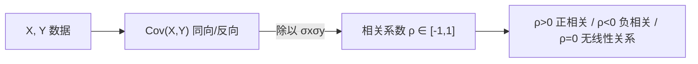

# MATH-306 期望、方差与协方差

## 1. 知识概览

| 项 | 内容 |
|---|---|
| 知识 ID | `MATH-306` |
| 英文名称 | Expectation, Variance and Covariance |
| 所属模块 | M-MATH-04 概率论与数理统计 |
| 难度等级 | L3 推导 |
| 前置知识 | [[MATH-305 常见连续分布与正态分布]] |
| 所属知识体系 | 期望 → 方差 → 协方差 → 相关系数 |
| **AI 应用场景** | 损失函数的期望、梯度估计的方差（影响训练稳定）、特征相关性与共线性 |
| **预计学习时间** | 55 分钟 |

**为什么学它**：训练用**小批量**估计梯度——这是"无偏估计量"，但**方差**决定它抖不抖。批量越大方差越小，这就是为什么 batch size 影响训练稳定性。协方差则告诉我们特征之间是否在传递重复信息。

## 2. 直观理解

- **期望**：长期平均值。掷骰子的期望 3.5，不是任何一次的结果。
- **方差**：波动大小。方差大 = 结果上下跳得厉害。
- **协方差**：两个变量"一起变"的程度。正 = 同向，负 = 反向，0 = 无线性关系。
- **相关系数**：把协方差标准化到 $[-1,1]$，去掉量纲影响。

生活类比：射击成绩。期望是"弹着中心"，方差是"散布范围"。协方差是"两个射手的弹着点是否同步移动"。

## 3. 正式数学定义

**期望**

$$
\mathbb{E}[X] = \sum_i x_i p(x_i) \quad\text{或}\quad \int x f(x)\,dx
$$

**期望的线性性**（无需独立）

$$
\mathbb{E}[aX+bY] = a\mathbb{E}[X] + b\mathbb{E}[Y]
$$

**方差**

$$
\operatorname{Var}(X) = \mathbb{E}[(X-\mu)^2] = \mathbb{E}[X^2] - (\mathbb{E}[X])^2
$$

**协方差**

$$
\operatorname{Cov}(X,Y) = \mathbb{E}[(X-\mu_X)(Y-\mu_Y)] = \mathbb{E}[XY] - \mathbb{E}[X]\mathbb{E}[Y]
$$

**相关系数**

$$
\rho_{XY} = \frac{\operatorname{Cov}(X,Y)}{\sigma_X\sigma_Y} \in [-1,1]
$$

**方差的和公式**

$$
\operatorname{Var}(X+Y) = \operatorname{Var}(X)+\operatorname{Var}(Y)+2\operatorname{Cov}(X,Y)
$$

**独立 ⇒ 不相关**（$\operatorname{Cov}=0$），但**反过来不成立**。

## 4. 数学推导

### 4.1 协方差的展开

**起点**：$\operatorname{Cov}(X,Y)=\mathbb{E}[(X-\mu_X)(Y-\mu_Y)]$。

**第 1 步**：展开乘积

$$
(X-\mu_X)(Y-\mu_Y) = XY - \mu_YX - \mu_XY + \mu_X\mu_Y
$$

**第 2 步**：取期望，用线性性

$$
\mathbb{E}[XY] - \mu_Y\mathbb{E}[X] - \mu_X\mathbb{E}[Y] + \mu_X\mu_Y
$$

**第 3 步**：代入 $\mathbb{E}[X]=\mu_X$、$\mathbb{E}[Y]=\mu_Y$

$$
= \mathbb{E}[XY] - \mu_X\mu_Y - \mu_X\mu_Y + \mu_X\mu_Y = \mathbb{E}[XY]-\mu_X\mu_Y
$$

**结论**：$\operatorname{Cov}(X,Y)=\mathbb{E}[XY]-\mathbb{E}[X]\mathbb{E}[Y]$。

### 4.2 为什么 $\operatorname{Var}(X+Y)$ 多出 $2\operatorname{Cov}$

**起点**：

$$
X+Y - (\mu_X+\mu_Y) = (X-\mu_X) + (Y-\mu_Y)
$$

**第 1 步**：平方

$$
[(X-\mu_X)+(Y-\mu_Y)]^2 = (X-\mu_X)^2 + (Y-\mu_Y)^2 + 2(X-\mu_X)(Y-\mu_Y)
$$

**第 2 步**：取期望

$$
\operatorname{Var}(X+Y) = \operatorname{Var}(X)+\operatorname{Var}(Y)+2\operatorname{Cov}(X,Y)
$$

**结论**：**只有不相关时方差才可加**。这也解释了"独立同分布样本的均值方差 = $\sigma^2/n$"——交叉项全为 0。

## 5. 几何直观与图解



```text
正相关 ρ≈0.9      无相关 ρ≈0        负相关 ρ≈-0.9
   ╱                · ·  ·             ╲
  ╱              ·   ·  ·               ╲
 ╱                ·  · ·                 ╲
```

## 6. 计算示例

**例 1**：掷骰子，$\mathbb{E}[X]=3.5$，$\operatorname{Var}(X)=35/12\approx2.9167$。

**例 2**：若 $Y=X+N$，$N$ 与 $X$ 独立，求 $\operatorname{Cov}(X,Y)$。

$$
\operatorname{Cov}(X,Y) = \operatorname{Cov}(X,X)+\operatorname{Cov}(X,N) = \operatorname{Var}(X)+0
$$

**例 3**：上例中 $\operatorname{Var}(Y)=\operatorname{Var}(X)+\operatorname{Var}(N)$，所以

$$
\operatorname{Var}(X+Y) = \operatorname{Var}(X) + [\operatorname{Var}(X)+\operatorname{Var}(N)] + 2\operatorname{Var}(X)
$$

**例 4**：模拟验证（10 万样本）。

| 量 | 模拟值 | 理论值 |
|---|---|---|
| $\mathbb{E}[X]$ | 3.498 | 3.5 |
| $\operatorname{Var}(X)$ | 2.9103 | 2.9167 |
| $\operatorname{Cov}(X,Y)$ | 2.9107 | 2.9167 |

## 7. Python 辅助验证

**依赖**：NumPy 2.5.4。

```powershell
python math306_moments.py
```

```python
import numpy as np

rng = np.random.default_rng(0)
x = rng.integers(1, 7, size=100000)
y = x + rng.normal(0, 1, size=100000)

print("E[X] ≈", round(float(x.mean()), 4), "（理论 3.5）")
print("Var[X] ≈", round(float(x.var()), 4), "（理论 2.9167）")
print("Cov(X,Y) ≈", round(float(np.cov(x, y)[0, 1]), 4))
print("Corr(X,Y) ≈", round(float(np.corrcoef(x, y)[0, 1]), 4))
print("Var(X+Y) ≈", round(float((x + y).var()), 4))
```

**实际运行结果**

```
E[X] ≈ 3.498 （理论 3.5）
Var[X] ≈ 2.9103 （理论 2.9167）
Cov(X,Y) ≈ 2.9107
Corr(X,Y) ≈ 0.8625
Var(X+Y) ≈ 12.6448
```

**代码解析**

- 模拟值与理论值的差约 $10^{-3}$，符合 $1/\sqrt{n}$ 量级的抽样误差。
- `Cov(X,Y)≈2.9107` 约等于 $\operatorname{Var}(X)$，因为 $Y=X+N$ 且 $N$ 独立。
- 相关系数 0.8625 小于 1，说明 $Y$ 里还混着噪声 $N$。
- `Var(X+Y)` 明显大于两者方差之和，因为交叉项 $2\operatorname{Cov}$ 不为 0。

## 8. 知识关联

| 类型 | 链接 |
|---|---|
| 前置数学 | [[MATH-305 常见连续分布与正态分布]]、[[MATH-303 随机变量与分布函数]] |
| 后续数学 | [[MATH-401 大数定律与中心极限定理]]、[[MATH-402 参数估计]]、[[MATH-451 最小二乘与回归统计]] |
| 相关 Python | [[PY-067 聚合与统计]]、[[PY-068 随机数、视图与副本]] |
| 相关机器学习 | 待关联（梯度估计方差、特征共线性） |
| 相关深度学习 | 待关联（batch size 与梯度噪声） |
| 相关大语言模型 | 待关联（梯度累积与方差） |

## 9. 实战练习

**基础 1**：$X$ 取 1、2、3，概率各 $1/3$，求 $\mathbb{E}[X]$ 与 $\operatorname{Var}(X)$。

**基础 2**：已知 $\operatorname{Var}(X)=4$、$\operatorname{Var}(Y)=9$、$\operatorname{Cov}(X,Y)=3$，求 $\operatorname{Var}(X+Y)$。

**进阶 1**：$\rho_{XY}=0.8$，$\sigma_X=2$、$\sigma_Y=5$，求 $\operatorname{Cov}(X,Y)$。

**综合 1**：为什么"独立一定不相关，但不相关不一定独立"？举一个反例。

## 10. 参考答案

> [!success]- 基础 1
> $$\mathbb{E}[X] = \frac{1+2+3}{3} = 2,\qquad \mathbb{E}[X^2]=\frac{1+4+9}{3}=\frac{14}{3}$$
>
> $$\operatorname{Var}(X) = \frac{14}{3}-4 = \frac23 \approx 0.6667$$

> [!success]- 基础 2
> $$\operatorname{Var}(X+Y) = 4+9+2\times3 = 19$$

> [!success]- 进阶 1
> $$\operatorname{Cov}(X,Y) = \rho\,\sigma_X\sigma_Y = 0.8\times2\times5 = 8$$

> [!success]- 综合 1
> 独立意味着联合分布等于边缘分布之积，此时 $\mathbb{E}[XY]=\mathbb{E}[X]\mathbb{E}[Y]$，所以协方差必为 0。
>
> 反例：$X\sim U(-1,1)$，$Y=X^2$。$Y$ 完全由 $X$ 决定，但
>
> $$\operatorname{Cov}(X,Y)=\mathbb{E}[X^3]-\mathbb{E}[X]\mathbb{E}[X^2]=0-0=0$$
>
> 协方差为 0，但两者**明显不独立**（$Y$ 是 $X$ 的函数）。协方差只捕捉**线性**关系。

## 11. 常见错误

| 类型 | 错误表现 | 原因 | 纠正 |
|---|---|---|---|
| 概念错误 | 认为不相关=独立 | 只说明无线性关系 | 独立更强 |
| 公式错误 | $\operatorname{Var}(X+Y)=\operatorname{Var}X+\operatorname{Var}Y$ 无条件用 | 漏协方差项 | 加 $2\operatorname{Cov}$ |
| 概念错误 | 把 $\mathbb{E}[XY]=\mathbb{E}[X]\mathbb{E}[Y]$ 当恒等式 | 只在独立时成立 | 需独立性 |
| 计算错误 | 相关系数超过 1 | 算错 | 必在 $[-1,1]$ |
| 概念错误 | 用样本方差时除以 $n$ 却当无偏 | 有偏估计 | 无偏用 $n-1$ |

## 12. 学习记录

| 日期 | 状态 | 掌握程度 | 复习状态 | 学习笔记 | 关联练习 |
|---|---|---|---|---|---|
| — | planned | — | — | — | 练习 1–4 |

---

## 🔗 Notion 同步信息

> 以下内容由 Notion「AI Knowledge System · 知识点」数据库按知识 ID 合并而来（导出于 2026-11-09）。

| 属性 | 值 |
|---|---|
| 学科 | 数学 |
| 学习状态 | 未开始 |
| 难度 | L3 推导 |
| 知识类型 | Concept |

- **所属模块**：[M-MATH-04 概率论与数理统计](../%E8%AF%BE%E7%A8%8B%E6%A8%A1%E5%9D%97/M-MATH-04%20%E6%A6%82%E7%8E%87%E8%AE%BA%E4%B8%8E%E6%95%B0%E7%90%86%E7%BB%9F%E8%AE%A1.md)
- **前置知识**：[MATH-305 常见连续分布与正态分布](MATH-305%20%E5%B8%B8%E8%A7%81%E8%BF%9E%E7%BB%AD%E5%88%86%E5%B8%83%E4%B8%8E%E6%AD%A3%E6%80%81%E5%88%86%E5%B8%83.md)
- **后继知识**：[MATH-401 大数定律与中心极限定理](../04%20%E6%95%B0%E7%90%86%E7%BB%9F%E8%AE%A1/MATH-401%20%E5%A4%A7%E6%95%B0%E5%AE%9A%E5%BE%8B%E4%B8%8E%E4%B8%AD%E5%BF%83%E6%9E%81%E9%99%90%E5%AE%9A%E7%90%86.md)
- **关联Python**：[PY-067 聚合与统计](../../01_Python%E5%9F%BA%E7%A1%80/08%20NumPy/PY-067%20%E8%81%9A%E5%90%88%E4%B8%8E%E7%BB%9F%E8%AE%A1.md)
- **关联数学**：[MATH-305 常见连续分布与正态分布](MATH-305%20%E5%B8%B8%E8%A7%81%E8%BF%9E%E7%BB%AD%E5%88%86%E5%B8%83%E4%B8%8E%E6%AD%A3%E6%80%81%E5%88%86%E5%B8%83.md)
- **被引用为数学**：[MATH-401 大数定律与中心极限定理](../04%20%E6%95%B0%E7%90%86%E7%BB%9F%E8%AE%A1/MATH-401%20%E5%A4%A7%E6%95%B0%E5%AE%9A%E5%BE%8B%E4%B8%8E%E4%B8%AD%E5%BF%83%E6%9E%81%E9%99%90%E5%AE%9A%E7%90%86.md) · [ML-007 经验风险与泛化能力](../../03_%E6%9C%BA%E5%99%A8%E5%AD%A6%E4%B9%A0/01%20%E6%9C%BA%E5%99%A8%E5%AD%A6%E4%B9%A0%E5%9F%BA%E7%A1%80/ML-007%20%E7%BB%8F%E9%AA%8C%E9%A3%8E%E9%99%A9%E4%B8%8E%E6%B3%9B%E5%8C%96%E8%83%BD%E5%8A%9B.md) · [ML-011 缺失值处理](../../03_%E6%9C%BA%E5%99%A8%E5%AD%A6%E4%B9%A0/05%20%E7%89%B9%E5%BE%81%E5%B7%A5%E7%A8%8B/ML-011%20%E7%BC%BA%E5%A4%B1%E5%80%BC%E5%A4%84%E7%90%86.md) · [ML-012 异常值识别与处理](../../03_%E6%9C%BA%E5%99%A8%E5%AD%A6%E4%B9%A0/05%20%E7%89%B9%E5%BE%81%E5%B7%A5%E7%A8%8B/ML-012%20%E5%BC%82%E5%B8%B8%E5%80%BC%E8%AF%86%E5%88%AB%E4%B8%8E%E5%A4%84%E7%90%86.md) · [ML-014 数值特征标准化与归一化](../../03_%E6%9C%BA%E5%99%A8%E5%AD%A6%E4%B9%A0/05%20%E7%89%B9%E5%BE%81%E5%B7%A5%E7%A8%8B/ML-014%20%E6%95%B0%E5%80%BC%E7%89%B9%E5%BE%81%E6%A0%87%E5%87%86%E5%8C%96%E4%B8%8E%E5%BD%92%E4%B8%80%E5%8C%96.md) · [ML-023 回归评价指标与残差诊断](../../03_%E6%9C%BA%E5%99%A8%E5%AD%A6%E4%B9%A0/02%20%E7%9B%91%E7%9D%A3%E5%AD%A6%E4%B9%A0/ML-023%20%E5%9B%9E%E5%BD%92%E8%AF%84%E4%BB%B7%E6%8C%87%E6%A0%87%E4%B8%8E%E6%AE%8B%E5%B7%AE%E8%AF%8A%E6%96%AD.md) · [ML-032 类别不平衡处理](../../03_%E6%9C%BA%E5%99%A8%E5%AD%A6%E4%B9%A0/02%20%E7%9B%91%E7%9D%A3%E5%AD%A6%E4%B9%A0/ML-032%20%E7%B1%BB%E5%88%AB%E4%B8%8D%E5%B9%B3%E8%A1%A1%E5%A4%84%E7%90%86.md) · [ML-034 K-Means 聚类](../../03_%E6%9C%BA%E5%99%A8%E5%AD%A6%E4%B9%A0/03%20%E6%97%A0%E7%9B%91%E7%9D%A3%E5%AD%A6%E4%B9%A0/ML-034%20K-Means%20%E8%81%9A%E7%B1%BB.md) · [ML-039 异常检测](../../03_%E6%9C%BA%E5%99%A8%E5%AD%A6%E4%B9%A0/03%20%E6%97%A0%E7%9B%91%E7%9D%A3%E5%AD%A6%E4%B9%A0/ML-039%20%E5%BC%82%E5%B8%B8%E6%A3%80%E6%B5%8B.md) · [ML-044 ROC 曲线与 AUC](../../03_%E6%9C%BA%E5%99%A8%E5%AD%A6%E4%B9%A0/04%20%E6%A8%A1%E5%9E%8B%E8%AF%84%E4%BC%B0/ML-044%20ROC%20%E6%9B%B2%E7%BA%BF%E4%B8%8E%20AUC.md) · [ML-045 PR 曲线与阈值选择](../../03_%E6%9C%BA%E5%99%A8%E5%AD%A6%E4%B9%A0/04%20%E6%A8%A1%E5%9E%8B%E8%AF%84%E4%BC%B0/ML-045%20PR%20%E6%9B%B2%E7%BA%BF%E4%B8%8E%E9%98%88%E5%80%BC%E9%80%89%E6%8B%A9.md) · [ML-046 过拟合与欠拟合](../../03_%E6%9C%BA%E5%99%A8%E5%AD%A6%E4%B9%A0/04%20%E6%A8%A1%E5%9E%8B%E8%AF%84%E4%BC%B0/ML-046%20%E8%BF%87%E6%8B%9F%E5%90%88%E4%B8%8E%E6%AC%A0%E6%8B%9F%E5%90%88.md) · [ML-047 偏差-方差权衡与学习曲线](../../03_%E6%9C%BA%E5%99%A8%E5%AD%A6%E4%B9%A0/04%20%E6%A8%A1%E5%9E%8B%E8%AF%84%E4%BC%B0/ML-047%20%E5%81%8F%E5%B7%AE-%E6%96%B9%E5%B7%AE%E6%9D%83%E8%A1%A1%E4%B8%8E%E5%AD%A6%E4%B9%A0%E6%9B%B2%E7%BA%BF.md) · [ML-050 集成学习基本思想](../../03_%E6%9C%BA%E5%99%A8%E5%AD%A6%E4%B9%A0/06%20%E6%A8%A1%E5%9E%8B%E4%BC%98%E5%8C%96/ML-050%20%E9%9B%86%E6%88%90%E5%AD%A6%E4%B9%A0%E5%9F%BA%E6%9C%AC%E6%80%9D%E6%83%B3.md) · [ML-051 Bagging 与随机森林](../../03_%E6%9C%BA%E5%99%A8%E5%AD%A6%E4%B9%A0/06%20%E6%A8%A1%E5%9E%8B%E4%BC%98%E5%8C%96/ML-051%20Bagging%20%E4%B8%8E%E9%9A%8F%E6%9C%BA%E6%A3%AE%E6%9E%97.md) · [ML-052 Extra Trees](../../03_%E6%9C%BA%E5%99%A8%E5%AD%A6%E4%B9%A0/06%20%E6%A8%A1%E5%9E%8B%E4%BC%98%E5%8C%96/ML-052%20Extra%20Trees.md) · [ML-056 Stacking 与 Voting](../../03_%E6%9C%BA%E5%99%A8%E5%AD%A6%E4%B9%A0/06%20%E6%A8%A1%E5%9E%8B%E4%BC%98%E5%8C%96/ML-056%20Stacking%20%E4%B8%8E%20Voting.md) · [ML-064 模型监控与常见问题](../../03_%E6%9C%BA%E5%99%A8%E5%AD%A6%E4%B9%A0/07%20%E5%B7%A5%E7%A8%8B%E5%AE%9E%E8%B7%B5/ML-064%20%E6%A8%A1%E5%9E%8B%E7%9B%91%E6%8E%A7%E4%B8%8E%E5%B8%B8%E8%A7%81%E9%97%AE%E9%A2%98.md) · [DL-015 均方误差 MSE](../../04_%E6%B7%B1%E5%BA%A6%E5%AD%A6%E4%B9%A0/01%20%E7%A5%9E%E7%BB%8F%E7%BD%91%E7%BB%9C%E5%9F%BA%E7%A1%80/DL-015%20%E5%9D%87%E6%96%B9%E8%AF%AF%E5%B7%AE%20MSE.md) · [DL-030 权重初始化：Xavier 与 He](../../04_%E6%B7%B1%E5%BA%A6%E5%AD%A6%E4%B9%A0/05%20%E8%AE%AD%E7%BB%83%E6%8A%80%E5%B7%A7/DL-030%20%E6%9D%83%E9%87%8D%E5%88%9D%E5%A7%8B%E5%8C%96%E2%80%94%E2%80%94Xavier%20%E4%B8%8E%20He.md) · [DL-033 偏差-方差与泛化能力](../../04_%E6%B7%B1%E5%BA%A6%E5%AD%A6%E4%B9%A0/05%20%E8%AE%AD%E7%BB%83%E6%8A%80%E5%B7%A7/DL-033%20%E5%81%8F%E5%B7%AE-%E6%96%B9%E5%B7%AE%E4%B8%8E%E6%B3%9B%E5%8C%96%E8%83%BD%E5%8A%9B.md) · [DL-035 Dropout](../../04_%E6%B7%B1%E5%BA%A6%E5%AD%A6%E4%B9%A0/05%20%E8%AE%AD%E7%BB%83%E6%8A%80%E5%B7%A7/DL-035%20Dropout.md) · [DL-036 Batch Normalization](../../04_%E6%B7%B1%E5%BA%A6%E5%AD%A6%E4%B9%A0/05%20%E8%AE%AD%E7%BB%83%E6%8A%80%E5%B7%A7/DL-036%20Batch%20Normalization.md) · [DL-037 Layer Normalization 与 BN 的区别](../../04_%E6%B7%B1%E5%BA%A6%E5%AD%A6%E4%B9%A0/05%20%E8%AE%AD%E7%BB%83%E6%8A%80%E5%B7%A7/DL-037%20Layer%20Normalization%20%E4%B8%8E%20BN%20%E7%9A%84%E5%8C%BA%E5%88%AB.md) · [DL-065 数据管道与预处理工程](../../04_%E6%B7%B1%E5%BA%A6%E5%AD%A6%E4%B9%A0/07%20%E5%B7%A5%E7%A8%8B%E4%B8%8E%E9%A1%B9%E7%9B%AE/DL-065%20%E6%95%B0%E6%8D%AE%E7%AE%A1%E9%81%93%E4%B8%8E%E9%A2%84%E5%A4%84%E7%90%86%E5%B7%A5%E7%A8%8B.md) · [LLM-013 点积注意力与 Scaled Dot-Product Attention](../../05_%E5%A4%A7%E8%AF%AD%E8%A8%80%E6%A8%A1%E5%9E%8B/03%20Attention%E6%9C%BA%E5%88%B6/LLM-013%20%E7%82%B9%E7%A7%AF%E6%B3%A8%E6%84%8F%E5%8A%9B%E4%B8%8E%20Scaled%20Dot-Product%20Attention.md) · [LLM-025 残差、LayerNorm 与 Pre-LN/Post-LN](../../05_%E5%A4%A7%E8%AF%AD%E8%A8%80%E6%A8%A1%E5%9E%8B/04%20Transformer%E6%9E%B6%E6%9E%84/LLM-025%20%E6%AE%8B%E5%B7%AE%E3%80%81LayerNorm%20%E4%B8%8E%20Pre-LN%E3%80%81Post-LN.md) · [LLM-037 语义空间与相似度](../../05_%E5%A4%A7%E8%AF%AD%E8%A8%80%E6%A8%A1%E5%9E%8B/02%20Token%E4%B8%8EEmbedding/LLM-037%20%E8%AF%AD%E4%B9%89%E7%A9%BA%E9%97%B4%E4%B8%8E%E7%9B%B8%E4%BC%BC%E5%BA%A6.md) · [LLM-094 量化：INT8、INT4 与 GPTQ](../../05_%E5%A4%A7%E8%AF%AD%E8%A8%80%E6%A8%A1%E5%9E%8B/06%20%E6%8E%A8%E7%90%86%E4%B8%8E%E9%83%A8%E7%BD%B2/LLM-094%20%E9%87%8F%E5%8C%96%EF%BC%9AINT8%E3%80%81INT4%20%E4%B8%8E%20GPTQ.md) · [LLM-076 RAG 的基本架构](../../05_%E5%A4%A7%E8%AF%AD%E8%A8%80%E6%A8%A1%E5%9E%8B/07%20RAG%E4%B8%8EAgent/LLM-076%20RAG%20%E7%9A%84%E5%9F%BA%E6%9C%AC%E6%9E%B6%E6%9E%84.md) · [LLM-078 向量化与嵌入模型](../../05_%E5%A4%A7%E8%AF%AD%E8%A8%80%E6%A8%A1%E5%9E%8B/07%20RAG%E4%B8%8EAgent/LLM-078%20%E5%90%91%E9%87%8F%E5%8C%96%E4%B8%8E%E5%B5%8C%E5%85%A5%E6%A8%A1%E5%9E%8B.md) · [LLM-079 向量检索与相似度索引](../../05_%E5%A4%A7%E8%AF%AD%E8%A8%80%E6%A8%A1%E5%9E%8B/07%20RAG%E4%B8%8EAgent/LLM-079%20%E5%90%91%E9%87%8F%E6%A3%80%E7%B4%A2%E4%B8%8E%E7%9B%B8%E4%BC%BC%E5%BA%A6%E7%B4%A2%E5%BC%95.md) · [LLM-080 混合检索：BM25 与向量](../../05_%E5%A4%A7%E8%AF%AD%E8%A8%80%E6%A8%A1%E5%9E%8B/07%20RAG%E4%B8%8EAgent/LLM-080%20%E6%B7%B7%E5%90%88%E6%A3%80%E7%B4%A2%EF%BC%9ABM25%20%E4%B8%8E%E5%90%91%E9%87%8F.md) · [LLM-083 RAG 的评估](../../05_%E5%A4%A7%E8%AF%AD%E8%A8%80%E6%A8%A1%E5%9E%8B/07%20RAG%E4%B8%8EAgent/LLM-083%20RAG%20%E7%9A%84%E8%AF%84%E4%BC%B0.md) · [LLM-087 Agent 的规划、记忆与多步执行](../../05_%E5%A4%A7%E8%AF%AD%E8%A8%80%E6%A8%A1%E5%9E%8B/07%20RAG%E4%B8%8EAgent/LLM-087%20Agent%20%E7%9A%84%E8%A7%84%E5%88%92%E3%80%81%E8%AE%B0%E5%BF%86%E4%B8%8E%E5%A4%9A%E6%AD%A5%E6%89%A7%E8%A1%8C.md) · [PY-067 聚合与统计](../../01_Python%E5%9F%BA%E7%A1%80/08%20NumPy/PY-067%20%E8%81%9A%E5%90%88%E4%B8%8E%E7%BB%9F%E8%AE%A1.md)
