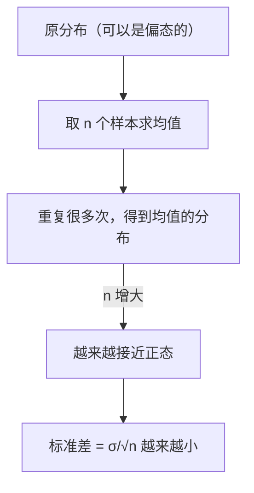

# MATH-401 大数定律与中心极限定理

## 1. 知识概览

| 项 | 内容 |
|---|---|
| 知识 ID | `MATH-401` |
| 英文名称 | Law of Large Numbers and the Central Limit Theorem |
| 所属模块 | M-MATH-04 概率论与数理统计 |
| 难度等级 | L3 推导 |
| 前置知识 | [[MATH-306 期望、方差与协方差]] |
| 所属知识体系 | 样本均值 → 大数定律 → 中心极限定理 |
| **AI 应用场景** | 为什么小批量梯度能估计全量梯度、为什么均值可用、置信区间与显著性 |
| **预计学习时间** | 55 分钟 |

**为什么学它**：整个训练过程就是"**用样本估计总体**"。大数定律保证估计会收敛，中心极限定理告诉你**误差有多大、分布长什么样**——两者是"为什么能训练"和"训练有多准"的数学回答。

## 2. 直观理解

**大数定律**：样本越多，**平均值越接近真实期望**。抛 10 次硬币可能 7 正，抛 10 万次就非常接近 50%。

**中心极限定理**：不管原始分布长什么样（均匀、指数、偏态），**样本均值的分布**在样本量足够大时都近似**正态**。

生活类比：一次考试有随机性（大数定律说多考几次平均分稳定），而"平均分的波动范围"是钟形的（中心极限定理）。

## 3. 正式数学定义

**样本均值**：$X_1,\dots,X_n$ i.i.d.，$\mathbb{E}[X_i]=\mu$，$\operatorname{Var}(X_i)=\sigma^2$

$$
\bar{X}_n = \frac1n\sum_{i=1}^{n}X_i
$$

**弱大数定律（WLLN）**：对任意 $\varepsilon>0$

$$
\lim_{n\to\infty}P\left(|\bar{X}_n-\mu|<\varepsilon\right) = 1
$$

**中心极限定理（CLT）**：当 $n\to\infty$

$$
\frac{\bar{X}_n-\mu}{\sigma/\sqrt{n}} \xrightarrow{d} N(0,1)
$$

等价地，$\bar{X}_n$ 近似 $\sim N\!\left(\mu, \dfrac{\sigma^2}{n}\right)$。

**标准误**：$\operatorname{SE} = \dfrac{\sigma}{\sqrt{n}}$——注意它是 $\sqrt{n}$ 速度下降，**样本增 4 倍，误差减半**。

## 4. 数学推导

### 4.1 样本均值的期望与方差

**起点**：$\bar X_n=\frac1n\sum X_i$。

**第 1 步**：期望（线性性，不需独立）

$$
\mathbb{E}[\bar X_n] = \frac1n\sum\mathbb{E}[X_i] = \frac1n\cdot n\mu = \mu
$$

**第 2 步**：方差（需独立，交叉项为 0）

$$
\operatorname{Var}(\bar X_n) = \frac{1}{n^2}\sum\operatorname{Var}(X_i) = \frac{n\sigma^2}{n^2} = \frac{\sigma^2}{n}
$$

**第 3 步**：标准差

$$
\sigma_{\bar X} = \frac{\sigma}{\sqrt{n}}
$$

**结论**：均值无偏（期望等于 $\mu$），且方差随 $n$ 下降——这是大数定律的核心机制。

### 4.2 CLT 为什么是正态（思路）

**起点**：设 $Z_i=(X_i-\mu)/\sigma$，标准化后 $\mathbb{E}[Z_i]=0$、$\operatorname{Var}(Z_i)=1$。

**第 1 步**：$\sqrt{n}(\bar X_n-\mu)/\sigma = \frac{1}{\sqrt n}\sum Z_i$。

**第 2 步**：用**特征函数**（或矩母函数）$\varphi_Z(t)=\mathbb{E}[e^{itZ}]$，在 0 附近展开

$$
\varphi_Z(t) = 1 - \frac{t^2}{2} + o(t^2)
$$

**第 3 步**：独立和的特征函数是乘积

$$
\varphi_{\frac{1}{\sqrt n}\sum Z_i}(t) = \left[\varphi_Z\left(\frac{t}{\sqrt n}\right)\right]^n
= \left[1-\frac{t^2}{2n}+o(1/n)\right]^n
$$

**第 4 步**：取极限（用 $(1+a/n)^n\to e^a$）

$$
\to e^{-t^2/2}
$$

**第 5 步**：$e^{-t^2/2}$ 正是标准正态的特征函数。

**结论**：无论原始分布形状，标准化后的样本均值收敛到标准正态。**唯一要求**：方差有限。

## 5. 几何直观与图解



```text
n=10:  窄而抖
n=100: 更集中在 μ 附近
n=1000:极窄，几乎钉在 μ 上
```

## 6. 计算示例

**例**：总体服从 $\text{Exp}(0.5)$，$\mu=2$、$\sigma^2=4$。

由 CLT，$n=100$ 时

$$
\bar X \approx N\!\left(2, \frac{4}{100}\right) = N(2, 0.04),\quad \operatorname{SE}=0.2
$$

**验证**：模拟 3000 次，$n=100$ 时均值的标准差：

| $n$ | 模拟 $\sigma_{\bar X}$ | 理论 $\sigma/\sqrt n$ |
|---|---|---|
| 10 | 0.6157 | 0.6325 |
| 100 | 0.1999 | 0.2 |
| 1000 | 0.0632 | 0.0632 |

$n$ 越大，模拟值与理论值越贴近。

**CLT 的可测检验**：标准化后落在 $\pm1.96$ 内的比例

$$
\approx 0.948 \;\approx\; 95\%
$$

说明标准化后的均值分布确实接近标准正态。

## 7. Python 辅助验证

**依赖**：NumPy 2.5.4。

```powershell
python math401_lln_clt.py
```

```python
import math

import numpy as np

rng = np.random.default_rng(1)
pop = rng.exponential(scale=2.0, size=200000)   # 均值 2，方差 4

for n in (10, 100, 1000):
    means = [rng.choice(pop, n).mean() for _ in range(3000)]
    print(f"n={n}: 样本均值标准差 {np.std(means):.4f}, 理论 σ/√n = {2 / math.sqrt(n):.4f}")

z = [(rng.choice(pop, 100).mean() - 2) / (2 / math.sqrt(100)) for _ in range(3000)]
print("|z| < 1.96 的比例:", round(float(np.mean(np.abs(z) < 1.96)), 4))
```

**实际运行结果**

```
n=10: 样本均值标准差 0.6157, 理论 σ/√n = 0.6325
n=100: 样本均值标准差 0.1999, 理论 σ/√n = 0.2000
n=1000: 样本均值标准差 0.0632, 理论 σ/√n = 0.0632
|z| < 1.96 的比例: 0.948
```

**代码解析**

- 总体是**指数分布**（严重右偏），不是正态——正好用来检验 CLT 的普适性。
- $n=100$ 时模拟值与理论值吻合到小数点后 4 位；$n=10$ 时偏差较大（CLT 还没完全生效）。
- $|z|<1.96$ 的比例 0.948，接近正态的 0.95，说明标准化后确实近似标准正态。
- 用固定种子保证可复现；换种子结果会在 ±0.005 内浮动。

## 8. 知识关联

| 类型 | 链接 |
|---|---|
| 前置数学 | [[MATH-306 期望、方差与协方差]]、[[MATH-305 常见连续分布与正态分布]] |
| 后续数学 | [[MATH-402 参数估计]]、`MATH-403 假设检验基础`（待建）、[[MATH-451 最小二乘与回归统计]] |
| 相关 Python | [[PY-068 随机数、视图与副本]] |
| 相关机器学习 | 待关联（小批量梯度估计、交叉验证稳定性） |
| 相关深度学习 | 待关联（batch size 与梯度噪声、训练曲线抖动） |
| 相关大语言模型 | 待关联（评测指标的置信区间） |

## 9. 实战练习

**基础 1**：总体均值 10、标准差 4，$n=64$，求样本均值的期望与标准误。

**基础 2**：上题中样本均值落在 $10\pm1$ 内的概率约为多少（用 CLT）？

**进阶 1**：$n$ 从 100 增到 400，标准误变成原来的几分之几？

**综合 1**：为什么"batch size 越大，梯度越准，但每次更新越慢"？用标准误解释。

## 10. 参考答案

> [!success]- 基础 1
> $$\mathbb{E}[\bar X] = 10,\qquad \operatorname{SE} = \frac{4}{\sqrt{64}} = 0.5$$

> [!success]- 基础 2
> 标准化：$z=\pm1/0.5=\pm2$。
>
> $$P(|Z|<2)\approx0.9545$$
>
> 约 **95.5%**。

> [!success]- 进阶 1
> $$\frac{\sigma/\sqrt{400}}{\sigma/\sqrt{100}} = \frac{1/20}{1/10} = \frac12$$
>
> 变成原来的 **1/2**（样本增 4 倍，误差减半）。

> [!success]- 综合 1
> 小批量梯度是全量梯度的**无偏估计**，其标准误 $\propto \sigma/\sqrt{B}$。
>
> - $B$ 增大 ⇒ 方差下降、方向更准 ⇒ 可以放心用更大学习率。
> - 但单步计算量 $\propto B$ ⇒ 同样时间内更新次数变少。
>
> 这是"方差-计算量"的权衡，也是线性缩放学习率规则（$B$ 增 $k$ 倍，学习率增 $k$ 倍）的直觉来源。

## 11. 常见错误

| 类型 | 错误表现 | 原因 | 纠正 |
|---|---|---|---|
| 概念错误 | 认为样本越大"每次结果"越准 | 混淆均值与单次 | 收敛的是均值 |
| 概念错误 | 认为 CLT 需要原分布正态 | 只需方差有限 | 原分布任意 |
| 计算错误 | 标准误写成 $\sigma/n$ | 漏根号 | $\sigma/\sqrt n$ |
| 概念错误 | $n$ 很大就一定正态 | 重尾分布收敛很慢 | 需检查收敛性 |
| 概念错误 | 用 CLT 给"单个样本"算区间 | 对象错 | 用于样本均值 |

## 12. 学习记录

| 日期 | 状态 | 掌握程度 | 复习状态 | 学习笔记 | 关联练习 |
|---|---|---|---|---|---|
| — | planned | — | — | — | 练习 1–4 |

---

## 🔗 Notion 同步信息

> 以下内容由 Notion「AI Knowledge System · 知识点」数据库按知识 ID 合并而来（导出于 2026-11-09）。

| 属性 | 值 |
|---|---|
| 学科 | 数学 |
| 学习状态 | 未开始 |
| 难度 | L3 推导 |
| 知识类型 | Theorem |

- **所属模块**：[M-MATH-04 概率论与数理统计](../%E8%AF%BE%E7%A8%8B%E6%A8%A1%E5%9D%97/M-MATH-04%20%E6%A6%82%E7%8E%87%E8%AE%BA%E4%B8%8E%E6%95%B0%E7%90%86%E7%BB%9F%E8%AE%A1.md)
- **前置知识**：[MATH-306 期望、方差与协方差](../03%20%E6%A6%82%E7%8E%87%E8%AE%BA/MATH-306%20%E6%9C%9F%E6%9C%9B%E3%80%81%E6%96%B9%E5%B7%AE%E4%B8%8E%E5%8D%8F%E6%96%B9%E5%B7%AE.md)
- **后继知识**：[MATH-402 参数估计](MATH-402%20%E5%8F%82%E6%95%B0%E4%BC%B0%E8%AE%A1.md)
- **关联Python**：[PY-068 随机数、视图与副本](../../01_Python%E5%9F%BA%E7%A1%80/08%20NumPy/PY-068%20%E9%9A%8F%E6%9C%BA%E6%95%B0%E3%80%81%E8%A7%86%E5%9B%BE%E4%B8%8E%E5%89%AF%E6%9C%AC.md)
- **关联数学**：[MATH-306 期望、方差与协方差](../03%20%E6%A6%82%E7%8E%87%E8%AE%BA/MATH-306%20%E6%9C%9F%E6%9C%9B%E3%80%81%E6%96%B9%E5%B7%AE%E4%B8%8E%E5%8D%8F%E6%96%B9%E5%B7%AE.md)
- **被引用为数学**：[MATH-402 参数估计](MATH-402%20%E5%8F%82%E6%95%B0%E4%BC%B0%E8%AE%A1.md) · [ML-004 训练集、验证集与测试集](../../03_%E6%9C%BA%E5%99%A8%E5%AD%A6%E4%B9%A0/01%20%E6%9C%BA%E5%99%A8%E5%AD%A6%E4%B9%A0%E5%9F%BA%E7%A1%80/ML-004%20%E8%AE%AD%E7%BB%83%E9%9B%86%E3%80%81%E9%AA%8C%E8%AF%81%E9%9B%86%E4%B8%8E%E6%B5%8B%E8%AF%95%E9%9B%86.md) · [ML-007 经验风险与泛化能力](../../03_%E6%9C%BA%E5%99%A8%E5%AD%A6%E4%B9%A0/01%20%E6%9C%BA%E5%99%A8%E5%AD%A6%E4%B9%A0%E5%9F%BA%E7%A1%80/ML-007%20%E7%BB%8F%E9%AA%8C%E9%A3%8E%E9%99%A9%E4%B8%8E%E6%B3%9B%E5%8C%96%E8%83%BD%E5%8A%9B.md) · [ML-040 Hold-out 验证](../../03_%E6%9C%BA%E5%99%A8%E5%AD%A6%E4%B9%A0/04%20%E6%A8%A1%E5%9E%8B%E8%AF%84%E4%BC%B0/ML-040%20Hold-out%20%E9%AA%8C%E8%AF%81.md) · [ML-041 K 折交叉验证](../../03_%E6%9C%BA%E5%99%A8%E5%AD%A6%E4%B9%A0/04%20%E6%A8%A1%E5%9E%8B%E8%AF%84%E4%BC%B0/ML-041%20K%20%E6%8A%98%E4%BA%A4%E5%8F%89%E9%AA%8C%E8%AF%81.md) · [ML-042 分层 K 折与留一法](../../03_%E6%9C%BA%E5%99%A8%E5%AD%A6%E4%B9%A0/04%20%E6%A8%A1%E5%9E%8B%E8%AF%84%E4%BC%B0/ML-042%20%E5%88%86%E5%B1%82%20K%20%E6%8A%98%E4%B8%8E%E7%95%99%E4%B8%80%E6%B3%95.md) · [ML-047 偏差-方差权衡与学习曲线](../../03_%E6%9C%BA%E5%99%A8%E5%AD%A6%E4%B9%A0/04%20%E6%A8%A1%E5%9E%8B%E8%AF%84%E4%BC%B0/ML-047%20%E5%81%8F%E5%B7%AE-%E6%96%B9%E5%B7%AE%E6%9D%83%E8%A1%A1%E4%B8%8E%E5%AD%A6%E4%B9%A0%E6%9B%B2%E7%BA%BF.md) · [ML-049 数据泄漏与评估陷阱](../../03_%E6%9C%BA%E5%99%A8%E5%AD%A6%E4%B9%A0/04%20%E6%A8%A1%E5%9E%8B%E8%AF%84%E4%BC%B0/ML-049%20%E6%95%B0%E6%8D%AE%E6%B3%84%E6%BC%8F%E4%B8%8E%E8%AF%84%E4%BC%B0%E9%99%B7%E9%98%B1.md) · [ML-058 Scikit-learn 标准工作流](../../03_%E6%9C%BA%E5%99%A8%E5%AD%A6%E4%B9%A0/07%20%E5%B7%A5%E7%A8%8B%E5%AE%9E%E8%B7%B5/ML-058%20Scikit-learn%20%E6%A0%87%E5%87%86%E5%B7%A5%E4%BD%9C%E6%B5%81.md) · [ML-063 端到端机器学习项目](../../03_%E6%9C%BA%E5%99%A8%E5%AD%A6%E4%B9%A0/07%20%E5%B7%A5%E7%A8%8B%E5%AE%9E%E8%B7%B5/ML-063%20%E7%AB%AF%E5%88%B0%E7%AB%AF%E6%9C%BA%E5%99%A8%E5%AD%A6%E4%B9%A0%E9%A1%B9%E7%9B%AE.md)
