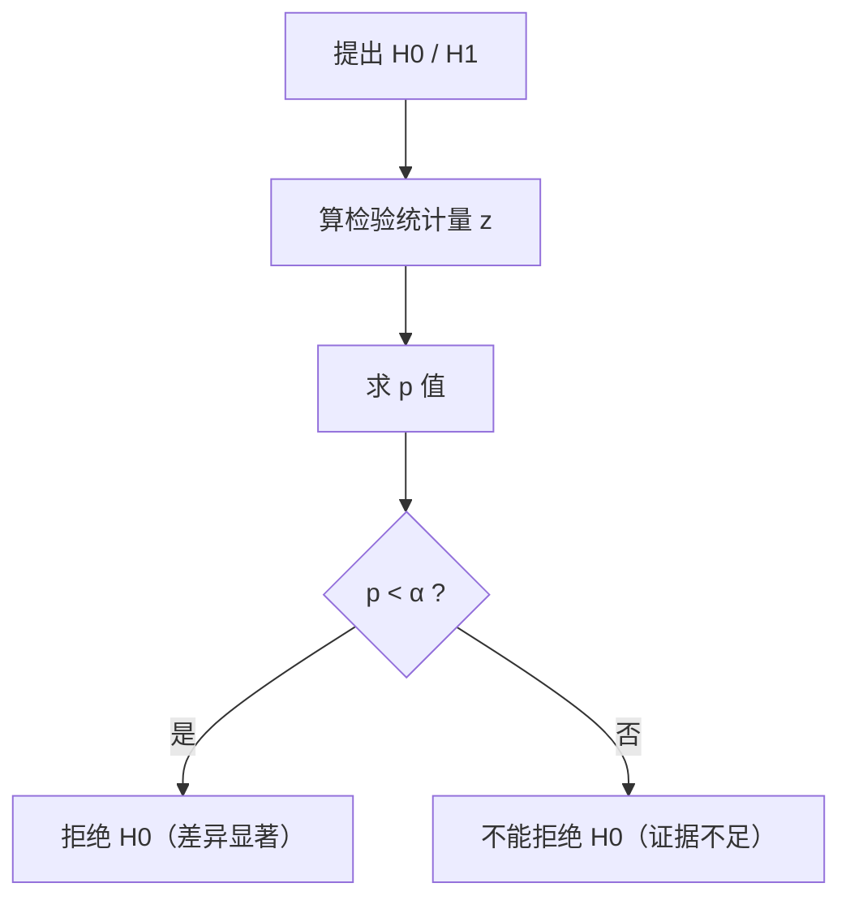

# MATH-403 假设检验基础

## 1. 知识概览

| 项 | 内容 |
|---|---|
| 知识 ID | `MATH-403` |
| 英文名称 | Basics of Hypothesis Testing |
| 所属模块 | M-MATH-04 概率论与数理统计 |
| 难度等级 | L3 推导 |
| 前置知识 | [[MATH-402 参数估计]] |
| 所属知识体系 | 原假设 → 检验统计量 → p 值 → 两类错误 |
| **AI 应用场景** | A/B 实验、模型 A/B 对比是否显著、消融实验结论是否可靠 |
| **预计学习时间** | 55 分钟 |

**为什么学它**：调模型时常问"新版本涨了 0.3%，是真的还是噪声"。假设检验就是回答这个问题——**在承认随机性的前提下，判断差异是否可能只是偶然**。

## 2. 直观理解

假设检验像**法庭审判**：

- **原假设 $H_0$**：被告无罪（"没有差异/没有效果"）。
- **备择假设 $H_1$**：被告有罪（"有差异"）。
- **证据**：样本数据。
- **判决**：证据足够强才拒绝 $H_0$（判有罪），否则"不能拒绝"。

关键：**"不能拒绝 $H_0$" ≠ "$H_0$ 为真"**，只是证据不足。

**p 值**：假设 $H_0$ 为真，出现"当前这么极端甚至更极端"结果的概率。p 很小 ⇒ 数据在 $H_0$ 下很反常 ⇒ 怀疑 $H_0$。

## 3. 正式数学定义

**假设**：$H_0:\theta=\theta_0$ 对 $H_1:\theta\neq\theta_0$（双侧）或 $\theta>\theta_0$（单侧）。

**检验统计量**（$\sigma$ 已知时）

$$
z = \frac{\bar X-\mu_0}{\sigma/\sqrt n} \sim N(0,1) \quad (\text{在 } H_0 \text{ 下})
$$

**p 值**（双侧）

$$
p = 2\left(1-\Phi(|z|)\right)
$$

**显著性水平 $\alpha$**：事先设定的"误判上限"，常用 0.05。

**决策规则**：$p<\alpha$ ⇒ 拒绝 $H_0$。

**两类错误**

| | $H_0$ 为真 | $H_0$ 为假 |
|---|---|---|
| 拒绝 $H_0$ | **第一类错误**（$\alpha$） | 正确（功效 $1-\beta$） |
| 不拒绝 $H_0$ | 正确 | **第二类错误**（$\beta$） |

**与置信区间的关系**：$\mu_0$ 落在 $1-\alpha$ 置信区间外 $\iff$ 在水平 $\alpha$ 下拒绝 $H_0$。

## 4. 数学推导

### 4.1 p 值为什么这样算

**起点**：$H_0:\mu=\mu_0$ 成立时，由 CLT

$$
z=\frac{\bar X-\mu_0}{\sigma/\sqrt n}\sim N(0,1)
$$

**第 1 步**：观测到 $\bar x$，算出 $z_{obs}$。

**第 2 步**：双侧检验关心"偏离多远"，所以取 $|z|$。

**第 3 步**：p 值是"在 $H_0$ 下，$|Z|$ 至少和观测一样大"的概率

$$
p = P(|Z|\ge|z_{obs}|) = 2\left(1-\Phi(|z_{obs}|)\right)
$$

**第 4 步**：若 $p<\alpha$，说明这种极端情况在 $H_0$ 下太罕见，拒绝 $H_0$。

**结论**：p 值是"数据对 $H_0$ 的反驳强度"，不是"$H_0$ 为真的概率"。

### 4.2 为什么 $\alpha$ 与 $\beta$ 不能同时无限小

**起点**：固定样本量 $n$。

**第 1 步**：$\alpha$ 是"拒绝阈值"——把阈值往极端推（更严格），$\alpha$ 变小。

**第 2 步**：但阈值越极端，真实差异越难被检出，$\beta$（漏检）变大、功效下降。

**第 3 步**：要同时降低两者，只能**增大样本量**（标准误变小，分布更窄，容易区分）。

**结论**：$\alpha$、$\beta$、$n$ 三者互相牵制。实践中先定 $\alpha$，再用功效分析定 $n$。

## 5. 几何直观与图解



```text
H0 下的分布（标准正态）
        ┌───┐
    ╱   │   │   ╲
  ╱     │   │     ╲
─┴──────┴───┴──────┴─
 -1.96      1.96
 拒绝区    接受区   拒绝区
  （各 α/2）
```

## 6. 计算示例

**例**：某零件标准长度 $\mu_0=100$，已知 $\sigma=15$。抽 $n=36$，样本均值 $\bar x=105$。检验是否有差异（$\alpha=0.05$）。

**第 1 步**：标准误

$$
\operatorname{SE} = \frac{15}{\sqrt{36}} = 2.5
$$

**第 2 步**：检验统计量

$$
z = \frac{105-100}{2.5} = 2.0
$$

**第 3 步**：双侧 p 值

$$
p = 2(1-\Phi(2.0)) = 2\times0.02275 \approx 0.0455
$$

**第 4 步**：判断

$$
p=0.0455 < 0.05 \Rightarrow \text{拒绝 } H_0
$$

**结论**：在 5% 水平下，样本均值与 100 有显著差异。

**注意**：p=0.0455 只比 0.05 小一点点，**结论很脆弱**——换一批样本可能就翻盘。

## 7. Python 辅助验证

**依赖**：`math`（用 `erf` 算正态尾概率）。

```powershell
python math403_hypothesis.py
```

```python
import math


def normal_cdf(x, mu=0.0, sigma=1.0):
    return 0.5 * (1 + math.erf((x - mu) / (sigma * math.sqrt(2))))


mu0, sigma, n, xbar = 100.0, 15.0, 36, 105.0
se = sigma / math.sqrt(n)
z = (xbar - mu0) / se
p = 2 * (1 - normal_cdf(abs(z)))

print("标准误:", round(se, 4))
print("检验统计量 z:", round(z, 4))
print("双侧 p 值:", round(p, 6))
print("拒绝 H0（α=0.05）:", bool(p < 0.05))
print("1.96 处的 CDF:", round(normal_cdf(1.96), 6))
```

**实际运行结果**

```
标准误: 2.5
检验统计量 z: 2.0
双侧 p 值: 0.0455
拒绝 H0（α=0.05）: True
1.96 处的 CDF: 0.975002
```

**代码解析**

- p 值 $0.0455$ 与手算一致。
- `1.96` 的 CDF 是 $0.975$，所以 95% 双侧临界值就是 $\pm1.96$。
- 结论"拒绝"但 p 值贴近 0.05，实际报告应给 p 值而非只说"显著"。
- 若改成 $n=100$，$z$ 会变成 3.33、p 降到 0.0009——**同样差异，样本更多就更"显著"**，这正是"统计显著≠效应大"。

## 8. 知识关联

| 类型 | 链接 |
|---|---|
| 前置数学 | [[MATH-402 参数估计]]、[[MATH-401 大数定律与中心极限定理]] |
| 后续数学 | `MATH-404 最大似然估计`、`MATH-806 PCA 数学原理`（待建） |
| 相关 Python | [[PY-067 聚合与统计]] |
| 相关机器学习 | 待关联（A/B 实验、模型对比显著性） |
| 相关深度学习 | 待关联（多次随机种子的显著性检验） |
| 相关大语言模型 | 待关联（评测集差异是否显著） |

## 9. 实战练习

**基础 1**：$z=1.5$，求双侧 p 值（用 $\Phi(1.5)\approx0.9332$）。

**基础 2**：$\alpha=0.01$ 时，双侧临界值约是多少？

**进阶 1**：某 A/B 实验：A 准确率 0.80（n=1000），B 准确率 0.82（n=1000），粗略判断差异是否显著（可用两比例 z 检验思路）。

**综合 1**：为什么"p 值小"不等于"效应大"？举一个具体场景说明。

## 10. 参考答案

> [!success]- 基础 1
> $$p = 2(1-\Phi(1.5)) = 2(1-0.9332) = 0.1336$$
>
> 大于 0.05，不能拒绝 $H_0$。

> [!success]- 基础 2
> 查表：$z_{0.995}\approx2.576$。
>
> 双侧 $\alpha=0.01$ 时临界值约 $\pm2.58$。

> [!success]- 进阶 1
> 合并比例 $\hat p=(0.80+0.82)/2=0.81$，$\operatorname{SE}=\sqrt{2\hat p(1-\hat p)/1000}=\sqrt{2\times0.81\times0.19/1000}\approx0.01755$。
>
> $$z=\frac{0.82-0.80}{0.01755}\approx1.14$$
>
> $p\approx0.25>0.05$ ⇒ **不显著**。2 个百分点在 1000 样本下还不足以确认。

> [!success]- 综合 1
> 样本极大时标准误极小，任何微小差异都会显著。
>
> 例：把样本从 1000 增到 100 万，0.2 个百分点的差异也会 p<0.001。但业务上 0.2% 可能毫无意义。
>
> **正确做法**：同时报告**效应量**（差值、Cohen's d）与置信区间，而不是只看 p。

## 11. 常见错误

| 类型 | 错误表现 | 原因 | 纠正 |
|---|---|---|---|
| 概念错误 | 把 p 值当"$H_0$ 为真的概率" | 条件方向反了 | p 是"$H_0$ 下数据的概率" |
| 概念错误 | "不拒绝 $H_0$"就说"$H_0$ 成立" | 证据不足≠证明 | 只能说"没有足够证据" |
| 概念错误 | 多组比较不做校正 | 多重检验假阳性累积 | Bonferroni 等校正 |
| 概念错误 | 只看 p 不看效应量 | 样本大时虚高显著 | 同时报效应量与 CI |
| 计算错误 | 单侧检验用双侧 p | 方向混淆 | 先想清 $H_1$ 方向 |

## 12. 学习记录

| 日期 | 状态 | 掌握程度 | 复习状态 | 学习笔记 | 关联练习 |
|---|---|---|---|---|---|
| — | planned | — | — | — | 练习 1–4 |

---

## 🔗 Notion 同步信息

> 以下内容由 Notion「AI Knowledge System · 知识点」数据库按知识 ID 合并而来（导出于 2026-11-09）。

| 属性 | 值 |
|---|---|
| 学科 | 数学 |
| 学习状态 | 未开始 |
| 难度 | L3 推导 |
| 知识类型 | Technique |

- **所属模块**：[M-MATH-04 概率论与数理统计](../%E8%AF%BE%E7%A8%8B%E6%A8%A1%E5%9D%97/M-MATH-04%20%E6%A6%82%E7%8E%87%E8%AE%BA%E4%B8%8E%E6%95%B0%E7%90%86%E7%BB%9F%E8%AE%A1.md)
- **前置知识**：[MATH-402 参数估计](MATH-402%20%E5%8F%82%E6%95%B0%E4%BC%B0%E8%AE%A1.md)
- **后继知识**：[MATH-404 最大似然估计](MATH-404%20%E6%9C%80%E5%A4%A7%E4%BC%BC%E7%84%B6%E4%BC%B0%E8%AE%A1.md)
- **关联Python**：[PY-067 聚合与统计](../../01_Python%E5%9F%BA%E7%A1%80/08%20NumPy/PY-067%20%E8%81%9A%E5%90%88%E4%B8%8E%E7%BB%9F%E8%AE%A1.md)
- **关联数学**：[MATH-402 参数估计](MATH-402%20%E5%8F%82%E6%95%B0%E4%BC%B0%E8%AE%A1.md)
- **被引用为数学**：[MATH-404 最大似然估计](MATH-404%20%E6%9C%80%E5%A4%A7%E4%BC%BC%E7%84%B6%E4%BC%B0%E8%AE%A1.md)
