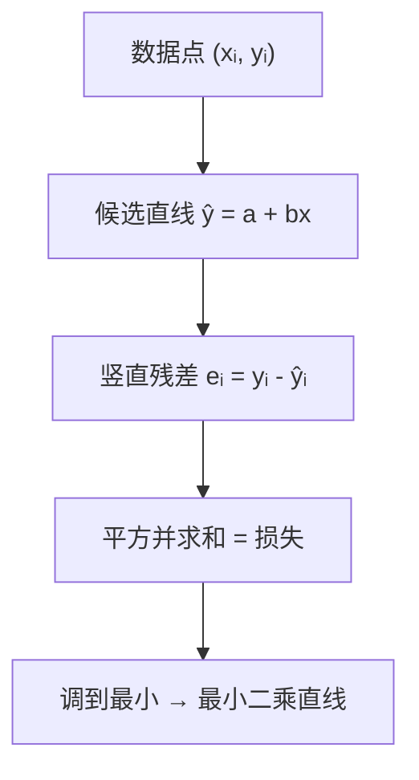

# MATH-451 最小二乘与回归统计

> **前置说明**：本节需要两样东西——**矩阵乘法**（MATH-216）与**导数**（MATH-121）。
> 不假设你学过统计。文中会先把"回归"用最朴素的话讲清，再上公式。

## 1. 通俗概念解释

你有一堆点，想画一条直线尽量穿过它们。"尽量"需要一个标准：**让每个点到直线的竖直距离的平方和最小**。

为什么用平方而不用绝对值？三个理由：

1. 平方后处处可导，能用微积分求极小值（绝对值在 0 点不可导）。
2. 平方会**重罚**大偏差，符合"离谱的点更该被压制"的直觉。
3. 在"误差是独立同分布的正态噪声"假设下，最小二乘等价于最大似然估计。

## 2. 数学定义

给定 $n$ 个样本 $(\mathbf{x}_i, y_i)$，模型为线性

$$
\hat{y}_i = \mathbf{w}^\top \mathbf{x}_i + b
$$

损失函数（残差平方和）：

$$
L(\mathbf{w}, b) = \sum_{i=1}^{n}\left(y_i - \hat{y}_i\right)^2
= \|\mathbf{y} - X\mathbf{w} - b\mathbf{1}\|^2
$$

把截距吸收进 $\mathbf{w}$（给 $\mathbf{x}$ 加一列 1），记 $X \in \mathbb{R}^{n\times d}$、$\mathbf{y}\in\mathbb{R}^n$，则

$$
L(\mathbf{w}) = \|X\mathbf{w} - \mathbf{y}\|^2
$$

最小二乘解就是 $\arg\min_{\mathbf{w}} L(\mathbf{w})$。

## 3. 公式推导

展开损失：

$$
L(\mathbf{w}) = (X\mathbf{w}-\mathbf{y})^\top (X\mathbf{w}-\mathbf{y})
= \mathbf{w}^\top X^\top X \mathbf{w} - 2\mathbf{y}^\top X\mathbf{w} + \mathbf{y}^\top\mathbf{y}
$$

对 $\mathbf{w}$ 求梯度（用矩阵求导法则，本质是多元链式法则）：

$$
\nabla_{\mathbf{w}} L = 2X^\top X\mathbf{w} - 2X^\top\mathbf{y}
$$

令梯度为零，得**正规方程**：

$$
X^\top X\,\mathbf{w} = X^\top\mathbf{y}
\;\Longrightarrow\;
\hat{\mathbf{w}} = (X^\top X)^{-1}X^\top\mathbf{y}
$$

几个必须知道的点：

- $X^\top X$ 可逆要求 $X$ 的列**线性无关**（没有完全共线的特征）。
- 若不可逆（共线/样本太少），用**伪逆**或加正则：$\hat{\mathbf{w}} = (X^\top X + \lambda I)^{-1}X^\top\mathbf{y}$（岭回归）。
- 该解是**全局最优**，因为 $L$ 是凸二次函数（$X^\top X$ 半正定）。

## 4. 几何直观



几何上还有一个更漂亮的解释：$X\mathbf{w}$ 只能落在 $X$ 的**列空间**里，而 $\mathbf{y}$ 一般不在其中。最小二乘做的事，是把 $\mathbf{y}$ **正交投影**到列空间上——此时"误差向量"与列空间垂直，长度最短。这也解释了为什么最优解的残差与每个特征都正交：$X^\top(\mathbf{y}-X\hat{\mathbf{w}})=0$。

## 5. 具体数值示例

三个点：$(1,2)$、$(2,3)$、$(3,5)$，拟合 $y = a + bx$。

先算所需的和：

| 量 | 值 |
|---|---|
| $n$ | 3 |
| $\sum x$ | 6 |
| $\sum y$ | 10 |
| $\sum x^2$ | $1+4+9=14$ |
| $\sum xy$ | $1\cdot2+2\cdot3+3\cdot5=23$ |

正规方程（对 $a,b$ 求偏导令零）：

$$
\begin{cases}
3a + 6b = 10\\
6a + 14b = 23
\end{cases}
$$

第一式乘 2：$6a+12b=20$；第二式减它：$2b = 3 \Rightarrow b = 1.5$。
回代：$3a + 9 = 10 \Rightarrow a = \tfrac{1}{3} \approx 0.3333$。

于是

$$
\hat{y} = 0.3333 + 1.5x
$$

预测与残差：

| $x$ | $y$ | $\hat{y}$ | 残差 |
|---|---|---|---|
| 1 | 2 | 1.8333 | 0.1667 |
| 2 | 3 | 3.3333 | −0.3333 |
| 3 | 5 | 4.8333 | 0.1667 |

残差平方和 $= 0.0278+0.1111+0.0278 = 0.1667 = \tfrac{1}{6}$。

## 6. 计算步骤

1. 给每个 $\mathbf{x}$ 前置一列 1（吸收截距）。
2. 算 $X^\top X$ 与 $X^\top\mathbf{y}$。
3. 解线性方程组（或求逆）。
4. 得到 $\mathbf{w}$，再算预测值与残差。
5. 评估：看 $R^2$ 与残差图（残差应无明显形状）。

## 7. Python 应用示例

```python
def lstsq_line(points):
    n = len(points)
    sx = sum(x for x, _ in points)
    sy = sum(y for _, y in points)
    sxx = sum(x * x for x, _ in points)
    sxy = sum(x * y for x, y in points)

    det = n * sxx - sx * sx
    a = (sy * sxx - sx * sxy) / det
    b = (n * sxy - sx * sy) / det
    return a, b

points = [(1, 2), (2, 3), (3, 5)]
a, b = lstsq_line(points)
print(f"拟合直线: y = {a:.4f} + {b:.4f}x")

sse = 0.0
for x, y in points:
    pred = a + b * x
    sse += (y - pred) ** 2
    print(f"x={x}  y={y}  预测={pred:.4f}  残差={y - pred:+.4f}")
print(f"残差平方和 = {sse:.4f}")
```

## 8. 基础练习

1. 两点 $(1,1)$、$(2,3)$ 拟合直线，写出 $a,b$。
2. 解释为什么最小二乘用平方误差而不是绝对值误差（至少两点理由）。
3. 若 $X^\top X$ 不可逆，可能是什么原因？

## 9. 进阶练习

1. 用正规方程推导单特征情形下的闭式解 $b=\frac{\overline{xy}-\bar{x}\bar{y}}{\overline{x^2}-\bar{x}^2}$。
2. 说明为什么加入 $L_2$ 正则（$\lambda I$）能缓解"不可逆"，并写出修改后的解。

## 10. 参考答案

**基础**

1. 两点必过，直线为 $y = 2x - 1$，即 $a=-1, b=2$。
2. 平方处处可导（便于求极值）；对大偏差惩罚更重；在正态噪声假设下等价于最大似然。
3. 特征之间存在完全共线（线性相关），或样本数少于特征数。

**进阶**

1. 由正规方程展开并解二元方程组，代入 $\bar x=\frac1n\sum x$、$\bar y=\frac1n\sum y$ 化简即得。
2. 加 $\lambda I$ 后矩阵正定（只要 $\lambda>0$），必可逆；代价是引入少量偏差换取方差下降（偏差-方差权衡）。

## 11. 常见错误

| 错误 | 说明 | 正确做法 |
|---|---|---|
| 忘记给 $X$ 加截距列 | 拟合出的直线被迫过原点 | 加一列 1，或单独求 $a$ |
| 用 $R^2$ 代替一切评估 | $R^2$ 高也可能过拟合 | 配合残差图与交叉验证 |
| 特征未标准化就比系数大小 | 量纲不同，系数不可比 | 先标准化 |
| 共线特征直接求逆 | 数值不稳定/报错 | 用岭回归或删特征 |
| 用最小二乘拟合明显非线性的数据 | 模型假设不成立 | 换模型或做特征变换 |

## 12. 与机器学习、深度学习的联系

| 用到的地方 | 具体形式 |
|---|---|
| 线性回归 | 本节就是它的全部数学 |
| 岭回归 / Lasso | 在损失上加 $L_2$ / $L_1$ 正则 |
| 逻辑回归 | 同样是线性打分，但用交叉熵损失，无闭式解 |
| 神经网络训练 | 最小二乘是"平方损失"的特例；一般用梯度法而非正规方程 |
| 偏差-方差 | 最小二乘解的方差与 $X^\top X$ 的条件数直接相关 |

---

## 关联与记录

- **前置**：[[MATH-216 矩阵乘法]]
- **关联数学**：[[MATH-216 矩阵乘法]]（构造 $X^\top X$）、[[MATH-121 导数]]（对 $\mathbf{w}$ 求梯度）
- **后继**：[[MATH-721 梯度下降]]（无闭式解时的通用解法）
- **被谁用**：见 Backlinks（线性回归）
- **所属模块**：`M-MATH-01 数学基础`

| 日期 | 动作 | 用时 | 结果 | 复盘 |
|---|---|---|---|---|
| 2026-11-01 | 建立笔记 | — | 待学 | — |

---

## 🔗 Notion 同步信息

> 以下内容由 Notion「AI Knowledge System · 知识点」数据库按知识 ID 合并而来（导出于 2026-11-09）。

| 属性 | 值 |
|---|---|
| 学科 | 数学 |
| 学习状态 | 未开始 |
| 难度 | L3 推导 |
| 知识类型 | Principle |
| 学习目标 | 理解最小二乘目标与正规方程推导，能拟合直线并评估残差。 |

- **所属模块**：[M-MATH-04 概率论与数理统计](../%E8%AF%BE%E7%A8%8B%E6%A8%A1%E5%9D%97/M-MATH-04%20%E6%A6%82%E7%8E%87%E8%AE%BA%E4%B8%8E%E6%95%B0%E7%90%86%E7%BB%9F%E8%AE%A1.md)
- **前置知识**：[MATH-216 矩阵乘法](../02%20%E7%BA%BF%E6%80%A7%E4%BB%A3%E6%95%B0/MATH-216%20%E7%9F%A9%E9%98%B5%E4%B9%98%E6%B3%95.md)
- **关联数学**：[MATH-216 矩阵乘法](../02%20%E7%BA%BF%E6%80%A7%E4%BB%A3%E6%95%B0/MATH-216%20%E7%9F%A9%E9%98%B5%E4%B9%98%E6%B3%95.md) · [MATH-121 导数](../01%20%E9%AB%98%E7%AD%89%E6%95%B0%E5%AD%A6/MATH-121%20%E5%AF%BC%E6%95%B0.md)
- **被引用为数学**：[MATH-721 梯度下降](../07%20%E6%9C%80%E4%BC%98%E5%8C%96%E6%96%B9%E6%B3%95/MATH-721%20%E6%A2%AF%E5%BA%A6%E4%B8%8B%E9%99%8D.md) · [ML-017 回归任务基本概念](../../03_%E6%9C%BA%E5%99%A8%E5%AD%A6%E4%B9%A0/02%20%E7%9B%91%E7%9D%A3%E5%AD%A6%E4%B9%A0/ML-017%20%E5%9B%9E%E5%BD%92%E4%BB%BB%E5%8A%A1%E5%9F%BA%E6%9C%AC%E6%A6%82%E5%BF%B5.md) · [ML-019 多元线性回归与正规方程](../../03_%E6%9C%BA%E5%99%A8%E5%AD%A6%E4%B9%A0/02%20%E7%9B%91%E7%9D%A3%E5%AD%A6%E4%B9%A0/ML-019%20%E5%A4%9A%E5%85%83%E7%BA%BF%E6%80%A7%E5%9B%9E%E5%BD%92%E4%B8%8E%E6%AD%A3%E8%A7%84%E6%96%B9%E7%A8%8B.md) · [ML-023 回归评价指标与残差诊断](../../03_%E6%9C%BA%E5%99%A8%E5%AD%A6%E4%B9%A0/02%20%E7%9B%91%E7%9D%A3%E5%AD%A6%E4%B9%A0/ML-023%20%E5%9B%9E%E5%BD%92%E8%AF%84%E4%BB%B7%E6%8C%87%E6%A0%87%E4%B8%8E%E6%AE%8B%E5%B7%AE%E8%AF%8A%E6%96%AD.md)
