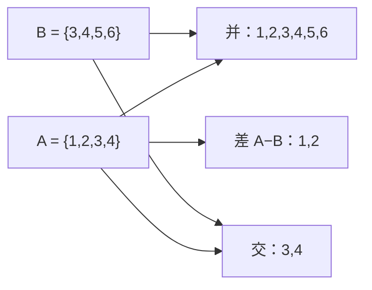

# MATH-501 集合与集合运算

## 1. 知识概览

| 项 | 内容 |
|---|---|
| 知识 ID | `MATH-501` |
| 英文名称 | Sets and Set Operations |
| 所属模块 | M-MATH-06 离散数学与信息论 |
| 难度等级 | L1 概念 |
| 前置知识 | 无（离散数学起点） |
| 所属知识体系 | 集合 → 运算 → 容斥 → 笛卡尔积 |
| **AI 应用场景** | 样本空间与事件（概率）、词表/标签集合、去重与交并差、$|\mathcal{V}|$ 词表大小 |
| **预计学习时间** | 50 分钟 |

**为什么学它**：**概率论建立在集合论上**——样本空间是集合，事件是子集，$P(A\cup B)$ 就是容斥公式。同时 Python 的 `set` 就是集合的实现，去重、交并差都是它的运算。

## 2. 直观理解

集合就是**一堆东西的汇总**，元素不重复、无序。

- $A=\{1,2,3,4\}$：4 个元素。
- $B=\{3,4,5,6\}$：另 4 个。

五种基本运算，像"筛子组合"：

| 运算 | 含义 | 类比 |
|---|---|---|
| 并 $A\cup B$ | 属于 A **或** B | 两家书店的书合并 |
| 交 $A\cap B$ | 既属 A **又** 属 B | 两家都有的书 |
| 差 $A-B$ | 属 A **且不**属 B | A 有而 B 没有的 |
| 对称差 $A\triangle B$ | 只在其中一边 | 只有一家有的书 |
| 补 $A^c$ | 不在 A 里 | 全集剩下的 |

## 3. 正式数学定义

**集合**：无序、互异的元素汇总。$a\in A$ 表示 $a$ 属于 $A$。

**基本运算**

$$
A\cup B = \{x: x\in A \lor x\in B\}
$$

$$
A\cap B = \{x: x\in A \land x\in B\}
$$

$$
A - B = \{x: x\in A \land x\notin B\}
$$

$$
A\triangle B = (A-B)\cup(B-A)
$$

**补集**（相对全集 $U$）：$A^c = U - A$。

**子集**：$A\subseteq B \iff \forall x\in A,\ x\in B$。

**幂集**：$\mathcal{P}(A)$ 是 $A$ 的所有子集，$|\mathcal{P}(A)|=2^{|A|}$。

**笛卡尔积**

$$
A\times B = \{(a,b): a\in A,\ b\in B\}, \qquad |A\times B| = |A|\cdot|B|
$$

**容斥原理（两个集合）**

$$
|A\cup B| = |A| + |B| - |A\cap B|
$$

**德摩根律**

$$
(A\cap B)^c = A^c\cup B^c, \qquad (A\cup B)^c = A^c\cap B^c
$$

## 4. 数学推导

### 4.1 容斥公式为什么减一次

**起点**：要数 $A\cup B$ 的元素个数。

**第 1 步**：先数 $A$ 的（$|A|$ 个），再数 $B$ 的（$|B|$ 个）。

**第 2 步**：$A\cap B$ 里的元素被**数了两次**（既在 $A$ 又在 $B$）。

**第 3 步**：减去多算的一次

$$
|A\cup B| = |A| + |B| - |A\cap B|
$$

**推广（三集合）**

$$
|A\cup B\cup C| = |A|+|B|+|C| - |A\cap B|-|A\cap C|-|B\cap C| + |A\cap B\cap C|
$$

**结论**：**"加一遍减两遍加三遍"**——奇数个集合的交加，偶数个的减。

### 4.2 德摩根律的证明（元素法）

**起点**：证 $(A\cap B)^c = A^c\cup B^c$。

**第 1 步**：任取 $x\in(A\cap B)^c$，则 $x\notin A\cap B$。

**第 2 步**："不在交里"意味着**至少有一个不含它**

$$
x\notin A \;\lor\; x\notin B
$$

**第 3 步**：即 $x\in A^c\lor x\in B^c$，所以 $x\in A^c\cup B^c$。

**第 4 步**：反向同理，故两边相等。

**结论**：**"交的补 = 补的并"**。这在概率里就是"两个事件都发生的对立面 = 至少一个不发生"。

## 5. 几何直观与图解



```text
      A         B
   ┌──────┬──────┐
   │ 1  2 │ 3  4 │ 5  6 │
   └──────┴──────┘
      ↑      ↑
    A−B    A∩B
```

## 6. 计算示例

**例 1**：$A=\{1,2,3,4\}$、$B=\{3,4,5,6\}$。

- $A\cup B=\{1,2,3,4,5,6\}$，$|A\cup B|=6$
- $A\cap B=\{3,4\}$，$|A\cap B|=2$
- $A-B=\{1,2\}$
- $A\triangle B=\{1,2,5,6\}$

**容斥验证**：$4+4-2=6$ ✓

**例 2**：50 人班，30 人学 Python，25 人学数学，12 人两个都学。问至少学一个的有多少人？

$$
|P\cup M| = 30+25-12 = 43
$$

所以两个都不学的有 $50-43=7$ 人。

**例 3**：$|A|=3$，幂集大小 $2^3=8$。

## 7. Python 辅助验证

**依赖**：仅标准库（`set`）。

```powershell
python math501_sets.py
```

```python
A = {1, 2, 3, 4}
B = {3, 4, 5, 6}

print("并:", sorted(A | B))
print("交:", sorted(A & B))
print("差 A-B:", sorted(A - B))
print("对称差:", sorted(A ^ B))

print("容斥:", len(A), "+", len(B), "-", len(A & B), "=", len(A | B))

U = A | B
print("德摩根 (A∩B)ᶜ == Aᶜ∪Bᶜ:", sorted(U - (A & B)) == sorted((U - A) | (U - B)))
```

**实际运行结果**

```
并: [1, 2, 3, 4, 5, 6]
交: [3, 4]
差 A-B: [1, 2]
对称差: [1, 2, 5, 6]
容斥: 4 + 4 - 2 = 6
德摩根 (A∩B)ᶜ == Aᶜ∪Bᶜ: True
```

**代码解析**

- Python 的 `|`、`&`、`-`、`^` 正好对应并、交、差、对称差。
- `len(A|B)` 直接给出容斥结果，可用来验证公式。
- 补集要指定全集 $U$，代码里用 `U - X` 表示 $X^c$。
- 德摩根律用集合相等验证（转成有序列表比较）。

## 8. 知识关联

| 类型 | 链接 |
|---|---|
| 前置数学 | 无 |
| 后续数学 | [[MATH-301 概率基础与条件概率]]（样本空间=集合）、`MATH-502 命题逻辑与真值表`（待建） |
| 相关 Python | [[PY-008 字典与集合]]、[[PY-013 集合与哈希原理]] |
| 相关机器学习 | 待关联（标签集合、词表、去重统计） |
| 相关深度学习 | 待关联（类别集合、mask） |
| 相关大语言模型 | 待关联（词表大小 $|\mathcal{V}|$） |

## 9. 实战练习

**基础 1**：$A=\{1,2,3\}$、$B=\{2,3,4\}$，求 $A\cap B$ 与 $A\triangle B$。

**基础 2**：$|A|=4$，幂集有多少个元素？

**进阶 1**：全班 40 人，会英语 25 人，会日语 15 人，两种都会 8 人，求两种都不会的人数。

**综合 1**：某词表有 50000 个 token，训练集出现了其中 32000 个。求覆盖率，并说明"词表"与"出现的 token 集合"是什么关系。

## 10. 参考答案

> [!success]- 基础 1
> $$A\cap B = \{2,3\},\qquad A\triangle B = \{1,4\}$$

> [!success]- 基础 2
> $$2^4 = 16$$

> [!success]- 进阶 1
> $$|E\cup J| = 25+15-8 = 32$$
>
> 两种都不会：$40-32 = 8$ 人。

> [!success]- 综合 1
> 覆盖率 $=32000/50000 = 64\%$。
>
> 关系：**出现的 token 集合是词表集合的子集**（$S\subseteq\mathcal{V}$），所以 $|S|\le|\mathcal{V}|$。未出现的 18000 个 token 属于 $\mathcal{V}-S$。

## 11. 常见错误

| 类型 | 错误表现 | 原因 | 纠正 |
|---|---|---|---|
| 概念错误 | 认为集合有顺序 | 与列表混淆 | 集合无序 |
| 计算错误 | 容斥忘记减交 | 漏重复计数 | 减去 $|A\cap B|$ |
| 概念错误 | 把 $A-B$ 与 $B-A$ 混同 | 差集不对称 | 差集有方向 |
| 概念错误 | 补集不指定全集 | 定义不完整 | 先明确 $U$ |
| 计算错误 | 幂集当 $|A|^2$ | 混淆 | 是 $2^{|A|}$ |

## 12. 学习记录

| 日期 | 状态 | 掌握程度 | 复习状态 | 学习笔记 | 关联练习 |
|---|---|---|---|---|---|
| — | planned | — | — | — | 练习 1–4 |

---

## 🔗 Notion 同步信息

> 以下内容由 Notion「AI Knowledge System · 知识点」数据库按知识 ID 合并而来（导出于 2026-11-09）。

| 属性 | 值 |
|---|---|
| 学科 | 数学 |
| 学习状态 | 未开始 |
| 难度 | L1 概念 |
| 知识类型 | Concept |

- **所属模块**：[M-MATH-06 离散数学与信息论](../%E8%AF%BE%E7%A8%8B%E6%A8%A1%E5%9D%97/M-MATH-06%20%E7%A6%BB%E6%95%A3%E6%95%B0%E5%AD%A6%E4%B8%8E%E4%BF%A1%E6%81%AF%E8%AE%BA.md)
- **后继知识**：[MATH-502 命题逻辑与真值表](MATH-502%20%E5%91%BD%E9%A2%98%E9%80%BB%E8%BE%91%E4%B8%8E%E7%9C%9F%E5%80%BC%E8%A1%A8.md)
- **关联Python**：[PY-008 字典与集合](../../01_Python%E5%9F%BA%E7%A1%80/03%20%E6%95%B0%E6%8D%AE%E7%BB%93%E6%9E%84/PY-008%20%E5%AD%97%E5%85%B8%E4%B8%8E%E9%9B%86%E5%90%88.md)
- **被引用为数学**：[MATH-502 命题逻辑与真值表](MATH-502%20%E5%91%BD%E9%A2%98%E9%80%BB%E8%BE%91%E4%B8%8E%E7%9C%9F%E5%80%BC%E8%A1%A8.md) · [ML-024 分类任务基本概念](../../03_%E6%9C%BA%E5%99%A8%E5%AD%A6%E4%B9%A0/02%20%E7%9B%91%E7%9D%A3%E5%AD%A6%E4%B9%A0/ML-024%20%E5%88%86%E7%B1%BB%E4%BB%BB%E5%8A%A1%E5%9F%BA%E6%9C%AC%E6%A6%82%E5%BF%B5.md) · [ML-043 混淆矩阵与分类指标](../../03_%E6%9C%BA%E5%99%A8%E5%AD%A6%E4%B9%A0/04%20%E6%A8%A1%E5%9E%8B%E8%AF%84%E4%BC%B0/ML-043%20%E6%B7%B7%E6%B7%86%E7%9F%A9%E9%98%B5%E4%B8%8E%E5%88%86%E7%B1%BB%E6%8C%87%E6%A0%87.md) · [PY-008 字典与集合](../../01_Python%E5%9F%BA%E7%A1%80/03%20%E6%95%B0%E6%8D%AE%E7%BB%93%E6%9E%84/PY-008%20%E5%AD%97%E5%85%B8%E4%B8%8E%E9%9B%86%E5%90%88.md)
