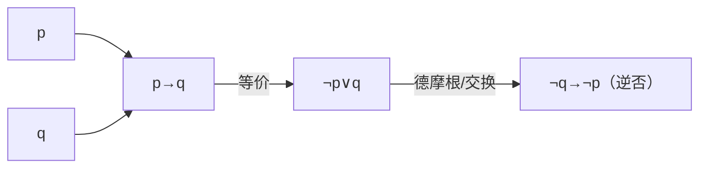

# MATH-502 命题逻辑与真值表

## 1. 知识概览

| 项 | 内容 |
|---|---|
| 知识 ID | `MATH-502` |
| 英文名称 | Propositional Logic and Truth Tables |
| 所属模块 | M-MATH-06 离散数学与信息论 |
| 难度等级 | L2 应用 |
| 前置知识 | [[MATH-501 集合与集合运算]] |
| 所属知识体系 | 命题 → 联结词 → 真值表 → 等价 |
| **AI 应用场景** | 布尔电路、条件判断、SQL/规则引擎、程序断言、位运算掩码 |
| **预计学习时间** | 50 分钟 |

**为什么学它**：`if` 语句、`and/or/not`，本质就是命题逻辑。搞清"蕴含"的真值表，才能理解为什么 `if not cond: return` 这类写法成立。

## 2. 直观理解

命题是**能判真假的陈述**："今天下雨"是命题；"快点走"不是（无真假）。

五个联结词：

| 联结词 | 符号 | 读法 |
|---|---|---|
| 非 | $\neg p$ | 不是 p |
| 与 | $p\land q$ | p 且 q |
| 或 | $p\lor q$ | p 或 q |
| 蕴含 | $p\to q$ | 若 p 则 q |
| 等价 | $p\leftrightarrow q$ | p 当且仅当 q |

**反直觉的只有蕴含**：$p\to q$ 只有在"p 真而 q 假"时才为假。

生活例子："如果明天下雨，我就带伞"。只有"明天下雨却没带伞"才算说谎——没下雨时，带不带伞都不算违背承诺。

## 3. 正式数学定义

**真值表**

| $p$ | $q$ | $\neg p$ | $p\land q$ | $p\lor q$ | $p\to q$ | $p\leftrightarrow q$ |
|---|---|---|---|---|---|---|
| T | T | F | T | T | T | T |
| T | F | F | F | T | **F** | F |
| F | T | T | F | T | T | F |
| F | F | T | F | F | T | T |

**恒等式**

$$
p\to q \;\equiv\; \neg p\lor q
$$

$$
p\leftrightarrow q \;\equiv\; (p\to q)\land(q\to p)
$$

$$
\neg(p\land q)\equiv\neg p\lor\neg q, \qquad \neg(p\lor q)\equiv\neg p\land\neg q \quad(\text{德摩根})
$$

$$
p\to q \;\equiv\; \neg q\to\neg p \quad(\text{逆否})
$$

**术语**：重言式（永真）、矛盾式（永假）、可满足式（至少一真）。

## 4. 数学推导

### 4.1 为什么 $p\to q\equiv\neg p\lor q$

**起点**：比较两边的真值表。

**第 1 步**：列出 $p\to q$ 的四行真值：T, F, T, T（只在 $p=T,q=F$ 时为 F）。

**第 2 步**：列出 $\neg p\lor q$：

| $p$ | $q$ | $\neg p$ | $\neg p\lor q$ |
|---|---|---|---|
| T | T | F | T |
| T | F | F | **F** |
| F | T | T | T |
| F | F | T | T |

**第 3 步**：两列完全相同，故等价。

**结论**：**"若 p 则 q" = "非 p 或 q"**。这也解释了为什么"前件为假时蕴含式为真"——$\neg p$ 为真，或运算就为真。

### 4.2 逆否等价的证明

**起点**：要证 $p\to q\equiv\neg q\to\neg p$。

**第 1 步**：左边等价于 $\neg p\lor q$。

**第 2 步**：右边 $\neg q\to\neg p$ 等价于 $\neg(\neg q)\lor\neg p = q\lor\neg p$。

**第 3 步**：$\neg p\lor q$ 与 $q\lor\neg p$ 只是交换律，完全相等。

**结论**：命题与逆否命题同真假。这是**反证法**的基础：要证 $p\to q$，可证 $\neg q\to\neg p$。

## 5. 几何直观与图解



```text
蕴含 p→q 的"违约"只有一处：
  p=T,q=F  ← 唯一的假
其余三行都是真（包括 p=F 的两行）
```

## 6. 计算示例

**例 1**：判断 $(p\to q)\land(q\to p)$ 是否等价于 $p\leftrightarrow q$。

真值表两列逐行相同，等价 ✓

**例 2**：验证德摩根 $\neg(p\land q)\equiv\neg p\lor\neg q$。

| $p$ | $q$ | $p\land q$ | $\neg(p\land q)$ | $\neg p\lor\neg q$ |
|---|---|---|---|---|
| T | T | T | F | F |
| T | F | F | T | T |
| F | T | F | T | T |
| F | F | F | T | T |

两列相同 ✓

**例 3**：$p\to q$ 与 $q\to p$ **不等价**（前者是原命题，后者是逆命题）。

反例：$p$=下雨，$q$=地湿。"下雨则地湿"为真，但"地湿则下雨"未必（可能洒水车）。

## 7. Python 辅助验证

**依赖**：仅标准库 `itertools`。

```powershell
python math502_logic.py
```

```python
import itertools


def implies(p, q):
    return (not p) or q


print("p     q   p→q")
for p, q in itertools.product([True, False], repeat=2):
    print(f"{p!s:<5} {q!s:<5} {implies(p, q)}")


def equivalent(f, g):
    return all(f(*v) == g(*v) for v in itertools.product([True, False], repeat=2))


print("p→q ≡ ¬p∨q:", equivalent(lambda p, q: implies(p, q),
                                lambda p, q: (not p) or q))
print("¬(p∧q) ≡ ¬p∨¬q:", equivalent(lambda p, q: not (p and q),
                                    lambda p, q: (not p) or (not q)))
print("p→q ≡ ¬q→¬p:", equivalent(lambda p, q: implies(p, q),
                                  lambda p, q: implies(not q, not p)))
```

**实际运行结果**

```
p     q   p→q
True  True  True
True  False False
False True  True
False False True
p→q ≡ ¬p∨q: True
¬(p∧q) ≡ ¬p∨¬q: True
p→q ≡ ¬q→¬p: True
```

**代码解析**

- `itertools.product([True,False], repeat=2)` 枚举全部 4 种赋值。
- `equivalent` 用"对所有赋值结果都相同"来判定等价——这是**穷举验证**，对小规模命题足够严谨。
- 三条恒等式全部为 True，与手推一致。

## 8. 知识关联

| 类型 | 链接 |
|---|---|
| 前置数学 | [[MATH-501 集合与集合运算]]（并与交对应或与且） |
| 后续数学 | [[MATH-503 量词与数学归纳法]]、`MATH-504 排列组合与递归`（待建） |
| 相关 Python | [[PY-005 条件判断]]、[[PY-003 运算符]] |
| 相关机器学习 | 待关联（决策规则的布尔表达） |
| 相关深度学习 | 待关联（掩码与门控） |
| 相关大语言模型 | 待关联（约束解码的规则） |

## 9. 实战练习

**基础 1**：写出 $\neg(p\lor q)$ 的真值表，并判断它等价于什么。

**基础 2**：$p$=真、$q$=假，求 $p\to q$ 与 $q\to p$ 的真值。

**进阶 1**：证明 $p\to(q\to r)\equiv(p\land q)\to r$。

**综合 1**：程序里 `if not (a and b): return` 与 `if (not a) or (not b): return` 等价吗？用德摩根说明。

## 10. 参考答案

> [!success]- 基础 1
> | $p$ | $q$ | $p\lor q$ | $\neg(p\lor q)$ | $\neg p\land\neg q$ |
> |---|---|---|---|---|
> | T | T | T | F | F |
> | T | F | T | F | F |
> | F | T | T | F | F |
> | F | F | F | T | T |
>
> 等价于 $\neg p\land\neg q$（德摩根）。

> [!success]- 基础 2
> $p\to q$：T→F ⇒ **假**。
>
> $q\to p$：F→T ⇒ **真**。
>
> 两者不同，说明原命题与逆命题不等价。

> [!success]- 进阶 1
> 左边 $=\neg p\lor(\neg q\lor r)=\neg p\lor\neg q\lor r$。
>
> 右边 $=\neg(p\land q)\lor r=(\neg p\lor\neg q)\lor r$。
>
> 两式相同（结合律）✓

> [!success]- 综合 1
> 等价。由德摩根
>
> $$\neg(a\land b)\equiv\neg a\lor\neg b$$
>
> 所以 `not (a and b)` 与 `(not a) or (not b)` 完全等价。Python 里推荐前者（更短、意图更清楚）。

## 11. 常见错误

| 类型 | 错误表现 | 原因 | 纠正 |
|---|---|---|---|
| 概念错误 | 认为 $p\to q$ 与 $q\to p$ 等价 | 混淆原命题与逆命题 | 逆否才等价 |
| 概念错误 | $p$ 为假时判 $p\to q$ 为假 | 直觉错 | $p$ 假时蕴含为真 |
| 公式错误 | 德摩根忘记换联结词 | 只取反不换 | 且↔或同时取反 |
| 概念错误 | 把"或"理解为"排他或" | 日常语义 | 逻辑或是**可兼或** |
| 概念错误 | 认为等价就是"看起来一样" | 需真值表 | 逐行比对 |

## 12. 学习记录

| 日期 | 状态 | 掌握程度 | 复习状态 | 学习笔记 | 关联练习 |
|---|---|---|---|---|---|
| — | planned | — | — | — | 练习 1–4 |

---

## 🔗 Notion 同步信息

> 以下内容由 Notion「AI Knowledge System · 知识点」数据库按知识 ID 合并而来（导出于 2026-11-09）。

| 属性 | 值 |
|---|---|
| 学科 | 数学 |
| 学习状态 | 未开始 |
| 难度 | L2 应用 |
| 知识类型 | Concept |

- **所属模块**：[M-MATH-06 离散数学与信息论](../%E8%AF%BE%E7%A8%8B%E6%A8%A1%E5%9D%97/M-MATH-06%20%E7%A6%BB%E6%95%A3%E6%95%B0%E5%AD%A6%E4%B8%8E%E4%BF%A1%E6%81%AF%E8%AE%BA.md)
- **前置知识**：[MATH-501 集合与集合运算](MATH-501%20%E9%9B%86%E5%90%88%E4%B8%8E%E9%9B%86%E5%90%88%E8%BF%90%E7%AE%97.md)
- **后继知识**：[MATH-503 量词与数学归纳法](MATH-503%20%E9%87%8F%E8%AF%8D%E4%B8%8E%E6%95%B0%E5%AD%A6%E5%BD%92%E7%BA%B3%E6%B3%95.md)
- **关联Python**：[PY-005 条件判断](../../01_Python%E5%9F%BA%E7%A1%80/01%20%E8%AF%AD%E6%B3%95%E4%B8%8E%E7%B1%BB%E5%9E%8B/PY-005%20%E6%9D%A1%E4%BB%B6%E5%88%A4%E6%96%AD.md)
- **关联数学**：[MATH-501 集合与集合运算](MATH-501%20%E9%9B%86%E5%90%88%E4%B8%8E%E9%9B%86%E5%90%88%E8%BF%90%E7%AE%97.md)
- **被引用为数学**：[MATH-503 量词与数学归纳法](MATH-503%20%E9%87%8F%E8%AF%8D%E4%B8%8E%E6%95%B0%E5%AD%A6%E5%BD%92%E7%BA%B3%E6%B3%95.md)
