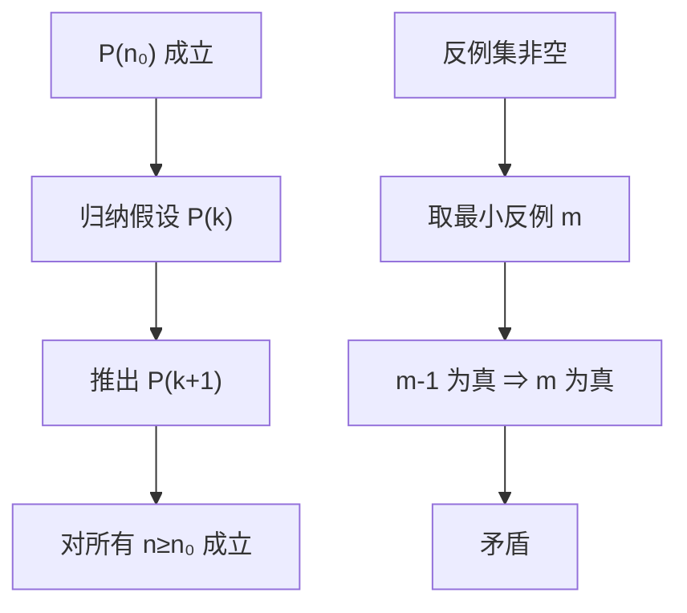

# MATH-503 量词与数学归纳法

## 1. 知识概览

| 项 | 内容 |
|---|---|
| 知识 ID | `MATH-503` |
| 英文名称 | Quantifiers and Mathematical Induction |
| 所属模块 | M-MATH-06 离散数学与信息论 |
| 难度等级 | L2 应用 |
| 前置知识 | [[MATH-502 命题逻辑与真值表]] |
| 所属知识体系 | 全称/存在量词 → 否定 → 归纳法（三步） |
| **AI 应用场景** | 算法正确性证明、循环不变式、"对所有样本成立"的表述、递归函数终止性 |
| **预计学习时间** | 50 分钟 |

**为什么学它**：论文里满是"$\forall$""$\exists$"，而算法正确性靠**归纳法**证明。看懂这些符号，才能读懂定理陈述；会归纳，才能说清"为什么递归函数是对的"。

## 2. 直观理解

**全称量词 $\forall$**："所有"。
**存在量词 $\exists$**："存在至少一个"。

它们的否定要**换量词并否定结论**：

- "所有人都及格"的否定是"**存在**人**没**及格"。
- "存在一只黑天鹅"的否定是"**所有**天鹅都**不是**黑"。

**数学归纳法**像**多米诺骨牌**：

1. 推倒第一张（基础情形）。
2. 证明"前一张倒会带动下一张"（归纳步）。
3. 于是全部倒下（结论）。

## 3. 正式数学定义

**量词**

$$
\forall x\in S,\ P(x) \quad\text{（对所有）}
$$

$$
\exists x\in S,\ P(x) \quad\text{（存在）}
$$

**量词否定**

$$
\neg(\forall x\,P(x)) \equiv \exists x\,\neg P(x)
$$

$$
\neg(\exists x\,P(x)) \equiv \forall x\,\neg P(x)
$$

**数学归纳法**：要证 $\forall n\ge n_0,\ P(n)$，只需两步

1. **基础步**：$P(n_0)$ 成立。
2. **归纳步**：假设 $P(k)$ 成立（归纳假设），推出 $P(k+1)$ 成立。

**强归纳法**：假设 $P(n_0),\dots,P(k)$ 全部成立，推出 $P(k+1)$。

**良序原理**（等价形式）：非空正整数集必有最小元。

## 4. 数学推导

### 4.1 用归纳法证明 $1+2+\cdots+n=\dfrac{n(n+1)}{2}$

**起点**：记 $P(n)$ 为该等式。

**第 1 步（基础）**：$n=1$ 时

$$
\text{左} = 1,\qquad \text{右} = \frac{1\cdot2}{2} = 1 \;\checkmark
$$

**第 2 步（归纳假设）**：设 $P(k)$ 成立

$$
1+2+\cdots+k = \frac{k(k+1)}{2}
$$

**第 3 步（推 $k+1$）**：两边加上 $k+1$

$$
1+\cdots+k+(k+1) = \frac{k(k+1)}{2} + (k+1)
$$

**第 4 步**：提取公因子 $(k+1)$

$$
= (k+1)\left(\frac{k}{2}+1\right) = \frac{(k+1)(k+2)}{2}
$$

**第 5 步**：这正是 $P(k+1)$ 的形式

$$
\frac{(k+1)\big((k+1)+1\big)}{2} \;\checkmark
$$

**结论**：由归纳法，对一切 $n\ge1$ 成立。

### 4.2 为什么归纳法有效（与良序原理的联系）

**起点**：假设基础步与归纳步都成立，但存在某个 $m$ 使 $P(m)$ 为假。

**第 1 步**：令 $S=\{n\ge n_0: P(n)\text{ 为假}\}$，由假设 $S$ 非空。

**第 2 步**：由良序原理，$S$ 有最小元 $m$。

**第 3 步**：$m\neq n_0$（基础步保证 $P(n_0)$ 真），所以 $m-1\ge n_0$。

**第 4 步**：$m$ 是最小反例 ⇒ $P(m-1)$ 为真。

**第 5 步**：由归纳步，$P(m-1)$ 真 ⇒ $P(m)$ 真，与 $m\in S$ 矛盾。

**结论**：$S$ 为空，即对所有 $n$ 成立。

## 5. 几何直观与图解



```text
多米诺：
  ▮ → ▮ → ▮ → ▮ → ...
  第1张倒（基础）
  每张倒会带倒下一张（归纳步）
```

## 6. 计算示例

**例 1**：验证 $1+\cdots+n=n(n+1)/2$ 对若干 $n$ 成立（数值检查，**不是证明**）。

| $n$ | 左边 | 右边 |
|---|---|---|
| 1 | 1 | 1 |
| 2 | 3 | 3 |
| 3 | 6 | 6 |
| 10 | 55 | 55 |
| 100 | 5050 | 5050 |

**例 2**：量词的否定。

- $\forall n\in\{1,\dots,10\},\ n<10$：为假（$n=10$ 不满足）。
- 其否定 $\exists n,\ n\ge10$：为真。

**例 3**：$\exists n\in\{1,\dots,10\},\ 7\mid n$：为真（$n=7$）。

## 7. Python 辅助验证

**依赖**：仅标准库。

```powershell
python math503_quantifiers.py
```

```python
print("n  左边  右边")
for n in (1, 2, 3, 10, 100):
    print(n, sum(range(1, n + 1)), n * (n + 1) // 2)

nums = list(range(1, 11))
print("∀n: n² > 0 →", all(n * n > 0 for n in nums))
print("∃n: 7 | n →", any(n % 7 == 0 for n in nums))

print("∀n: n < 10 →", all(n < 10 for n in nums))
print("其否定 ∃n: n ≥ 10 →", any(n >= 10 for n in nums))
```

**实际运行结果**

```
n  左边  右边
1 1 1
2 3 3
3 6 6
10 55 55
100 5050 5050
∀n: n² > 0 → True
∃n: 7 | n → True
∀n: n < 10 → False
其否定 ∃n: n ≥ 10 → True
```

**代码解析**

- `all()` 对应 $\forall$，`any()` 对应 $\exists$——Python 内置函数就是量词的实现。
- 前两个命题为真，第三个为假、其否定为真，正好演示"$\neg\forall$ = $\exists\neg$"。
- 数值验证只能**否证**（找到一个反例即推翻），不能代替归纳证明。

## 8. 知识关联

| 类型 | 链接 |
|---|---|
| 前置数学 | [[MATH-502 命题逻辑与真值表]]、[[MATH-501 集合与集合运算]] |
| 后续数学 | [[MATH-504 排列组合与递归]]、`MATH-505 图论与树基础` |
| 相关 Python | [[PY-006 循环结构]]、[[PY-022 递归]] |
| 相关机器学习 | 待关联（算法正确性论证） |
| 相关深度学习 | 待关联（循环不变式） |
| 相关大语言模型 | 待关联（形式化推理） |

## 9. 实战练习

**基础 1**：写出"所有猫都会叫"的否定。

**基础 2**：用归纳法证明 $1+3+5+\cdots+(2n-1)=n^2$。

**进阶 1**：证明 $2^n>n$ 对 $n\ge1$ 成立（归纳法）。

**综合 1**：为什么"验证了 $n=1,2,\dots,1000$ 都成立"不能算证明？举一个前 1000 项成立但第 1001 项失败的反例思路。

## 10. 参考答案

> [!success]- 基础 1
> $$\neg(\forall x\in\text{猫},\ \text{会叫}(x)) \equiv \exists x\in\text{猫},\ \neg\text{会叫}(x)$$
>
> 即"**存在不会叫的猫**"。

> [!success]- 基础 2
> **基础**：$n=1$，左边 $1$，右边 $1$ ✓
>
> **归纳**：设 $1+3+\cdots+(2k-1)=k^2$。
>
> 加下一项 $2(k+1)-1=2k+1$：
>
> $$k^2+(2k+1)=(k+1)^2 \;\checkmark$$
>
> 得证。

> [!success]- 进阶 1
> **基础**：$n=1$，$2>1$ ✓
>
> **归纳**：设 $2^k>k$。则
>
> $$2^{k+1}=2\cdot2^k>2k\ge k+1 \quad(k\ge1)$$
>
> 得证。

> [!success]- 综合 1
> 有限验证只覆盖有限个 $n$，命题可能在第 1001 项失效。
>
> 经典例子：多项式 $f(n)=n^2+n+41$ 在 $n=0,\dots,39$ 全为素数，但 $n=40$ 时 $f(40)=1681=41^2$ 不是素数。
>
> **结论**：验证只能证伪，不能证真；证明必须用归纳法或其他演绎推理。

## 11. 常见错误

| 类型 | 错误表现 | 原因 | 纠正 |
|---|---|---|---|
| 概念错误 | 量词否定只加"不" | 忘记换量词 | $\forall\leftrightarrow\exists$ 要对调 |
| 逻辑错误 | 归纳法跳过基础步 | 以为归纳步够 | 基础步不可省 |
| 逻辑错误 | 归纳步里没用归纳假设 | 循环论证/无效 | 必须显式使用 $P(k)$ |
| 概念错误 | 有限验证当证明 | 混淆 | 只能证伪 |
| 概念错误 | 归纳法起点可以随便取 | 与命题范围不符 | $n_0$ 要覆盖命题定义域 |

## 12. 学习记录

| 日期 | 状态 | 掌握程度 | 复习状态 | 学习笔记 | 关联练习 |
|---|---|---|---|---|---|
| — | planned | — | — | — | 练习 1–4 |

---

## 🔗 Notion 同步信息

> 以下内容由 Notion「AI Knowledge System · 知识点」数据库按知识 ID 合并而来（导出于 2026-11-09）。

| 属性 | 值 |
|---|---|
| 学科 | 数学 |
| 学习状态 | 未开始 |
| 难度 | L2 应用 |
| 知识类型 | Technique |

- **所属模块**：[M-MATH-06 离散数学与信息论](../%E8%AF%BE%E7%A8%8B%E6%A8%A1%E5%9D%97/M-MATH-06%20%E7%A6%BB%E6%95%A3%E6%95%B0%E5%AD%A6%E4%B8%8E%E4%BF%A1%E6%81%AF%E8%AE%BA.md)
- **前置知识**：[MATH-502 命题逻辑与真值表](MATH-502%20%E5%91%BD%E9%A2%98%E9%80%BB%E8%BE%91%E4%B8%8E%E7%9C%9F%E5%80%BC%E8%A1%A8.md)
- **后继知识**：[MATH-504 排列组合与递归](MATH-504%20%E6%8E%92%E5%88%97%E7%BB%84%E5%90%88%E4%B8%8E%E9%80%92%E5%BD%92.md)
- **关联Python**：[PY-006 循环结构](../../01_Python%E5%9F%BA%E7%A1%80/01%20%E8%AF%AD%E6%B3%95%E4%B8%8E%E7%B1%BB%E5%9E%8B/PY-006%20%E5%BE%AA%E7%8E%AF%E7%BB%93%E6%9E%84.md)
- **关联数学**：[MATH-502 命题逻辑与真值表](MATH-502%20%E5%91%BD%E9%A2%98%E9%80%BB%E8%BE%91%E4%B8%8E%E7%9C%9F%E5%80%BC%E8%A1%A8.md)
- **被引用为数学**：[MATH-504 排列组合与递归](MATH-504%20%E6%8E%92%E5%88%97%E7%BB%84%E5%90%88%E4%B8%8E%E9%80%92%E5%BD%92.md)
