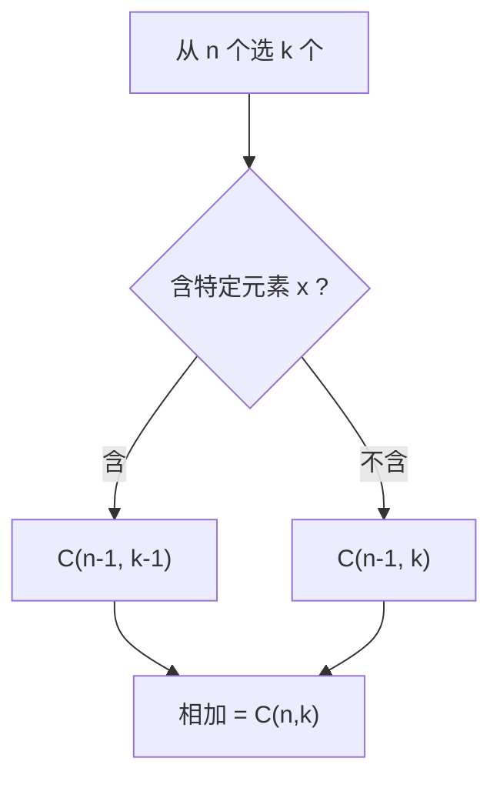

# MATH-504 排列组合与递归

## 1. 知识概览

| 项 | 内容 |
|---|---|
| 知识 ID | `MATH-504` |
| 英文名称 | Permutations, Combinations and Recursion |
| 所属模块 | M-MATH-06 离散数学与信息论 |
| 难度等级 | L3 推导 |
| 前置知识 | [[MATH-503 量词与数学归纳法]] |
| 所属知识体系 | 加法/乘法原理 → 排列 → 组合 → 递归关系 |
| **AI 应用场景** | 复杂度分析（组合爆炸）、采样空间大小、搜索空间估算、词表组合数 |
| **预计学习时间** | 55 分钟 |

**为什么学它**：为什么"穷举所有可能"不可行？因为组合数增长极快。长度 10、词表 5 万的序列有 $50000^{10}$ 种——**这个量级说明为什么需要模型而不是搜索**。

## 2. 直观理解

- **加法原理**：做一件事有两类互斥方法，分别 $m$、$n$ 种，共 $m+n$ 种。**"或"就加**。
- **乘法原理**：分两步做，第一步 $m$ 种、第二步 $n$ 种，共 $mn$ 种。**"且"就乘**。

**排列**：讲究**顺序**（排队）。
**组合**：不讲究顺序（选人）。

从 5 个人里选 2 个：

- 排列：谁站前谁站后不同 ⇒ $5\times4=20$。
- 组合：只看选中谁 ⇒ $20/2=10$。

**递归**：把大问题化成同类小问题，加一个"出口"。

## 3. 正式数学定义

**排列数**

$$
P(n,k) = \frac{n!}{(n-k)!} = n(n-1)\cdots(n-k+1)
$$

**组合数**

$$
C(n,k) = \binom{n}{k} = \frac{n!}{k!(n-k)!}
$$

**两个恒等式**

$$
\binom{n}{k} = \binom{n-1}{k-1} + \binom{n-1}{k} \quad(\text{帕斯卡})
$$

$$
\binom{n}{0}=\binom{n}{n}=1
$$

**递归关系**：数列 $\{a_n\}$ 由前面若干项定义，如

$$
a_n = a_{n-1} + a_{n-2}, \quad a_1=a_2=1 \quad(\text{斐波那契})
$$

**特征方程法**（线性常系数）：$a_n = pa_{n-1}+qa_{n-2}$ 的特征方程 $r^2=pr+q$。

## 4. 数学推导

### 4.1 帕斯卡恒等式（组合的递归）

**起点**：从 $n$ 个里选 $k$ 个。

**第 1 步**：固定某一个元素 $x$，把选法分成两类。

**第 2 步**：**选 $x$**：还要从剩下 $n-1$ 个里选 $k-1$ 个 ⇒ $\binom{n-1}{k-1}$ 种。

**第 3 步**：**不选 $x$**：要从剩下 $n-1$ 个里选 $k$ 个 ⇒ $\binom{n-1}{k}$ 种。

**第 4 步**：两类互斥，用加法原理

$$
\binom{n}{k} = \binom{n-1}{k-1} + \binom{n-1}{k}
$$

**结论**：组合数有天然递归结构，这正是杨辉三角的来源。

### 4.2 斐波那契的通项（特征方程）

**起点**：$a_n = a_{n-1}+a_{n-2}$，设 $a_n=r^n$。

**第 1 步**：代入得 $r^n=r^{n-1}+r^{n-2}$，两边除以 $r^{n-2}$

$$
r^2 = r + 1
$$

**第 2 步**：解二次方程

$$
r = \frac{1\pm\sqrt5}{2}
$$

**第 3 步**：通解是两解的线性组合

$$
a_n = A\left(\frac{1+\sqrt5}{2}\right)^n + B\left(\frac{1-\sqrt5}{2}\right)^n
$$

**第 4 步**：用 $a_1=a_2=1$ 定 $A,B$，得比内公式

$$
a_n = \frac{1}{\sqrt5}\left[\left(\frac{1+\sqrt5}{2}\right)^n-\left(\frac{1-\sqrt5}{2}\right)^n\right]
$$

**结论**：**递归定义 + 特征方程 ⇒ 闭式解**。增长率由主特征值 $\varphi\approx1.618$ 决定。

## 5. 几何直观与图解



```text
杨辉三角（帕斯卡）：
        1
       1 1
      1 2 1
     1 3 3 1
    1 4 6 4 1
 每个数 = 上方两数之和
```

## 6. 计算示例

**例 1**：$P(5,2)=5\times4=20$；$C(5,2)=20/2=10$。

**例 2**：$C(10,3)=\dfrac{10\times9\times8}{3\times2\times1}=120$。

**例 3**：验证帕斯卡恒等式，$n=6,k=2$：

$$
\binom62 = 15,\qquad \binom51+\binom52 = 5+10 = 15 \;\checkmark
$$

**例 4**：斐波那契前 10 项：$1,1,2,3,5,8,13,21,34,55$。

**例 5（组合爆炸）**：词表 $|\mathcal{V}|=50000$，生成长度 10 的序列，可能数

$$
50000^{10} \approx 9.8\times10^{46}
$$

远超可枚举范围——这就是"必须用概率模型"的直接理由。

## 7. Python 辅助验证

**依赖**：标准库 `math`（`perm`/`comb`）。

```powershell
python math504_combinatorics.py
```

```python
import math

print("P(5,2) =", math.perm(5, 2))
print("C(5,2) =", math.comb(5, 2))
print("C(10,3) =", math.comb(10, 3))
print("帕斯卡 C(6,2)==C(5,1)+C(5,2):",
      math.comb(6, 2) == math.comb(5, 1) + math.comb(5, 2))


def fib(n, memo=None):
    if memo is None:
        memo = {}
    if n <= 2:
        return 1
    if n in memo:
        return memo[n]
    memo[n] = fib(n - 1) + fib(n - 2)
    return memo[n]


print("斐波那契前 10 项:", [fib(i) for i in range(1, 11)])
```

**实际运行结果**

```
P(5,2) = 20
C(5,2) = 10
C(10,3) = 120
帕斯卡 C(6,2)==C(5,1)+C(5,2): True
斐波那契前 10 项: [1, 1, 2, 3, 5, 8, 13, 21, 34, 55]
```

**代码解析**

- `math.perm` 与 `math.comb` 分别对应排列与组合，都是精确整数。
- 斐波那契用**记忆化递归**：不加 memo 时 $n=35$ 就要几秒，加了以后 $O(n)$。
- 帕斯卡恒等式用数值验证（不是证明），证明靠 4.1 的分类讨论。

## 8. 知识关联

| 类型 | 链接 |
|---|---|
| 前置数学 | [[MATH-503 量词与数学归纳法]]、[[MATH-501 集合与集合运算]] |
| 后续数学 | `MATH-505 图论与树基础`、`MATH-506 信息量与熵` |
| 相关 Python | [[PY-022 递归]]、[[PY-020 时间复杂度]] |
| 相关机器学习 | 待关联（搜索空间估算、组合特征） |
| 相关深度学习 | 待关联（序列建模的组合爆炸） |
| 相关大语言模型 | 待关联（$|\mathcal{V}|^n$ 的生成空间） |

## 9. 实战练习

**基础 1**：从 8 人中选 3 人组成小组，有多少种？

**基础 2**：8 人排成一排，有多少种排法？

**进阶 1**：用组合论证证明 $\binom{n}{1}+\binom{n}{2}+\cdots+\binom{n}{n}=2^n-1$。

**综合 1**：词表 32000，生成长度 8 的序列，估算可能数并说明与"可枚举"的差距。

## 10. 参考答案

> [!success]- 基础 1
> $$\binom{8}{3} = \frac{8\times7\times6}{3\times2\times1} = 56$$

> [!success]- 基础 2
> $$8! = 40320$$

> [!success]- 进阶 1
> 左边数的是"从 $n$ 个里选非空子集的方案数"。
>
> 另一方面，每个元素有"选/不选"两种状态，共 $2^n$ 个子集，去掉空集即 $2^n-1$。
>
> 两种数法数的是同一批对象 ⇒ 相等。

> [!success]- 综合 1
> $$32000^8 \approx 1.1\times10^{36}$$
>
> 即使每秒枚举 $10^9$ 个，也需要约 $10^{20}$ 年。而宇宙年龄约 $1.4\times10^{10}$ 年。
>
> **结论**：穷举完全不可行，必须用模型直接"生成"高概率序列。

## 11. 常见错误

| 类型 | 错误表现 | 原因 | 纠正 |
|---|---|---|---|
| 概念错误 | 该用组合却用排列 | 忽略顺序 | 先判断"顺序是否重要" |
| 计算错误 | $\binom{n}{k}$ 分子分母错位 | 公式记混 | 分子 $n!/(n-k)!$，分母 $k!$ |
| 概念错误 | 加法乘法原理混用 | "或/且"没分清 | 或加、且乘 |
| 实践错误 | 递归不写出口 | 无限递归 | 必须有基础情形 |
| 实践错误 | 递归不记忆化 | 指数级重复 | 加 memo 或改迭代 |

## 12. 学习记录

| 日期 | 状态 | 掌握程度 | 复习状态 | 学习笔记 | 关联练习 |
|---|---|---|---|---|---|
| — | planned | — | — | — | 练习 1–4 |

---

## 🔗 Notion 同步信息

> 以下内容由 Notion「AI Knowledge System · 知识点」数据库按知识 ID 合并而来（导出于 2026-11-09）。

| 属性 | 值 |
|---|---|
| 学科 | 数学 |
| 学习状态 | 未开始 |
| 难度 | L3 推导 |
| 知识类型 | Technique |

- **所属模块**：[M-MATH-06 离散数学与信息论](../%E8%AF%BE%E7%A8%8B%E6%A8%A1%E5%9D%97/M-MATH-06%20%E7%A6%BB%E6%95%A3%E6%95%B0%E5%AD%A6%E4%B8%8E%E4%BF%A1%E6%81%AF%E8%AE%BA.md)
- **前置知识**：[MATH-503 量词与数学归纳法](MATH-503%20%E9%87%8F%E8%AF%8D%E4%B8%8E%E6%95%B0%E5%AD%A6%E5%BD%92%E7%BA%B3%E6%B3%95.md)
- **后继知识**：[MATH-505 图论与树基础](MATH-505%20%E5%9B%BE%E8%AE%BA%E4%B8%8E%E6%A0%91%E5%9F%BA%E7%A1%80.md)
- **关联Python**：[PY-022 递归](../../01_Python%E5%9F%BA%E7%A1%80/03%20%E6%95%B0%E6%8D%AE%E7%BB%93%E6%9E%84/PY-022%20%E9%80%92%E5%BD%92.md)
- **关联数学**：[MATH-503 量词与数学归纳法](MATH-503%20%E9%87%8F%E8%AF%8D%E4%B8%8E%E6%95%B0%E5%AD%A6%E5%BD%92%E7%BA%B3%E6%B3%95.md)
- **被引用为数学**：[MATH-505 图论与树基础](MATH-505%20%E5%9B%BE%E8%AE%BA%E4%B8%8E%E6%A0%91%E5%9F%BA%E7%A1%80.md) · [LLM-047 上下文窗口与位置外推](../../05_%E5%A4%A7%E8%AF%AD%E8%A8%80%E6%A8%A1%E5%9E%8B/05%20%E9%A2%84%E8%AE%AD%E7%BB%83%E4%B8%8E%E5%BE%AE%E8%B0%83/LLM-047%20%E4%B8%8A%E4%B8%8B%E6%96%87%E7%AA%97%E5%8F%A3%E4%B8%8E%E4%BD%8D%E7%BD%AE%E5%A4%96%E6%8E%A8.md) · [LLM-048 微调范式：全参与参数高效](../../05_%E5%A4%A7%E8%AF%AD%E8%A8%80%E6%A8%A1%E5%9E%8B/05%20%E9%A2%84%E8%AE%AD%E7%BB%83%E4%B8%8E%E5%BE%AE%E8%B0%83/LLM-048%20%E5%BE%AE%E8%B0%83%E8%8C%83%E5%BC%8F%EF%BC%9A%E5%85%A8%E5%8F%82%E4%B8%8E%E5%8F%82%E6%95%B0%E9%AB%98%E6%95%88.md) · [LLM-052 现代 Decoder-only 架构的差异](../../05_%E5%A4%A7%E8%AF%AD%E8%A8%80%E6%A8%A1%E5%9E%8B/05%20%E9%A2%84%E8%AE%AD%E7%BB%83%E4%B8%8E%E5%BE%AE%E8%B0%83/LLM-052%20%E7%8E%B0%E4%BB%A3%20Decoder-only%20%E6%9E%B6%E6%9E%84%E7%9A%84%E5%B7%AE%E5%BC%82.md) · [LLM-093 束搜索与确定性解码](../../05_%E5%A4%A7%E8%AF%AD%E8%A8%80%E6%A8%A1%E5%9E%8B/06%20%E6%8E%A8%E7%90%86%E4%B8%8E%E9%83%A8%E7%BD%B2/LLM-093%20%E6%9D%9F%E6%90%9C%E7%B4%A2%E4%B8%8E%E7%A1%AE%E5%AE%9A%E6%80%A7%E8%A7%A3%E7%A0%81.md)
