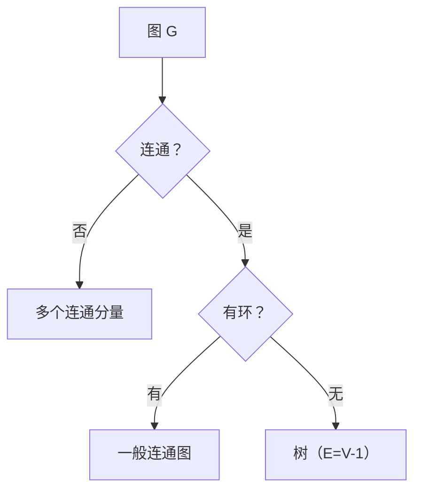

# MATH-505 图论与树基础

## 1. 知识概览

| 项 | 内容 |
|---|---|
| 知识 ID | `MATH-505` |
| 英文名称 | Basics of Graph Theory and Trees |
| 所属模块 | M-MATH-06 离散数学与信息论 |
| 难度等级 | L2 应用 |
| 前置知识 | [[MATH-504 排列组合与递归]] |
| 所属知识体系 | 图 → 度 → 路径 → 连通 → 树 |
| **AI 应用场景** | 计算图（反向传播就是图遍历）、决策树、知识图谱、GNN、搜索算法 |
| **预计学习时间** | 50 分钟 |

**为什么学它**：**PyTorch 的计算图就是一个有向无环图（DAG）**，反向传播是按拓扑序反向遍历。决策树、知识图谱、图神经网络——它们的数学基础都是图论。

## 2. 直观理解

图 = **点 + 边**。

- **无向图**：边没有方向（朋友关系）。
- **有向图**：边有方向（关注关系、计算图）。
- **度**：一个点连了几条边。

**树**是特殊的图：**连通且无环**。像家族谱、文件夹结构。

**核心直觉**：树是"最省的连通方式"——$V$ 个点只要 $V-1$ 条边就能全连通；多一条就有环，少一条就断开。

## 3. 正式数学定义

**图** $G=(V,E)$：顶点集 $V$、边集 $E$。

**度**：$\deg(v)$ 为与 $v$ 相连的边数。

**握手定理**

$$
\sum_{v\in V}\deg(v) = 2|E|
$$

**路径 / 回路**：依次相邻的顶点序列；首尾相同则为回路。

**连通**：任意两点间存在路径。

**树**：连通无环的无向图。等价条件（任一成立即可）：

1. 连通且 $|E|=|V|-1$；
2. 无环且 $|E|=|V|-1$；
3. 任意两点间**恰有唯一一条路径**。

**DAG**：有向无环图。

**拓扑序**：DAG 顶点的一个线性排列，使每条边都从前指向后。

## 4. 数学推导

### 4.1 握手定理

**起点**：数"边—端点"配对的总数。

**第 1 步**：每条边有两个端点，所以配对总数是 $2|E|$。

**第 2 步**：换个数法——按顶点数。顶点 $v$ 贡献 $\deg(v)$ 个配对数。

**第 3 步**：两种数法数的是同一批对象

$$
\sum_{v}\deg(v) = 2|E|
$$

**推论**：度为奇数的顶点个数必为**偶数**（因为总和是偶数）。

### 4.2 树为什么恰好 $|V|-1$ 条边

**起点**：树连通且无环。

**第 1 步（构造）**：从单点树开始，$|V|=1$、$|E|=0$，满足 $|E|=|V|-1$。

**第 2 步（每次加点）**：向树上加一个新顶点，为了保持连通**至少**要加一条边。

**第 3 步（不能加两条）**：若加两条边，新点会与已有两个点相连，形成环——违反"无环"。

**第 4 步**：所以每加一个点恰加一条边，归纳得

$$
|E| = |V|-1
$$

**结论**：树的边数被顶点数完全确定。这也是"树的存储只需记父节点"的依据。

## 5. 几何直观与图解



```text
树:        一般图（有环）:
   1          1
  / \        / \
 2   3      2---3
 |           \ /
 4            4
E=3,V=4      E=4,V=4 → 有环
```

## 6. 计算示例

**例**：图 $G$ 的边为 $(1,2),(1,3),(2,4),(3,4),(4,5)$。

**第 1 步**：顶点数 $|V|=5$（1,2,3,4,5），边数 $|E|=5$。

**第 2 步**：各点度数

| 顶点 | 邻居 | 度 |
|---|---|---|
| 1 | 2,3 | 2 |
| 2 | 1,4 | 2 |
| 3 | 1,4 | 2 |
| 4 | 2,3,5 | 3 |
| 5 | 4 | 1 |

**第 3 步**：验证握手定理

$$
2+2+2+3+1 = 10 = 2\times5 \;\checkmark
$$

**第 4 步**：从 1 到 5 的最短路径长度。

$1\to2\to4\to5$（3 步）或 $1\to3\to4\to5$（3 步），所以距离为 **3**。

**例 2**：树 $(1,2),(1,3),(2,4)$：$|E|=3$、$|V|=4$，满足 $|E|=|V|-1$ ✓

## 7. Python 辅助验证

**依赖**：标准库 `collections.deque`。

```powershell
python math505_graph.py
```

```python
from collections import deque

edges = [(1, 2), (1, 3), (2, 4), (3, 4), (4, 5)]
adj = {}
for u, v in edges:
    adj.setdefault(u, []).append(v)
    adj.setdefault(v, []).append(u)

print("|V| =", len(adj), " |E| =", len(edges))
deg_sum = sum(len(nb) for nb in adj.values())
print("度和 =", deg_sum, "= 2|E| =", 2 * len(edges))


def bfs_distance(start, target):
    q = deque([(start, 0)])
    seen = {start}
    while q:
        u, d = q.popleft()
        if u == target:
            return d
        for w in adj[u]:
            if w not in seen:
                seen.add(w)
                q.append((w, d + 1))
    return None


print("1 到 5 的最短距离:", bfs_distance(1, 5))

tree = [(1, 2), (1, 3), (2, 4)]
verts = {x for e in tree for x in e}
print("树的 |E| =", len(tree), " |V|-1 =", len(verts) - 1)
```

**实际运行结果**

```
|V| = 5  |E| = 5
度和 = 10 = 2|E| = 10
1 到 5 的最短距离: 3
树的 |E| = 3  |V|-1 = 3
```

**代码解析**

- 邻接表用 dict of list 存无向图（正反各加一次）。
- `deg_sum` 直接累加邻居个数，等于 $2|E|$，验证握手定理。
- BFS 求最短距离（无权图），返回 3。
- 树的边数恰好是 $|V|-1$，与推导一致。

## 8. 知识关联

| 类型 | 链接 |
|---|---|
| 前置数学 | [[MATH-504 排列组合与递归]]、[[MATH-501 集合与集合运算]] |
| 后续数学 | `MATH-506 信息量与熵`（决策树的信息增益） |
| 相关 Python | [[PY-016 链表]]、[[PY-017 树的基本概念]]、[[PY-022 递归]] |
| 相关机器学习 | 待关联（决策树、随机森林） |
| 相关深度学习 | 待关联（计算图、GNN、拓扑序反向传播） |
| 相关大语言模型 | 待关联（注意力图的稀疏性） |

## 9. 实战练习

**基础 1**：4 个顶点的完全图 $K_4$ 有多少条边？每个点的度是多少？

**基础 2**：一棵树有 12 个顶点，它有多少条边？

**进阶 1**：证明"度为奇数的顶点个数必为偶数"。

**综合 1**：为什么反向传播必须按拓扑序（从输出往输入）进行？用 DAG 解释。

## 10. 参考答案

> [!success]- 基础 1
> $$|E| = \binom{4}{2} = 6,\qquad \deg = 3 \text{（每个点连其余 3 点）}$$
>
> 验证：$4\times3 = 12 = 2\times6$ ✓

> [!success]- 基础 2
> $$|E| = |V|-1 = 11$$

> [!success]- 进阶 1
> 由握手定理 $\sum\deg(v)=2|E|$ 是偶数。
>
> 偶数 = 偶度顶点之和（偶数）+ 奇度顶点之和。
>
> 所以"奇度顶点之和"必为偶数，而每个奇度至少为 1 且是奇数，故奇度顶点个数必为偶数。

> [!success]- 综合 1
> 计算图是 DAG。若存在边 $u\to v$（$v$ 由 $u$ 算出），则 $v$ 的梯度依赖 $u$ 的梯度，必须先算 $v$ 再算 $u$。
>
> 拓扑序保证"所有下游都算完了才算上游"，否则会用不完整的信息。DAG 无环保证了这种顺序一定存在（有环则无法排序）。

## 11. 常见错误

| 类型 | 错误表现 | 原因 | 纠正 |
|---|---|---|---|
| 概念错误 | 把树当"任意连通图" | 忘了无环 | 树 = 连通 + 无环 |
| 计算错误 | 握手定理漏乘 2 | 每条边计两次 | $\sum\deg=2|E|$ |
| 概念错误 | 有向图也用 $E=V-1$ 判树 | 树定义针对无向 | 有向看 DAG |
| 概念错误 | 认为环不影响连通性 | 环是多余边 | 去掉环仍连通 |
| 实践错误 | 图遍历不记 visited | 死循环 | 必须标记已访问 |

## 12. 学习记录

| 日期 | 状态 | 掌握程度 | 复习状态 | 学习笔记 | 关联练习 |
|---|---|---|---|---|---|
| — | planned | — | — | — | 练习 1–4 |

---

## 🔗 Notion 同步信息

> 以下内容由 Notion「AI Knowledge System · 知识点」数据库按知识 ID 合并而来（导出于 2026-11-09）。

| 属性 | 值 |
|---|---|
| 学科 | 数学 |
| 学习状态 | 未开始 |
| 难度 | L2 应用 |
| 知识类型 | Concept |

- **所属模块**：[M-MATH-06 离散数学与信息论](../%E8%AF%BE%E7%A8%8B%E6%A8%A1%E5%9D%97/M-MATH-06%20%E7%A6%BB%E6%95%A3%E6%95%B0%E5%AD%A6%E4%B8%8E%E4%BF%A1%E6%81%AF%E8%AE%BA.md)
- **前置知识**：[MATH-504 排列组合与递归](MATH-504%20%E6%8E%92%E5%88%97%E7%BB%84%E5%90%88%E4%B8%8E%E9%80%92%E5%BD%92.md)
- **后继知识**：[MATH-506 信息量与熵](MATH-506%20%E4%BF%A1%E6%81%AF%E9%87%8F%E4%B8%8E%E7%86%B5.md)
- **关联Python**：[PY-022 递归](../../01_Python%E5%9F%BA%E7%A1%80/03%20%E6%95%B0%E6%8D%AE%E7%BB%93%E6%9E%84/PY-022%20%E9%80%92%E5%BD%92.md)
- **关联数学**：[MATH-504 排列组合与递归](MATH-504%20%E6%8E%92%E5%88%97%E7%BB%84%E5%90%88%E4%B8%8E%E9%80%92%E5%BD%92.md)
- **被引用为数学**：[MATH-506 信息量与熵](MATH-506%20%E4%BF%A1%E6%81%AF%E9%87%8F%E4%B8%8E%E7%86%B5.md) · [PY-017 树的基本概念](../../01_Python%E5%9F%BA%E7%A1%80/03%20%E6%95%B0%E6%8D%AE%E7%BB%93%E6%9E%84/PY-017%20%E6%A0%91%E7%9A%84%E5%9F%BA%E6%9C%AC%E6%A6%82%E5%BF%B5.md)
