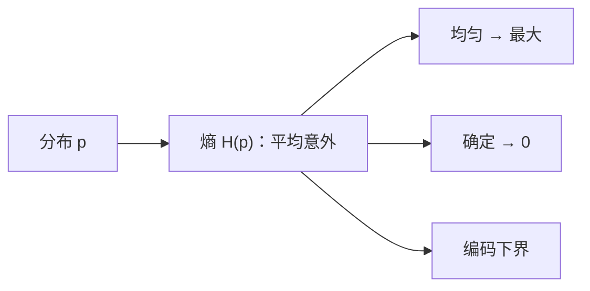

# MATH-506 信息量与熵

## 1. 知识概览

| 项 | 内容 |
|---|---|
| 知识 ID | `MATH-506` |
| 英文名称 | Information Content and Entropy |
| 所属模块 | M-MATH-06 离散数学与信息论 |
| 难度等级 | L3 推导 |
| 前置知识 | [[MATH-505 图论与树基础]]、[[MATH-303 随机变量与分布函数]] |
| 所属知识体系 | 信息量 → 熵 → 条件熵 → 互信息 |
| **AI 应用场景** | 交叉熵损失、决策树信息增益、困惑度（perplexity）、压缩下限 |
| **预计学习时间** | 55 分钟 |

**为什么学它**：**交叉熵损失的理论根基就是熵**。语言模型的 perplexity 就是 $2^{H}$。理解熵，才能理解"模型在学什么"——它在降低对下一个 token 的不确定性。

## 2. 直观理解

**信息量**：一件越**意外**的事，信息量越大。

- "太阳从东边升起"：信息量≈0（几乎必然）。
- "今天中了彩票"：信息量巨大。

**熵**：一个分布的**平均意外程度**，也就是**不确定性**。

- 均匀硬币（$p=0.5$）：最不确定，熵最大（1 bit）。
- 灌铅硬币（$p=0.99$）：几乎确定，熵很小。

生活类比：熵是"你平均需要多少次是/否回答才能猜出结果"。

## 3. 正式数学定义

**信息量（自信息）**

$$
I(x) = -\log_2 p(x)
$$

**熵**（离散分布 $p$）

$$
H(p) = -\sum_x p(x)\log_2 p(x)
$$

单位：比特（bit）。用 $\ln$ 时单位是 nat。

**性质**

$$
0 \le H(p) \le \log_2 n
$$

- 下界：确定性分布（某个 $p=1$）熵为 0。
- 上界：均匀分布取到 $\log_2 n$。

**联合熵 / 条件熵**

$$
H(X,Y) = -\sum_{x,y}p(x,y)\log p(x,y)
$$

$$
H(Y\mid X) = H(X,Y) - H(X)
$$

**互信息**

$$
I(X;Y) = H(X) - H(X\mid Y) = H(X)+H(Y)-H(X,Y)
$$

**信息增益**（决策树分裂准则）：$I(\text{特征};\text{标签})$。

## 4. 数学推导

### 4.1 均匀分布为什么熵最大

**起点**：$n$ 个结果的分布 $p_i$，$\sum p_i=1$。

**第 1 步**：要最大化 $H=-\sum p_i\log p_i$，用拉格朗日乘子

$$
\mathcal{L} = -\sum p_i\log p_i + \lambda\left(\sum p_i - 1\right)
$$

**第 2 步**：对 $p_i$ 求导并令 0

$$
-\log p_i - \frac{1}{\ln 2} + \lambda = 0
$$

**第 3 步**：解得 $p_i$ 与 $i$ 无关，即所有 $p_i$ 相等

$$
p_i = \frac1n
$$

**第 4 步**：代回得最大值

$$
H_{max} = -\sum \frac1n\log\frac1n = \log_2 n
$$

**结论**：**均匀分布信息量最大**——没有任何先验偏好时，不确定性最高。这也解释了为什么"模型输出均匀分布"意味着"它什么都没学到"。

### 4.2 熵与编码长度的关系（香农信源编码）

**起点**：要给每个符号分配二进制码。

**第 1 步**：符号 $x$ 出现概率 $p(x)$，直觉上它需要的码长应约为 $-\log_2 p(x)$。

**第 2 步**：平均码长

$$
\bar L = \sum p(x)\,\ell(x)
$$

**第 3 步**：香农证明最优平均码长满足

$$
H(p) \le \bar L < H(p) + 1
$$

**结论**：**熵是压缩的下界**。任何无损编码平均至少要 $H(p)$ 比特/符号。这是"为什么熵叫信息量"的严格含义。

## 5. 几何直观与图解



```text
H(p) 随二元分布 p 变化：
 1 ┤    ╭──╮
   │   ╱    ╲
 0 ┴──╱      ╲──
    0   0.5    1  ← p
```

## 6. 计算示例

**例 1**：均匀硬币 $p=(0.5,0.5)$

$$
H = -0.5\log_2 0.5 - 0.5\log_2 0.5 = 1 \text{ bit}
$$

**例 2**：灌铅硬币 $q=(0.9,0.1)$

$$
H = -0.9\log_2 0.9 - 0.1\log_2 0.1 \approx 0.469 \text{ bit}
$$

**例 3**：4 个等可能结果 $r=(0.25,0.25,0.25,0.25)$

$$
H = \log_2 4 = 2 \text{ bit}
$$

**对比**：均匀 2 结果 1 bit，均匀 4 结果 2 bit —— **每翻倍结果数，熵加 1 bit**。

## 7. Python 辅助验证

**依赖**：标准库 `math`。

```powershell
python math506_entropy.py
```

```python
import math


def entropy(p):
    return -sum(x * math.log2(x) for x in p if x > 0)


print("H(0.5, 0.5) =", entropy([0.5, 0.5]))
print("H(0.9, 0.1) =", round(entropy([0.9, 0.1]), 4))
print("H(均匀 4 项) =", entropy([0.25] * 4))
print("H(确定性) =", entropy([1.0]))
```

**实际运行结果**

```
H(0.5, 0.5) = 1.0
H(0.9, 0.1) = 0.469
H(均匀 4 项) = 2.0
H(确定性) = 0.0
```

**代码解析**

- `if x > 0` 跳过零概率项（$0\log0$ 约定为 0）。
- 均匀 4 项得 2.0，正好 $\log_2 4$，验证上界。
- 确定性分布熵为 0，验证下界。
- 二元分布从 0.5 移到 0.9，熵从 1 降到 0.469——**越偏越确定**。

## 8. 知识关联

| 类型 | 链接 |
|---|---|
| 前置数学 | [[MATH-505 图论与树基础]]、[[MATH-303 随机变量与分布函数]]、[[MATH-003 指数、根式与对数]] |
| 后续数学 | `MATH-507 交叉熵与 KL 散度`（待建）、`MATH-807 贝叶斯分类`（待建） |
| 相关 Python | [[PY-003 运算符]] |
| 相关机器学习 | 待关联（决策树信息增益、特征选择） |
| 相关深度学习 | 待关联（交叉熵损失、困惑度） |
| 相关大语言模型 | 待关联（perplexity $=2^{H}$、token 熵） |

## 9. 实战练习

**基础 1**：$p=(0.25,0.75)$，求熵（保留 3 位）。

**基础 2**：8 个等可能结果的熵是多少？

**进阶 1**：证明 $H(p)\ge0$，并指出等号成立条件。

**综合 1**：某语言模型对下一个 token 的预测分布为 $(0.5,0.3,0.2)$，求困惑度（perplexity $=2^{H}$）。

## 10. 参考答案

> [!success]- 基础 1
> $$H = -0.25\log_2 0.25 - 0.75\log_2 0.75 \approx 0.5 + 0.3113 = 0.8113$$
>
> 约 **0.811 bit**。

> [!success]- 基础 2
> $$H = \log_2 8 = 3 \text{ bit}$$

> [!success]- 进阶 1
> 因 $0<p\le1$，有 $\log_2 p\le0$，故 $-p\log_2 p\ge0$，求和仍 $\ge0$。
>
> 等号成立当且仅当所有非零 $p$ 都满足 $\log_2 p=0$，即 $p=1$——**确定性分布**。

> [!success]- 综合 1
> $$H = -(0.5\log_2 0.5 + 0.3\log_2 0.3 + 0.2\log_2 0.2)$$
>
> $$= 0.5 + 0.5211 + 0.4644 \approx 1.4855$$
>
> $$\text{PPL} = 2^{1.4855} \approx 2.80$$
>
> 含义：模型平均"在约 2.8 个等可能选项之间犹豫"。

## 11. 常见错误

| 类型 | 错误表现 | 原因 | 纠正 |
|---|---|---|---|
| 概念错误 | 认为熵可以为负 | 概率≤1，$-\log p\ge0$ | 熵非负 |
| 计算错误 | 用 $\log_{10}$ 却标 bit | 底数错 | bit 用 $\log_2$ |
| 概念错误 | 认为熵是"分布的好坏" | 熵只是不确定性 | 与任务表现无关 |
| 计算错误 | 零概率项直接算 $\log0$ | 未跳过 | 约定 $0\log0=0$ |
| 概念错误 | 混淆熵与交叉熵 | 后者需两个分布 | 熵只需一个分布 |

## 12. 学习记录

| 日期 | 状态 | 掌握程度 | 复习状态 | 学习笔记 | 关联练习 |
|---|---|---|---|---|---|
| — | planned | — | — | — | 练习 1–4 |

---

## 🔗 Notion 同步信息

> 以下内容由 Notion「AI Knowledge System · 知识点」数据库按知识 ID 合并而来（导出于 2026-11-09）。

| 属性 | 值 |
|---|---|
| 学科 | 数学 |
| 学习状态 | 未开始 |
| 难度 | L3 推导 |
| 知识类型 | Concept |

- **所属模块**：[M-MATH-06 离散数学与信息论](../%E8%AF%BE%E7%A8%8B%E6%A8%A1%E5%9D%97/M-MATH-06%20%E7%A6%BB%E6%95%A3%E6%95%B0%E5%AD%A6%E4%B8%8E%E4%BF%A1%E6%81%AF%E8%AE%BA.md)
- **前置知识**：[MATH-505 图论与树基础](MATH-505%20%E5%9B%BE%E8%AE%BA%E4%B8%8E%E6%A0%91%E5%9F%BA%E7%A1%80.md)
- **后继知识**：[MATH-507 交叉熵与 KL 散度](MATH-507%20%E4%BA%A4%E5%8F%89%E7%86%B5%E4%B8%8E%20KL%20%E6%95%A3%E5%BA%A6.md)
- **关联Python**：[PY-003 运算符](../../01_Python%E5%9F%BA%E7%A1%80/01%20%E8%AF%AD%E6%B3%95%E4%B8%8E%E7%B1%BB%E5%9E%8B/PY-003%20%E8%BF%90%E7%AE%97%E7%AC%A6.md)
- **关联数学**：[MATH-505 图论与树基础](MATH-505%20%E5%9B%BE%E8%AE%BA%E4%B8%8E%E6%A0%91%E5%9F%BA%E7%A1%80.md)
- **被引用为数学**：[MATH-507 交叉熵与 KL 散度](MATH-507%20%E4%BA%A4%E5%8F%89%E7%86%B5%E4%B8%8E%20KL%20%E6%95%A3%E5%BA%A6.md) · [ML-028 决策树](../../03_%E6%9C%BA%E5%99%A8%E5%AD%A6%E4%B9%A0/02%20%E7%9B%91%E7%9D%A3%E5%AD%A6%E4%B9%A0/ML-028%20%E5%86%B3%E7%AD%96%E6%A0%91.md) · [ML-053 AdaBoost](../../03_%E6%9C%BA%E5%99%A8%E5%AD%A6%E4%B9%A0/06%20%E6%A8%A1%E5%9E%8B%E4%BC%98%E5%8C%96/ML-053%20AdaBoost.md) · [ML-057 特征重要性与模型解释](../../03_%E6%9C%BA%E5%99%A8%E5%AD%A6%E4%B9%A0/06%20%E6%A8%A1%E5%9E%8B%E4%BC%98%E5%8C%96/ML-057%20%E7%89%B9%E5%BE%81%E9%87%8D%E8%A6%81%E6%80%A7%E4%B8%8E%E6%A8%A1%E5%9E%8B%E8%A7%A3%E9%87%8A.md) · [LLM-001 什么是语言模型](../../05_%E5%A4%A7%E8%AF%AD%E8%A8%80%E6%A8%A1%E5%9E%8B/01%20NLP%E5%9F%BA%E7%A1%80/LLM-001%20%E4%BB%80%E4%B9%88%E6%98%AF%E8%AF%AD%E8%A8%80%E6%A8%A1%E5%9E%8B.md) · [LLM-002 统计语言模型与 N-gram](../../05_%E5%A4%A7%E8%AF%AD%E8%A8%80%E6%A8%A1%E5%9E%8B/01%20NLP%E5%9F%BA%E7%A1%80/LLM-002%20%E7%BB%9F%E8%AE%A1%E8%AF%AD%E8%A8%80%E6%A8%A1%E5%9E%8B%E4%B8%8E%20N-gram.md) · [LLM-005 什么是大语言模型](../../05_%E5%A4%A7%E8%AF%AD%E8%A8%80%E6%A8%A1%E5%9E%8B/01%20NLP%E5%9F%BA%E7%A1%80/LLM-005%20%E4%BB%80%E4%B9%88%E6%98%AF%E5%A4%A7%E8%AF%AD%E8%A8%80%E6%A8%A1%E5%9E%8B.md) · [LLM-014 Softmax 在 Attention 中的作用](../../05_%E5%A4%A7%E8%AF%AD%E8%A8%80%E6%A8%A1%E5%9E%8B/03%20Attention%E6%9C%BA%E5%88%B6/LLM-014%20Softmax%20%E5%9C%A8%20Attention%20%E4%B8%AD%E7%9A%84%E4%BD%9C%E7%94%A8.md) · [LLM-045 预训练目标对比：MLM、CLM 与 Span Corruption](../../05_%E5%A4%A7%E8%AF%AD%E8%A8%80%E6%A8%A1%E5%9E%8B/05%20%E9%A2%84%E8%AE%AD%E7%BB%83%E4%B8%8E%E5%BE%AE%E8%B0%83/LLM-045%20%E9%A2%84%E8%AE%AD%E7%BB%83%E7%9B%AE%E6%A0%87%E5%AF%B9%E6%AF%94%EF%BC%9AMLM%E3%80%81CLM%20%E4%B8%8E%20Span%20Corruption.md) · [LLM-046 双向上下文与单向生成](../../05_%E5%A4%A7%E8%AF%AD%E8%A8%80%E6%A8%A1%E5%9E%8B/05%20%E9%A2%84%E8%AE%AD%E7%BB%83%E4%B8%8E%E5%BE%AE%E8%B0%83/LLM-046%20%E5%8F%8C%E5%90%91%E4%B8%8A%E4%B8%8B%E6%96%87%E4%B8%8E%E5%8D%95%E5%90%91%E7%94%9F%E6%88%90.md) · [LLM-049 零样本、少样本与上下文学习](../../05_%E5%A4%A7%E8%AF%AD%E8%A8%80%E6%A8%A1%E5%9E%8B/05%20%E9%A2%84%E8%AE%AD%E7%BB%83%E4%B8%8E%E5%BE%AE%E8%B0%83/LLM-049%20%E9%9B%B6%E6%A0%B7%E6%9C%AC%E3%80%81%E5%B0%91%E6%A0%B7%E6%9C%AC%E4%B8%8E%E4%B8%8A%E4%B8%8B%E6%96%87%E5%AD%A6%E4%B9%A0.md) · [LLM-050 提示的结构与格式敏感性](../../05_%E5%A4%A7%E8%AF%AD%E8%A8%80%E6%A8%A1%E5%9E%8B/05%20%E9%A2%84%E8%AE%AD%E7%BB%83%E4%B8%8E%E5%BE%AE%E8%B0%83/LLM-050%20%E6%8F%90%E7%A4%BA%E7%9A%84%E7%BB%93%E6%9E%84%E4%B8%8E%E6%A0%BC%E5%BC%8F%E6%95%8F%E6%84%9F%E6%80%A7.md) · [LLM-051 模型规模与能力的关系](../../05_%E5%A4%A7%E8%AF%AD%E8%A8%80%E6%A8%A1%E5%9E%8B/05%20%E9%A2%84%E8%AE%AD%E7%BB%83%E4%B8%8E%E5%BE%AE%E8%B0%83/LLM-051%20%E6%A8%A1%E5%9E%8B%E8%A7%84%E6%A8%A1%E4%B8%8E%E8%83%BD%E5%8A%9B%E7%9A%84%E5%85%B3%E7%B3%BB.md) · [LLM-092 采样策略：温度、Top-K、Top-P](../../05_%E5%A4%A7%E8%AF%AD%E8%A8%80%E6%A8%A1%E5%9E%8B/06%20%E6%8E%A8%E7%90%86%E4%B8%8E%E9%83%A8%E7%BD%B2/LLM-092%20%E9%87%87%E6%A0%B7%E7%AD%96%E7%95%A5%EF%BC%9A%E6%B8%A9%E5%BA%A6%E3%80%81Top-K%E3%80%81Top-P.md)
