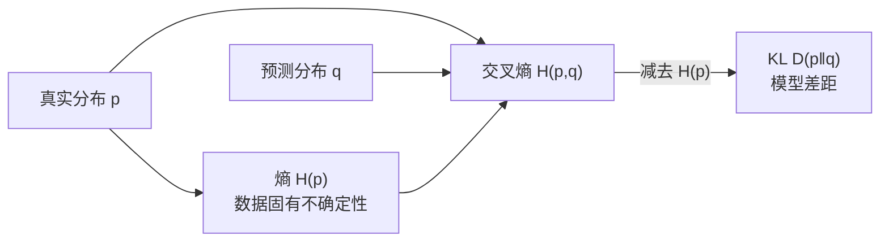

# MATH-507 交叉熵与 KL 散度

## 1. 知识概览

| 项 | 内容 |
|---|---|
| 知识 ID | `MATH-507` |
| 英文名称 | Cross-Entropy and KL Divergence |
| 所属模块 | M-MATH-06 离散数学与信息论 |
| 难度等级 | L3 推导 |
| 前置知识 | [[MATH-506 信息量与熵]] |
| 所属知识体系 | 熵 → 交叉熵 → KL 散度 → 三者关系 |
| **AI 应用场景** | 分类损失函数、语言模型训练目标、蒸馏损失、VAE 的正则项 |
| **预计学习时间** | 55 分钟 |

**为什么学它**：**分类任务的标准损失就是交叉熵**。理解它与 KL 散度的关系，才能解释"为什么最小化交叉熵等价于让预测分布逼近真实分布"，也才能理解知识蒸馏里的 KL 项。

## 2. 直观理解

- **熵 $H(p)$**：用**真实分布** $p$ 时，平均需要多少比特。
- **交叉熵 $H(p,q)$**：**真实是 $p$，却用 $q$ 来编码**时，平均需要多少比特。
- **KL 散度 $D(p\|q)$**：因为用错了分布 $q$，**多花的比特数**。

$$
\underbrace{H(p,q)}_{\text{用错分布的总代价}} = \underbrace{H(p)}_{\text{本来就需要的}} + \underbrace{D(p\|q)}_{\text{用错多花的}}
$$

因为 $H(p)$ 与模型无关（由数据决定），**最小化交叉熵 = 最小化 KL 散度**。

## 3. 正式数学定义

**交叉熵**

$$
H(p,q) = -\sum_x p(x)\log q(x)
$$

**KL 散度（相对熵）**

$$
D_{KL}(p\|q) = \sum_x p(x)\log\frac{p(x)}{q(x)} = H(p,q) - H(p)
$$

**性质**

| 性质 | 说明 |
|---|---|
| 非负性 | $D(p\|q)\ge0$，等号当且仅当 $p=q$ |
| 不对称 | $D(p\|q)\neq D(q\|p)$（不是距离） |
| 不满足三角不等式 | 因此叫"散度"不叫"距离" |

**前向 / 反向 KL**

- $D(p\|q)$（前向）：$p$ 有值处 $q$ 必须覆盖，倾向"覆盖所有模式"。
- $D(q\|p)$（反向）：$q$ 有值处 $p$ 必须支持，倾向"只拟合一个模式"。

## 4. 数学推导

### 4.1 KL 散度非负（Gibbs 不等式）

**起点**：要证 $\sum_x p(x)\log\dfrac{p(x)}{q(x)}\ge0$。

**第 1 步**：利用 $\ln u\le u-1$（对 $u>0$，等号仅 $u=1$）。

**第 2 步**：把 $\log_2$ 换成 $\ln$（差一个正常数 $\ln2$，不影响符号）

$$
D(p\|q) = \frac{1}{\ln2}\sum_x p(x)\ln\frac{p(x)}{q(x)}
$$

**第 3 步**：代入 $u=p/q$，乘 $p$ 后

$$
\sum_x p(x)\ln\frac{p(x)}{q(x)} \le \sum_x p(x)\left(\frac{p(x)}{q(x)}-1\right) = \sum_x \frac{p^2}{q} - 1
$$

**第 4 步**：更直接的做法是用 $\sum p=\sum q=1$

$$
-\sum p\ln\frac{q}{p} \ge -\ln\left(\sum p\cdot\frac{q}{p}\right) = -\ln 1 = 0
$$

（用了 Jensen 不等式，$\ln$ 是凹函数）

**结论**：$D(p\|q)\ge0$，且仅当 $p=q$ 时为 0。

### 4.2 交叉熵 = 熵 + KL

**起点**：展开交叉熵定义。

**第 1 步**：

$$
H(p,q) = -\sum p\log q = -\sum p\log\left(p\cdot\frac{q}{p}\right)
$$

**第 2 步**：拆成两项（对数化积为和）

$$
= -\sum p\log p - \sum p\log\frac{q}{p}
$$

**第 3 步**：第一项是 $H(p)$，第二项是 $-D(p\|q)$ 的形式

$$
= H(p) + \left(-\sum p\log\frac{q}{p}\right) = H(p) + D(p\|q)
$$

**结论**：$H(p,q)=H(p)+D(p\|q)$。这是本节最重要的恒等式。

## 5. 几何直观与图解



```text
H(p,q)
├──────────────┬──────────────┤
   H(p) 固定        D(p‖q) 可优化
   （与模型无关）    （模型越准越小）
```

## 6. 计算示例

**例**：真实 $p=(0.9,0.1)$，预测 $q=(0.5,0.5)$。

**第 1 步**：熵

$$
H(p) = -0.9\log_2 0.9 - 0.1\log_2 0.1 \approx 0.469
$$

**第 2 步**：交叉熵

$$
H(p,q) = -0.9\log_2 0.5 - 0.1\log_2 0.5 = 1.0
$$

**第 3 步**：KL

$$
D(p\|q) = 1.0 - 0.469 = 0.531
$$

**第 4 步**：反过来 $D(q\|p)$

$$
H(q,p) = -0.5\log_2 0.9 - 0.5\log_2 0.1 \approx 1.737
$$

$$
D(q\|p) = 1.737 - 1.0 = 0.737
$$

**关键观察**：$0.531\neq0.737$——**KL 不对称**，所以不能当距离用。

## 7. Python 辅助验证

**依赖**：标准库 `math`。

```powershell
python math507_cross_entropy.py
```

```python
import math


def entropy(p):
    return -sum(x * math.log2(x) for x in p if x > 0)


def cross_entropy(p, q):
    return -sum(pi * math.log2(qi) for pi, qi in zip(p, q) if pi > 0)


def kl(p, q):
    return sum(pi * math.log2(pi / qi) for pi, qi in zip(p, q) if pi > 0)


p, q = [0.9, 0.1], [0.5, 0.5]
print("H(p) =", round(entropy(p), 4))
print("H(p,q) =", round(cross_entropy(p, q), 4))
print("D(p‖q) =", round(kl(p, q), 4))
print("D(q‖p) =", round(kl(q, p), 4))
print("H(p)+D(p‖q) == H(p,q):", round(entropy(p) + kl(p, q), 4) == round(cross_entropy(p, q), 4))
print("D(p‖p) =", round(kl(p, p), 10))
```

**实际运行结果**

```
H(p) = 0.469
H(p,q) = 1.0
D(p‖q) = 0.531
D(q‖p) = 0.737
H(p)+D(p‖q) == H(p,q): True
D(p‖p) = 0.0
```

**代码解析**

- 交叉熵 1.0 恰等于"用均匀分布编码二元结果"的代价。
- $D(p\|q)\neq D(q\|p)$，直观验证不对称性。
- $H(p)+D(p\|q)=H(p,q)$ 成立，验证 4.2 的恒等式。
- $D(p\|p)=0$，验证"同分布时散度为 0"。

## 8. 知识关联

| 类型 | 链接 |
|---|---|
| 前置数学 | [[MATH-506 信息量与熵]]、[[MATH-003 指数、根式与对数]] |
| 后续数学 | `MATH-801 线性回归的数学`、`MATH-802 逻辑回归与 Sigmoid`、`MATH-805 Softmax 与交叉熵`（待建） |
| 相关 Python | [[PY-003 运算符]] |
| 相关机器学习 | 待关联（分类损失、类别不平衡） |
| 相关深度学习 | 待关联（知识蒸馏的 KL 项、VAE 正则） |
| 相关大语言模型 | 待关联（语言建模目标、perplexity） |

## 9. 实战练习

**基础 1**：$p=(0.7,0.3)$、$q=(0.6,0.4)$，求 $H(p,q)$（3 位小数）。

**基础 2**：上题求 $D(p\|q)$。

**进阶 1**：证明 $H(p,q)$ 在 $q=p$ 时取最小值，且最小值为 $H(p)$。

**综合 1**：为什么分类任务常用交叉熵而不是 MSE？用"梯度"角度简要说明。

## 10. 参考答案

> [!success]- 基础 1
> $$H(p,q) = -0.7\log_2 0.6 - 0.3\log_2 0.4$$
>
> $$= 0.7\times0.73697 + 0.3\times1.32193 \approx 0.5159 + 0.3966 = 0.9125$$
>
> 约 **0.912 bit**。

> [!success]- 基础 2
> $$H(p) = -0.7\log_2 0.7 - 0.3\log_2 0.3 \approx 0.3602 + 0.5211 = 0.8813$$
>
> $$D(p\|q) = 0.9125 - 0.8813 \approx 0.0312$$

> [!success]- 进阶 1
> 由 $H(p,q)=H(p)+D(p\|q)$，而 $H(p)$ 与 $q$ 无关，$D(p\|q)\ge0$ 且仅在 $q=p$ 时为 0。
>
> 所以 $H(p,q)$ 在 $q=p$ 取最小值 $H(p)$。

> [!success]- 综合 1
> 交叉熵对 logits 的梯度是 $p-q$，**误差越大梯度越大**，学习快。
>
> MSE 配 sigmoid 时梯度含 $\sigma'(z)$，而 $\sigma'$ 在饱和区接近 0，导致梯度消失、学不动。所以分类用交叉熵。

## 11. 常见错误

| 类型 | 错误表现 | 原因 | 纠正 |
|---|---|---|---|
| 概念错误 | 认为 KL 是对称距离 | 不满足对称与三角不等式 | 是"散度" |
| 计算错误 | 交叉熵写成 $-\sum q\log p$ | 顺序反了 | $-\sum p\log q$（真实在前） |
| 概念错误 | 认为最小化交叉熵与最小化 KL 不同 | 差常数 $H(p)$ | 等价 |
| 计算错误 | 分母 $q=0$ 直接算 | 无穷大 | 需平滑（label smoothing / eps） |
| 概念错误 | 用 KL 比较两个模型"距离" | 不对称 | 需明确方向 |

## 12. 学习记录

| 日期 | 状态 | 掌握程度 | 复习状态 | 学习笔记 | 关联练习 |
|---|---|---|---|---|---|
| — | planned | — | — | — | 练习 1–4 |

---

## 🔗 Notion 同步信息

> 以下内容由 Notion「AI Knowledge System · 知识点」数据库按知识 ID 合并而来（导出于 2026-11-09）。

| 属性 | 值 |
|---|---|
| 学科 | 数学 |
| 学习状态 | 未开始 |
| 难度 | L3 推导 |
| 知识类型 | Concept |

- **所属模块**：[M-MATH-06 离散数学与信息论](../%E8%AF%BE%E7%A8%8B%E6%A8%A1%E5%9D%97/M-MATH-06%20%E7%A6%BB%E6%95%A3%E6%95%B0%E5%AD%A6%E4%B8%8E%E4%BF%A1%E6%81%AF%E8%AE%BA.md)
- **前置知识**：[MATH-506 信息量与熵](MATH-506%20%E4%BF%A1%E6%81%AF%E9%87%8F%E4%B8%8E%E7%86%B5.md)
- **关联Python**：[PY-003 运算符](../../01_Python%E5%9F%BA%E7%A1%80/01%20%E8%AF%AD%E6%B3%95%E4%B8%8E%E7%B1%BB%E5%9E%8B/PY-003%20%E8%BF%90%E7%AE%97%E7%AC%A6.md)
- **关联数学**：[MATH-506 信息量与熵](MATH-506%20%E4%BF%A1%E6%81%AF%E9%87%8F%E4%B8%8E%E7%86%B5.md)
- **被引用为数学**：[ML-025 逻辑回归](../../03_%E6%9C%BA%E5%99%A8%E5%AD%A6%E4%B9%A0/02%20%E7%9B%91%E7%9D%A3%E5%AD%A6%E4%B9%A0/ML-025%20%E9%80%BB%E8%BE%91%E5%9B%9E%E5%BD%92.md) · [LLM-006 预训练语言模型与 Foundation Model](../../05_%E5%A4%A7%E8%AF%AD%E8%A8%80%E6%A8%A1%E5%9E%8B/01%20NLP%E5%9F%BA%E7%A1%80/LLM-006%20%E9%A2%84%E8%AE%AD%E7%BB%83%E8%AF%AD%E8%A8%80%E6%A8%A1%E5%9E%8B%E4%B8%8E%20Foundation%20Model.md) · [LLM-045 预训练目标对比：MLM、CLM 与 Span Corruption](../../05_%E5%A4%A7%E8%AF%AD%E8%A8%80%E6%A8%A1%E5%9E%8B/05%20%E9%A2%84%E8%AE%AD%E7%BB%83%E4%B8%8E%E5%BE%AE%E8%B0%83/LLM-045%20%E9%A2%84%E8%AE%AD%E7%BB%83%E7%9B%AE%E6%A0%87%E5%AF%B9%E6%AF%94%EF%BC%9AMLM%E3%80%81CLM%20%E4%B8%8E%20Span%20Corruption.md)
