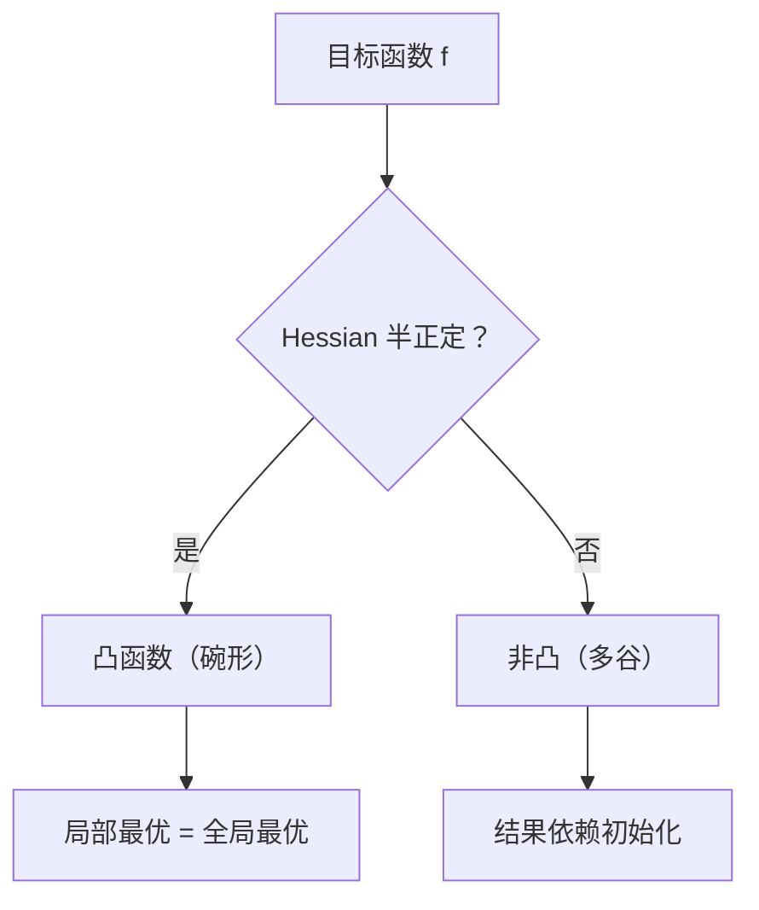

# MATH-701 优化问题与凸性

## 1. 知识概览

| 项 | 内容 |
|---|---|
| 知识 ID | `MATH-701` |
| 英文名称 | Optimization Problems and Convexity |
| 所属模块 | M-MATH-05 优化方法 |
| 难度等级 | L3 推导 |
| 前置知识 | [[MATH-127 Hessian 与多元展开]] |
| 所属知识体系 | 优化三要素 → 局部/全局 → 凸函数 → 凸优化 |
| **AI 应用场景** | 线性回归/逻辑回归是凸问题（必得全局最优）；神经网络非凸（只能到局部/鞍点） |
| **预计学习时间** | 55 分钟 |

**为什么学它**：**凸性决定了"能不能找到全局最优"**。线性回归有闭式解且全局唯一，正是因为损失是凸的；神经网络非凸，所以训练结果依赖初始化。判断问题凸不凸，就知道该期待什么样的训练结果。

## 2. 直观理解

**优化问题** = 找一组参数，让目标函数最小（或最大）。

三要素：

1. **目标函数** $f(\theta)$：要最小化的东西（如损失）。
2. **参数** $\theta$：可以调的变量。
3. **约束**：参数必须满足的条件（可无）。

**凸函数**像**碗**：任意两点连线都在曲面上方。碗里只有一个最低点，且"跟着坡度走一定能到"。

**非凸函数**像**山地**：有多个山谷，进去哪个取决于起点。

## 3. 正式数学定义

**优化问题**

$$
\min_{\theta} f(\theta) \quad \text{s.t. } \theta\in\Omega
$$

**局部最优**：存在邻域使 $f(\theta^*)\le f(\theta)$ 对所有邻域内 $\theta$ 成立。

**全局最优**：对所有定义域内 $\theta$，$f(\theta^*)\le f(\theta)$。

**凸集**：$\forall x,y\in C,\ t\in[0,1]$，有 $tx+(1-t)y\in C$。

**凸函数**：定义域是凸集，且

$$
f(tx+(1-t)y) \le t f(x) + (1-t)f(y)
$$

**一阶条件**（可微）：$f$ 凸 $\iff$

$$
f(y)\ge f(x) + \nabla f(x)^T(y-x)
$$

**二阶条件**（二阶可微）：$f$ 凸 $\iff$ Hessian 半正定 $H\succeq0$。

**凸优化**：目标凸 + 约束集凸。

**核心定理**：**凸问题的任一局部最优都是全局最优。**

## 4. 数学推导

### 4.1 为什么凸函数"局部最优即全局最优"

**起点**：$f$ 凸，$\theta^*$ 是局部最优（存在邻域内 $f(\theta^*)\le f(\theta)$）。

**第 1 步**：反设存在 $\theta_1$ 使 $f(\theta_1) < f(\theta^*)$。

**第 2 步**：对任意 $t\in(0,1]$，令 $\theta_t = \theta^* + t(\theta_1-\theta^*)$。当 $t$ 足够小时，$\theta_t$ 落在 $\theta^*$ 的邻域内。

**第 3 步**：由凸性

$$
f(\theta_t) \le (1-t)f(\theta^*) + t f(\theta_1)
$$

**第 4 步**：因 $f(\theta_1)<f(\theta^*)$，右端严格小于 $f(\theta^*)$

$$
f(\theta_t) < f(\theta^*)
$$

**第 5 步**：这与"$\theta^*$ 在邻域内最小"矛盾。

**结论**：不存在更小的点，$\theta^*$ 是**全局最优**。

### 4.2 二阶条件：为什么 $H\succeq0$ 等价于凸

**起点**：一元情形 $f''(x)\ge0$ $\iff$ $f$ 凸（曲线向上弯）。

**第 1 步**：多元时"向上弯"要在**每个方向**都成立。

**第 2 步**：沿方向 $d$ 的二阶导是

$$
\frac{d^2}{dt^2}f(x+td)\Big|_{t=0} = d^T H(x) d
$$

**第 3 步**：要求所有方向都 $\ge0$

$$
d^THd\ge0 \quad \forall d \iff H\succeq0
$$

**结论**：$H$ 半正定就是"处处向上弯"，即凸。

## 5. 几何直观与图解



```text
凸（碗）            非凸（山地）
 ╲     ╱              ╲  ╱╲  ╱
  ╲   ╱                ╲╱  ╲╱
   ╲_╱                 局部谷
   唯一最低
```

## 6. 计算示例

**例 1**：判断 $f(x)=x^2$ 的凸性。

$$
f''(x) = 2 > 0 \Rightarrow \text{严格凸}
$$

**例 2**：判断 $f(x,y)=x^2+3xy+y^2$ 的凸性。

$$
H = \begin{bmatrix}2&3\\3&2\end{bmatrix},\quad \text{特征值 } -1, 5
$$

有负特征值 ⇒ **非凸**（不定），存在鞍点。

**例 3**：数值检验凸性（判断 $f(tx+(1-t)y)\le tf(x)+(1-t)f(y)$ 的最大违规量）。

| 函数 | 最大违规量 | 结论 |
|---|---|---|
| $x^2$ | $0.0$ | 凸 |
| $-x^2$ | $3.9599$ | 非凸 |
| $e^x$ | $0.0$ | 凸 |

**例 4**：线性回归损失

$$
L(w)=\|Xw-y\|^2 = w^TX^TXw - 2y^TXw + y^Ty
$$

Hessian $=2X^TX$，半正定 ⇒ **凸**，所以有全局唯一解（$X^TX$ 可逆时）。

## 7. Python 辅助验证

**依赖**：NumPy 2.5.4。

```powershell
python math701_convexity.py
```

```python
import math

import numpy as np


def max_violation(f, lo, hi, n=200):
    """检查凸性不等式 f(tx+(1-t)y) <= t f(x)+(1-t) f(y) 的最大违规量。"""
    xs = np.linspace(lo, hi, n)
    worst = -1e9
    for i in range(0, n, 7):
        for j in range(0, n, 11):
            for t in (0.25, 0.5, 0.75):
                lhs = f(t * xs[i] + (1 - t) * xs[j])
                rhs = t * f(xs[i]) + (1 - t) * f(xs[j])
                worst = max(worst, lhs - rhs)
    return worst


print("x² 违规量:", round(max_violation(lambda v: v**2, -2, 2), 6), "→ 凸")
print("-x² 违规量:", round(max_violation(lambda v: -v**2, -2, 2), 6), "→ 非凸")
print("eˣ 违规量:", round(max_violation(math.exp, -1, 1), 6), "→ 凸")
```

**实际运行结果**

```
x² 违规量: 0.0 → 凸
-x² 违规量: 3.9599 → 非凸
eˣ 违规量: 0.0 → 凸
```

**代码解析**

- 直接检查凸性定义的**中点不等式**，取最大违规量。
- 凸函数违规量必 $\le0$（这里 $0.0$ 表示没有正违规）。
- $-x^2$ 违规量接近 4，明显非凸。
- 这只是**数值检验**，不是证明；严格判断要看二阶导/Hessian。

## 8. 知识关联

| 类型 | 链接 |
|---|---|
| 前置数学 | [[MATH-127 Hessian 与多元展开]]、[[MATH-223 特征值与特征向量]] |
| 后续数学 | [[MATH-702 学习率与收敛]]、[[MATH-703 批量梯度下降]]、[[MATH-721 梯度下降]] |
| 相关 Python | [[PY-009 函数]]、[[PY-066 矩阵运算]] |
| 相关机器学习 | 待关联（线性/逻辑回归的凸性） |
| 相关深度学习 | 待关联（非凸损失、局部最优） |
| 相关大语言模型 | 待关联（预训练损失的非凸性） |

## 9. 实战练习

**基础 1**：判断 $f(x)=3x^2-2x+1$ 是否凸。

**基础 2**：判断 $f(x,y)=x^2+y^2$ 是否凸（用 Hessian）。

**进阶 1**：$f(x)=x^3$ 在 $\mathbb{R}$ 上凸吗？在 $x>0$ 上呢？

**综合 1**：为什么说"神经网络训练是凸优化"是错的？但为什么实践中仍能找到不错的解？

## 10. 参考答案

> [!success]- 基础 1
> $f''(x)=6>0$ ⇒ **严格凸**。
>
> 它是一条开口向上的抛物线，最小值在 $x=1/3$。

> [!success]- 基础 2
> $$H=\begin{bmatrix}2&0\\0&2\end{bmatrix}\succeq0 \Rightarrow \text{凸}$$
>
> 且严格凸（特征值都 $>0$），全局唯一最小在原点。

> [!success]- 进阶 1
> 在 $\mathbb{R}$ 上：$f''(x)=6x$，当 $x<0$ 时为负 ⇒ **非凸**。
>
> 在 $x>0$ 上：$f''>0$ 恒成立 ⇒ **凸**。
>
> **要点**：凸性依赖定义域，去掉一半区间后性质可能改变。

> [!success]- 综合 1
> 神经网络的损失是大量非线性激活的复合，Hessian 含负特征值，**非凸**——存在大量局部极小与鞍点。
>
> 实践中仍能找到好解，原因包括：
> 1. 高维下"坏的局部极小"较少，多数临界点是鞍点（梯度下降能逃离）；
> 2. 过参数化使损失面更"平坦"，容易找到低损失区域；
> 3. 随机梯度带来噪声，帮助跳出浅坑。

## 11. 常见错误

| 类型 | 错误表现 | 原因 | 纠正 |
|---|---|---|---|
| 概念错误 | 认为非凸一定找不到好解 | 混淆理论最坏与实践 | 高维下往往可行 |
| 概念错误 | 把"局部最优"当"全局最优" | 忽略非凸 | 只有凸问题等价 |
| 判断错误 | 只检查一个方向凸性 | 需所有方向 | 检查 Hessian |
| 概念错误 | 认为仿射变换会破坏凸性 | 实际保持不变 | 凸性对仿射复合封闭 |
| 计算错误 | 用一阶导判断凸性 | 一阶只能给必要条件 | 用二阶/Hessian |

## 12. 学习记录

| 日期 | 状态 | 掌握程度 | 复习状态 | 学习笔记 | 关联练习 |
|---|---|---|---|---|---|
| — | planned | — | — | — | 练习 1–4 |

---

## 🔗 Notion 同步信息

> 以下内容由 Notion「AI Knowledge System · 知识点」数据库按知识 ID 合并而来（导出于 2026-11-09）。

| 属性 | 值 |
|---|---|
| 学科 | 数学 |
| 学习状态 | 未开始 |
| 难度 | L3 推导 |
| 知识类型 | Concept |

- **所属模块**：[M-MATH-05 优化方法](../%E8%AF%BE%E7%A8%8B%E6%A8%A1%E5%9D%97/M-MATH-05%20%E4%BC%98%E5%8C%96%E6%96%B9%E6%B3%95.md)
- **前置知识**：[MATH-127 Hessian 与多元展开](../01%20%E9%AB%98%E7%AD%89%E6%95%B0%E5%AD%A6/MATH-127%20Hessian%20%E4%B8%8E%E5%A4%9A%E5%85%83%E5%B1%95%E5%BC%80.md)
- **后继知识**：[MATH-702 学习率与收敛](MATH-702%20%E5%AD%A6%E4%B9%A0%E7%8E%87%E4%B8%8E%E6%94%B6%E6%95%9B.md)
- **关联Python**：[PY-009 函数](../../01_Python%E5%9F%BA%E7%A1%80/02%20%E5%87%BD%E6%95%B0%E4%B8%8E%E4%BD%9C%E7%94%A8%E5%9F%9F/PY-009%20%E5%87%BD%E6%95%B0.md)
- **关联数学**：[MATH-127 Hessian 与多元展开](../01%20%E9%AB%98%E7%AD%89%E6%95%B0%E5%AD%A6/MATH-127%20Hessian%20%E4%B8%8E%E5%A4%9A%E5%85%83%E5%B1%95%E5%BC%80.md)
- **被引用为数学**：[MATH-702 学习率与收敛](MATH-702%20%E5%AD%A6%E4%B9%A0%E7%8E%87%E4%B8%8E%E6%94%B6%E6%95%9B.md) · [ML-029 支持向量机](../../03_%E6%9C%BA%E5%99%A8%E5%AD%A6%E4%B9%A0/02%20%E7%9B%91%E7%9D%A3%E5%AD%A6%E4%B9%A0/ML-029%20%E6%94%AF%E6%8C%81%E5%90%91%E9%87%8F%E6%9C%BA.md) · [ML-048 超参数搜索 GridSearchCV](../../03_%E6%9C%BA%E5%99%A8%E5%AD%A6%E4%B9%A0/04%20%E6%A8%A1%E5%9E%8B%E8%AF%84%E4%BC%B0/ML-048%20%E8%B6%85%E5%8F%82%E6%95%B0%E6%90%9C%E7%B4%A2%20GridSearchCV.md)
